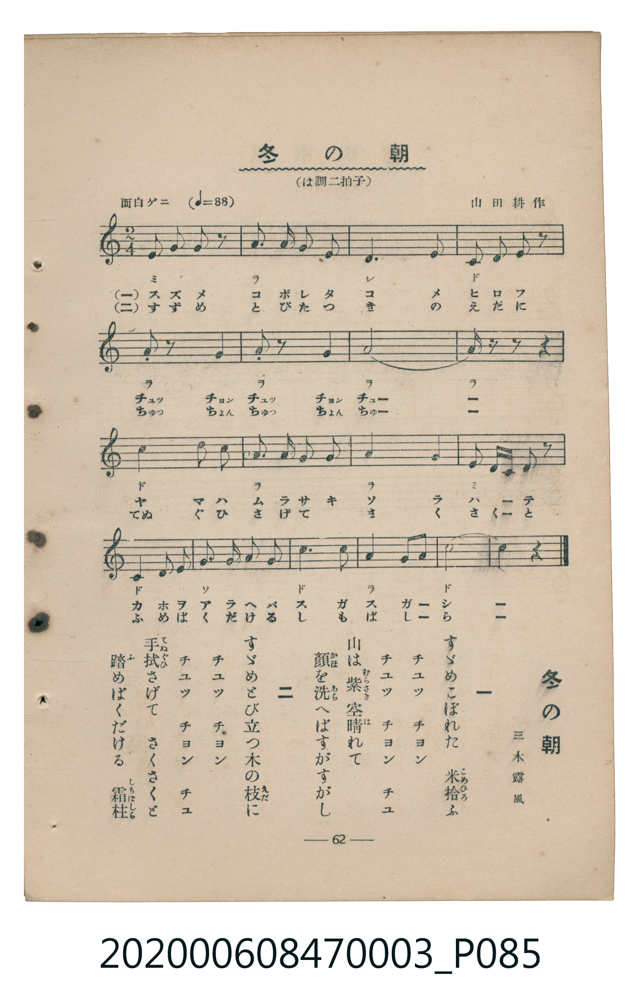

# 冬の朝

> Re:Shōka 使用 AI 協助辨識與重建樂譜，可能會有錯誤。歡迎[回報](https://github.com/TMDLang/reshoka/issues)。

- **鋼琴伴奏版**：<br><audio controls src="fuyu_no_asa.mp3"></audio>
- **NEUTRINO 歌聲合成版**：<br><audio controls src="fuyu_no_asa_neutrino.mp3"></audio>

- 三木露風 作詞 / 山田耕筰 作曲
- 臺灣教育會公認《新定兒童唱歌》尋常科第三學年用（2020.006.0847.0003）

## 說明

Reference Materials 20: 冬の朝 (Fuyu no Asa / Winter Morning)
Source: 臺灣教育會公認 新定兒童唱歌 尋常科第三學年用 (1934), p. 62 (P085.jpg)
Lyricist: 三木露風 (Miki Rofū) / Composer: 山田耕筰 (Yamada Kōsaku)
Key: C major (?= C), 2/4 (<2/4>), 面白ゲニ Quarter = 88 (!= 88)


## 歌詞

```text
一、すゞめこぼれた　米拾ふ
チュッ　チョン　チュッ　チョン　チュ
山は紫　空晴れて
顔を洗へばすがすがし
二、すゞめとび立つ木の枝に
チュッ　チョン　チュッ　チョン　チュ
手拭さげて　さくさくと
踏めばくだける　霜柱
```

## ABC

<div class="abc-score" data-abc-src="fuyu_no_asa.abc" aria-label="五線譜載入中"></div>

[下載 ABC 原始檔](fuyu_no_asa.abc)

## TMD 檔案連結

- [主旋律 TMD 檔案](fuyu_no_asa.tmd) [[在 TMD Studio 編輯](https://tmdlang.github.io/Tmd-TS/#tmd=s7IKdvYPcrWy4qpTUCpJTLdSSM7PyUlNLsnMz7MqzsjMK0nNjM_KTMmPL87Iz05Ugisry88pzU21Si9KTEmNN443MjAyiDcwMIs3sDAxBzIMjBFKi_NLi5JTrYqTM_Lzc-JLUitKkvLzsxHyBUX5Zal5iXlANQVFIBtTwIoQClLLMlNSQdKpKZkl-UWZiTlI7kgtKga7FWxJfElRYl5xclFmAcgDCFUlGalAx5Zk5qbG56fFpyRWoksVpyYW5-cVI4SB1qRn5lmVJGYCPQ7yfHlifG5iZl5OYl4KsqqSjHxgGBRkVFplZBaDHJecmBOfnZiHFFRQpxUkpqdaBRhYmCpxaWkpPG1b87hx3bM5cxW0tLgUbRUsLLjsbRWcuWyM9E3sQFqf7Oh8NmfFyzmbXi5aofBk75wXK-cp6Cs83bjx-ZQNLxqmPl-7AST6bPYmsEUv2nc9b1z8bOrMF02bns1pftq65sWq3scNXc-mbXi6btbT1knPVy99OmXjs7U9jxu6n27ofrpjx_PlE5-vWQO05unaHU93bnk-ZcX7PR2geNQDxqMeKB6BDAPj93s6lbi49LW4FLQUglLTUotAMaHgm1iSCoqIYgUjAyskz2i4lVaWKuTlKzgWJwKdGw6KziIF3_yivMy8dE2QGcGQ1KCA1cUKmO5VwOVaBQ1DS2MTTR2FAj0FMyMFDVDQ6mUVQGzxqQTGBDBCrBRQwlHDNzM7UyEoP-3oak2g85zzcwvyi1OLgD5ADleNyMTcxJREBe-jvcWJ2aVgA71TK60UnBVyE7PyixQ0QFEFtBkYVwoa4BgDcl7OXfR85t7HTZseN3crBJYmFoF8DopYBQ1w_IKMgTut2ArEfLKj4XFD4-PGmY-b5j1uAjImP27c87ip53Hj_McNDc83bn7Wve9x41aQUiAfhJobHzcvfdzcDGMvf9y8maA4Qj_Qm48b1z_fshpk_Mpdz2ZuAdu2DKHi5cIpj5smPdsy_XHjjseNG0BuawSqgJDTwY7eBUxDyI5e8bhx8_PV3Y8blwADGpQO5s193Liaeo5-1tn9rHvt48apjxsnAd0KEgSx-2HkCoTSFzv6wU4CuhsoseBx48THTd0gX82Z82z-RqA6fS6uMGCJAcyImYl5-Q41BjXVXApAYGNopmUHZulrKRjqmlgpgP08C2gakIWIFjAHLLbpcVMvMG5ARoK01SgYK-gqmEKxARDXKJgBSV0gCRIBydYoGIFFIBAiYggkQaIgHlgX2DQfwxqQA4B8oBtAJNBKXYV4sA6gC8D6gW4CiveAWfNRZCAQogckugnM6wWr3AozB2KPET57VkDt2Qy1ARjDUBmQWXB7GtdBRTvAvAVgcjWKPcBANdW1AAYqLMohLFCE4xUD-hCI4UEMClBQIIECFARxiSDDGrAKkBoQBosgghhuNcSxCAfA9BKrAoul8WANIIxkKSi86W0pMPAtdQ2NgKHf1PK4EVigrAeyGh43dYIzUC8wsuYCOUBqPaQwQIS3YRzUICMQA8xDTdUgjAhyRCSAUrMRMG2DUjZaqm5qgaoCOgVMrof4qKkBIgp2yVSwDCiVgdLVXJgOoBw8BMD6YOl_GdTTyKl62ePGNXCrJoBJUEYASYGMB_EnQbXCjISIg2T60UQhIpAsgZKsDY11DUEJuxFY_u0GlpxAVhM4aEGlJ6QQ6YFS4OTcOB0lRYOyPziAgRhSIEAC0RQcqJDghccCCKJEAkQFiI2mCpYcIBBLwm_shnt1NzgcJ0E92wQRBcfCDrD8BqgMqJSAQZCnUEUhIrAgm47TLVjyA7hMgtgKKn0QNkIiAVSiAAtysDzI1ejmP24CuRkkCtIH0QGTB6UrWJrB55ZaLi5dOwVwzaAAZChzAQA)]
- [鋼琴伴奏 TMD 檔案](fuyu_no_asa_piano.tmd) [[在 TMD Studio 編輯](https://tmdlang.github.io/Tmd-TS/#tmd=s7IKdvYPcrWy4qpTUCpJTLdSyC8qychPL0osyKi0ysgsLskvykxOzInPTsxLVIIrKs4vLUpOjS9ITE-1CjCwMFXi0tJSeNq25nHjumdz5r7f0_Gye8_zCVue7NnydGn_886O93s6FbS0uBRtFSwsuOxtFZy5bIz0TexA5j3Z0flszoqXcza9XLRC4cneOS9WzlPQV3i6cePzKRteNEx9vnYDSPTZ7E1g21-073reuPjZ1JkvmjY9m9P8tHXNi1W9jxu6nk3b8HTdrKetk56vXvp0ysZna3seN3Q_3dD9dMeO58snPl-zBmjN07U7nu7c8nzKCqD7jAyMDPQMDMz0DCxMzIEMA2OgE5W4uPS1uBS0FIJS01KLUvOSUxV8E0tSizITc4oVjAysED5U0HArrSxVyMtXcCxOBDo3PDMPqE7BN78oLzMvXVNBVyEgMxEkm5ycn1uQmJeZm5pXAjI5GBxwVgpY_aGA6QsFXH5Q0DC0NDbR1FEo0FMwM1LQAMWCXlZBuibQFn0urrDUomJg1IAcEeThUGNQU82lAAQ2hmZadmBWjYIx0JWmUGwAxDUKZkBSF0iCRECyNQpGYBEIhIgYAkmQKIgH1gU2zcewRuFx40wg_3HjLBDZ1Agk48E6HjdOBut_3LgHKN4DZs1HkYFAiB6Q6CYwrxescivMHIg9RvjsWQG1ZzPUhseNS6AyILPg9jSug4p2gHkLwORqFHsgYQHyHygsQBCXCDKsAasAqQFhsAgidJobHzcvfdzcDLUHzF_-uHkzXC-xKrBYGg_WAMJIloKCit6WAtNHHFTACMQA81ATFggjgg4RmKAEZQRMXqDEhZawmlqgqh437gOT6yEua2qAiDZ1AsWmgmVAEQ2K2rkwHUA5uE_A-mBJcBnU8cgJa9njxjVwqyaASVBaBEmBjAfxJ0G1woyEiINk-tFEISKQVImcskA5CBxAQAzJU5BAMAUHCiR44KEIgiiBCFEBYqOpgkULBGJJgI3dcKfuBofDJKhjmyCi4FDcAZbfAJUBZTQYfNwICjdkUYgIzMvTcboFS7oEZ2uIraAMjLAREoigTPm4cSJYHuRqdPMfN4HcDBIF6YPogMmD0gUszvG5pRalkPTBUUgagjREG8YCSTATUlCagEVN4KIQBcCIjAfzTONBXFMkNtQgiDzCIKglYONAAmAZiINxikGsNYPYZBafCzEexMdW9OB2K6niUL-BeWCvIfsAPZhgmoyR9aCEB6oHIOrgvkFyA5o2JNMh4Qu1CB5KCO8DI1jXTgEcx9E-IGVwjhGYo8wFAA)]

## 分析

```text
================================================================================
📊 TMD Song Profile: [ 冬の朝 ]
================================================================================
⏱  Duration:       0:24 (24.5s), 18 measures total
🎼 Key & Tempo:    首調基準 C, != 88.0 BPM, <2/4>
   - 分析範圍：      由實際發聲的音符與和弦推測調性；播放脈絡另行呈現
🎤 人聲音域:    C4 (MIDI 60) – D5 (MIDI 74) [跨度: 14 個半音 / 1.2 個八度, 難度: moderate]
   - 最低音:  C4 in [Verse #1 @ m.4, 0:04]
   - 最高音: D5 in [Verse #1 @ m.9, 0:11]
   - 適合: soprano, mezzo-soprano, contralto, tenor, baritone, bass
🏛  結構:      Verse (24.5s)
⚡ 編曲密度:        Peak 1 軌道同時演奏
🗝  調性診斷：       C 大調（純淨自然大調，未偵測到可信轉調）
   - 風格氣質:    純淨自然大調（陽光明朗、易唱易記，無明顯調外色彩）
   - 轉調歷程:    全曲維持單一推測調性（未偵測到可信轉調）
   - 核心骨幹音:  C, A, G, D, E
   - 調性數值:    C 大調 [相關度: 0.79, 穩定度: Moderate, 自然音純度: 100.0%]
   - 候選調性 (K-S): C 大調 (0.79), A 小調 (0.75), G 大調 (0.65)
   - 五度圈歷程:   +0
   - 各段落調性細節:
     • [Verse #1]: C 大調 (r: 0.79, 自然音純度: 100.0%)

  [ 五度圈游移軌跡 ]
              [C ]*
         F            G  
      Bb               D  
      Eb               A  
         Ab           E  
            Db       B  
               F# 
     (* = active key center)

  [ 十二半音累積音高分佈 ]
     C  : ████████████████████████  26.8%
     C# :                            0.0%
     D  : ███████████               12.2%
     D# :                            0.0%
     E  : █████████                  9.8%
     F  :                            0.0%
     F# :                            0.0%
     G  : ██████████████████████    24.4%
     G# :                            0.0%
     A  : ████████████████████████  26.8%
     A# :                            0.0%
     B  :                            0.0%
--------------------------------------------------------------------------------
Assignment 軌道音域：
  - Piano         : C4 – D5 (14 個半音 / 1.2 個八度, 43 個音符)
================================================================================
```


## 原書掃描頁




