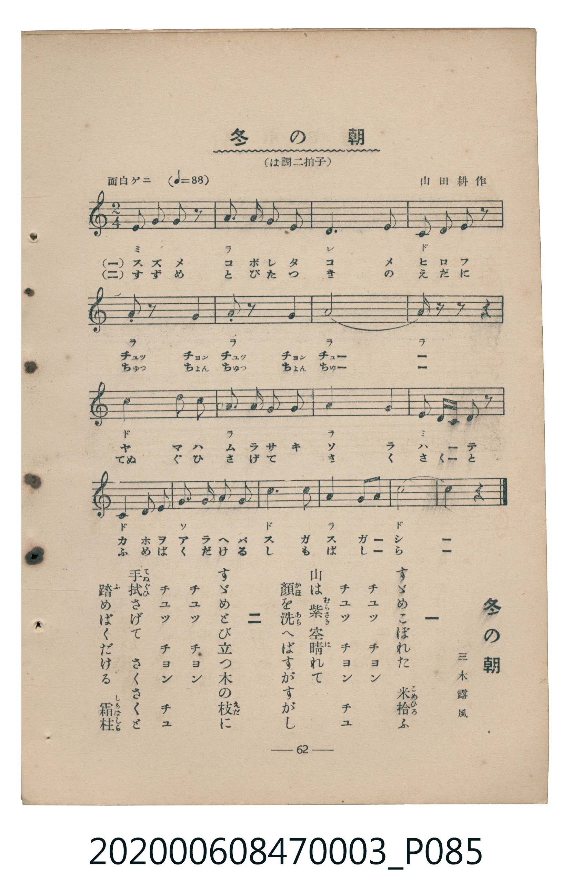

# 冬の朝

> Re:Shōka 使用 AI 協助辨識與重建樂譜，可能會有錯誤。歡迎回報。

- **鋼琴伴奏版**：<br><audio controls src="fuyu_no_asa.mp3"></audio>
- **NEUTRINO 歌聲合成版**：<br><audio controls src="fuyu_no_asa_neutrino.mp3"></audio>

- 三木露風 作詞 / 山田耕作 作曲
- 臺灣教育會公認《新定兒童唱歌》尋常科第三學年用（2020.006.0847.0003）

## 說明

Reference Materials 20: 冬の朝 (Fuyu no Asa / Winter Morning)
Source: 臺灣教育會公認 新定兒童唱歌 尋常科第三學年用 (1934), p. 62 (P085.jpg)
Lyricist: 三木露風 (Miki Rofū) / Composer: 山田耕作 (Yamada Kōsaku)
Key: C major (?= C), 2/4 (<2/4>), 面白ゲニ Quarter = 88 (!= 88)


## 歌詞

```text
一、すゞめこぼれた　米拾ふ
チュッ　チョン　チュッ　チョン　チュ
山は紫　空晴れて
顔を洗へばすがすがし
二、すゞめとび立つ木の枝に
チュッ　チョン　チュッ　チョン　チュ
手拭さげて　さくさくと
踏めばくだける　霜柱
```

## ABC

```abc
X:1
T:冬の朝
M:2/4
L:1/16
Q:1/4=88
K:C
V:V1 name="Piano" snm="Pia"
[V:V1]
E2 G2 G2 z2 | A3 A G2 E2 | D6 E2 | C2 D2 E2 z2 |
w: 1.~す ず め | こ ぼ れ た | こ め | ひ ろ ふ
w: 2.~す ず め | と び た つ | き の | え だ に
A2 z2 G4 | A2 z2 G4 | A8- | A z z2 z4 |
w: 1.~チュッ チョン | チュッ チョン | チュ | _
w: 2.~チュッ チョン | チュッ チョン | チュ | _
c4 d2 c2 | A3 A G2 G2 | A4 G4 | E2 D C D2 z2 |
w: 1.~や ま は | む ら さ き | そ ら | は れ _ て
w: 2.~てぬ ぐ ひ | さ げ て _ | さ く | さ く _ と
C4 D2 E2 | G3 G A2 G2 | c6 c2 | A4 G2 A2 |
w: 1.~か ほ を | あ ら へ ば | す が | す が _
w: 2.~ふ め ば | く だ け る | し も | ば し _
c8- | c4 z4 |
w: 1.~し | _
w: 2.~ら | _
```

## TMD 檔案連結

- [主旋律 TMD 檔案](fuyu_no_asa.tmd) [[在 TMD Studio 編輯](https://tmdlang.github.io/Tmd-TS/#tmd=s7IKdvYPcrWy4qpTUCpJTLdSSM7PyUlNLsnMz7MqzsjMK0nNjM_KTMmPL87Iz05Ugisry88pzU21Si9KTEmNN443MjAyiDcwMIs3sDAxBzIMjBFKi_NLi5JTrYqTM_Lzc-JLUitKkvLzsxHyBUX5Zal5iXlANQVFIBtTwIoQClLLMlNSQdKpKZkl-UWZiTlI7kgtKga7FWxJfElRYl5xclFmAcgDCFUlGalAx5Zk5qbG56fFpyRWoksVpyYW5-cVI4SB1qRn5lmVJGYCPQ7yfHlifG5iZl5OYl6KEpeWlsLTtjWPG9c9mzNXQUuLS9FWwcKCy95WwZnLxkjfxA5kzJMdnc_mrHg5Z9PLRSsUnuyd82LlPAV9hacbNz6fsuFFw1SgCEj02exNYEtftO963rj42dSZL5o2PZvT_LR1zYtVvY8bup5N2_B03aynrZOer176dMrGZ2t7Hjd0P93Q_XTHjufLJz5fswZozdO1O57u3PJ8yor3ezpAEaEHjAg9UEQAGQbG7_d0KnFx6WtxKWgpBKWmpRaBglLBN7EkFRSSxQpGBlZIntFwK60sVcjLV3AsTgQ6NxwUH0UKvvlFeZl56ZogM4Ih0amA1cUKmO5VwOVaBQ1DS2MTTR2FAj0FMyMFjQADC1O9rAKILT6VRZnJmcUlVgoo4ajhm5mdqRCUn3Z0tSbQec75uQX5xalFQB8gh6tGZGJuYkqigvfR3uLE7FKwgd6plVYKzgq5iVn5RQoaoKgC2gyMKwUNcIwBOS_nLno-c-_jpk2Pm7sVAksTi0A-B0WsggY4fkHGwJ1WbAViPtnR8Lih8XHjzMdN8x43ARmTHzfuedzU87hx_uOGhucbNz_r3ve4cStIKZAPQs2Nj5uXPm5uhrGXP27eTFAcoR_ozceN659vWQ0yfuWuZzO3gG1bhlDxcuGUx02Tnm2Z_rhxx-PGDSC3NQJVQMjpYEfvAqYhZEeveNy4-fnq7seNS4ABDUoH8-Y-blxNPUc_6-x-1r32cePUx42TgG4FCYLY_TByBULpix39YCcB3Q2UWPC4ceLjpm6Qr-bMeTZ_I1CdPhdXGDDLp1oFZCbm5TvUGNRUcykAgY2hmZYdmKWvpWCoa2KlAPbzLKBpQBYiWsAcsNimx029wLgBGQnSVqNgrKCrYArFBkBco2AGJHWBJEgEJFujYAQWgUCIiCGQBImCeGBdYNN8DGtADgDygW4AkUArdRXiwTqALgDrB7oJKN4DZs1HkYFAiB6Q6CYwrxescivMHIg9RvjsWQG1ZzPUBmAMQ2VAZsHtaVwHFe0A8xaAydUo9gAD1VTXAhiosCiHsEARjlcM6EMghgcxKEBBgQQKUBDEJYIMa8AqQGpAGCyCCGK41RDHIhwA00usCiyWxoM1gDCSpaDwprelwMC31DU0AoZ-U8vjRmCBsh7Ianjc1AnOQL3AyJoL5ACp9ZDCABHehnFQg4xADDAPNVWDMCLIEZEASs1GwLQNStloqbqpBaoK6BQwuR7io6YGiCjYJVPBMqBUBkpXc2E6gHLwEADrg6X_ZVBPI6fqZY8b18CtmgAmQRkBJAUyHsSfBNUKMxIiDpLpRxOFiECyBEqyNjTWNQQl7EZg-bcbWHICWU3goAWVnpBCpAdKgZNz43SUFA3K_uAABmJIgQAJRFNwoEKCFx4LIIgSCRAVIDaaKlhygEAsCb-xG-7V3eBwnAT1bBNEFBwLO8DyG6AyoFICBkGeQhWFiMCCbDpOt2DJD-AyCWIrqPRB2AiJBFCJAizIwfIgV6Ob_7gJ5GaQKEgfRAdMHpSuYGkGn1tqubh07RTANYMCkKHMBQA)]
- [鋼琴伴奏 TMD 檔案](fuyu_no_asa_piano.tmd) [[在 TMD Studio 編輯](https://tmdlang.github.io/Tmd-TS/#tmd=s7IKdvYPcrWy4tLSUnjatuZx47pnc-a-39PxsnvP8wlbnuzZ8nRp__POjvd7OhW0tLgUbRUsLLjsbRWcuWyM9E3suOoUlJ7s6Hw2Z8XLOZteLlqh8GTvnBcr5ynoKzzduPH5lA0vGqYCRUCiz2ZvUgKpftG-63nj4mdTZ75o2vRsTvPT1jUvVvU-buh6Nm3D03WznrZOer566dMpG5-t7Xnc0P10Q_fTHTueL5_4fM0aoDVP1-54unPL8ykrgO4zMjAy0DMwMNMzsDAxBzIMjIFOVOLi0tfiUtBSCEpNSy1KzUtOVfBNLEktykzMKVYwMrBC-FBBw620slQhL1_BsTgR6NzwzDygOgXf_KK8zLx0TQVdhYDMRJBscnJ-bkFiXmZual4JyOTg_NKi5FQrBaz-UMD0hQIuPyhoGFoam2jqKBToKZgZKWgEGFiY6mUVpGsCbdHn4gpLLSpOtQI7IsjDocagpppLAQhsDM207MCsGgVjoCtNodgAiGsUzICkLpAEiYBkaxSMwCIQCBExBJIgURAPrAtsmo9hjcLjxplA_uPGWSCyqRFIxoN1PG6cDNb_uHEPULwHzJqPIgOBED0g0U1gXi9Y5VaYORB7jPDZswJqz2aoDY8bl0BlQGbB7WlcBxXtAPMWgMnVKPZAwgLkP1BYgCAuEWRYA1YBUgPCYBFE6DQ3Pm5e-ri5GWoPmL_8cfNmuF5iVWCxNB6sAYSRLAUFFb0tBaaPOKiAEYgB5qEmLBBGBB0iMEEJygiYvECJCy1hNbVAVT1u3Acm10Nc1tQAEW3qBIpNBcuAIhoUtXNhOoBycJ-A9cGS4DKo45ET1rLHjWvgVk0Ak6C0CJICGQ_iT4JqhRkJEQfJ9KOJQkQgqRI5ZYFyEDiAgBiSpyCBYAoOFEjwwEMRBFECEaICxEZTBYsWCMSSABu74U7dDQ6HSVDHNkFEwaG4Ayy_ASoDymgw-LgRFG7IohARmJen43QLlnQJztYQW0EZGGEjJBBBmfJx40SwPMjV6OY_bgK5GSQK0gfRAZMHpQtYnONzSy1KIemDo5A0BGmINowFkmAmpKA0AYuawEUhCoARGQ_mmcaDuKZIbKhBEHmEQVBLwMaBBMAyEAfjFINYawaxySw-F2I8iI-t6MHtVlLFoX4D88BeQ_YBejDBNBkj60EJD1QPQNTBfYPkBjRtSKZDwhdqETyUEN4HRrCunQI4jqN9QMrgHCMwR5kLAA)]

## 分析

```text
================================================================================
📊 TMD Song Profile: [ 冬の朝 ]
================================================================================
⏱  Duration:       0:24 (24.5s), 18 measures total
🎼 Key & Tempo:    首調基準 C, != 88.0 BPM, <2/4>
   - 分析範圍：      由實際發聲的音符與和弦推測調性；播放脈絡另行呈現
🎤 人聲音域:    C4 (MIDI 60) – D5 (MIDI 74) [跨度: 14 個半音 / 1.2 個八度, 難度: moderate]
   - 最低音:  C4 in [Verse #1 @ m.4, 0:04]
   - 最高音: D5 in [Verse #1 @ m.9, 0:11]
   - 適合: soprano, mezzo-soprano, contralto, tenor, baritone, bass
🏛  結構:      Verse (24.5s)
⚡ 編曲密度:        Peak 1 軌道同時演奏
🗝  調性診斷：       C 大調（純淨自然大調，未偵測到可信轉調）
   - 風格氣質:    純淨自然大調（陽光明朗、易唱易記，無明顯調外色彩）
   - 轉調歷程:    全曲維持單一推測調性（未偵測到可信轉調）
   - 核心骨幹音:  C, A, G, D, E
   - 調性數值:    C 大調 [相關度: 0.79, 穩定度: Moderate, 自然音純度: 100.0%]
   - 候選調性 (K-S): C 大調 (0.79), A 小調 (0.75), G 大調 (0.65)
   - 五度圈歷程:   +0
   - 各段落調性細節:
     • [Verse #1]: C 大調 (r: 0.79, 自然音純度: 100.0%)

  [ 五度圈游移軌跡 ]
              [C ]*
         F            G  
      Bb               D  
      Eb               A  
         Ab           E  
            Db       B  
               F# 
     (* = active key center)

  [ 十二半音累積音高分佈 ]
     C  : ████████████████████████  26.8%
     C# :                            0.0%
     D  : ███████████               12.2%
     D# :                            0.0%
     E  : █████████                  9.8%
     F  :                            0.0%
     F# :                            0.0%
     G  : ██████████████████████    24.4%
     G# :                            0.0%
     A  : ████████████████████████  26.8%
     A# :                            0.0%
     B  :                            0.0%
--------------------------------------------------------------------------------
Assignment 軌道音域：
  - Piano         : C4 – D5 (14 個半音 / 1.2 個八度, 43 個音符)
================================================================================
```


## 原書掃描頁




