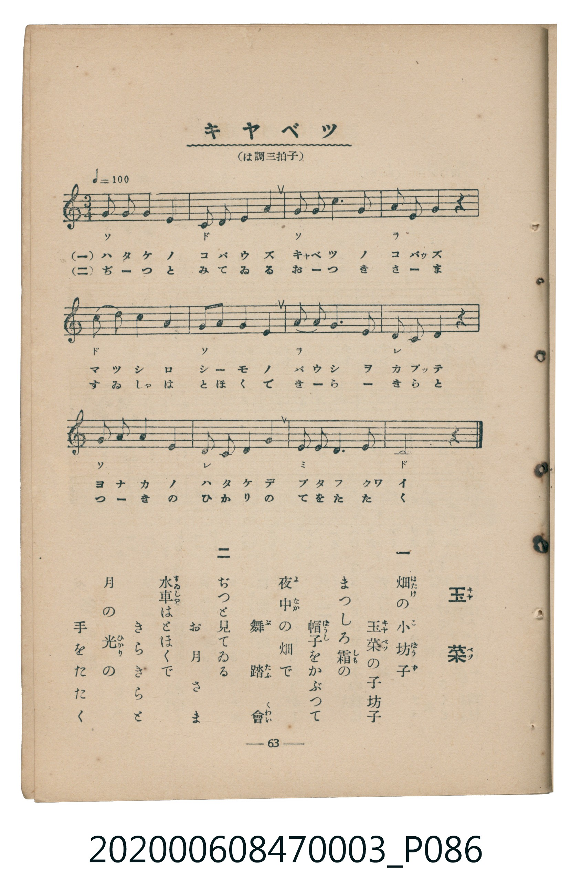

# キャベツ

> Re:Shoka 使用 AI 協助辨識與重建樂譜，可能會有錯誤。歡迎回報。

<audio controls src="kyabetsu.mp3"></audio>

- 臺灣教育會公認《新定兒童唱歌》尋常科第三學年用（2020.006.0847.0003）

## 說明

Reference Materials 21: キャベツ (Kyabetsu / Cabbage [玉菜])
Source: 臺灣教育會公認 新定兒童唱歌 尋常科第三學年用 (1934), p. 63 (P086.jpg)
Key: C major (?= C), 3/4 (<3/4>), Quarter = 100 (!= 100)

## 歌詞

```text
一、畑の小坊子　玉菜の子坊子
まつしろ霜の　帽子をかぶつて
夜中の畑で　舞踏會
二、ぢつと見てゐる　お月さま
水車はとほくで　きらきらと
月の光の　手をたたく
```

## ABC

```abc
X:1
T:キャベツ
M:3/4
L:1/16
Q:1/4=100
K:C
V:V1 name="Piano" snm="Pia"
[V:V1]
G2 G2 G4 G4 | C2 C2 C4 C4 | G2 G2 G6 G2 | A2 A2 A4 z4 |
c2 c2 c4 c4 | G2 G2 G4 G4 | A2 A2 A6 A2 | D2 D2 D4 z4 |
G2 G2 G4 G4 | D2 D2 D4 D4 | E2 E2 E6 E2 | C8 z4 |
```

## TMD 檔案連結

- [主旋律 TMD 檔案](kyabetsu.tmd) [[在 TMD Studio 編輯](https://tmdlang.github.io/Tmd-TS/#tmd=s7IKdvYPcrWy4qpTUCpJTLdSSM7PyUlNLsnMz7MqzsjMK0nNjM_KTMmPL87Iz05Ugisry88pzU21Si9KTEmNN443MjAyiDcwMIs3sDAxBzIMjBFKi_NLi5JTrYqTM_Lzc-JLUitKkvLzsxHyBUX5Zal5iXlANQVFIBtTwIoQClLLMlNSQdKpKZkl-UWZiTlI7kgtKga7FWxJfElRYl5xclFmAcgDCFUlGalAxxbkJOYhGQsRTMvPT1Hi0tJSeNy09nHz4sfNMx83tyhoaXEp2ioYGhhw2dsqOHPZGOub2IE0vmjf9bxx8bOpM180bXo2p_lp65oXq3ofN3Q9m7bh6bpZT1snPV-99OmUjc_W9jxu6H66ofvpjh3Pl098vmbNkx2dT9fueLpzy_MpK97v6QCFlx4wvPRA4QVkGBi_39OpxMWlr8WloKUQlJqWWgTysYJvYkkqyMPFCkaGVqhO1PCuTExKLSkuVdBXcE5MSkpMT1WIft7X-aJ_TqwmyJRgSLgrYHWzAqaLFXC5V0HD0NLYRFNHoUBPwcxYQSPAwMJML6sgHWyLd2qllYKzQm5iVn6RggYotIAKgcGloAEONCAnsDSxCOgLBXB4KmhAwhWkF6Tdp7IoM7nYCsR8sqPhcUPj86kTHzeue7qh_-ncrqdrJzxuaID4CSS4dgJEEKQaKAFCjfseNy553Dj9cVPvyzkgRUDBpzv2gnQ2TXrc2P24cRtYwTKEnqdL5jzZsRaoFGzVcqDIi455L3b0A8MG7IxdwLhrfNy4CKxvxYtlQDOWPW4CmtcNtrDr2ZyOx41TgTYjjHy2YcuL3V2PG9cDNTxu3P24sR9i8OPG3sdNnTByBZIGkBnrnrYCRUEuftbZDXbufDDqB6rT5-IKAybtVKuAzMS8fIcagxqFai4FILCx0LIDM_S1FAx1TYCJAmQrUBco2B43Tn7cuOFxY9vjxlkoqQVdDmg-yIwaBVMw1AXjGgVDMNQFY4QcSLZGwQwMdRUMQHIwF5jqWoBcAIyExZBIAJNNQOuAohDLgHx4RAAVLUPYbRgHRUALQQS6a2A26gLJGgUjMESz31LX0AiUL4ChuQpsCdCb8OBYDnQD0FIgZysoRpqAkQLM2dh9DjMdhGsUjMEQZLMxOFRALJjNtVxcunYK4MhRADKUubgA)]
- [鋼琴伴奏 TMD 檔案](kyabetsu_piano.tmd) [[在 TMD Studio 編輯](https://tmdlang.github.io/Tmd-TS/#tmd=s7IKdvYPcrWy4tLSUnjctPZx8-LHzTMfN7e839PxsnvP8wlbnuzZ8nRp__POjvd7OhW0tLgUbRUMDQy47G0VnLlsjPVN7LjqFJRetO963rj42dSZL5o2PZvT_LR1zYtVvY8bup5N2_B03aynrZOer176dMrGZ2t7Hjd0P93Q_XTHjufLJz5fs-bJjs6na3c83bnl-ZQVQCuNDIwM9AwMzPQMLEzMgQwDY6CtSlxc-lpcCloKQalpqUWpecmpCr6JJalFmYk5xQpGhlYo7lbQ8K5MTEotKS5V0FdwTkxKSkxPVYh-3tf5on9OrKaCrkJAZmJevoJjcnJ-bkFiXmZual4JyOzg_NKi5FQrBaw-UcD0hwIuXyhoGFoam2jqKBToKZgZK2gEGFiY6WUVpGsCbdHn4gpLLSpOtQI7IsjDocagRqGaSwEIbCy07MCMGgVTMNQF4xoFQzDUBWOEHEi2RsEMDHUVDEByUN2GcVAE1AIi0M2D6dEFkjUKRmCIagKqepgKEK5RMAZDkG5jsNtALJjuWhTf-eDwnWE8UHG0YSycJFbIBCxkAuKg-JdUzRAS6M14sJhpPLqJKBJQCpcoslUoYijBomunAA4ZBWSGMhcXAA)]

## 分析

```text
================================================================================
📊 TMD Song Profile: [ キャベツ ]
================================================================================
⏱  Duration:       0:21 (21.6s), 12 measures total
🎼 Key & Tempo:    首調基準 C, != 100.0 BPM, <3/4>
   - 分析範圍：      由實際發聲的音符與和弦推測調性；播放脈絡另行呈現
🎤 人聲音域:    C4 (MIDI 60) – C5 (MIDI 72) [跨度: 12 個半音 / 1.0 個八度, 難度: easy]
   - 最低音:  C4 in [Verse #1 @ m.2, 0:01]
   - 最高音: C5 in [Verse #1 @ m.5, 0:07]
   - 適合: soprano, mezzo-soprano, contralto, tenor, baritone, bass
🏛  結構:      Verse (21.6s)
⚡ 編曲密度:        Peak 1 軌道同時演奏
🗝  調性診斷：       G 調性不明確（純淨自然大調，未偵測到可信轉調）
   - 風格氣質:    純淨自然大調（陽光明朗、易唱易記，無明顯調外色彩）
   - 轉調歷程:    全曲維持單一推測調性（未偵測到可信轉調）
   - 核心骨幹音:  G, C, D, A, E
   - 調性數值:    G 調性不明確 [相關度: 0.83, 穩定度: Ambiguous, 自然音純度: 100.0%]
   - 候選調性 (K-S): G 大調 (0.83), C 大調 (0.81), G 小調 (0.59)
   - 五度圈歷程:   +1
   - 各段落調性細節:
     • [Verse #1]: G 調性不明確 (r: 0.83, 自然音純度: 100.0%)

  [ 五度圈游移軌跡 ]
               C  
         F           [G ]*
      Bb               D  
      Eb               A  
         Ab           E  
            Db       B  
               F# 
     (* = active key center)

  [ 十二半音累積音高分佈 ]
     C  : ████████████████          24.2%
     C# :                            0.0%
     D  : ██████████                15.2%
     D# :                            0.0%
     E  : ██████                     9.1%
     F  :                            0.0%
     F# :                            0.0%
     G  : ████████████████████████  36.4%
     G# :                            0.0%
     A  : ██████████                15.2%
     A# :                            0.0%
     B  :                            0.0%
--------------------------------------------------------------------------------
Assignment 軌道音域：
  - Piano         : C4 – C5 (12 個半音 / 1.0 個八度, 43 個音符)
================================================================================
```


## 原書掃描頁




