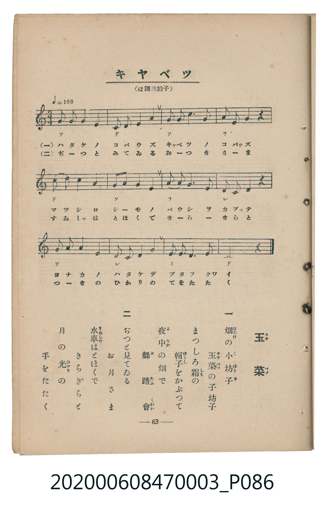

# キャベツ

> Re:Shōka 使用 AI 協助辨識與重建樂譜，可能會有錯誤。歡迎回報。

- **鋼琴伴奏版**：<br><audio controls src="kyabetsu.mp3"></audio>
- **NEUTRINO 歌聲合成版**：<br><audio controls src="kyabetsu_neutrino.mp3"></audio>

- 臺灣教育會公認《新定兒童唱歌》尋常科第三學年用（2020.006.0847.0003）

## 說明

Reference Materials 21: キャベツ (Kyabetsu / Cabbage [玉菜])
Source: 臺灣教育會公認 新定兒童唱歌 尋常科第三學年用 (1934), p. 63 (P086.jpg)
Key: C major (?= C), 3/4 (<3/4>), Quarter = 100 (!= 100)


## 歌詞

```text
一、畑の小坊子　玉菜の子坊子
まつしろ霜の　帽子をかぶつて
夜中の畑で　舞踏會
二、ぢつと見てゐる　お月さま
水車はとほくで　きらきらと
月の光の　手をたたく
```

## ABC

<div class="abc-score" data-abc-src="kyabetsu.abc" aria-label="五線譜載入中"></div>

[下載 ABC 原始檔](kyabetsu.abc)

## TMD 檔案連結

- [主旋律 TMD 檔案](kyabetsu.tmd) [[在 TMD Studio 編輯](https://tmdlang.github.io/Tmd-TS/#tmd=s7IKdvYPcrWy4qpTUCpJTLdSSM7PyUlNLsnMz7MqzsjMK0nNjM_KTMmPL87Iz05Ugisry88pzU21Si9KTEmNN443MjAyiDcwMIs3sDAxBzIMjBFKi_NLi5JTrYqTM_Lzc-JLUitKkvLzsxHyBUX5Zal5iXlANQVFIBtTwIoQClLLMlNSQdKpKZkl-UWZiTlI7kgtKga7FWxJfElRYl5xclFmAcgDCFUlGalAxxbkJOYhGQsRTMvPT0GIAU1Pz8yzKknMLE_Mi89PS8tMRrEuv6gkIx_o6YKMSquMzGKQa5ITc-KzE_OQwgbqloLE9FSrAAMLMyUuLS2Fx01rHzcvftw883Fzi4KWFpeirYKhgQGXva2CM5eNsb6JHUj7i_ZdzxsXP5s680XTpmdzmp-2rnmxqvdxQ9ezaRuerpv1tHXS89VLn07Z-Gxtz-OG7qcbup_u2PF8-cTna9Y82dH5dO2Opzu3PJ-y4v2eDlB06AGjQw8UHUCGgfH7PZ1KXFz6WlwKWgpBqWmpRaAAVfBNLEkFhWexgpGhFaoTNbwrE5NSS4pLFfQVnBOTkoCeUYh-3tf5on9OrCbIlGBItCpgdbMCposVcLlXQcPQ0thEU0ehQE_BzFhBAxRkelkF6WBbvFMrrRScFXITs_KLFDRAoQVUCAwuBQ1woAE5gaWJRUBfKIDDU0EDEq4gvSDtPpXACCq2AjGf7Gh43ND4fOrEx43rnm7ofzq36-naCY8bGiB-AgmunQARBKkGSoBQ477HjUseN05_3NT7cg5IEVDw6Y69IJ1Nkx43dj9u3AZWsAyh5-mSOU92rAUqBVu1HCjyomPeix39wLABO2MXMO4aHzcuAutb8WIZ0Ixlj5uA5nWDLex6NqfjceNUoM0II59t2PJid9fjxvVADY8bdz9u7IcY_Lix93FTJ4xcgaQBZMa6p61AUZCLn3V2g507H4z6ger0ubjCgDkHmD4zE_PyHWoMaqq5FIDAxkLLDszQ11Iw1DUBpgmQpUBNoFB73Dj5ceOGx41tjxtnoSQWdDmg8SAzahRMwVBXwRiIaxQMFYzALDMwDyRjGAdk6gIZNUBBY7BSA5AkWLuPYQ3IeiCeD8QTgeJAe8BagZYB8QYgbgOLzoKIgl2kAHQSELeADQZpgCsHqYaojUfYYQSSXgRWuhhMroDasB-IlwHNnAASbeqGinaB1SyBGt4LFpsKZu9DMRcYfKa6FqDgAyagxZAEBCabQE6ChRSQD09EQEXLEAEHDBijOEjwwELLDCkkzaA8EL8GGKqgkMUMun1gTwGtAXuhF-oFCK8JJTghQQmRA8lOAot2AzHIZeCQwAw1YDADQwfsi2awaeuhpq0A4t1A3A8WXQ4VBdkPTKdgG2AiID4kyFGCzlLX0AhUHAET8Spw-ACTFzwZLoe4CsjZCsoITcC8ACxQESkOFDawcIKFDCisaoBixmAeJNQMoS5BC7WmDqD5q8C-Rw4h1GQI89M2qOhWaIIAOQcsAUl-mGEGSjnQoIAbvQkS1E2QtAUTBaW9SWDjIUbPB4uCghRhbi0Xl66dAjgjKwAZylwA)]
- [鋼琴伴奏 TMD 檔案](kyabetsu_piano.tmd) [[在 TMD Studio 編輯](https://tmdlang.github.io/Tmd-TS/#tmd=s7IKdvYPcrWy4qpTUCpJTLdSyC8qychPL0osyKi0ysgsLskvykxOzInPTsxLVIIrKs4vLUpOjS9ITE-1CjCwMFPi0tJSeNy09nHz4sfNMx83t7zf0_Gye8_zCVue7NnydGn_886O93s6FbS0uBRtFQwNDLjsbRWcuWyM9U3sQGa-aN_1vHHxs6kzXzRtejan-Wnrmhereh83dD2btuHpullPWyc9X7306ZSNz9b2PG7ofrqh--mOHc-XT3y-Zs2THZ1P1-54unPL8ykrgFYaGRgZ6BkYmOkZWJiYAxkGxkBblbi49LW4FLQUglLTUotS85JTFXwTS1KLMhNzihWMDK1Q3K2g4V2ZmJRaUlyqoK_gnJiUBPShQvTzvs4X_XNiNRV0FQIyE_PyFRyTk_NzCxLzMnNT80pAZgeDA8RKAatPFDD9oYDLFwoahpbGJpo6CgV6CmbGChqg0NXLKkjXBNqiz8UVllpUDAxykCOCPBxqDGqquRSAwMZCyw7MqFEwBUNdBWMgrlEwVDACs8zAPJCMYRyQqQtk1AAFjcFKDUCSYO0-hjUKjxvXA_F8IJ4IFH_cuA6s9XHjZCDeAMRtYNFZEFFw0CkAww6IW8AGgzTAlYNUQ9TGI-wwAknPACtdDCZXQG3YD8TLgBhk0OOmbqhoF1jNEqjhvWCxqWD2PhRzgZ6NUzCKg3gQ5l8zpLAwg_JA_BpguIDCBtPz-8DOetw4HeyIXqgjILwmlACBBAZEDiQ7CSzaDcTbIEYsw-JvYEAB_QfU9LipGWzaeqhpK4B4NxD3g0WXQ0VB9j9u6gTbABMB8SGBhux5kF9Bvob4FeY7kH9rgGLGYB7E54ZQ09B83tQBNHUV2AfIvkRNDDB3bYOKboVGS__jpn6wBCQRYPobFH9Q78CN3gQJriZIDMNEgSkAGJQg4yFGzweLgoIFYW4tSk7wQc4JJvCcYBivEG0YC8Zwjkk8ugRQBMg3gIcjkB9tApQEYqwqIWzT-HggRtIGlIHIQ-SiTeOB2kAEWAouBDcSpBPoC107BbBHon2AYgiOEZijzAUA)]

## 分析

```text
================================================================================
📊 TMD Song Profile: [ キャベツ ]
================================================================================
⏱  Duration:       0:21 (21.6s), 12 measures total
🎼 Key & Tempo:    首調基準 C, != 100.0 BPM, <3/4>
   - 分析範圍：      由實際發聲的音符與和弦推測調性；播放脈絡另行呈現
🎤 人聲音域:    C4 (MIDI 60) – D5 (MIDI 74) [跨度: 14 個半音 / 1.2 個八度, 難度: moderate]
   - 最低音:  C4 in [Verse #1 @ m.2, 0:01]
   - 最高音: D5 in [Verse #1 @ m.5, 0:07]
   - 適合: soprano, mezzo-soprano, contralto, tenor, baritone, bass
🏛  結構:      Verse (21.6s)
⚡ 編曲密度:        Peak 1 軌道同時演奏
🗝  調性診斷：       C 調性不明確（純淨自然大調，未偵測到可信轉調）
   - 風格氣質:    純淨自然大調（陽光明朗、易唱易記，無明顯調外色彩）
   - 轉調歷程:    全曲維持單一推測調性（未偵測到可信轉調）
   - 核心骨幹音:  G, C, E, D, A
   - 調性數值:    C 調性不明確 [相關度: 0.80, 穩定度: Ambiguous, 自然音純度: 100.0%]
   - 候選調性 (K-S): C 大調 (0.80), G 大調 (0.79), E 小調 (0.66)
   - 五度圈歷程:   +0
   - 各段落調性細節:
     • [Verse #1]: C 調性不明確 (r: 0.80, 自然音純度: 100.0%)

  [ 五度圈游移軌跡 ]
              [C ]*
         F            G  
      Bb               D  
      Eb               A  
         Ab           E  
            Db       B  
               F# 
     (* = active key center)

  [ 十二半音累積音高分佈 ]
     C  : █████████████████         19.7%
     C# :                            0.0%
     D  : ███████████████           16.7%
     D# :                            0.0%
     E  : █████████████████         19.7%
     F  :                            0.0%
     F# :                            0.0%
     G  : ████████████████████████  27.3%
     G# :                            0.0%
     A  : ███████████████           16.7%
     A# :                            0.0%
     B  :                            0.0%
--------------------------------------------------------------------------------
Assignment 軌道音域：
  - Piano         : C4 – D5 (14 個半音 / 1.2 個八度, 43 個音符)
================================================================================
```


## 原書掃描頁




