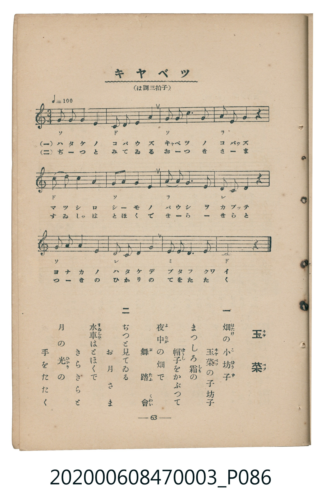

# キャベツ

> Re:Shōka 使用 AI 協助辨識與重建樂譜，可能會有錯誤。歡迎回報。

- **NEUTRINO 歌聲合成版**：<br><audio controls src="kyabetsu_neutrino.mp3"></audio>
- **鋼琴伴奏版**：<br><audio controls src="kyabetsu.mp3"></audio>


- 臺灣教育會公認《新定兒童唱歌》尋常科第三學年用（2020.006.0847.0003）

## 說明

Reference Materials 21: キャベツ (Kyabetsu / Cabbage [玉菜])
Source: 臺灣教育會公認 新定兒童唱歌 尋常科第三學年用 (1934), p. 63 (P086.jpg)
Key: C major (?= C), 3/4 (<3/4>), Quarter = 100 (!= 100)


## 歌詞

```text
一、畑の小坊子　玉菜の子坊子
まつしろ霜の　帽子をかぶつて
夜中の畑で　舞踏會
二、ぢつと見てゐる　お月さま
水車はとほくで　きらきらと
月の光の　手をたたく
```

## ABC

```abc
X:1
T:キャベツ
M:3/4
L:1/16
Q:1/4=100
K:C
V:V1 name="Piano" snm="Pia"
[V:V1]
G2 G2 G4 E4 | C2 D2 E4 A4 | G2 G2 c6 G2 | A2 E2 G4 z4 |
w: 1.~は た け の | こ ば う ず | キャ ベ ツ の | こ ばう ず
w: 2.~ぢ _ っ と | み て ゐ る | お _ つ き | さ _ ま
c2 d2 c4 A4 | G2 A2 G4 E4 | A2 A2 G6 E2 | D2 C2 D4 z4 |
w: 1.~ま っ し ろ | し _ も の | ば う し を | か ぶっ て
w: 2.~す ゐ しゃ は | と ほ く で | き _ ら _ | き ら と
G2 A2 A4 E4 | D2 C2 D4 G4 | E2 E2 D6 E2 | C8 z4 |
w: 1.~よ な か の | は た け で | ぶ た ふ くわ | い
w: 2.~つ _ き の | ひ か り の | て を た た | く
```

## TMD 檔案連結

- [主旋律 TMD 檔案](kyabetsu.tmd) [[在 TMD Studio 編輯](https://tmdlang.github.io/Tmd-TS/#tmd=s7IKdvYPcrWy4qpTUCpJTLdSSM7PyUlNLsnMz7MqzsjMK0nNjM_KTMmPL87Iz05Ugisry88pzU21Si9KTEmNN443MjAyiDcwMIs3sDAxBzIMjBFKi_NLi5JTrYqTM_Lzc-JLUitKkvLzsxHyBUX5Zal5iXlANQVFIBtTwIoQClLLMlNSQdKpKZkl-UWZiTlI7kgtKga7FWxJfElRYl5xclFmAcgDCFUlGalAxxbkJOYhGQsRTMvPT1Hi0tJSeNy09nHz4sfNMx83tyhoaXEp2ioYGhhw2dsqOHPZGOub2IE0vmjf9bxx8bOpM180bXo2p_lp65oXq3ofN3Q9m7bh6bpZT1snPV-99OmUjc_W9jxu6H66ofvpjh3Pl098vmbNkx2dT9fueLpzy_MpK97v6QCFlx4wvPRA4QVkGBi_39OpxMWlr8WloKUQlJqWWgTysYJvYkkqyMPFCkaGVqhO1PCuTExKLSkuVdBXcE5MSkpMT1WIft7X-aJ_TqwmyJRgSLgrYHWzAqaLFXC5V0HD0NLYRFNHoUBPwcxYQSPAwMJML6sgHWyLd2qllYKzQm5iVn6RggYotIAKgcGloAEONCAnsDSxCOgLBXB4KmhAwhWkF6Tdp7IoM7nYCsR8sqPhcUPj86kTHzeue7qh_-ncrqdrJzxuaID4CSS4dgJEEKQaKAFCjfseNy553Dj9cVPvyzkgRUDBpzv2gnQ2TXrc2P24cRtYwTKEnqdL5jzZsRaoFGzVcqDIi455L3b0A8MG7IxdwLhrfNy4CKxvxYtlQDOWPW4CmtcNtrDr2ZyOx41TgTYjjHy2YcuL3V2PG9cDNTxu3P24sR9i8OPG3sdNnTByBZIGkBnrnrYCRUEuftbZDXbufDDqB6rT5-IKAybtVKuAzMS8fIcag5pqLgUgsLHQsgMz9LUUDHVNgGkCZClQEyjUHjdOfty44XFj2-PGWSiJBV0OaDzIjBoFUzDUVTAG4hoFQwUjMMsMzAPJGMYBmbpARg1Q0Bis1AAkCdbuY1gDsh6I5wPxRKA40B6wVqBlQLwBiNvAorMgomAXKQCdBMQtYINBGuDKQaohauMRdhiBpBeBlS4GkyugNuwH4mVAMyeARJu6oaJdYDVLoIb3gsWmgtn7UMwFBp-prgUo-IAJaDEkAYHJJpCTYCEF5MMTEVDRMkTAAQPGKA4SPLDQMkMKSTMoD8SvAYYqKGQxg24f2FNAa8Be6IV6AcJrQglOSFBC5ECyk8Ci3UAMchk4JDBDDRjMwNAB-6IZbNp6qGkrgHg3EPeDRZdDRUH2A9Mp2AaYCIgPCXKUoLPUNTQCFUfARLwKHD7A5AVPhsshrgJytoIyQhMwLwALVESKA4UNLJxgIQMKqxqgmDGYBwk1Q6hL0EKtqQNo_iqw75FDCDUZwvy0DSq6FZogQM4BS0CSH2aYgVIONCjgRm-CBHUTJG3BREFpbxLYeIjR88GioCBFmFvLxaVrpwDOyApAhjIXAA)]
- [鋼琴伴奏 TMD 檔案](kyabetsu_piano.tmd) [[在 TMD Studio 編輯](https://tmdlang.github.io/Tmd-TS/#tmd=s7IKdvYPcrWy4tLSUnjctPZx8-LHzTMfN7e839PxsnvP8wlbnuzZ8nRp__POjvd7OhW0tLgUbRUMDQy47G0VnLlsjPVN7LjqFJRetO963rj42dSZL5o2PZvT_LR1zYtVvY8bup5N2_B03aynrZOer176dMrGZ2t7Hjd0P93Q_XTHjufLJz5fs-bJjs6na3c83bnl-ZQVQCuNDIwM9AwMzPQMLEzMgQwDY6CtSlxc-lpcCloKQalpqUWpecmpCr6JJalFmYk5xQpGhlYo7lbQ8K5MTEotKS5V0FdwTkxKSkxPVYh-3tf5on9OrKaCrkJAZmJevoJjcnJ-bkFiXmZual4JyOzg_NKi5FQrBaw-UcD0hwIuXyhoGFoam2jqKBToKZgZK2gEGFiY6WUVpGsCbdHn4gpLLSpOtQI7IsjDocagpppLAQhsLLTswIwaBVMw1FUwBuIaBUMFIzDLDMwDyRjGAZm6QEYNUNAYrNQAJAnW7mNYo_C4cT0QzwfiiUDxx43rwFofN04G4g1A3AYWnQURBQedAjDsgLgFbDBIA1w5SDVEbTzCDiOQ9CKw0sVgcgXUhv1AvAxo5gSQaFM3VLQLrGYJ1PBesNhUMHsfirlAz8YpGMVBPAjzrxlSWJhBeSB-DTBcQGGD6fl9YGc9bpwOdkQv1BEQXhNKgEACAyIHkp0EFu0G4m0QI5Zh8TcwoID-A2p63NQMNm091LQVQLwbiPvBosuhoiD7Hzd1gm2AiYD4kEBD9jzIryBfQ_wK8x3IvzVAMWMwD-JzQ6hpaD5v6gCaugrsA2RfoiYGmLu2QUW3QqOl_3FTP1gCkggw_Q2KP6h34EZvggRXEySGYaKgFDAJbDzE6PlgUVCwIMytRckJPthzgiFIbbRhLJxEETIBm4RNEVgGLI4IIahotAlYIZgkoBcmYhoP4pmiGwdWg1ANUxdtGg82DkJBlaFIoVgLMREYGrp2CuAAifYBicM5RmCOMhcA)]

## 分析

```text
================================================================================
📊 TMD Song Profile: [ キャベツ ]
================================================================================
⏱  Duration:       0:21 (21.6s), 12 measures total
🎼 Key & Tempo:    首調基準 C, != 100.0 BPM, <3/4>
   - 分析範圍：      由實際發聲的音符與和弦推測調性；播放脈絡另行呈現
🎤 人聲音域:    C4 (MIDI 60) – D5 (MIDI 74) [跨度: 14 個半音 / 1.2 個八度, 難度: moderate]
   - 最低音:  C4 in [Verse #1 @ m.2, 0:01]
   - 最高音: D5 in [Verse #1 @ m.5, 0:07]
   - 適合: soprano, mezzo-soprano, contralto, tenor, baritone, bass
🏛  結構:      Verse (21.6s)
⚡ 編曲密度:        Peak 1 軌道同時演奏
🗝  調性診斷：       C 調性不明確（純淨自然大調，未偵測到可信轉調）
   - 風格氣質:    純淨自然大調（陽光明朗、易唱易記，無明顯調外色彩）
   - 轉調歷程:    全曲維持單一推測調性（未偵測到可信轉調）
   - 核心骨幹音:  G, C, E, D, A
   - 調性數值:    C 調性不明確 [相關度: 0.80, 穩定度: Ambiguous, 自然音純度: 100.0%]
   - 候選調性 (K-S): C 大調 (0.80), G 大調 (0.79), E 小調 (0.66)
   - 五度圈歷程:   +0
   - 各段落調性細節:
     • [Verse #1]: C 調性不明確 (r: 0.80, 自然音純度: 100.0%)

  [ 五度圈游移軌跡 ]
              [C ]*
         F            G  
      Bb               D  
      Eb               A  
         Ab           E  
            Db       B  
               F# 
     (* = active key center)

  [ 十二半音累積音高分佈 ]
     C  : █████████████████         19.7%
     C# :                            0.0%
     D  : ███████████████           16.7%
     D# :                            0.0%
     E  : █████████████████         19.7%
     F  :                            0.0%
     F# :                            0.0%
     G  : ████████████████████████  27.3%
     G# :                            0.0%
     A  : ███████████████           16.7%
     A# :                            0.0%
     B  :                            0.0%
--------------------------------------------------------------------------------
Assignment 軌道音域：
  - Piano         : C4 – D5 (14 個半音 / 1.2 個八度, 43 個音符)
================================================================================
```


## 原書掃描頁




