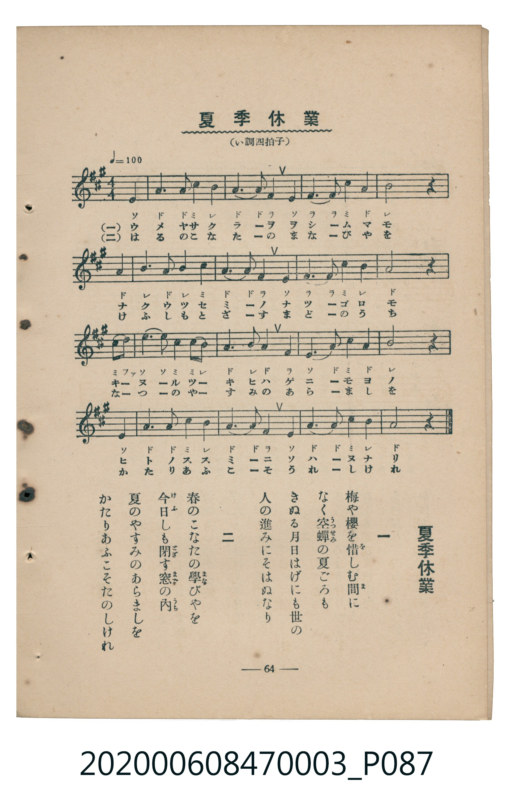

# 夏季休業

<audio controls src="kaki_kyugyo.mp3"></audio>

- 臺灣教育會公認《新定兒童唱歌》尋常科第三學年用（2020.006.0847.0003）

## 說明

Reference Materials 22: 夏季休業 (Kaki Kyūgyō / Summer Vacation)
Source: 臺灣教育會公認 新定兒童唱歌 尋常科第三學年用 (1934), p. 64 (P087.jpg)
Key: A major (?= A), 4/4 (<4/4>), Quarter = 100 (!= 100)

## 歌詞

```text
一、梅や櫻を惜しむ間に
なく空蟬の夏ごろも
きぬる月日はげにも世の
人の進みにそはぬなり
二、春のこなたの學びやを
今日しも閉す窓の内
夏のやすみのあらましを
かたりあふこそたのしけれ
```

## 原書掃描頁



## 分析

```text
================================================================================
📊 TMD Song Profile: [ 夏季休業 ]
================================================================================
⏱  Duration:       1:16 (76.8s), 32 measures total
🎼 Key & Tempo:    首調基準 A, != 100.0 BPM, <4/4>
   - 分析範圍：      由實際發聲的音符與和弦推測調性；播放脈絡另行呈現
🎤 人聲音域:    E4 (MIDI 64) – E5 (MIDI 76) [跨度: 12 個半音 / 1.0 個八度, 難度: easy]
   - 最低音:  E4 in [Verse #1 @ m.1, 0:00]
   - 最高音: E5 in [Verse #1 @ m.9, 0:19]
   - 適合: soprano, mezzo-soprano, contralto, tenor, baritone, bass
🏛  結構:      Verse (38.4s) -> Verse (38.4s)
⚡ 編曲密度:        Peak 1 軌道同時演奏
🗝  調性診斷：       A 大調（純淨自然大調，未偵測到可信轉調）
   - 風格氣質:    純淨自然大調（陽光明朗、易唱易記，無明顯調外色彩）
   - 轉調歷程:    全曲維持單一推測調性（未偵測到可信轉調）
   - 核心骨幹音:  A, B, C#, E, F#
   - 調性數值:    A 大調 [相關度: 0.84, 穩定度: High, 自然音純度: 100.0%]
   - 候選調性 (K-S): A 大調 (0.84), F# 小調 (0.65), E 大調 (0.56)
   - 五度圈歷程:   +3 -> +3
   - 各段落調性細節:
     • [Verse #1]: A 大調 (r: 0.84, 自然音純度: 100.0%)
     • [Verse #2]: A 大調 (r: 0.84, 自然音純度: 100.0%)

  [ 五度圈游移軌跡 ]
               C  
         F            G  
      Bb               D  
      Eb              [A ]*
         Ab           E  
            Db       B  
               F# 
     (* = active key center)

  [ 十二半音累積音高分佈 ]
     C  :                            0.0%
     C# : ████████                  13.3%
     D  : █                          0.8%
     D# :                            0.0%
     E  : ████████                  13.3%
     F  :                            0.0%
     F# : ████████                  13.3%
     G  :                            0.0%
     G# :                            0.0%
     A  : ████████████████████████  38.3%
     A# :                            0.0%
     B  : █████████████             20.8%
--------------------------------------------------------------------------------
Assignment 軌道音域：
  - Piano         : E4 – E5 (12 個半音 / 1.0 個八度, 116 個音符)
================================================================================
```

## ABC

```abc
X:1
T:夏季休業
C:TMD (Chen, Chih-Han / aguai)
M:4/4
L:1/16
Q:1/4=100
K:A

V:V1 name="Piano" snm="Pia"

[V:V1]
e4 a6 a2 c4 | b4 a6 a2 f4 | e4 f6 f2 c4 | a4 b8 z4 |
a4 b6 a2 b4 | c4 a6 a2 f4 | e4 f6 f2 c4 | b4 a8 z4 |
c2 d2 e6 e2 c2 b2 | a4 b6 a2 f4 | e4 a6 a2 c4 | a4 b8 z4 |
e4 a6 a2 c4 | b4 a6 a2 f4 | e4 a6 a2 c4 | b4 a8 z4 |
e4 a6 a2 c4 | b4 a6 a2 f4 | e4 f6 f2 c4 | a4 b8 z4 |
a4 b6 a2 b4 | c4 a6 a2 f4 | e4 f6 f2 c4 | b4 a8 z4 |
c2 d2 e6 e2 c2 b2 | a4 b6 a2 f4 | e4 a6 a2 c4 | a4 b8 z4 |
e4 a6 a2 c4 | b4 a6 a2 f4 | e4 a6 a2 c4 | b4 a8 z4 |
```

- [主旋律 TMD 檔案](kaki_kyugyo.tmd)
- [鋼琴伴奏 TMD 檔案](kaki_kyugyo_piano.tmd)
