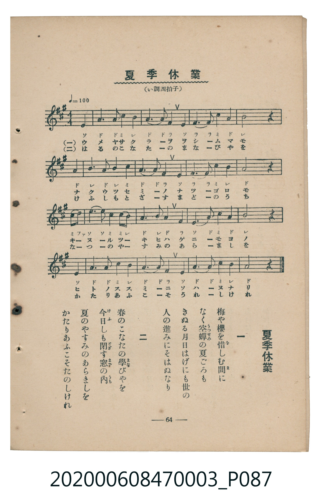

# 夏季休業

> Re:Shōka 使用 AI 協助辨識與重建樂譜，可能會有錯誤。歡迎[回報](https://github.com/TMDLang/reshoka/issues)。

- **鋼琴伴奏版**：<br><audio controls src="kaki_kyugyo.mp3"></audio>
- **NEUTRINO 歌聲合成版**：<br><audio controls src="kaki_kyugyo_neutrino.mp3"></audio>

- 臺灣教育會公認《新定兒童唱歌》尋常科第三學年用（2020.006.0847.0003）

## 說明

Reference Materials 22: 夏季休業 (Kaki Kyūgyō / Summer Vacation)
Source: 臺灣教育會公認 新定兒童唱歌 尋常科第三學年用 (1934), p. 64 (P087.jpg)
Key: A major (?= A), 4/4 (<4/4>), Quarter = 100 (!= 100)


## 歌詞

```text
一、梅や櫻を惜しむ間に
なく空蟬の夏ごろも
きぬる月日はげにも世の
人の進みにそはぬなり
二、春のこなたの學びやを
今日しも閉す窓の内
夏のやすみのあらましを
かたりあふこそたのしけれ
```

## ABC

<div class="abc-score" data-abc-src="kaki_kyugyo.abc" aria-label="五線譜載入中"></div>

[下載 ABC 原始檔](kaki_kyugyo.abc)

## TMD 檔案連結

- [主旋律 TMD 檔案](kaki_kyugyo.tmd) [[在 TMD Studio 編輯](https://tmdlang.github.io/Tmd-TS/#tmd=s7IKdvYPcrWy4qpTUCpJTLdSSM7PyUlNLsnMz7MqzsjMK0nNjM_KTMmPL87Iz05Ugisry88pzU21Si9KTEmNN443MjAyiDcwMIs3sDAxBzIMjBFKi_NLi5JTrYqTM_Lzc-JLUitKkvLzsxHyBUX5Zal5iXlANQVFIBtTwIoQClLLMlNSQdKpKZkl-UWZiTlI7kgtKga7FWxJfElRYl5xclFmAcgDCFUlGalAx0JdkJOZloqQApqXnplnVZKYCfQhyJflifG5iZl5OYl5KciqSjLygZ4tyKi0ysgsBrkiOTEnPjsxDylMoG4oSExPtQowsDBX4tLSUni6pP_p2sVP9kx8tnStgpYWl6KtgqGBAZe9rYIjl42JvokdSPuL9l3PGxc_mzrzRdOmZ3Oan7auebGq93FD17NpG56um_W0ddLz1UufTtn4bG3P44bupxu6n-7Y8Xz5xOdr1jzZ0fl07Y6nO7c8n7Li_Z4OUDToAaNBDxQNQIaB8fs9nUpcXPpaXApaCkGpaalFoIBU8E0sSQWFY7GCkZEVqhM1vBOzMxW8K4-uTq882qugrxBcmpubWqQQlpicCApUTZBJwZAoVcDqbgVMVyvgcrOChqGlsYmmjkKBnoKZiYIGKNj0sgrSwbZ4p1ZaKTgq5CZm5RcpaIBCDKgQGGQKGuCAA3ICSxOLgD5RAIepggYkbEF6Qdp9KoGRVGwFYj7Z0fC4ofHZotbHTS3PVu9-3DTpWfOcx43THzc1vJw2-XHjapCixw1ARQ2PG1c9bux_vnLXi_lrHjeuA4bN48Ypj5t6Hzc1ISvqfdy45nFT97M5Hc-mL33cuP5x4ySgMUBFT3ZMA2pDKH2yaxeQ_7Jh0-PG_SAVjXPBqoFmr3rc1AV23C5grDY-mwE0Zt3jRqBrgA6YD7J67Y7HjZuBLgY6F8m83V1gG4Fub3o5rfNx48znq4B61j1ta0UoArt6HUhr40ywvUCDmx43AVXvA-tEMu9xYzfIuqYukIrGrWAHAJ0IcgBIaePEx009QNX6XFxhwKwGTNiZiXn5DjW6hjXVXApAYGOhZQdm6APT-p6NL7Zuf9bdq6ABjGcTIEPTSuFxYxswFQE9DTIEpLBGwUBBF45N44FEDVjCx7BGAcSDYZBOuJwRutx6uBzQZkNdE6BNTY1gL08FRiDQFpB_m_cAPQtkTQLxgd4B8YFe3gfmrlbQAAa2JsJdhkAjdYGkMZA0AhkPFzED2QlxKoStC6JA6kAqasCqQRDkI7AI3ENAR4FlgC4DWjkV7PR-sB6g-6C6QO6DkWB3wsUbwOr3QcVXQ8UhAbAKJXCAiRGip3EdEE9GqADS82HmAeWQzQPJQ8Q3Q10IcRfIHQh7JiIHtKmuBShKgcmr7XHjkseNs8EG7QcFLNjiVWD-EjAflG3A5jWBAroXKIYU1pAQMwTToHAkJqyR4wQS1sYKJshhDQ5ZSMIBOgLMmg316360MICFDUgVRHwKOAx6oWHQhBIGYFFEWDduheqZDlX5uHEF1LxpcPNmooT1SjT7wUkbSC9EsQcRp8CwttQ1BJbOoLIClGyB2RQUrGBNwNIHWJ6sB7IgCXs1WAUwh3eAuetA4b0JKbBNwVaYggPRGBiMsEA0AtPgQAYqgoQ1JPljJmu0jAp0FsxH4JQHCUmw46D-3ATNpCBHoqZfaJgBXQsRB4UIIgw2oYU1IobAIQdLpeDwBYnuh4cpyFSUfAUOfUh-wkzXIFcjChBjXUMzUGCvABd8wFJzJlLKXg1kzQXz14P5oNIbbGIXqYUHLlWIAhE5iEGJCpalIckJRKImZ1CgglwHEQcFOEQcFD3wZA50KMLrSBEJDmBI8QBSAwlCSPIGyYCKEYhpIPMhKpEjDBK00CICaEIPhi21XFy6dgrgqkMByFDmAgA)]
- [鋼琴伴奏 TMD 檔案](kaki_kyugyo_piano.tmd) [[在 TMD Studio 編輯](https://tmdlang.github.io/Tmd-TS/#tmd=s7IKdvYPcrWy4qpTUCpJTLdSyC8qychPL0osyKi0ysgsLskvykxOzInPTsxLVIIrKs4vLUpOjS9ITE-1CjCwMFfi0tJSeLqk_-naxU_2THy2dO37PR0vu_c8n7DlyZ4tT5f2P-_seL-nU0FLi0vRVsHQwIDL3lbBkcvGRN_EDmTmi_ZdzxsXP5s680XTpmdzmp-2rnmxqvdxQ9ezaRuerpv1tHXS89VLn07Z-Gxtz-OG7qcbup_u2PF8-cTna9Y82dH5dO2Opzu3PJ-yAmilkYGRgZ6BgZmegYWJOZBhYAy0VYmLS1-LS0FLISg1LbUoNS85VcE3sSS1KDMxp1jByMgKxd0KGt6J2ZkK3pVHV6dXHu1V0FcILs3NTS1SCEtMTizJzM_TVNBVCMhMzMtXcExOzs8tSMzLzE3NKwGZHwwOFCsFrL5RwPSLAi6fKGgYWhqbaOooFOgpmJkoaIBCWC-rIF0TaIs-F1dYalExMNhBjgjycKgxqKnmUgACGwstOzCjRsEA6EgYNo0HEjVgCR_DGgUQD4YfN7Yh5IzQ5dbD5WoUDIFsXSBpDCSNQOJwETOQYogdELYuiAKpA6moAasGQZBTwCJwlzxuagTLPG5qAdo2FWxnP1jP46ZOqK7HTZPgJFC8cTpcvAGsfh9UfDVUHOLyVSi-etzUDdHTuA6IJyNUAOn5MPOAcsjmgeQh4puhLoS4C-QOhD0TkUII4k9DMA3yPTEhhBySkBAyVjBBDiFweEDi6XHjEjBrNtSF-9FcDvMRSBVEfArY5b1QlzehuBwsigihxq1QPdOhKh83roCaNw1u3kyUEFqJZj84JQHphSj2IGKiRsEULG4K9rkx0O8wnxuBaXDIABVBAgiS0jBTEFpifty4BuYMcCRDvA8SB3kQxN8ETciPG2FJCJZUoB5t6oCKg7yBcPgmtABCBCvYu7AEAQ4UkOh-eECATEVJwuAggyRdzCQEcjVpmQyXKkSORw4fUDTCkj4kAkEkagIChcjjxrlQcVBoQcRBYQtPWE1dSO5GigVw6ECyEUgNxP-QBAWSAWU3iGkg8yEqkUMbEi7QrAQ0oQfDllqUAs8HucAzgRd4hvEK0YaxwCCKB4YAPDwhgkAKJA7nm8SDWDUgOtoELA0SBSU9IMs0Ht0UFGGwRpzmoFgDpPA6BWocUDfUDog8XrcQ8BFSKIA1o7sFGJS6dgrg0Iz2AQojOEZgjjIXAA)]

## 分析

```text
================================================================================
📊 TMD Song Profile: [ 夏季休業 ]
================================================================================
⏱  Duration:       0:38 (38.4s), 16 measures total
🎼 Key & Tempo:    首調基準 A, != 100.0 BPM, <4/4>
   - 分析範圍：      由實際發聲的音符與和弦推測調性；播放脈絡另行呈現
🎤 人聲音域:    E4 (MIDI 64) – E5 (MIDI 76) [跨度: 12 個半音 / 1.0 個八度, 難度: easy]
   - 最低音:  E4 in [Verse #1 @ m.1, 0:01]
   - 最高音: E5 in [Verse #1 @ m.10, 0:21]
   - 適合: soprano, mezzo-soprano, contralto, tenor, baritone, bass
🏛  結構:      Verse (38.4s)
⚡ 編曲密度:        Peak 1 軌道同時演奏
🗝  調性診斷：       A 大調（純淨自然大調，未偵測到可信轉調）
   - 風格氣質:    純淨自然大調（陽光明朗、易唱易記，無明顯調外色彩）
   - 轉調歷程:    全曲維持單一推測調性（未偵測到可信轉調）
   - 核心骨幹音:  A, B, C#, E, F#
   - 調性數值:    A 大調 [相關度: 0.86, 穩定度: High, 自然音純度: 100.0%]
   - 候選調性 (K-S): A 大調 (0.86), F# 小調 (0.67), E 大調 (0.57)
   - 五度圈歷程:   +3
   - 各段落調性細節:
     • [Verse #1]: A 大調 (r: 0.86, 自然音純度: 100.0%)

  [ 五度圈游移軌跡 ]
               C  
         F            G  
      Bb               D  
      Eb              [A ]*
         Ab           E  
            Db       B  
               F# 
     (* = active key center)

  [ 十二半音累積音高分佈 ]
     C  :                            0.0%
     C# : ██████████                15.0%
     D  : █                          0.8%
     D# :                            0.0%
     E  : █████████                 14.2%
     F  :                            0.0%
     F# : █████████                 13.3%
     G  :                            0.0%
     G# :                            0.0%
     A  : ████████████████████████  37.5%
     A# :                            0.0%
     B  : ████████████              19.2%
--------------------------------------------------------------------------------
Assignment 軌道音域：
  - Piano         : E4 – E5 (12 個半音 / 1.0 個八度, 58 個音符)
================================================================================
```


## 原書掃描頁




