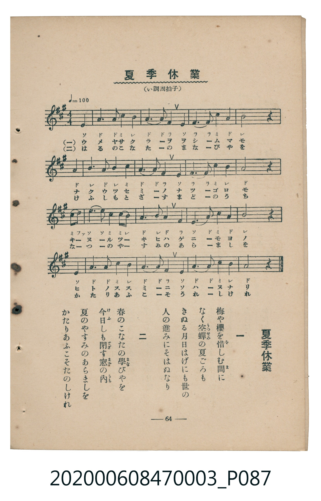

# 夏季休業

> Re:Shōka 使用 AI 協助辨識與重建樂譜，可能會有錯誤。歡迎回報。

- **NEUTRINO 歌聲合成版**：<br><audio controls src="kaki_kyugyo_neutrino.mp3"></audio>
- **鋼琴伴奏版**：<br><audio controls src="kaki_kyugyo.mp3"></audio>


- 臺灣教育會公認《新定兒童唱歌》尋常科第三學年用（2020.006.0847.0003）

## 說明

Reference Materials 22: 夏季休業 (Kaki Kyūgyō / Summer Vacation)
Source: 臺灣教育會公認 新定兒童唱歌 尋常科第三學年用 (1934), p. 64 (P087.jpg)
Key: A major (?= A), 4/4 (<4/4>), Quarter = 100 (!= 100)


## 歌詞

```text
一、梅や櫻を惜しむ間に
なく空蟬の夏ごろも
きぬる月日はげにも世の
人の進みにそはぬなり
二、春のこなたの學びやを
今日しも閉す窓の内
夏のやすみのあらましを
かたりあふこそたのしけれ
```

## ABC

```abc
X:1
T:夏季休業
M:4/4
L:1/16
Q:1/4=100
K:A
V:V1 name="Piano" snm="Pia"
[V:V1]
z4 z4 z4 E4 | A6 A2 c4 B4 | A6 A2 F4 E4 | F6 F2 c4 A4 |
w: 1.~う | め や さ く | ら _ を を | し _ む ま
w: 2.~は | る の こ な | た _ の ま | な _ び や
B8 z4 A4 | B6 A2 B4 c4 | A6 A2 F4 E4 | F6 F2 c4 B4 |
w: 1.~に な | く う つ せ | み _ の な | つ _ ご ろ
w: 2.~を け | ふ し も と | ざ _ す ま | ど _ の う
A8 z4 c2 d2 | e6 e2 c4 c2 B2 | A6 B2 A4 F4 | E6 A2 c4 A4 |
w: 1.~も き _ | ぬ _ る つ _ | き ひ は げ | に _ も よ
w: 2.~ち な _ | つ _ の や _ | す み の あ | ら _ ま し
B8 z4 E4 | A6 A2 c4 B4 | A6 A2 F4 E4 | A6 A2 c4 B4 |
w: 1.~の ひ | と の す す | み _ に そ | は _ ぬ な
w: 2.~を か | た り あ ふ | こ _ そ た | の _ し け
A8 z4 z4 |
w: 1.~り
w: 2.~れ
```

## TMD 檔案連結

- [主旋律 TMD 檔案](kaki_kyugyo.tmd) [[在 TMD Studio 編輯](https://tmdlang.github.io/Tmd-TS/#tmd=s7IKdvYPcrWy4qpTUCpJTLdSSM7PyUlNLsnMz7MqzsjMK0nNjM_KTMmPL87Iz05Ugisry88pzU21Si9KTEmNN443MjAyiDcwMIs3sDAxBzIMjBFKi_NLi5JTrYqTM_Lzc-JLUitKkvLzsxHyBUX5Zal5iXlANQVFIBtTwIoQClLLMlNSQdKpKZkl-UWZiTlI7kgtKga7FWxJfElRYl5xclFmAcgDCFUlGalAx0JdkJOZloqQApqXnplnVZKYCfQhyJflifG5iZl5OYl5KUpcWloKT5f0P127-Mmeic-WrlXQ0uJStFUwNDDgsrdVcOSyMdE3sQMZ9aJ91_PGxc-mznzRtOnZnOanrWterOp93ND1bNqGp-tmPW2d9Hz10qdTNj5b2_O4ofvphu6nO3Y8Xz7x-Zo1T3Z0Pl274-nOLc-nrHi_pwMUjnrAcNQDhSOQYWD8fk-nEheXvhaXgpZCUGpaahEoJBR8E0tSQQFRrGBkZIXqRA3vxOxMBe_Ko6vTK4_2KugrBJfm5qYWKYQlJieCQkUTZFIwJE4UsLpbAdPVCrjcrKBhaGlsoqmjUKCnYGaioBFgYGGul1WQDrbFO7XSSsFRITcxK79IQQMUYkCFwCBT0AAHHJATWJpYBPSJAjhMFTQgYQvSC9LuU1mUmVxsBWI-2dHwuKHx2aLWx00tz1bvftw06VnznMeN0x83NbycNvlx42qQoscNQEUNjxtXPW7sf75y14v5ax43rgOGzePGKY-beh83NSEr6n3cuOZxU_ezOR3Ppi993Lj-ceMkoDFARU92TANqQyh9smsXkP-yYdPjxv0gFY1zwaqBZq963NQFdtwuYKw2PpsBNGbd40aga4AOmA-yeu2Ox42bgS4GOhfJvN1dYBuBbm96Oa3zcePM56uAetY9bWtFKAK7eh1Ia-NMsL1Ag5seNwFV7wPrRDLvcWM3yLqmLpCKxq1gBwCdCHIASGnjxMdNPUDV-lxcYcC8kmoVkJmYl-9QY1BTzaUABDYWWnZghj4wqe_Z-GLr9mfdvQoawGg2ATI0rRQeN7YBExHQzyAzQAprFAwUdOHYNB5I1IAlfAxrFEA8GAbphMsZocuth8sBbTbUNQHa1NQI9vFUYPwBbQF5t3kP0K9A1iQQH-gbEB_o431g7moFDWBYayLcZQg0UhdIGgNJI5DxcBEzkJ0Qp0LYuiAKpA6kogasGgRBPgKLwD0EdBRYBugyoJVTwU7vB-sBug-qC-Q-GAl2J1y8Aax-H1R8NVQcEgCrUAIHmBYhehrXAfFkhAogPR9mHlAO2TyQPER8M9SFEHeB3IGwZyJyQJvqWoCiFJi62h43LnncOBts0H5QwIItXgXmLwHzQbkGbF4TKKB7gWJIYQ0JMUMwDQpHYsIaOU4gYW2sYIIc1uCQhSQcoCPArNlQv-5HCwNY2IBUQcSngMOgFxoGTShhABZFhHXjVqie6VCVjxtXQM2bBjdvJkpYr0SzH5y0gfRCFHsQcQoMa0tdQ2DhDCoqQMkWmEtBwQrWBCx8gMXJeiALkrBXg1UAM3gHmLsOFN6bkALbFGyFKTgQjYHBCAtEIzANDmSgIkhYQ5I_ZrJGy6hAZ8F8BE55kJAEOw7qz03QTApyJGr6hYYZ0LUQcVCIIMJgE1pYI2IIHHKwVAoOX5DofniYgkxFyVfg0IfkJ8x0DXI1ogAx1jU0AwX2CnC5Byw0ZyKl7NVA1lwwfz2YDyq8wSZ2kVp44FKFKBCRgxiUqGBZGpKcQCRqcgYFKsh1EHFQgEPEQdEDT-ZAhyK8jhSR4ACGFA8gNZAghCRvkAyoGIGYBjIfohI5wiBBCy0igCb0YNhSy8Wla6cArjkUgAxlLgA)]
- [鋼琴伴奏 TMD 檔案](kaki_kyugyo_piano.tmd) [[在 TMD Studio 編輯](https://tmdlang.github.io/Tmd-TS/#tmd=s7IKdvYPcrWy4tLSUni6pP_p2sVP9kx8tnTt-z0dL7v3PJ-w5cmeLU-X9j_v7Hi_p1NBS4tL0VbB0MCAy95WwZHLxkTfxI6rTkHpRfuu542Ln02d-aJp07M5zU9b17xY1fu4oevZtA1P18162jrp-eqlT6dsfLa253FD99MN3U937Hi-fOLzNWue7Oh8unbH051bnk9ZAbTSyMDIQM_AwEzPwMLEHMgwMAbaqsTFpa_FpaClEJSallqUmpecquCbWJJalJmYU6xgZGSF4m4FDe_E7EwF78qjq9Mrj_Yq6CsEl-bmphYphCUmJ5Zk5udpKugqBGQm5uUrOCYn5-cWJOZl5qbmlYDMD84vLUpOtVLA6hsFTL8o4PKJgoahpbGJpo5CgZ6CmYmCRoCBhbleVkG6JtAWfS6usNSi4lQrsCOCPBxqDGqquRSAwMZCyw7MqFEwADoShk3jgUQNWMLHsEYBxIPhx41tCDkjdLn1cLkaBUMgWxdIGgNJI5A4XMQMpBhiB4StC6JA6kAqasCqQRDkFLAI3CWPmxrBMo-bWoC2TQXb2Q_W87ipE6rrcdMkOAkUb5wOF28Aq98HFV8NFYe4fBWKrx43dUP0NK4D4skIFUB6Psw8oByyeSB5iPhmqAsh7gK5A2HPRKQQgvjTEEyDfE9MCCGHJCSEjBVMkEMIHB6QeHrcuATMmg114X40l8N8BFIFEZ8Cdnkv1OVNKC4HiyJCqHErVM90qMrHjSug5k2DmzcTJYRWotkPTklAeiGKPYiYqFEwBYubgn1uDPQ7zOdGYBocMkBFkACCpDTMFISWmB83roE5AxzJEO-DxEEeBPE3QRPy40ZYEoIlFahHmzqg4iBvIBy-CS2AEMEK9i4sQYADBSS6Hx4QIFNRkjA4yCBJFzMJgVxNWibDpQqR45HDBxSNsKQPiUAQiZqAQCHyuHEuVBwUWhBxUNjCE1ZTF5K7kWIBHDqQbARSA_E_JEGBZEDZDWIayHyISuTQhoQLNCsBTejBsKUWpcDzwV7gGYLURhvGgoMJxEaEA4okmAlRgSJuAmKC-TUQdrQJXDlEBShpgnmm8dhtwSINNZBIe7A4C8wk2itIloLNhrsJoZ5Iv5AYYhihDzUYl1-AUaprpwCO1WgfkCScYwTmKHMBAA)]

## 分析

```text
================================================================================
📊 TMD Song Profile: [ 夏季休業 ]
================================================================================
⏱  Duration:       0:40 (40.8s), 17 measures total
🎼 Key & Tempo:    首調基準 A, != 100.0 BPM, <4/4>
   - 分析範圍：      由實際發聲的音符與和弦推測調性；播放脈絡另行呈現
🎤 人聲音域:    E4 (MIDI 64) – E5 (MIDI 76) [跨度: 12 個半音 / 1.0 個八度, 難度: easy]
   - 最低音:  E4 in [Verse #1 @ m.1, 0:01]
   - 最高音: E5 in [Verse #1 @ m.10, 0:21]
   - 適合: soprano, mezzo-soprano, contralto, tenor, baritone, bass
🏛  結構:      Verse (40.8s)
⚡ 編曲密度:        Peak 1 軌道同時演奏
🗝  調性診斷：       A 大調（純淨自然大調，未偵測到可信轉調）
   - 風格氣質:    純淨自然大調（陽光明朗、易唱易記，無明顯調外色彩）
   - 轉調歷程:    全曲維持單一推測調性（未偵測到可信轉調）
   - 核心骨幹音:  A, B, C#, E, F#
   - 調性數值:    A 大調 [相關度: 0.86, 穩定度: High, 自然音純度: 100.0%]
   - 候選調性 (K-S): A 大調 (0.86), F# 小調 (0.67), E 大調 (0.57)
   - 五度圈歷程:   +3
   - 各段落調性細節:
     • [Verse #1]: A 大調 (r: 0.86, 自然音純度: 100.0%)

  [ 五度圈游移軌跡 ]
               C  
         F            G  
      Bb               D  
      Eb              [A ]*
         Ab           E  
            Db       B  
               F# 
     (* = active key center)

  [ 十二半音累積音高分佈 ]
     C  :                            0.0%
     C# : ██████████                15.0%
     D  : █                          0.8%
     D# :                            0.0%
     E  : █████████                 14.2%
     F  :                            0.0%
     F# : █████████                 13.3%
     G  :                            0.0%
     G# :                            0.0%
     A  : ████████████████████████  37.5%
     A# :                            0.0%
     B  : ████████████              19.2%
--------------------------------------------------------------------------------
Assignment 軌道音域：
  - Piano         : E4 – E5 (12 個半音 / 1.0 個八度, 58 個音符)
================================================================================
```


## 原書掃描頁




