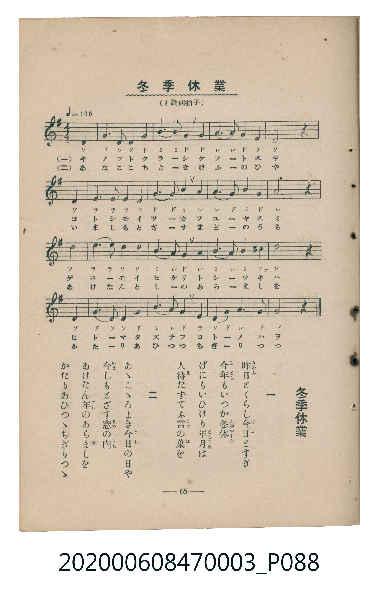

# 冬季休業

> Re:Shōka 使用 AI 協助辨識與重建樂譜，可能會有錯誤。歡迎[回報](https://github.com/TMDLang/reshoka/issues)。

- **鋼琴伴奏版**：<br><audio controls src="toki_kyugyo.mp3"></audio>
- **NEUTRINO 歌聲合成版**：<br><audio controls src="toki_kyugyo_neutrino.mp3"></audio>

- 臺灣教育會公認《新定兒童唱歌》尋常科第三學年用（2020.006.0847.0003）

## 說明

Reference Materials 23: 冬季休業 (Tōki Kyūgyō / Winter Vacation)
Source: 臺灣教育會公認 新定兒童唱歌 尋常科第三學年用 (1934), p. 65 (P088.jpg)
Key: G major (?= G), 4/4 (<4/4>), Quarter = 100 (!= 100)


## 歌詞

```text
一、昨日とくらし今日とすぎ
今年もいつか冬休
げにもいひけり年月は
人待たずてふ言の葉を
二、あゝこゝろよき今日の日や（譜下作「あなこゝちよきけふのひや」）
今しもとざす窓の内
あけなん年のあらましを
かたりあひつゝちぎりつゝ
```

## ABC

<div class="abc-score" data-abc-src="toki_kyugyo.abc" aria-label="五線譜載入中"></div>

[下載 ABC 原始檔](toki_kyugyo.abc)

## TMD 檔案連結

- [主旋律 TMD 檔案](toki_kyugyo.tmd) [[在 TMD Studio 編輯](https://tmdlang.github.io/Tmd-TS/#tmd=s7IKdvYPcrWy4qpTUCpJTLdSSM7PyUlNLsnMz7MqzsjMK0nNjM_KTMmPL87Iz05Ugisry88pzU21Si9KTEmNN443MjAyiDcwMIs3sDAxBzIMjBFKi_NLi5JTrYqTM_Lzc-JLUitKkvLzsxHyBUX5Zal5iXlANQVFIBtTwIoQClLLMlNSQdKpKZkl-UWZiTlI7kgtKga7FWxJfElRYl5xclFmAcgDCFUlGalAx0JdkJOZloqQApqXnplnVZKYCfQhyJflifG5iZl5OYl5KciqSjLygZ4tyKi0ysgsBrkiOTEnPjsxDylMoG4oSExPtQowsLBQ4tLSUnjatubp2sVP9kx8tnStgpYWl6KtgqGBAZe9rYI7l42JvokdSPuL9l3PGxc_mzrzRdOmZ3Oan7auebGq93FD17NpG56um_W0ddLz1UufTtn4bG3P44bupxu6n-7Y8Xz5xOdr1jzZ0fl07Y6nO7c8n7Li_Z4OUDToAaNBDxQNQIaB8fs9nUpcXPpaXApaCkGpaalFoIBU8E0sSQWFY7GCkbEVqhM1Qo72ZmcqeFceXZ1eebRXQV8hHBQnRQphicmJoFDVBBkVDIlTBawOV8B0tgIuRytoGFoam2jqKBToKZiZKmiAwk0vqyAdbIt3aqWVgrtCbmJWfpGCBijIgAqBYaagAQ45ICewNLEI5DhwoCpoQAIXpBek3acSGEvFViDmkx0Njxsan81Y8Wz60seNKx439j9u6nzcOP3J7i6YyMzHjX0gpY8bgEobgBJABz5uanrc2PK4ccnjxm5gKAGDCKHiceOkx42rYSo2PW6c-LgJpOfZnI7HjeuRTNq16-m-1seN8x83znrcuOxx49YXK4Ca172Y2Pm4aRLYcbuA0dr4uLHpcdPcx42TQWRT7-MmoDG9MPetA5FNLcAofrF2zpMd3U_2znnc0APS0rgKqqVxIUQLyCGNW4FaQI5qannc0AtMAygeA_ob7Gygp6cB_f181WSg6qdtrch-A0oDjVn1uGkyKBhAhgFdBwyxfWDNYGfDlHaD_NYENBWoBxgMS6COaewDC4K4QNX6XFxhwKwKzBiZiXn5DjW6hjXVXApAYGOhZQdm6APzyp6NL7Zuf9bdq6ABTCYmQIamlQLQS8BECDQdZAhIYY2CgYIuHJvGA4kasISPYY0CiAfDIJ1wOSN0uSa4HNBmQ10TkE1AbwJDDpQ8gLaA_Nu8B-hfoMREEB8oB-KD0gqY26egAQx7TYS7DIFGgl0EdhSIV6NgDBYzBvMgIkZgESMwzwzseoh6EMTiI6CrwFJA64F4BZjVD9YFdCBUG8iRIHIiRByoEiYOUT8TKt4HFYeEwGSU0AHGNlTPZKgcMBah9nTAzQOFKDZ7QG4ERj9UfQuKPSAePKRNdS1AIQ0MREgibAEbtAQcst1gI0EGtIH4wMQLDen9oJCehBTS4HADBx-YBQkyaPgbgsMcFMqwsIaIIIc-NKTRAhoUWJDABDoN4XSQ--Ae7YZGBcSjbTBxsJcRAb0fJQAmoQX0Pgx7QDaDZKbB7QGZBFEJEl-JFtAge0HioAhC2IOSpC11DY1AIb0aHJTwkIYWVGA7Qfzp4JAHFnC9YO56UEhvQg5pSECDwwocXtAUDUm_kFCGiYBoE3WwEEgpzgS9Gh5qqKEMSj6Q5AVyIXK4gJI3RA4UE9CMDXYusv_ByQ8pnEHJFCS-CmgeJEFjmgcJT3DIoWQoUMhD1IHEQTGIsAeUBhBFh7GuoRkkSYNCElhAzgdbAS3swXkJnLjA0sASZj3URCKKDcxCAhboIBZMJ6IwxEzMCK_Mh3p9FlR0GTQZQ8sBFB2wEgfmVITnkaISHMQgUyFRCYkwaEDCo3IJPMqgZQm8DILogKhBzmIIW2q5uHTtFMDVhgKQocwFAA)]
- [鋼琴伴奏 TMD 檔案](toki_kyugyo_piano.tmd) [[在 TMD Studio 編輯](https://tmdlang.github.io/Tmd-TS/#tmd=s7IKdvYPcrWy4qpTUCpJTLdSyC8qychPL0osyKi0ysgsLskvykxOzInPTsxLVIIrKs4vLUpOjS9ITE-1CjCwsFDi0tJSeNq25unaxU_2THy2dO37PR0vu_c8n7DlyZ4tT5f2P-_seL-nU0FLi0vRVsHQwIDL3lbBncvGRN_EDmTmi_ZdzxsXP5s680XTpmdzmp-2rnmxqvdxQ9ezaRuerpv1tHXS89VLn07Z-Gxtz-OG7qcbup_u2PF8-cTna9Y82dH5dO2Opzu3PJ-yAmilkYGRgZ6BgZmegYWJOZBhYAy0VYmLS1-LS0FLISg1LbUoNS85VcE3sSS1KDMxp1jByNgKxd0KGiFHe7MzFbwrj65Orzzaq6CvEJ6ZB1StEJaYnFiSmZ-nqaCrEJCZmJev4JicnJ9bkJiXmZuaVwKyIBgcKlYKWL2jgOkZBVxeUdAwtDQ20dRRKNBTMDNV0AAFsV5WQbom0BZ9Lq6w1KJiYLiDHBHk4VCja1hTzaUABDYWWnZgRo2CAdCVMGwaDyRqwBI-hjUKIB4MP27sRcgZocs1weVqFAyBbLBRYNNAvBoFY7CYMZgHETECixiBeWZgayHqQRCLUx43rgNLPW7cCsQrwKx-sK7HTZ1QbY8bp4PJiRBxoEqYOET9TKh4H1Qc4vTJKN563LgKqmcyVO5x40KoPR1w80BBgc0ekBsfN26Cqm9BsQfEgwUR2MNgf4NZEL9CA84QHFig4IEFEkQEOdigQYQWQiBfQkLhcRMoQqB2AuklcBd2Q8MQ4sI2mDjYrYgQ2o_i8kloIbQPwx6QzSCZaXB7QCZBVILEV6KFEMhekDgoZBH2ICciM0gAgf0I9ic0CUESDCR0YCIg2kQdLARSijMFrYb7FjV0QPEFic_HTV0o_gGlJ4gcKAShWQBIr0dxNzi-kcIHlC5A4quA5kFSEKZ5kHAA-xglBYNCDKIOJA4KeYQ9oLgjnMkwsxQsxEAsmE5EnsdMQQh3zIe6exZUdBk07UBzDYoOWP5cj-FypHgAhw_IVEg8QEIbGgrweFgCD29ozoPnWIgOiBrkdI2wpRalzPNBKfNM4GWeYbxCtGEsMHTigUEAD1KEIJAJ50MpUFgCWabxYBETIBtJBNUgkGS0CVAYxABJIZsF4SObhWY6ullAo5CUoRtkDOGbgXQbgRQYYTUGt98QPoGaCdaNrAJkCjBYde0UwCEb7QMURnCAlgI5ylwA)]

## 分析

```text
================================================================================
📊 TMD Song Profile: [ 冬季休業 ]
================================================================================
⏱  Duration:       0:38 (38.4s), 16 measures total
🎼 Key & Tempo:    首調基準 G, != 100.0 BPM, <4/4>
   - 分析範圍：      由實際發聲的音符與和弦推測調性；播放脈絡另行呈現
🎤 人聲音域:    D4 (MIDI 62) – E5 (MIDI 76) [跨度: 14 個半音 / 1.2 個八度, 難度: moderate]
   - 最低音:  D4 in [Verse #1 @ m.1, 0:01]
   - 最高音: E5 in [Verse #1 @ m.10, 0:21]
   - 適合: soprano, mezzo-soprano, contralto, tenor, baritone, bass
🏛  結構:      Verse (38.4s)
⚡ 編曲密度:        Peak 1 軌道同時演奏
🗝  調性診斷：       G 大調（純淨自然大調，未偵測到可信轉調）
   - 風格氣質:    純淨自然大調（陽光明朗、易唱易記，無明顯調外色彩）
   - 轉調歷程:    全曲維持單一推測調性（未偵測到可信轉調）
   - 核心骨幹音:  G, D, A, B, E
   - 調性數值:    G 大調 [相關度: 0.88, 穩定度: Moderate, 自然音純度: 98.3%]
   - 候選調性 (K-S): G 大調 (0.88), D 大調 (0.77), B 小調 (0.57)
   - 五度圈歷程:   +1
   - 各段落調性細節:
     • [Verse #1]: G 大調 (r: 0.86, 自然音純度: 98.3%, 調外音: C#)

  [ 五度圈游移軌跡 ]
               C  
         F           [G ]*
      Bb               D  
      Eb               A  
         Ab           E  
            Db       B  
               F# 
     (* = active key center)

  [ 十二半音累積音高分佈 ]
     C  :                            0.0%
     C# : █                          1.7%
     D  : █████████████████████     25.0%
     D# :                            0.0%
     E  : ██████████                11.7%
     F  :                            0.0%
     F# :                            0.0%
     G  : ████████████████████████  28.3%
     G# :                            0.0%
     A  : ███████████████           17.5%
     A# :                            0.0%
     B  : █████████████             15.8%
--------------------------------------------------------------------------------
Assignment 軌道音域：
  - Piano         : D4 – E5 (14 個半音 / 1.2 個八度, 56 個音符)
================================================================================
```


## 原書掃描頁




