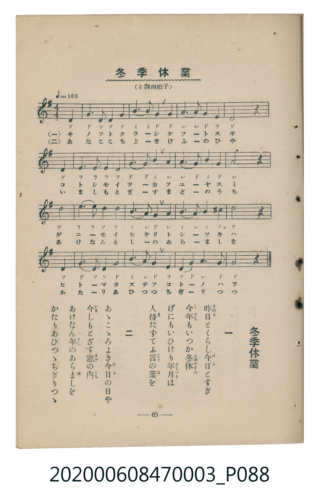

# 冬季休業

<audio controls src="toki_kyugyo.mp3"></audio>

- 臺灣教育會公認《新定兒童唱歌》尋常科第三學年用（2020.006.0847.0003）

## 說明

Reference Materials 23: 冬季休業 (Tōki Kyūgyō / Winter Vacation)
Source: 臺灣教育會公認 新定兒童唱歌 尋常科第三學年用 (1934), p. 65 (P088.jpg)
Key: G major (?= G), 4/4 (<4/4>), Quarter = 100 (!= 100)

## 歌詞

```text
一、昨日とくらし今日とすぎ
今年もいつか冬休
げにもいひけり年月は
人待たずてふ言の葉を
二、あゝこゝろよき今日の日や
今しもとざす窓の内
あけなん年のあらましを
かたりあひつゝちぎりつゝ
```

## ABC

```abc
X:1
T:冬季休業
M:4/4
L:1/16
Q:1/4=100
K:G
V:V1 name="Piano" snm="Pia"
[V:V1]
D4 G6 D2 D4 | G4 B6 B2 G4 | G4 A6 A2 G4 | E4 D8 z4 |
D4 E6 E2 E4 | D4 G6 G2 B4 | A4 A6 G2 B4 | G4 A8 z4 |
D4 E6 E2 D4 | D4 B6 A2 G4 | A4 B6 A2 B4 | ^c4 d8 z4 |
D4 G6 D2 D4 | G4 B6 A2 G4 | E4 D6 G2 A4 | G4 G8 z4 |
D4 G6 D2 D4 | G4 B6 B2 G4 | G4 A6 A2 G4 | E4 D8 z4 |
D4 E6 E2 E4 | D4 G6 G2 B4 | A4 A6 G2 B4 | G4 A8 z4 |
D4 E6 E2 D4 | D4 B6 A2 G4 | A4 B6 A2 B4 | ^c4 d8 z4 |
D4 G6 D2 D4 | G4 B6 A2 G4 | E4 D6 G2 A4 | G4 G8 z4 |
```

## TMD 檔案連結

- [主旋律 TMD 檔案](toki_kyugyo.tmd) [[在 TMD Studio 編輯](https://tmdlang.github.io/Tmd-TS/#tmd=s7IKdvYPcrWy4tLSUnjatubp2sVP9kx8tnStgpYWl6KtgqGBAZe9rYI7l42JvokdV52C0ov2Xc8bFz-bOvNF06Znc5qftq55sar3cUPXs2kbnq6b9bR10vPVS59O2fhsbc_jhu6nG7qf7tjxfPnE52vWPNnR-XTtjqc7tzyfsuL9ng4jAyMDPQMDMz0DCxNzIMPA-P2eTiUuLn0tLgUthaDUtNSi1LzkVAXfxJLUoszEnGIFI2MrVCdqhBztzc5U8K48ujq98mivgr5CeGYeULVCWGJyYklmfp4myKjg_NKi5FQrBawOV8B0tgIuRytoGFoam2jqKBToKZiZKmgEGFhY6GUVpINt8U6ttFJwV8hNzMovUtAABRlQITDMFDTAIQfkBJYmFoEcBw5UBQ1I4IL0grT7VBZlJhdbgZhPdjQ8bmh8NmPFs-lLHzeueNzY_7ip83Hj9Ce7u2AiMx839oGUPm4AKm0ASgAd-Lip6XFjy-PGJY8bu4GhBAwihIrHjZMeN66Gqdj0uHHi4yaQnmdzOh43rkcyadeup_taHzfOf9w463HjsseNW1-sAGpe92Ji5-OmSWDH7QJGa-PjxqbHTXMfN04GkU29j5uAxvTC3LcORDa1oLgP6Hyw7UC3TwM6__mqyUB1T9takZ0IlJ74uHHV46bJIN80rgNbAvT4PrBmsO0wpd0gJzYBTQXqAfpmCdgxC4GBAhYEcYGq9bm4wlKLilOtAjIT8_IdagxqFKq5FIDAxkLLDszQ11Iw1DWxUgA6HmzfVuTgBooCnQMRAoU3yECQphoF03gFXQVDINYFMcG8GjDfGCxmDGZDRIzAIkZQETOQUrB6EDQAicHcYaprAXIHMFiA1kHCChqXQNGtj5vagCEKdsd-NHeAzQRTYBaK6wzBLqoBuwLiEpgIwm1o7rDUNTQCOQRLegGKgt0GchUwvNbjdAg0RMAUJEhgAQCyEiYCcYiJOihIsLnE0FjX0AzkFKD1QHuBqQCRKuEhBYy09cC0QXTcYIsJQ7CzIKogOmEuqeXi0rVTACciBWSGMhcXAA)]
- [鋼琴伴奏 TMD 檔案](toki_kyugyo_piano.tmd) [[在 TMD Studio 編輯](https://tmdlang.github.io/Tmd-TS/#tmd=s7IKdvYPcrWy4tLSUnjatubp2sVP9kx8tnTt-z0dL7v3PJ-w5cmeLU-X9j_v7Hi_p1NBS4tL0VbB0MCAy95WwZ3LxkTfxI6rTkHpRfuu542Ln02d-aJp07M5zU9b17xY1fu4oevZtA1P18162jrp-eqlT6dsfLa253FD99MN3U937Hi-fOLzNWue7Oh8unbH051bnk9ZAbTSyMDIQM_AwEzPwMLEHMgwMAbaqsTFpa_FpaClEJSallqUmpecquCbWJJalJmYU6xgZGyF4m4FjZCjvdmZCt6VR1enVx7tVdBXCM_MA6pWCEtMTizJzM_TVNBVCMhMzMtXcExOzs8tSMzLzE3NKwFZEJxfWpScaqWA1TsKmJ5RwOUVBQ1DS2MTTR2FAj0FM1MFjQADCwu9rIJ0TaAt-lxcYalFxalWYEcEeTjUGNQoVHMpAIGNhZYdmFGjYBoPdKYhEOuCmGBeDZhvDBYzBrMhIkZgESOoiBlIKVg9CBqAxJCNBEuDKTALxSJDsOE1YAMhhsJEENbgNRLqTDAFcSfMVSDNMBGIkSbqIHfiMhO3z7H50xBsPkQVRCfMyFqUwPbBEdiGIGOiDWNB2hFMQuKm8SCeaTyyjAkSD6wK2WcQbSYgOag6MBu3PVCzsVmE6QT8NhHwEbLhKBJGRNhDfMBhBA_UZEwd8OjTtVMAx6ACMkOZiwsA)]

## 分析

```text
================================================================================
📊 TMD Song Profile: [ 冬季休業 ]
================================================================================
⏱  Duration:       1:16 (76.8s), 32 measures total
🎼 Key & Tempo:    首調基準 G, != 100.0 BPM, <4/4>
   - 分析範圍：      由實際發聲的音符與和弦推測調性；播放脈絡另行呈現
🎤 人聲音域:    D4 (MIDI 62) – D5 (MIDI 74) [跨度: 12 個半音 / 1.0 個八度, 難度: easy]
   - 最低音:  D4 in [Verse #1 @ m.1, 0:00]
   - 最高音: D5 in [Verse #1 @ m.12, 0:27]
   - 適合: soprano, mezzo-soprano, contralto, tenor, baritone, bass
🏛  結構:      Verse (38.4s) -> Verse (38.4s)
⚡ 編曲密度:        Peak 1 軌道同時演奏
🗝  調性診斷：       G 大調（純淨自然大調，未偵測到可信轉調）
   - 風格氣質:    純淨自然大調（陽光明朗、易唱易記，無明顯調外色彩）
   - 轉調歷程:    全曲維持單一推測調性（未偵測到可信轉調）
   - 核心骨幹音:  G, D, A, B, E
   - 調性數值:    G 大調 [相關度: 0.89, 穩定度: Moderate, 自然音純度: 98.3%]
   - 候選調性 (K-S): G 大調 (0.89), D 大調 (0.77), B 小調 (0.58)
   - 五度圈歷程:   +1 -> +1
   - 各段落調性細節:
     • [Verse #1]: G 大調 (r: 0.89, 自然音純度: 98.3%, 調外音: C#)
     • [Verse #2]: G 大調 (r: 0.89, 自然音純度: 98.3%, 調外音: C#)

  [ 五度圈游移軌跡 ]
               C  
         F           [G ]*
      Bb               D  
      Eb               A  
         Ab           E  
            Db       B  
               F# 
     (* = active key center)

  [ 十二半音累積音高分佈 ]
     C  :                            0.0%
     C# : █                          1.7%
     D  : ██████████████████████    25.8%
     D# :                            0.0%
     E  : ██████████                11.7%
     F  :                            0.0%
     F# :                            0.0%
     G  : ████████████████████████  28.3%
     G# :                            0.0%
     A  : ██████████████            16.7%
     A# :                            0.0%
     B  : █████████████             15.8%
--------------------------------------------------------------------------------
Assignment 軌道音域：
  - Piano         : D4 – D5 (12 個半音 / 1.0 個八度, 112 個音符)
================================================================================
```


## 原書掃描頁




