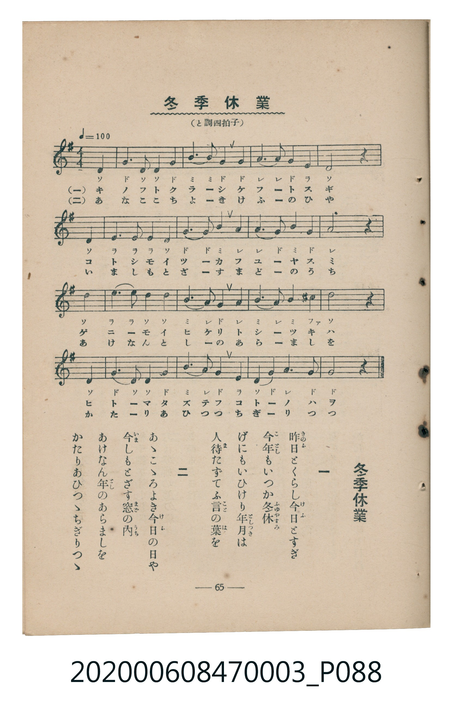

# 冬季休業

> Re:Shōka 使用 AI 協助辨識與重建樂譜，可能會有錯誤。歡迎回報。

- **鋼琴伴奏版**：<br><audio controls src="toki_kyugyo.mp3"></audio>
- **NEUTRINO 歌聲合成版**：<br><audio controls src="toki_kyugyo_neutrino.mp3"></audio>

- 臺灣教育會公認《新定兒童唱歌》尋常科第三學年用（2020.006.0847.0003）

## 說明

Reference Materials 23: 冬季休業 (Tōki Kyūgyō / Winter Vacation)
Source: 臺灣教育會公認 新定兒童唱歌 尋常科第三學年用 (1934), p. 65 (P088.jpg)
Key: G major (?= G), 4/4 (<4/4>), Quarter = 100 (!= 100)


## 歌詞

```text
一、昨日とくらし今日とすぎ
今年もいつか冬休
げにもいひけり年月は
人待たずてふ言の葉を
二、あゝこゝろよき今日の日や（譜下作「あなこゝちよきけふのひや」）
今しもとざす窓の内
あけなん年のあらましを
かたりあひつゝちぎりつゝ
```

## ABC

```abc
X:1
T:冬季休業
M:4/4
L:1/16
Q:1/4=100
K:G
V:V1 name="Piano" snm="Pia"
[V:V1]
z4 z4 z4 D4 | G6 D2 D4 G4 | B6 B2 G4 G4 | A6 A2 G4 E4 |
w: 1.~き | の ふ と く | ら _ し け | ふ _ と す
w: 2.~あ | な こ こ ち | よ _ き け | ふ _ の ひ
D8 z4 D4 | E6 E2 E4 D4 | G6 G2 B4 A4 | A6 G2 B4 G4 |
w: 1.~ぎ こ | と し も い | つ _ か ふ | ゆ _ や す
w: 2.~や い | ま し も と | ざ _ す ま | ど _ の う
A8 z4 d4 | e6 e2 d4 d4 | B6 A2 G4 A4 | B6 A2 B4 ^c4 |
w: 1.~み げ | に _ も い | ひ け り と | し _ つ き
w: 2.~ち あ | け な ん と | し _ の あ | ら _ ま し
d8 z4 D4 | G6 D2 D4 G4 | B6 A2 G4 E4 | D4 G4 A6 G2 |
w: 1.~は ひ | と _ ま た | ず て ふ こ | と _ の は
w: 2.~を か | た _ り あ | ひ つ つ ち | ぎ _ り つ
G8 z4 z4 |
w: 1.~を
w: 2.~つ
```

## TMD 檔案連結

- [主旋律 TMD 檔案](toki_kyugyo.tmd) [[在 TMD Studio 編輯](https://tmdlang.github.io/Tmd-TS/#tmd=s7IKdvYPcrWy4qpTUCpJTLdSSM7PyUlNLsnMz7MqzsjMK0nNjM_KTMmPL87Iz05Ugisry88pzU21Si9KTEmNN443MjAyiDcwMIs3sDAxBzIMjBFKi_NLi5JTrYqTM_Lzc-JLUitKkvLzsxHyBUX5Zal5iXlANQVFIBtTwIoQClLLMlNSQdKpKZkl-UWZiTlI7kgtKga7FWxJfElRYl5xclFmAcgDCFUlGalAx0JdkJOZloqQApqXnplnVZKYCfQhyJflifG5iZl5OYl5KUpcWloKT9vWPF27-Mmeic-WrlXQ0uJStFUwNDDgsrdVcOeyMdE3sQMZ9aJ91_PGxc-mznzRtOnZnOanrWterOp93ND1bNqGp-tmPW2d9Hz10qdTNj5b2_O4ofvphu6nO3Y8Xz7x-Zo1T3Z0Pl274-nOLc-nrHi_pwMUjnrAcNQDhSOQYWD8fk-nEheXvhaXgpZCUGpaahEoJBR8E0tSQQFRrGBkbIXqRI2Qo73ZmQrelUdXp1ce7VXQVwgHBWqRQlhiciIoWDRBRgVDIkUBq8MVMJ2tgMvRChqGlsYmmjoKBXoKZqYKGgEGFhZ6WQXpYFu8UyutFNwVchOz8osUNEBBBlQIDDMFDXDIATmBpYlFIMeBA1VBAxK4IL0g7T6VRZnJxVYg5pMdDY8bGp_NWPFs-tLHjSseN_Y_bup83Dj9ye4umMjMx419IKWPG4BKG4ASQAc-bmp63NjyuHHJ48ZuYCgBgwih4nHjpMeNq2EqNj1unPi4CaTn2ZyOx43rkUzatevpvtbHjfMfN8563LjscePWFyuAmte9mNj5uGkS2HG7gNHa-Lix6XHT3MeNk0FkU-_jJqAxvTD3rQORTS3AKH6xds6THd1P9s553NAD0tK4CqqlcSFEC8ghjVuBWkCOamp53NALTAMoHgP6G-xsoKenAf39fNVkoOqnba3IfgNKA41Z9bhpMigYQIYBXQcMsX1gzWBnw5R2g_zWBDQVqAcYDEugjmnsAwuCuEDV-lxcYcC8lmoVkJmYl-9Qo2tYU82lAAQ2Flp2YIY-MK_s2fhi6_Zn3b0KGsBkYgJkaFopAL0ETIRA00GGgBTWKBgo6MKxaTyQqAFL-BjWKIB4MAzSCZczQpdrgssBbTbUNQHZBPQmMORAyQNoC8i_zXuA_gVKTATxgXIgPiitgLl9ChrAsNdEuMsQaCTYRWBHgXg1CsZgMWMwDyJiBBYxAvPMwK6HqAdBLD4CugosBbQeiFeAWf1gXUAHQrWBHAkiJ0LEgSph4hD1M6HifVBxSAhMRgkdYGxD9UyGygFjEWpPB9w8UIhiswfkRmD0Q9W3oNgD4sFD2lTXAhTSwECEJMIWsEFLwCHbDTYSZEAbiA9MvNCQ3g8K6UlIIQ0ON3DwgVmQIIOGvyE4zEGhDAtriAhy6ENDGi2gQYEFCUyg0xBOB7kP7tFuaFRAPNoGEwd7GRHQ-1ECYBJaQO_DsAdkM0hmGtwekEkQlSDxlWgBDbIXJA6KIIQ9KEnaUtfQCBTSq8FBCQ9paEEFthPEnw4OeWAB1wvmrgeF9CbkkIYENDiswOEFTdGQ9AsJZZgIiDZRBwuBlOJM0KvhoYYayqDkA0leIBcihwsoeUPkQDEBzdhg5yL7H5z8kMIZlExB4quA5kESNKZ5kPAEhxxKhgKFPEQdSBwUgwh7QGkAUXQY6xqaQZI0KCSBBeR8sBXQwh6cl8CJCywNLGHWQ00kotjALCRggQ5iwXQiCkPMxIzwynyo12dBRZdBkzG0HEDRAStxYE5FeB4pKsFBDDIVEpWQCIMGJDwql8CjDFqWwMsgiA6IGuQshrCllotL104BXG0oABnKXAA)]
- [鋼琴伴奏 TMD 檔案](toki_kyugyo_piano.tmd) [[在 TMD Studio 編輯](https://tmdlang.github.io/Tmd-TS/#tmd=s7IKdvYPcrWy4tLSUnjatubp2sVP9kx8tnTt-z0dL7v3PJ-w5cmeLU-X9j_v7Hi_p1NBS4tL0VbB0MCAy95WwZ3LxkTfxI6rTkHpRfuu542Ln02d-aJp07M5zU9b17xY1fu4oevZtA1P18162jrp-eqlT6dsfLa253FD99MN3U937Hi-fOLzNWue7Oh8unbH051bnk9ZAbTSyMDIQM_AwEzPwMLEHMgwMAbaqsTFpa_FpaClEJSallqUmpecquCbWJJalJmYU6xgZGyF4m4FjZCjvdmZCt6VR1enVx7tVdBXCM_MA6pWCEtMTizJzM_TVNBVCMhMzMtXcExOzs8tSMzLzE3NKwFZEJxfWpScaqWA1TsKmJ5RwOUVBQ1DS2MTTR2FAj0FM1MFjQADCwu9rIJ0TaAt-lxcYalFxalWYEcEeTjU6BrWVHMpAIGNhZYdmFGjYAB0JQybxgOJGrCEj2GNAogHw48bexFyRuhyTXC5GgVDIBtsFNg0EK9GwRgsZgzmQUSMwCJGYJ4Z2FqIehDE4pTHjevAUo8btwLxCjCrH6zrcVMnVNvjxulgciJEHKgSJg5RPxMq3gcVhzh9Moq3HjeuguqZDJV73LgQak8H3DxQUGCzB-TGx42boOpbUOwB8WBBBPYw2N9gFsSv0IAzBAcWKHhggQQRQQ42aBChhRDIl5BQeNwEihConUB6CdyF3dAwhLiwDSYOdisihPajuHwSWgjtw7AHZDNIZhrcHpBJEJUg8ZVoIQSyFyQOClmEPciJyAwSQGA_gv0JTUKQBAMJHZgIiDZRBwuBlOJMQavhvkUNHVB8QeLzcVMXin9A6QkiBwpBaBYA0utR3A2Ob6TwAaULkPgqoHmQFIRpHiQcwD5GScGgEIOoA4mDQh5hDyjuCGcyzCwFCzEQC6YTkecxUxDCHfOh7p4FFV0GTTvQXIOiA5Y_12O4HCkewOEDMhUSD5DQhoYCPB6WwMMbmvPgORaiA6IGOV0jbKlFKfN8cJR5hiDF0Yax4CAEsREBgUUSLIAijsQEhTGYZxoPlzEBi6DJYFoEURZtApaGcCCKMO2CiWPahdUV2OwCW4WhDZdFxghxM4jJRhANRnitITbsUEMIyWaoyZg6ILYAo1fXTgEcw9E-IEk4B-Q8OwVlLgA)]

## 分析

```text
================================================================================
📊 TMD Song Profile: [ 冬季休業 ]
================================================================================
⏱  Duration:       0:38 (38.4s), 16 measures total
🎼 Key & Tempo:    首調基準 G, != 100.0 BPM, <4/4>
   - 分析範圍：      由實際發聲的音符與和弦推測調性；播放脈絡另行呈現
🎤 人聲音域:    D4 (MIDI 62) – E5 (MIDI 76) [跨度: 14 個半音 / 1.2 個八度, 難度: moderate]
   - 最低音:  D4 in [Verse #1 @ m.1, 0:01]
   - 最高音: E5 in [Verse #1 @ m.10, 0:21]
   - 適合: soprano, mezzo-soprano, contralto, tenor, baritone, bass
🏛  結構:      Verse (38.4s)
⚡ 編曲密度:        Peak 1 軌道同時演奏
🗝  調性診斷：       G 大調（純淨自然大調，未偵測到可信轉調）
   - 風格氣質:    純淨自然大調（陽光明朗、易唱易記，無明顯調外色彩）
   - 轉調歷程:    全曲維持單一推測調性（未偵測到可信轉調）
   - 核心骨幹音:  G, D, A, B, E
   - 調性數值:    G 大調 [相關度: 0.88, 穩定度: Moderate, 自然音純度: 98.3%]
   - 候選調性 (K-S): G 大調 (0.88), D 大調 (0.77), B 小調 (0.57)
   - 五度圈歷程:   +1
   - 各段落調性細節:
     • [Verse #1]: G 大調 (r: 0.86, 自然音純度: 98.3%, 調外音: C#)

  [ 五度圈游移軌跡 ]
               C  
         F           [G ]*
      Bb               D  
      Eb               A  
         Ab           E  
            Db       B  
               F# 
     (* = active key center)

  [ 十二半音累積音高分佈 ]
     C  :                            0.0%
     C# : █                          1.7%
     D  : █████████████████████     25.0%
     D# :                            0.0%
     E  : ██████████                11.7%
     F  :                            0.0%
     F# :                            0.0%
     G  : ████████████████████████  28.3%
     G# :                            0.0%
     A  : ███████████████           17.5%
     A# :                            0.0%
     B  : █████████████             15.8%
--------------------------------------------------------------------------------
Assignment 軌道音域：
  - Piano         : D4 – E5 (14 個半音 / 1.2 個八度, 56 個音符)
================================================================================
```


## 原書掃描頁




