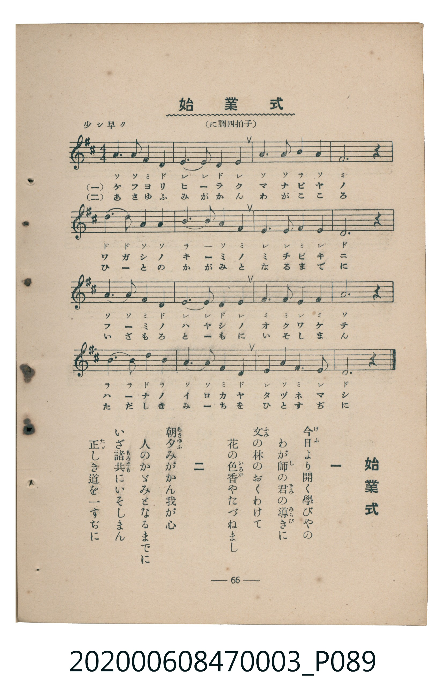

# 始業式

> Re:Shōka 使用 AI 協助辨識與重建樂譜，可能會有錯誤。歡迎回報。

- **鋼琴伴奏版**：<br><audio controls src="shigyoshiki.mp3"></audio>
- **NEUTRINO 歌聲合成版**：<br><audio controls src="shigyoshiki_neutrino.mp3"></audio>

- 臺灣教育會公認《新定兒童唱歌》尋常科第三學年用（2020.006.0847.0003）

## 說明

Reference Materials 24: 始業式 (Shigyōshiki / Opening Ceremony)
Source: 臺灣教育會公認 新定兒童唱歌 尋常科第三學年用 (1934), p. 66 (P089.jpg)
Key: D major (?= D), 4/4 (<4/4>), 少シ早ク Quarter = 108 (!= 108)


## 歌詞

```text
一、今日より開く學びやの
わが師の君の導きに
文の林のおくわけて
花の色香やたづねまし
二、朝夕みがかん我が心
人のかゞみとなるまでに
いざ諸共にいそしまん
正しき道を一すぢに
```

## ABC

<div class="abc-score" data-abc-src="shigyoshiki.abc" aria-label="五線譜載入中"></div>

[下載 ABC 原始檔](shigyoshiki.abc)

## TMD 檔案連結

- [主旋律 TMD 檔案](shigyoshiki.tmd) [[在 TMD Studio 編輯](https://tmdlang.github.io/Tmd-TS/#tmd=s7IKdvYPcrWy4qpTUCpJTLdSSM7PyUlNLsnMz7MqzsjMK0nNjM_KTMmPL87Iz05Ugisry88pzU21Si9KTEmNN443MjAyiDcwMIs3sDAxBzIMjBFKi_NLi5JTrYqTM_Lzc-JLUitKkvLzsxHyBUX5Zal5iXlANQVFIBtTwIoQClLLMlNSQdKpKZkl-UWZiTlI7kgtKga7FWxJfElRYl5xclFmAcgDCFUlGalAx0JdkJOZlooulZxalJqbn4diNNCm9Mw8q5LETKDfQf4vT4zPTczMy0nMS1Hi0tJSeLq8-9nStU_39CtoaXEp2ioYGlhw2dsquHDZmOib2IHMedG-63nj4mdTZ75o2vRsTvPT1jUvVvU-buh6Nm3D03WznrZOer566dMpG5-t7Xnc0P10Q_fTHTueL5_4fM2aJzs6n67d8XTnludTVrzf0wEKXj1g8OqBghfIMDB-v6dTiYtLX4tLQUshKDUN6HxgACn4JpakgsKnWMHIxArJfRrBGZnplUd7gTGanamgr-BfkJqXmZeu4AzxdqUmyJhgSDwpYHW0AqaTFXA5WEHD0NLYRFNHoUBPwcxMQSPAwMJSL6sgHWyLd2qllYKLQm5iVn6RggYouIAKgeGloAEONSDn6YaJj5u2P5u-8nHTeoXA0sQioJ8UwKGroAEJZZBBILN8Kosyk4utQMwnOxoeNzQ-2d31bPrSx00dj5u6Xk7rftzYD3TU48bNj5taHjeuA6l73ABU1_C4qf9xY8_THauBok8nzAaRG_oeN_Y-blyNUPRsWjtQ4tm86UDycWMX0DCwtomPG5chFL3o2giUftG56eWymWBb5j9uXPq4ce3jxn2PG6eDXbYLGLmNz-bMfbpk6uPG_UB7Hzd2P26a_KwDaFLP0_3NCMOe7NoFtgsoPQ-sdMXjxlWPm4D-ABq2HMVxjxuBdk17sXrH01agA4D-AHLnAm0EKW2ajOSJtYvBor0vGyc_bpoECqbGmY8bF0EM0-fiCgNmoFSrgMzEvHyHGoOaai4FILCx0LIDM_S1FAx1gUkJ7O2tkIB93LjpcVMnMDiAokB3rYKHL8g8kKYaBVMFXSA0VTAGkoZAXKNgBBYxAvNAbIQaMzAJEgGpBkEDKF0DNs3HsAZkPVgE6AYFoCNArKYusB6gY6CqgW4Cq-iHiu-D6lgFxJvB8i1QmXVQHfGo9hiB5JqguqYC1bdBbYTo2g-V6QHibrB5kyEyTSAbYTIgMQgJkunFahMwUE11LYCBCk6F4OgBRjow8QFjfB3IpseNC0GBCk6PiEA1jAObAaRAwQUJMlDgQYJRFxx8iIAG8SABDQpyGAQFLVKwojh9OpgFChyQd2FOh3gcIQ4LhoWwYAWrBMmsRrIH5GHkYIVHUuMKFNOASbsHzSKQApDUKohoUzc0LoE5AK9FwFC11DU0AqXVrZCgfNy4HpwwQeELFEXJwaSlVUjKNAbzIMEM0YU1UMEpBlvQrYf6qAUjsEFpGZJ2IVECSe8gmWV4AhWUnkFqpwF1gdItJL2BZEBhCLELLA4OMWQdc-EuAIUsKCGAUizWMDU01jU0AwXqenBWBwZqC9AecBkF8gdKcYcIVEi6NIOkWRAHdzhDRAgmVWjoQXI0cthB_QT0OyxfwvL5fKj6pUC8Ftm3YL_jClWYrgXwMIKFKiTpQxI_yJ5JUHFI4gaFOrBsBbMWQWUwU2otF5eunQK40FUAMpS5AA)]
- [鋼琴伴奏 TMD 檔案](shigyoshiki_piano.tmd) [[在 TMD Studio 編輯](https://tmdlang.github.io/Tmd-TS/#tmd=s7IKdvYPcrWy4tLSUni6vPvZ0rVP9_S_39PxsnvP8wlbnuzZ8nRp__POjvd7OhW0tLgUbRUMDSy47G0VXLhsTPRN7LjqFJRetO963rj42dSZL5o2PZvT_LR1zYtVvY8bup5N2_B03aynrZOer176dMrGZ2t7Hjd0P93Q_XTHjufLJz5fs-bJjs6na3c83bnl-ZQVQCuNDIwM9AwMzPQMLEzMgQwDY6CtSlxc-lpcCloKQalpqUWpecmpCr6JJalFmYk5xQpGJlYIRytoBGdkplce7S3OyMzOVNBX8C9IzcvMS1dwBurLzc-r1FTQVQjITMzLV3BMTs7PLUjMy8xNzSsBGR6cX1qUnGqlgNUrCpgeUcDlDQUNQ0tjE00dhQI9BTMzBY0AAwtLvayCdE2gLfpcXGGpRcWpVmBHBHk41BjUVHMpAIGNhZYdmFGjYAp0pC6QNAaShkBco2AEFjEC80BshBozMAkSAakGQQMoXQM2zcewRuFx40SwyOPGrQqPmzpArKYusJ7HjZugqh83dYJV9EPF90F1rALizWD5FqjMOqiOeFR7jEByTVBdU4Hq26A2QnTth8r0AHE32LzJEJkmkI0wGZAYhATJ9GK1qUbBMA7MBVIgn0N8DwoHSIjogkMCEWYgHiTMQKEHg6BQQgohFFdMB7NA_gS5HOYKiB8Q4jAfLYSFEFglSGY1kj0gtyOHEDy8G1egmNYNshrVIpACkNQqiGhTNzRaHjcux2sRcQkIklyMwTxIgEF0YQ0ecDRiC4T1ULe1YAQbKIFBEhQkcCGJECSzDE_wgBIZSO00oC5QYoIkApAMKDQgdoHFwX5H1jEX7gJQGIGiFJSMsIUOJKmYQZIRiIM7wCAiBFMPNBgg-QU5EKCOA3oCluphuWg-VP1SIF6L7GywJ3AFD0zXArhnYcEDSY2Q9AiyZxJUHJLeQMH3uHEmmLUIKoOZeGpRCicf7IWTIUhttGEsKKQQTGAQxoN5pvEIGbP4XCxyUI4JRArdOETI4rbKBGEAbiegcMizB4uXsBgHVYXbDchWITkdiUmkE4jyEjASde0UwPEY7QOShHOMwBxlLgA)]

## 分析

```text
================================================================================
📊 TMD Song Profile: [ 始業式 ]
================================================================================
⏱  Duration:       0:35 (35.6s), 16 measures total
🎼 Key & Tempo:    首調基準 D, != 108.0 BPM, <4/4>
   - 分析範圍：      由實際發聲的音符與和弦推測調性；播放脈絡另行呈現
🎤 人聲音域:    D4 (MIDI 62) – D5 (MIDI 74) [跨度: 12 個半音 / 1.0 個八度, 難度: easy]
   - 最低音:  D4 in [Verse #1 @ m.1, 0:01]
   - 最高音: D5 in [Verse #1 @ m.5, 0:08]
   - 適合: soprano, mezzo-soprano, contralto, tenor, baritone, bass
🏛  結構:      Verse (35.6s)
⚡ 編曲密度:        Peak 1 軌道同時演奏
🗝  調性診斷：       D 調性不明確（純淨自然大調，未偵測到可信轉調）
   - 風格氣質:    純淨自然大調（陽光明朗、易唱易記，無明顯調外色彩）
   - 轉調歷程:    全曲維持單一推測調性（未偵測到可信轉調）
   - 核心骨幹音:  A, D, E, F#, B
   - 調性數值:    D 調性不明確 [相關度: 0.83, 穩定度: Ambiguous, 自然音純度: 100.0%]
   - 候選調性 (K-S): D 大調 (0.83), A 大調 (0.81), F# 小調 (0.62)
   - 五度圈歷程:   +2
   - 各段落調性細節:
     • [Verse #1]: D 調性不明確 (r: 0.83, 自然音純度: 100.0%)

  [ 五度圈游移軌跡 ]
               C  
         F            G  
      Bb              [D ]*
      Eb               A  
         Ab           E  
            Db       B  
               F# 
     (* = active key center)

  [ 十二半音累積音高分佈 ]
     C  :                            0.0%
     C# :                            0.0%
     D  : ██████████████████████    23.7%
     D# :                            0.0%
     E  : ███████████████████       21.2%
     F  :                            0.0%
     F# : █████████████████         18.6%
     G  :                            0.0%
     G# :                            0.0%
     A  : ████████████████████████  26.3%
     A# :                            0.0%
     B  : █████████                 10.2%
--------------------------------------------------------------------------------
Assignment 軌道音域：
  - Piano         : D4 – D5 (12 個半音 / 1.0 個八度, 51 個音符)
================================================================================
```


## 原書掃描頁




