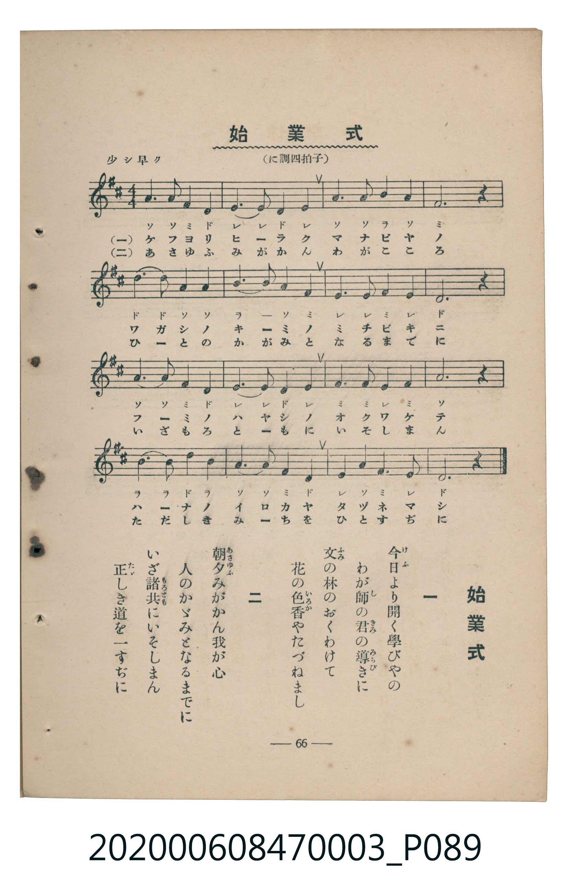

# 始業式

> Re:Shōka 使用 AI 協助辨識與重建樂譜，可能會有錯誤。歡迎[回報](https://github.com/TMDLang/reshoka/issues)。

- **鋼琴伴奏版**：<br><audio controls src="shigyoshiki.mp3"></audio>
- **NEUTRINO 歌聲合成版**：<br><audio controls src="shigyoshiki_neutrino.mp3"></audio>

- 臺灣教育會公認《新定兒童唱歌》尋常科第三學年用（2020.006.0847.0003）

## 說明

Reference Materials 24: 始業式 (Shigyōshiki / Opening Ceremony)
Source: 臺灣教育會公認 新定兒童唱歌 尋常科第三學年用 (1934), p. 66 (P089.jpg)
Key: D major (?= D), 4/4 (<4/4>), 少シ早ク Quarter = 108 (!= 108)


## 歌詞

```text
一、今日より開く學びやの
わが師の君の導きに
文の林のおくわけて
花の色香やたづねまし
二、朝夕みがかん我が心
人のかゞみとなるまでに
いざ諸共にいそしまん
正しき道を一すぢに
```

## ABC

<div class="abc-score" data-abc-src="shigyoshiki.abc" aria-label="五線譜載入中"></div>

[下載 ABC 原始檔](shigyoshiki.abc)

## TMD 檔案連結

- [主旋律 TMD 檔案](shigyoshiki.tmd) [[在 TMD Studio 編輯](https://tmdlang.github.io/Tmd-TS/#tmd=s7IKdvYPcrWy4qpTUCpJTLdSSM7PyUlNLsnMz7MqzsjMK0nNjM_KTMmPL87Iz05Ugisry88pzU21Si9KTEmNN443MjAyiDcwMIs3sDAxBzIMjBFKi_NLi5JTrYqTM_Lzc-JLUitKkvLzsxHyBUX5Zal5iXlANQVFIBtTwIoQClLLMlNSQdKpKZkl-UWZiTlI7kgtKga7FWxJfElRYl5xclFmAcgDCFUlGalAx0JdkJOZlooulZxalJqbn4diNNCm9Mw8q5LETKDfQf4vT4zPTczMy0nMS0FWVZKRDwyGgoxKq4zMYpD7khNz4rMT85BCC-q6gsT0VKsAAwtLJS4tLYWny7ufLV37dE-_gpYWl6KtgqGBBZe9rYILl42JvokdSO-L9l3PGxc_mzrzRdOmZ3Oan7auebGq93FD17NpG56um_W0ddLz1UufTtn4bG3P44bupxu6n-7Y8Xz5xOdr1jzZ0fl07Y6nO7c8n7Li_Z4OUOzoAWNHDxQ7QIaB8fs9nUpcXPpaXApaCkGpaUDfA8NXwTexJBUUvMUKRiZWSO7TCM7ITK882gtMENmZCvoK_gWpeZl56QrOkFCr1AQZEwyJZgWsjlbAdLICLgcraBhaGpto6igU6CmYmSlogAJML6sgHWyLd2qllYKLQm5iVn6RggYouIAKgeGloAEONSDn6YaJj5u2P5u-8nHTeoXA0sQioJ8UwKGroAEJZZBBILN8KoFxVWwFYj7Z0fC4ofHJ7q5n05c-bup43NT1clr348Z-oKMeN25-3NTyuHEdSN3jBqC6hsdN_Y8be57uWA0UfTphNojc0Pe4sfdx42qEomfT2oESz-ZNB5KPG7uAhoG1TXzcuAyh6EXXRqD0i85NL5fNBNsy_3Hj0seNax837nvcOB3ssl3AyG18Nmfu0yVTHzfuB9r7uLH7cdPkZx1Ak3qe7m9GGPZk1y6wXUDpeWClKx43rnrcBPQH0LDlKI573Ai0a9qL1TuetgIdAPQHkDsXaCNIadNkJE-sXQwW7X3ZOPlx0yRQMDXOfNy4CGKYPhdXGDD_AdN0ZmJevkONQU01lwIQ2Fho2YEZ-loKhrrApAT29lZIwD5u3PS4qRMYHEBRoLtWwcMXZB5IU42CqYIuEJoqGANJQyCuUTACixiBeSA2Qo0ZmASJgFSDoAGUrgGb5mNYA7IeLAJ0gwLQESBWUxdYD9AxUNVAN4FV9EPF90F1rALizWD5FqjMOqiOeFR7jEByTVBdU4Hq26A2QnTth8r0AHE32LzJEJkmkI0wGZAYhATJ9GK1CRioproWwEAFp0Jw9AAjHZj4gDG-DmTT48aFoEAFp0dEoBrGgc0AUqDgggQZKPAgwagLDj5EQIN4kIAGBTkMgoIWKVhRnD4dzAIFDsi7MKdDPI4QhwXDQliwglWCZFYj2QPyMHKwwiOpcQWKacCk3YNmEUgBSGoVRLSpGxqXwByA1yJgqFrqGhqB0upWSFA-blwPTpig8AWKouRg0tIqJGUag3mQYIbowhqo4BSDLejWQ33UghHYoLQMSbuQKIGkd5DMMjyBCkrPILXTgLpA6RaS3kAyoDCE2AUWB4cYso65cBeAQhaUEEApFmuYGhrrGpqBAnU9OKsDA7UFaA-4jAL5A6W4QwQqJF2aQdIsiIM7nCEiBJMqNPQgORo57KB-Avodli9h-Xw-VP1SIF6L7Fuw33GFKkzXAngYwUIVkvQhiR9kzySoOCRxg0IdWLaCWYugMpgptZaLS9dOAVzoKgAZylwA)]
- [鋼琴伴奏 TMD 檔案](shigyoshiki_piano.tmd) [[在 TMD Studio 編輯](https://tmdlang.github.io/Tmd-TS/#tmd=s7IKdvYPcrWy4qpTUCpJTLdSyC8qychPL0osyKi0ysgsLskvykxOzInPTsxLVIIrKs4vLUpOjS9ITE-1CjCwsFTi0tJSeLq8-9nStU_39L_f0_Gye8_zCVue7NnydGn_886O93s6FbS0uBRtFQwNLLjsbRVcuGxM9E3sQAa-aN_1vHHxs6kzXzRtejan-Wnrmhereh83dD2btuHpullPWyc9X7306ZSNz9b2PG7ofrqh--mOHc-XT3y-Zs2THZ1P1-54unPL8ykrgFYaGRgZ6BkYmOkZWJiYAxkGxkBblbi49LW4FLQUglLTUotS85JTFXwTS1KLMhNzihWMTKwQjlbQCM7ITK882luckZmdqaCv4F-QmpeZl67gDNSXm59XqamgqxCQmZiXr-CYnJyfW5CYl5mbmlcCMjwYHBxWCli9ooDpEQVc3lDQMLQ0NtHUUSjQUzAzU9AAha1eVkG6JtAWfS6usNSiYmCAgxwR5OFQY1BTzaUABDYWWnZgRo2CKdCRukDSGEgaAnGNghFYxAjMA7ERaszAJEgEpBoEDaB0Ddg0H8MahceNE8Eijxu3Kjxu6gCxmrrAeh43boKqftzUCVbRDxXfB9WxCog3g-VboDLroDriUe0xAsk1QXVNBapvg9oI0bUfKtMDxN1g8yZDZJpANsJkQGIQEiTTi9WmGgXDODAXSIF8DvE9KBwgIaILDglEmIF4kDADhR4MgkIJKYRQXDEdzAL5E-RymCsgfkCIw3y0EBZCYJUgmdVI9oDcjhxC8PBuXIFiWjfIalSLQApAUqsgok3d0Gh53Lgcr0XEJSBIcjEG8yABBtGFNXjA0YgtENZD3daCEWygBAZJUJDAhSRCkMwyPMEDSmQgtdOAukCJCZIIQDKg0IDYBRYH-x1Zx1y4C0BhBIpSUDLCFjqQpGIGSUYgDu4Ag4gQTD3QYIDkF-RAgDoO6AlYqoflovlQ9bOAeC2ys8GewBU8MF0L4J6FBQ8kNULSI8ieSVBxSHoDBd_jxplg1gyoDGbiqUUpnHyQCycTeOFkGK8QbRgLo4BBFw9kmcZDRMzic1HEwAwTkBBCmwEiH6MZZQJRjGk0nEGcOShOQtEGlsE0G2EU1AlQCo_ROJ0EDERdOwVwOEb7AIURHCMwR5kLAA)]

## 分析

```text
================================================================================
📊 TMD Song Profile: [ 始業式 ]
================================================================================
⏱  Duration:       0:35 (35.6s), 16 measures total
🎼 Key & Tempo:    首調基準 D, != 108.0 BPM, <4/4>
   - 分析範圍：      由實際發聲的音符與和弦推測調性；播放脈絡另行呈現
🎤 人聲音域:    D4 (MIDI 62) – D5 (MIDI 74) [跨度: 12 個半音 / 1.0 個八度, 難度: easy]
   - 最低音:  D4 in [Verse #1 @ m.1, 0:01]
   - 最高音: D5 in [Verse #1 @ m.5, 0:08]
   - 適合: soprano, mezzo-soprano, contralto, tenor, baritone, bass
🏛  結構:      Verse (35.6s)
⚡ 編曲密度:        Peak 1 軌道同時演奏
🗝  調性診斷：       D 調性不明確（純淨自然大調，未偵測到可信轉調）
   - 風格氣質:    純淨自然大調（陽光明朗、易唱易記，無明顯調外色彩）
   - 轉調歷程:    全曲維持單一推測調性（未偵測到可信轉調）
   - 核心骨幹音:  A, D, E, F#, B
   - 調性數值:    D 調性不明確 [相關度: 0.83, 穩定度: Ambiguous, 自然音純度: 100.0%]
   - 候選調性 (K-S): D 大調 (0.83), A 大調 (0.81), F# 小調 (0.62)
   - 五度圈歷程:   +2
   - 各段落調性細節:
     • [Verse #1]: D 調性不明確 (r: 0.83, 自然音純度: 100.0%)

  [ 五度圈游移軌跡 ]
               C  
         F            G  
      Bb              [D ]*
      Eb               A  
         Ab           E  
            Db       B  
               F# 
     (* = active key center)

  [ 十二半音累積音高分佈 ]
     C  :                            0.0%
     C# :                            0.0%
     D  : ██████████████████████    23.7%
     D# :                            0.0%
     E  : ███████████████████       21.2%
     F  :                            0.0%
     F# : █████████████████         18.6%
     G  :                            0.0%
     G# :                            0.0%
     A  : ████████████████████████  26.3%
     A# :                            0.0%
     B  : █████████                 10.2%
--------------------------------------------------------------------------------
Assignment 軌道音域：
  - Piano         : D4 – D5 (12 個半音 / 1.0 個八度, 51 個音符)
================================================================================
```


## 原書掃描頁




