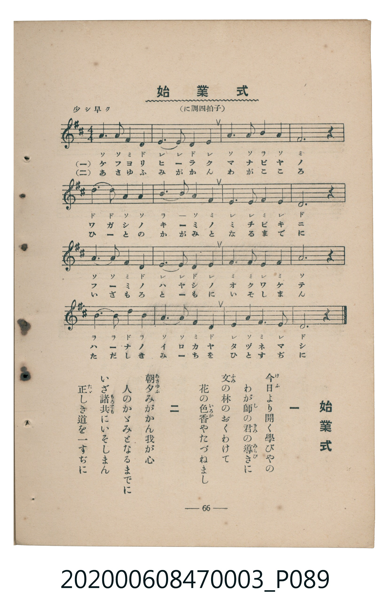

# 始業式

> Re:Shoka 使用 AI 協助辨識與重建樂譜，可能會有錯誤。歡迎回報。

<audio controls src="shigyoshiki.mp3"></audio>

- 臺灣教育會公認《新定兒童唱歌》尋常科第三學年用（2020.006.0847.0003）

## 說明

Reference Materials 24: 始業式 (Shigyōshiki / Opening Ceremony)
Source: 臺灣教育會公認 新定兒童唱歌 尋常科第三學年用 (1934), p. 66 (P089.jpg)
Key: D major (?= D), 4/4 (<4/4>), 少シ早ク Quarter = 108 (!= 108)

## 歌詞

```text
一、今日より開く學びやの
わが師の君の導きに
文の林のおくわけて
花の色香やたづねまし
二、朝夕みがかん我が心
人のかゞみとなるまでに
いざ諸共にいそしまん
正しき道を一すぢに
```

## ABC

```abc
X:1
T:始業式
M:4/4
L:1/16
Q:1/4=108
K:D
V:V1 name="Piano" snm="Pia"
[V:V1]
A6 A2 F4 D4 | E6 E2 D4 B,4 | E4 A6 A2 B4 | A4 F8 z4 |
d6 d2 A4 A4 | B8 A4 F4 | E6 E2 F4 E4 | D12 z4 |
A6 A2 F4 D4 | E6 E2 D4 E4 | F6 F2 E4 F4 | A12 z4 |
B6 B2 d4 B4 | A6 A2 F4 D4 | E6 A2 F4 E4 | D12 z4 |
```

## TMD 檔案連結

- [主旋律 TMD 檔案](shigyoshiki.tmd) [[在 TMD Studio 編輯](https://tmdlang.github.io/Tmd-TS/#tmd=s7IKdvYPcrWy4qpTUCpJTLdSSM7PyUlNLsnMz7MqzsjMK0nNjM_KTMmPL87Iz05Ugisry88pzU21Si9KTEmNN443MjAyiDcwMIs3sDAxBzIMjBFKi_NLi5JTrYqTM_Lzc-JLUitKkvLzsxHyBUX5Zal5iXlANQVFIBtTwIoQClLLMlNSQdKpKZkl-UWZiTlI7kgtKga7FWxJfElRYl5xclFmAcgDCFUlGalAx0JdkJOZlooulZxalJqbnwc2WktL4eny7mdL1z7d06-gpcWlaKtgaGDBZW-r4MJlY6JvYgfS-6J91_PGxc-mznzRtOnZnOanrWterOp93ND1bNqGp-tmPW2d9Hz10qdTNj5b2_O4ofvphu6nO3Y8Xz7x-Zo1T3Z0Pl274-nOLc-nrHi_pwMUcHrAgNMDBRyQYWD8fk-nEheXvhaXgpZCUGoa0GFAryv4JpakgnxerGBkYoXkPo3gjMz0yqO9wLjKzlTQV_AvSM3LzEtXcIZ4qFITZEwwJAYUsDpaAdPJCrgcrKBhaGlsoqmjUKCnYGamoBFgYGGpl1WQDrbFO7XSSsFFITcxK79IQQMUXECFwPBS0ACHGpDzdMPEx03bn01f-bhpvUJgaWIR0E8K4NBV0ICEMsggkFk-lUWZycVWIOaTHQ2PGxqf7O56Nn3p46aOx01dL6d1P27sBzrqcePmx00tjxvXgdQ9bgCqa3jc1P-4sefpjtVA0acTZoPIDX2PG3sfN65GKHo2rR0o8WzedCD5uLELaBhY28THjcsQil50bQRKv-jc9HLZTLAt8x83Ln3cuPZx477HjdPBLtsFjNzGZ3PmPl0y9XHjfqC9jxu7HzdNftYBNKnn6f5mhGFPdu0C2wWUngdWuuJx46rHTUB_AA1bjuK4x41Au6a9WL3jaSvQAUB_ALlzgTaClDZNRvLE2sVg0d6XjZMfN00CBVPjzMeNiyCG6XNxhQGzRqpVQGZiXr5DjUGNQjWXAhDYWGjZgRn6WgqGusC0BPb3VkjIPm7c9LipExgeQFGgw1bBAxhkIEhTjYKpgi4QmioYA0lDIK5RMAKLGIF5ZvFwIZhCM7AIiAfSAoIGIBGYG0x1LYBuAMca2DvAQAJGFjCE1gHdAKQWgtwAjj-EGwzjwOYAKZCxIFwDtgZiIcQihLtAPBAbqA-qBsMRlrqGRqCQ2Aqx-XHjerC3Qc4BiqIkEGJDAmIjxMvGYB7EVRBdWNxgaKxraAZyxHpwwAMd0fK4CehvYJJpAYqipD6EIyDeNoMECSKosbkLIoIrJGq5uHTtFMBpRgHIUObiAgA)]
- [鋼琴伴奏 TMD 檔案](shigyoshiki_piano.tmd) [[在 TMD Studio 編輯](https://tmdlang.github.io/Tmd-TS/#tmd=s7IKdvYPcrWy4tLSUni6vPvZ0rVP9_S_39PxsnvP8wlbnuzZ8nRp__POjvd7OhW0tLgUbRUMDSy47G0VXLhsTPRN7LjqFJRetO963rj42dSZL5o2PZvT_LR1zYtVvY8bup5N2_B03aynrZOer176dMrGZ2t7Hjd0P93Q_XTHjufLJz5fs-bJjs6na3c83bnl-ZQVQCuNDIwM9AwMzPQMLEzMgQwDY6CtSlxc-lpcCloKQalpqUWpecmpCr6JJalFmYk5xQpGJlYIRytoBGdkplce7S3OyMzOVNBX8C9IzcvMS1dwBurLzc-r1FTQVQjITMzLV3BMTs7PLUjMy8xNzSsBGR6cX1qUnGqlgNUrCpgeUcDlDQUNQ0tjE00dhQI9BTMzBY0AAwtLvayCdE2gLfpcXGGpRcWpVmBHBHk41BjUKFRzKQCBjYWWHZhRo2AKdKUukDQGkoZAXKNgBBYxAvPM4uFCMIVmYBEQD6QFBA1AIlDjDOPAQkAKpAKEa8A6IHohehBWgHggNlAfVA26efidB9ELcYcxmAcxH6IL0zSIS8wgrkR4BJsFEBFcjqtFCVsfHGFrCAq9aMNYkNEIJtDOeDDPNB4hYxafi0UOyjGBSKEbhxLuOKwyQRiA2wkoHPLsweIlLMZBVeF2A7JVSE5HYhLpBKK8BIxFXTsFcEQqIDOUubgA)]

## 分析

```text
================================================================================
📊 TMD Song Profile: [ 始業式 ]
================================================================================
⏱  Duration:       0:35 (35.6s), 16 measures total
🎼 Key & Tempo:    首調基準 D, != 108.0 BPM, <4/4>
   - 分析範圍：      由實際發聲的音符與和弦推測調性；播放脈絡另行呈現
🎤 人聲音域:    B3 (MIDI 59) – D5 (MIDI 74) [跨度: 15 個半音 / 1.2 個八度, 難度: moderate]
   - 最低音:  B3 in [Verse #1 @ m.2, 0:03]
   - 最高音: D5 in [Verse #1 @ m.5, 0:08]
   - 適合: soprano, mezzo-soprano, contralto, tenor, baritone, bass
🏛  結構:      Verse (35.6s)
⚡ 編曲密度:        Peak 1 軌道同時演奏
🗝  調性診斷：       D 調性不明確（純淨自然大調，未偵測到可信轉調）
   - 風格氣質:    純淨自然大調（陽光明朗、易唱易記，無明顯調外色彩）
   - 轉調歷程:    全曲維持單一推測調性（未偵測到可信轉調）
   - 核心骨幹音:  A, D, E, F#, B
   - 調性數值:    D 調性不明確 [相關度: 0.83, 穩定度: Ambiguous, 自然音純度: 100.0%]
   - 候選調性 (K-S): D 大調 (0.83), A 大調 (0.81), F# 小調 (0.61)
   - 五度圈歷程:   +2
   - 各段落調性細節:
     • [Verse #1]: D 調性不明確 (r: 0.83, 自然音純度: 100.0%)

  [ 五度圈游移軌跡 ]
               C  
         F            G  
      Bb              [D ]*
      Eb               A  
         Ab           E  
            Db       B  
               F# 
     (* = active key center)

  [ 十二半音累積音高分佈 ]
     C  :                            0.0%
     C# :                            0.0%
     D  : ██████████████████████    23.3%
     D# :                            0.0%
     E  : ███████████████████       20.8%
     F  :                            0.0%
     F# : █████████████████         18.3%
     G  :                            0.0%
     G# :                            0.0%
     A  : ████████████████████████  25.8%
     A# :                            0.0%
     B  : ███████████               11.7%
--------------------------------------------------------------------------------
Assignment 軌道音域：
  - Piano         : B3 – D5 (15 個半音 / 1.2 個八度, 52 個音符)
================================================================================
```


## 原書掃描頁




