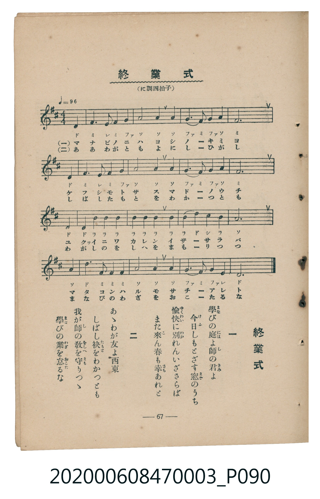

# 終業式

<audio controls src="shugyoshiki.mp3"></audio>

- 臺灣教育會公認《新定兒童唱歌》尋常科第三學年用（2020.006.0847.0003）

## 說明

Reference Materials 25: 終業式 (Shūgyōshiki / Closing Ceremony)
Source: 臺灣教育會公認 新定兒童唱歌 尋常科第三學年用 (1934), p. 67 (P090.jpg)
Key: D major (?= D), 4/4 (<4/4>), Quarter = 96 (!= 96)

## 歌詞

```text
一、學びの庭よ師の君よ
今日しもとざす窓のうち
愉快に別れんいざさらば
また來ん春も幸あれと
二、あゝわが友よ西東
しばし袂をわかつとも
我が師の教を守りつゝ
學びの業を怠るな
```

## ABC

```abc
X:1
T:終業式
C:TMD (Chen, Chih-Han / aguai)
M:4/4
L:1/16
Q:1/4=96
K:D
V:V1 name="Piano" snm="Pia"
[V:V1]
D4 F6 E2 F2 G2 | A8 A4 A4 | G6 F2 G4 A4 | F12 z4 |
D4 F6 E2 F2 G2 | A8 A4 A4 | G6 F2 G4 A4 | F12 z4 |
d4 d2 B2 B4 B4 | B4 B4 B4 B4 | B6 d2 c4 B4 | A12 z4 |
A4 d6 F2 F2 F2 | A8 A4 A4 | G6 F2 G4 E4 | D12 z4 |
D4 F6 E2 F2 G2 | A8 A4 A4 | G6 F2 G4 A4 | F12 z4 |
D4 F6 E2 F2 G2 | A8 A4 A4 | G6 F2 G4 A4 | F12 z4 |
d4 d2 B2 B4 B4 | B4 B4 B4 B4 | B6 d2 c4 B4 | A12 z4 |
A4 d6 F2 F2 F2 | A8 A4 A4 | G6 F2 G4 E4 | D12 z4 |
```

## TMD 檔案連結

- [主旋律 TMD 檔案](shugyoshiki.tmd)
- [鋼琴伴奏 TMD 檔案](shugyoshiki_piano.tmd)

## 分析

```text
================================================================================
📊 TMD Song Profile: [ 終業式 ]
================================================================================
⏱  Duration:       1:20 (80.0s), 32 measures total
🎼 Key & Tempo:    首調基準 D, != 96.0 BPM, <4/4>
   - 分析範圍：      由實際發聲的音符與和弦推測調性；播放脈絡另行呈現
🎤 人聲音域:    D4 (MIDI 62) – D5 (MIDI 74) [跨度: 12 個半音 / 1.0 個八度, 難度: easy]
   - 最低音:  D4 in [Verse #1 @ m.1, 0:00]
   - 最高音: D5 in [Verse #1 @ m.9, 0:20]
   - 適合: soprano, mezzo-soprano, contralto, tenor, baritone, bass
🏛  結構:      Verse (40.0s) -> Verse (40.0s)
⚡ 編曲密度:        Peak 1 軌道同時演奏
🗝  調性診斷：       D 大調（純淨自然大調，未偵測到可信轉調）
   - 風格氣質:    純淨自然大調（陽光明朗、易唱易記，無明顯調外色彩）
   - 轉調歷程:    全曲維持單一推測調性（未偵測到可信轉調）
   - 核心骨幹音:  A, F#, B, D, G
   - 調性數值:    D 大調 [相關度: 0.81, 穩定度: Moderate, 自然音純度: 100.0%]
   - 候選調性 (K-S): D 大調 (0.81), F# 小調 (0.68), A 大調 (0.59)
   - 五度圈歷程:   +2 -> +2
   - 各段落調性細節:
     • [Verse #1]: D 大調 (r: 0.81, 自然音純度: 100.0%)
     • [Verse #2]: D 大調 (r: 0.81, 自然音純度: 100.0%)

  [ 五度圈游移軌跡 ]
               C  
         F            G  
      Bb              [D ]*
      Eb               A  
         Ab           E  
            Db       B  
               F# 
     (* = active key center)

  [ 十二半音累積音高分佈 ]
     C  :                            0.0%
     C# : █                          1.7%
     D  : ███████████               14.2%
     D# :                            0.0%
     E  : ███                        3.3%
     F  :                            0.0%
     F# : █████████████████         21.7%
     G  : ███████████               14.2%
     G# :                            0.0%
     A  : ████████████████████████  30.0%
     A# :                            0.0%
     B  : ████████████              15.0%
--------------------------------------------------------------------------------
Assignment 軌道音域：
  - Piano         : D4 – D5 (12 個半音 / 1.0 個八度, 106 個音符)
================================================================================
```


## 原書掃描頁




