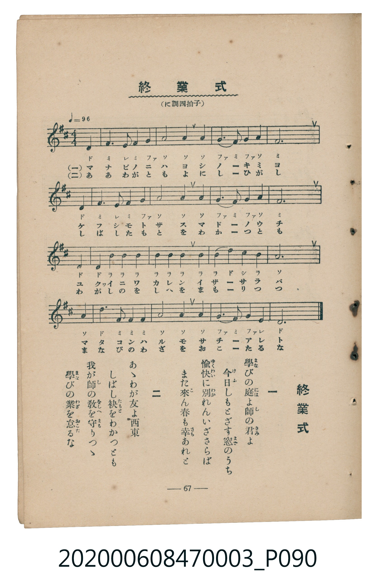

# 終業式

> Re:Shōka 使用 AI 協助辨識與重建樂譜，可能會有錯誤。歡迎[回報](https://github.com/TMDLang/reshoka/issues)。

- **鋼琴伴奏版**：<br><audio controls src="shugyoshiki.mp3"></audio>
- **NEUTRINO 歌聲合成版**：<br><audio controls src="shugyoshiki_neutrino.mp3"></audio>

- 臺灣教育會公認《新定兒童唱歌》尋常科第三學年用（2020.006.0847.0003）

## 說明

Reference Materials 25: 終業式 (Shūgyōshiki / Closing Ceremony)
Source: 臺灣教育會公認 新定兒童唱歌 尋常科第三學年用 (1934), p. 67 (P090.jpg)
Key: D major (?= D), 4/4 (<4/4>), Quarter = 96 (!= 96)


## 歌詞

```text
一、學びの庭よ師の君よ
今日しもとざす窓のうち
愉快に別れんいざさらば
また來ん春も幸あれと
二、あゝわが友よ西東
しばし袂をわかつとも
我が師の教を守りつゝ
學びの業を怠るな
```

## ABC

<div class="abc-score" data-abc-src="shugyoshiki.abc" aria-label="五線譜載入中"></div>

[下載 ABC 原始檔](shugyoshiki.abc)

## TMD 檔案連結

- [主旋律 TMD 檔案](shugyoshiki.tmd) [[在 TMD Studio 編輯](https://tmdlang.github.io/Tmd-TS/#tmd=s7IKdvYPcrWy4qpTUCpJTLdSSM7PyUlNLsnMz7MqzsjMK0nNjM_KTMmPL87Iz05Ugisry88pzU21Si9KTEmNN443MjAyiDcwMIs3sDAxBzIMjBFKi_NLi5JTrYqTM_Lzc-JLUitKkvLzsxHyBUX5Zal5iXlANQVFIBtTwIoQClLLMlNSQdKpKZkl-UWZiTlI7kgtKga7FWxJfElRYl5xclFmAcgDCFUlGalAx0JdkJOZlooulZxalJqbn4diNNCm9Mw8q5LETKDfQf4vT4zPTczMy0nMS0FWVZKRDwyGgoxKq4zMYpD7khNz4rMT85BCC-q6gsT0VKsAA0sDJS4tLYXnW5ueLV37dE-_gpYWl6KtgqUZl72tgguXjYm-iR1I64v2Xc8bFz-bOvNF06Znc5qftq55sar3cUPXs2kbnq6b9bR10vPVS59O2fhsbc_jhu6nG7qf7tjxfPnE52vWPNnR-XTtjqc7tzyfsuL9ng5Q5OgBI0cPFDlAhoHx-z2dSlxc-lpcCloKQalpQM8Dg1fBN7EkFRS6xQpGplZIztMIzji6Or3yaC8wQWRnKugrOOfkF2fmpSs4Q0KtUhNkTjAkmhWwuloB080KuFysoGFoaWyiqaNQoKdgZq6gAQowvayCdLAt3qmVVgouCrmJWflFChqg8AIqBAaYggY42ICcwNLEIqA_FEABqqABDleQTpBmn0pg5BRbgZhPdjQ8bmgE2vm4cfPjxnVPd6193NTxdMdqEHvCbCAbpOhxA1BRw5PdXc-mL33cOP1xU9PjxhWPG6c9bpz5fNVkoNLHjW2PGxcilD5r6Xy6H2jG6qcdSx839TxuAipqAWuY-rip83HjBoTSx437HjfOf7KvDajo2Qyg6qanO4GOaQJpa1wBduIuYLw2goXmPm7qf9zY87S_G-iyF0v3P5u7Edmk6UCTgeSLRUClk8BKux83LgG5takJyXEdE0FmgP0IjB6g0qfrOh43dYGUNs1FqIMHCjD6gYqeNSx43AQ0bxVQhT4XVxgwwwETcWZiXr5Dja5hTTWXAhDYWGjZgRn6WgpP92x8sXX7s-5eBQ1gzJoAGZpWCkDvAhMO0DMgQ0AKaxQMFHTh2BCIa8DiPoY1CvFAHgyDNMLljNDlmuByQIsNdU1AFq2CuB4YC0BLHjeuBwYZkJoO5qx73LzncWPv48b9IC5QQuNx40RNhJuMgebpKhiBaROQ2QqmYBFdMA3CNWBxXaAKEA0RgeiCQFSfAF0DFgU6CWQ7mLUarAfoMKgOkDNA4tOh4iBVED29YHI_RBysCgaBrkYJFUhIgMzqB7J7wCpWQPVBZBD2wOwH2QcxaxOYBOlCFofIgV0FC2FTXQtQCG-FZwawBlB-AMcTiLMSni2AXI3HTW00Dd2tcFdC_An3deM0uA9mgklwKgK5Dy4OiY02qPhCZF83gUWRQncDwp7G-WAV4JQHtQ-iZxKY7IeKd8PtWYLsLnhswGILKXQtdQ2NQMHb_7ipD1xurAYpABsGKUyArBZoiIOSMahMAXM3gJLxPqSABgWTGRKuQeEhRAzjgIQ5XAgWG7AYQQ5pkKPAHmkBk6BEhOpZoBPB5GS4KtRomAqW7YSKQwIUJoeaxWEJGJT0oNEEDlxY4nzcuAMR4LCIRUrmXfBgB-kA0dhsAhUYxrqGZqAQn_-4cTK4sF4PNgoY3E1gF4MTBjisQeUyNL4RoQwKPVBaBaVQECaUno3AIqDIgUFQ2YccyqC0BXImMKqhAQkqJcBugnsPks5BwYmcbiElACQSkNMlCILKSuTgxSiT4BEJjy5o4IKCEiQOcgtEDyT1g1yDMAnZllouLl07BXAtoQBkKHMBAA)]
- [鋼琴伴奏 TMD 檔案](shugyoshiki_piano.tmd) [[在 TMD Studio 編輯](https://tmdlang.github.io/Tmd-TS/#tmd=s7IKdvYPcrWy4qpTUCpJTLdSyC8qychPL0osyKi0ysgsLskvykxOzInPTsxLVIIrKs4vLUpOjS9ITE-1CjCwNFDi0tJSeL616dnStU_39L_f0_Gye8_zCVue7NnydGn_886O93s6FbS0uBRtFSzNuOxtFVy4bEz0TexA5r1o3_W8cfGzqTNfNG16Nqf5aeuaF6t6Hzd0PZu24em6WU9bJz1fvfTplI3P1vY8buh-uqH76Y4dz5dPfL5mzZMdnU_X7ni6c8vzKSuANhoZGBnoGRiY6RlYmJgDGQbGQEuVuLj0tbgUtBSCUtNSi1LzklMVfBNLUosyE3OKFYxMrRBuVtAIzji6Or3yaG9xRmZ2poK-gnNOfnFmXrqCM1Bjbn5epaaCrkJAZmJevoJjcnJ-bkFiXmZual4JyPRgcHBYKWD1iwKmTxRw-UNBw9DS2ERTR6FAT8HMXEEDFLZ6WQXpmkBb9Lm4wlKLioEBDnJEkIdDjUFNNZcCENhYaNmBGTUKBkBHwrAhENeAxX0MaxTigTwYfty4DyFnhC7XBJerUTAGsnUVjMC0CUhcwRQsogumQbgGLK4LVAGiISIQXRCI6orHjavAoo8bNwPxOjBrNVjP48b1UB2PmzrA4tOh4iBVED29YHI_RBysCgYfN05E8RHEFyCz-oHsHrCKFVB9EBmEPTD7QfZBzNoEJkG6kMUhcmBX0Sx0tsJtgbgT7urGaXAXzAST4BgE0ivh4pDQbIOKL0R2dRNYFCl0NiDsaZwPVgGOdah9ED2TwGQ_VLwbbs8SZHfBQxMW2ojQAfnNDAnXoPAQIoZxQMIcLgQLQlgwIgdP_-OmPrDtLWASFHOoLnzcBI7rpslwVahhNxUs2wkVh4QCTA41T8BSDSi-oWELDhFYinjcuAMRSrDYQEpbXfCwAukA0dhsAoYSyPegBAJKFiBMKBEZgUVAgQuDoMyOHEqgCAVZMxkeEKCsBXIePBKhiQsUHMiJBZJtIIGInBhAEFQ4IAcPRkaGRwQ8uKGBAwoKkDjILRA9kCQHcg3CJGRbalHKOh_kss4EXtYZxitEG8YqmMbHA0MAHpwQQSBlEo-qBkQDwxbEMo2HCoEYyHpoYg7QgGiTWDAGxiSEA6XAfKN4BWOoNSimYnMMxHIM10CNw-kWYHjq2imAgzTaByiM4BiBOcpcAA)]

## 分析

```text
================================================================================
📊 TMD Song Profile: [ 終業式 ]
================================================================================
⏱  Duration:       0:40 (40.0s), 16 measures total
🎼 Key & Tempo:    首調基準 D, != 96.0 BPM, <4/4>
   - 分析範圍：      由實際發聲的音符與和弦推測調性；播放脈絡另行呈現
🎤 人聲音域:    D4 (MIDI 62) – D5 (MIDI 74) [跨度: 12 個半音 / 1.0 個八度, 難度: easy]
   - 最低音:  D4 in [Verse #1 @ m.1, 0:01]
   - 最高音: D5 in [Verse #1 @ m.12, 0:28]
   - 適合: soprano, mezzo-soprano, contralto, tenor, baritone, bass
🏛  結構:      Verse (40.0s)
⚡ 編曲密度:        Peak 1 軌道同時演奏
🗝  調性診斷：       D 大調（純淨自然大調，未偵測到可信轉調）
   - 風格氣質:    純淨自然大調（陽光明朗、易唱易記，無明顯調外色彩）
   - 轉調歷程:    全曲維持單一推測調性（未偵測到可信轉調）
   - 核心骨幹音:  A, F#, D, G, B
   - 調性數值:    D 大調 [相關度: 0.82, 穩定度: Moderate, 自然音純度: 100.0%]
   - 候選調性 (K-S): D 大調 (0.82), F# 小調 (0.70), B 小調 (0.58)
   - 五度圈歷程:   +2
   - 各段落調性細節:
     • [Verse #1]: D 大調 (r: 0.74, 自然音純度: 100.0%)

  [ 五度圈游移軌跡 ]
               C  
         F            G  
      Bb              [D ]*
      Eb               A  
         Ab           E  
            Db       B  
               F# 
     (* = active key center)

  [ 十二半音累積音高分佈 ]
     C  :                            0.0%
     C# : █                          1.6%
     D  : █████████████             14.8%
     D# :                            0.0%
     E  : ███                        3.1%
     F  :                            0.0%
     F# : ████████████████████      23.4%
     G  : █████████████             14.8%
     G# :                            0.0%
     A  : ████████████████████████  28.1%
     A# :                            0.0%
     B  : ████████████              14.1%
--------------------------------------------------------------------------------
Assignment 軌道音域：
  - Piano         : D4 – D5 (12 個半音 / 1.0 個八度, 53 個音符)
================================================================================
```


## 原書掃描頁




