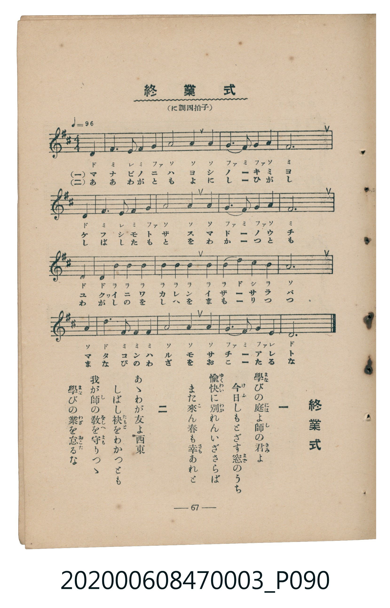

# 終業式

> Re:Shōka 使用 AI 協助辨識與重建樂譜，可能會有錯誤。歡迎回報。

<audio controls src="shugyoshiki.mp3"></audio>

- 臺灣教育會公認《新定兒童唱歌》尋常科第三學年用（2020.006.0847.0003）

## 說明

Reference Materials 25: 終業式 (Shūgyōshiki / Closing Ceremony)
Source: 臺灣教育會公認 新定兒童唱歌 尋常科第三學年用 (1934), p. 67 (P090.jpg)
Key: D major (?= D), 4/4 (<4/4>), Quarter = 96 (!= 96)

## 歌詞

```text
一、學びの庭よ師の君よ
今日しもとざす窓のうち
愉快に別れんいざさらば
また來ん春も幸あれと
二、あゝわが友よ西東
しばし袂をわかつとも
我が師の教を守りつゝ
學びの業を怠るな
```

## ABC

```abc
X:1
T:終業式
M:4/4
L:1/16
Q:1/4=96
K:D
V:V1 name="Piano" snm="Pia"
[V:V1]
z4 z4 z4 D4 | F6 E2 F4 G4 | A8 A4 A4 | G6 F2 G4 A4 |
w: 1.~ま | な び の に | は よ し | の _ き み
w: 2.~あ | あ わ が と | も よ に | し _ ひ が
F12 D4 | F6 E2 F4 G4 | A8 A4 A4 | G6 F2 G4 A4 |
w: 1.~よ け | ふ し も と | ざ す ま | ど _ の う
w: 2.~し し | ば し た も | と を わ | か _ つ と
F12 D4 | D4 B4 B4 B4 | B4 B4 B4 B4 | B4 d4 c4 B4 |
w: 1.~ち ゆ | くゎ い に わ | か れ ん い | ざ _ さ ら
w: 2.~も わ | が し の を | し へ を ま | も _ り つ
A12 A4 | d6 F2 F4 F4 | A8 A4 A4 | G6 F2 G4 E4 |
w: 1.~ば ま | た こ ん は | る も さ | ち _ あ れ
w: 2.~つ ま | な び の わ | ざ を お | こ _ た る
D12 z4 |
w: 1.~と
w: 2.~な
```

## TMD 檔案連結

- [主旋律 TMD 檔案](shugyoshiki.tmd) [[在 TMD Studio 編輯](https://tmdlang.github.io/Tmd-TS/#tmd=s7IKdvYPcrWy4qpTUCpJTLdSSM7PyUlNLsnMz7MqzsjMK0nNjM_KTMmPL87Iz05Ugisry88pzU21Si9KTEmNN443MjAyiDcwMIs3sDAxBzIMjBFKi_NLi5JTrYqTM_Lzc-JLUitKkvLzsxHyBUX5Zal5iXlANQVFIBtTwIoQClLLMlNSQdKpKZkl-UWZiTlI7kgtKga7FWxJfElRYl5xclFmAcgDCFUlGalAx0JdkJOZlooulZxalJqbnwc2WktL4fnWpmdL1z7d06-gpcWlaKtgacZlb6vgwmVjom9iB9L6on3X88bFz6bOfNG06dmc5qeta16s6n3c0PVs2oan62Y9bZ30fPXSp1M2Plvb87ih--mG7qc7djxfPvH5mjVPdnQ-Xbvj6c4tz6eseL-nAxRuesBw0wOFG5BhYPx-T6cSF5e-FpeClkJQahrQXUCfK_gmlqSCPF6sYGRqheQ8jeCMo6vTK4_2AuMqO1NBX8E5J784My9dwRnioUpNkDnBkBhQwOpqBUw3K-BysYKGoaWxiaaOQoGegpm5gkaAgaWBXlZBOtgW79RKKwUXhdzErPwiBQ1QeAEVAgNMQQMcbEBOYGliEdAfCqAAVdAAhytIJ0izT2VRZnKxFYj5ZEfD44ZGoJ2PGzc_blz3dNfax00dT3esBrEnzAayQYoeNwAVNTzZ3fVs-tLHjdMfNzU9blzxuHHa48aZz1dNBip93Nj2uHEhQumzls6n-4FmrH7asfRxU8_jJqCiFrCGqY-bOh83bkAofdy473Hj_Cf72oCKns0Aqm56uhPomCaQtsYVYCfuAsZrI1ho7uOm_seNPU_7u4Eue7F0_7O5G5FNmg40GUi-WARUOgmstPtx4xKQW5uakBzXMRFkBtiPwOgBKn26ruNxUxdIadNchDp4oACjH6joWcOCx01A81YBVehzcYUB80KqVUBmYl6-Q41BTTWXAhDYWGjZgRn6WgpP92x8sXX7s-5eBQ1gxJoAGZpWCkDfAtMN0C8gM0AKaxQMFHTh2BCIa8DiPoY1CvFAHgyDNMLljNDlmuByQIsNdU1AFq2COB4YCUBLHjeuB4YYkJoO5qx73LzncWPv48b9IC5QQuNx40RNhJuMgebpKhiBaROQ2QqmYBFdMA3CNWBxXaAKEA0RgeiCQFSfAF0DFgU6CWQ7mLUarAfoMKgOkDNA4tOh4iBVED29YHI_RBysCgaBrkYJFUhIgMzqB7J7wCpWQPVBZBD2wOwH2QcxaxOYBOlCFofIgV0FC2FTXQtQCG-F5wWwBlB2AMcTiLMSniuAXI3HTW00Dd2tcFdC_An3deM0uA9mgklwKgK5Dy4OiY02qPhCZF83gUWRQncDwp7G-WAV4JQHtQ-iZxKY7IeKd8PtWYLsLnhswGILKXQtdQ2NQMHb_7ipD1xsrAYpABsGKUuArBZoiIOSMahIAXM3gJLxPqSABgWTGRKuQeEhRAzjgIQ5XAgWG7AYQQ5pkKPAHmkBk6BEhOpZoBPB5GS4KtRomAqW7YSKQwIUJoeaxWEJGJT0oNEEDlxY4nzcuAMR4LCIRUrmXfBgB-kA0dhsAhUYxrqGZqAQn_-4cTK4rF4PNgoY3E1gF4MTBjisQcUyNL4RoQwKPVBaBaVQECaUno3AIqDIgUFQ2YccyqC0BXImMKqhAQkqJcBugnsPks5BwYmcbiElACQSkNMlCILKSuTgxSiT4BEJjy5o4IKCEiQOcgtEDyT1g1yDMAnZllouLl07BXAloQBkKHMBAA)]
- [鋼琴伴奏 TMD 檔案](shugyoshiki_piano.tmd) [[在 TMD Studio 編輯](https://tmdlang.github.io/Tmd-TS/#tmd=s7IKdvYPcrWy4tLSUni-tenZ0rVP9_S_39PxsnvP8wlbnuzZ8nRp__POjvd7OhW0tLgUbRUszbjsbRVcuGxM9E3suOoUlF6073reuPjZ1JkvmjY9m9P8tHXNi1W9jxu6nk3b8HTdrKetk56vXvp0ysZna3seN3Q_3dD9dMeO58snPl-z5smOzqdrdzzdueX5lBVAG40MjAz0DAzM9AwsTMyBDANjoKVKXFz6WlwKWgpBqWmpRal5yakKvoklqUWZiTnFCkamVgg3K2gEZxxdnV55tLc4IzM7U0FfwTknvzgzL13BGagxNz-vUlNBVyEgMzEvX8ExOTk_tyAxLzM3Na8EZHpwfmlRcqqVAla_KGD6RAGXPxQ0DC2NTTR1FAr0FMzMFTQCDCwN9LIK0jWBtuhzcYWlFhWnWoEdEeThUGNQU82lAAQ2Flp2YEaNggHQkTBsCMQ1YHEfwxqFeCAPhh837kPIGaHLNcHlahSMgWxdBSMwbQISVzAFi-iCaRCuAYvrAlWAaIgIRBcEorriceMqsOjjxs1AvA7MWg3W87hxPVTH46YOsPh0qDhIFURPL5jcDxEHq4LBx40TUXwE8QXIrH4guwesYgVUH0QGYQ_MfpB9ELM2gUmQLmRxiBzYVTQLna1wWyDuhLu6cRrcBTPBJDgGgfRKuDgkNNug4guRXd0EFkUKnQ0Iexrng1WAYx1qH0TPJDDZDxXvhtuzBNld8NCEhTYidEB-M0PCNSg8hIhhHJAwhwvBghAWjMjB0_-4qQ9sewuYBMUcqgsfN4HjumkyXBVq2E0Fy3ZCxSGhAJNDzROwVAOKb2jYgkMEliIeN-5AhBIsNpDSVhc8rEA6QDQ2m4ChBPI9KIGAkgUIE0pERmARUODCICizI4cSKEJB1kyGBwQoa4GcB49EaOICBQdyYoFkG0ggIicGEAQVDsjBg5GR4REBD25o4ICCAiQOcgtEDyTJgVyDMAnZllqUss4He1lnCFIbbRgLCqV4EBsRDiiSYKYJ2GBMPRA2MMwhPNN4JCkIB9OsAbMHbHi0CUgBhASmDIQQEhMqbgQijJGchcV2fJ6BORqnb5CsJMovwHjVtVMAR220D0gSzjECc5S5AA)]

## 分析

```text
================================================================================
📊 TMD Song Profile: [ 終業式 ]
================================================================================
⏱  Duration:       0:42 (42.5s), 17 measures total
🎼 Key & Tempo:    首調基準 D, != 96.0 BPM, <4/4>
   - 分析範圍：      由實際發聲的音符與和弦推測調性；播放脈絡另行呈現
🎤 人聲音域:    D4 (MIDI 62) – D5 (MIDI 74) [跨度: 12 個半音 / 1.0 個八度, 難度: easy]
   - 最低音:  D4 in [Verse #1 @ m.1, 0:01]
   - 最高音: D5 in [Verse #1 @ m.12, 0:28]
   - 適合: soprano, mezzo-soprano, contralto, tenor, baritone, bass
🏛  結構:      Verse (42.5s)
⚡ 編曲密度:        Peak 1 軌道同時演奏
🗝  調性診斷：       D 大調（純淨自然大調，未偵測到可信轉調）
   - 風格氣質:    純淨自然大調（陽光明朗、易唱易記，無明顯調外色彩）
   - 轉調歷程:    全曲維持單一推測調性（未偵測到可信轉調）
   - 核心骨幹音:  A, F#, D, G, B
   - 調性數值:    D 大調 [相關度: 0.82, 穩定度: Moderate, 自然音純度: 100.0%]
   - 候選調性 (K-S): D 大調 (0.82), F# 小調 (0.70), B 小調 (0.58)
   - 五度圈歷程:   +2
   - 各段落調性細節:
     • [Verse #1]: D 大調 (r: 0.82, 自然音純度: 100.0%)

  [ 五度圈游移軌跡 ]
               C  
         F            G  
      Bb              [D ]*
      Eb               A  
         Ab           E  
            Db       B  
               F# 
     (* = active key center)

  [ 十二半音累積音高分佈 ]
     C  :                            0.0%
     C# : █                          1.6%
     D  : █████████████             14.8%
     D# :                            0.0%
     E  : ███                        3.1%
     F  :                            0.0%
     F# : ████████████████████      23.4%
     G  : █████████████             14.8%
     G# :                            0.0%
     A  : ████████████████████████  28.1%
     A# :                            0.0%
     B  : ████████████              14.1%
--------------------------------------------------------------------------------
Assignment 軌道音域：
  - Piano         : D4 – D5 (12 個半音 / 1.0 個八度, 53 個音符)
================================================================================
```


## 原書掃描頁




