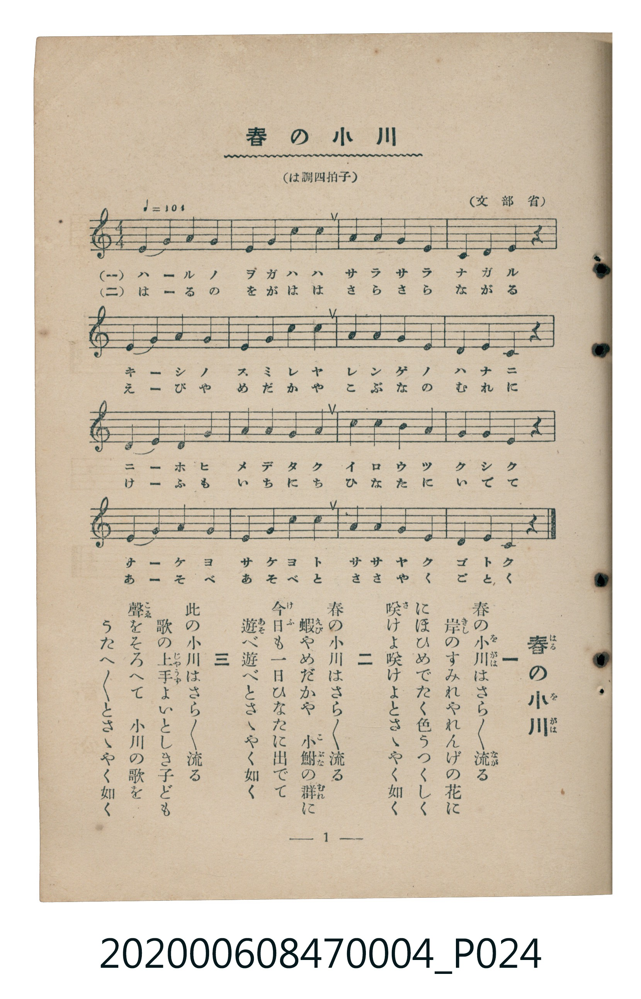

# 春の小川

> Re:Shōka 使用 AI 協助辨識與重建樂譜，可能會有錯誤。歡迎[回報](https://github.com/TMDLang/reshoka/issues)。

- **鋼琴伴奏版**：<br><audio controls src="haru_no_ogawa.mp3"></audio>
- **NEUTRINO 歌聲合成版**：<br><audio controls src="haru_no_ogawa_neutrino.mp3"></audio>

- 文部省唱歌
- 臺灣教育會公認《新定兒童唱歌》尋常科第四學年用（2020.006.0847.0004）

## 說明

原書資訊與歌詞全文（對應 P024.jpg，書頁 p. 1，第一學期第 1 首）：
調性與拍號：は調四拍子（C 大調 4/4 拍，♩=104，文部省）


## 歌詞

```text
一
春（はる）の小川（をがは）はさら／＼流（なが）る
岸（きし）のすみれやれんげの花（はな）に
にほひめでたく色（いろ）うつくしく
咲（さ）けよ咲けよとさゝやく如（ごと）く

二
春の小川はさら／＼流る
蝦（えび）やめだかや　小鮒（こぶな）の群（むれ）に
今日（けふ）も一日（いちにち）ひなたに出（い）でて
遊（あそ）べ遊べとさゝやく如く

三
此（こ）の小川はさら／＼流る
歌（うた）の上手（じゃうず）よいとしき子ども
聲（こゑ）をそろへて　小川の歌を
うたへ／＼とさゝやく如く
```

## ABC

<div class="abc-score" data-abc-src="haru_no_ogawa.abc" aria-label="五線譜載入中"></div>

[下載 ABC 原始檔](haru_no_ogawa.abc)

## TMD 檔案連結

- [主旋律 TMD 檔案](haru_no_ogawa.tmd) [[在 TMD Studio 編輯](https://tmdlang.github.io/Tmd-TS/#tmd=s7IKdvYPcrWy4qpTUCpJTLdSSM7PyUlNLsnMz7MqzsjMK0nNjM_KTMmPL87Iz05Ugisry88pzU21Si9KTEmNN4k3MjAyiDcwMIs3sDAxBzIMTBBKi_NLi5JTrYqTM_Lzc-JLUitKkvLzsxHyBUX5Zal5iXlANQVFIBtTwIoQClLLMlNSQdKpKZkl-UWZiTlI7kgtKga7FWxJfElRYl5xclFmAcgDCFUlGalAx-YllpQWpaKLFqcmFufnFSOEgTakZ-ZZ5ebnJZUCfY0sUZKRD_RxQUalVUZmMcgpyYk58dmJeUgBA3VIQWJ6qlWAgREwHLS0FJ7NWPq4cd3TDf1Pt89V0NLiUrRVMDQw4bK3VXDmsjHRN7EDaX82rf1l84rncxqfTtn4bG0P2MgX7bueNy5-NnXmi6ZNz-Y0P21d82JV7-OGrmfTNjxdN-tp66Tnq5dClD9u6H66ofvpjh3Pl098vmbN09mzn67d8XTnludTVrzf0wGKHz1g_OiB4gfIMDB5v6dTiYtLX0vBllqAS0FB4Wnf_Gezd7zY3P5iRdeLjnagu16snPe0dQXQb0BXPN3Q-6y9UwEULHpZBenv9_QAFb9c0KhQoKdgCOQB3f1kRwPQ3c_mzAeyFQwVXi6bBnTo-z2zQIa_WLX_WcNykLHdvS9mzgeKPm5cDxQE-hUo8nTtBKAVzgpPlywHiikAQ1UBKAo09dHMlbbA0AbZBgthoJlcIBOBtoEoYPQAtQINe9zUDZSCRxVIsGnS48YeoBRYfP3jxqmPm4Du6X-_Z8-zrUBzgLpWARWAZJu6wSGwaQdYtPdx43SIWY8bZz5u3P-4qedxUwuYnPy4EWjouhddG6G2Nq4Cq1wN0g-kHjfufty46XFT4-PG5Y8b5z9u7H_RuQmsFKgf6COg0rbHjUuA4kA7gCTY2kkQFVPB0hMfN3UARSCMx40rwM6eC7K_sf_psiawyilAcbDifkhQ7OqBBgXc-5j-hfrxxdxlYCOAaDPY50B3AR274HFjN4jd0ADU_3LdJLAaoGe3wTy47vm-JeAwbQCGA8LLT3Z3PZsOiYGJjxu3gk1sAkYNTBDo6oXgYFkI1gP0FjDIgcGy-mn7LogCsDgwrJaBjHvZ2AUWbXrcCIxBoMROoAiQxAwHuN93dIL9vhbsusbJyGkAZyAA0zZYNTAqgEkRpOHJjq5nncAEBBSc8bipGSw1C-wbiCeA1gOjC5RQHzeuBHoRHJSNkHib_LhpIlgpMGUAHQhMPTuA3oEEJdgV60B5vGkSJImA7ASqgDgJu7-A6ijP0lCgoKXPxeWRWFTql--fnlieaBWQmZiX71BjUFMNskfBxkTLDszAVpwoQHL1i4U9ChomCkDvPF_foAMvAzSxaADaBjVMA6hR00rhcXM_EO8B4tVA3KdQAyQ3KTxuWgOV6QeJNG0FslbCaZCaLqia1UDTkA3d1QMytHE9xNCmbiB7HdiISUBWD0QGiIEijVOBop1wGiSyCqIGqAtuaI2CsYKpghkQQ1iGcSBUA2SZAvlGQJYhkDRWMFCoAav3MQS5rl9BlwIfxcPMMgI5aj3ILLI9AjfLGCQ-GWQW0ByQKSA-whxdokzCnxJ29VCUEprWQiNtOyzcmnYCWfOBGBQuS8ChBGJtBsoAQxQatqAwBYZdM1KkIaeEDoihjSBNLWBDG4G8BUAMDFKICDBYgCUZ1LOQQG4AYlDgICUvwikBlA4MUVMC0E-g2CPXR6gpoQMce-R6BDUltIHNAroEog5WqgFZs4A6QDaBRFuAeAUQTwfiXrgNoHTbRER62NFJWckA9Be4ZJgNxOD02rwQiNuBtu8HYnDab1oCFAGmm6ZlQBoSKsD0DApvII01PUyEpgdgxgN6AuZJoMHAIALRIBFgVICDEBQ8q-FqlgPxMuT0AIpvI3B6MAOnCzNQaQBOFeZgNiRloJYM3eCSgVwfoaaHieA4JNcjWEqGJmDgQEuGuUBWL5DeAVaLXu5A0gwotQBNBsoQTAvAdhxlZQOonASVDRuB9ApYCQrlPW7ugIuA1AFDEBqWW8ByONNCEzQtAD3buBPsJaAIlAdK-NAiEVwcggIOXHQ3ToFmin7CZQMkXRjjKBu2gsOcXB-hpoUmcFog1yO4yoYdyPEMTgvEmVXLxaVrp4DUrFAAcpW5AA)]
- [鋼琴伴奏 TMD 檔案](haru_no_ogawa_piano.tmd) [[在 TMD Studio 編輯](https://tmdlang.github.io/Tmd-TS/#tmd=s7IKdvYPcrWy4qpTUCpJTLdSyC8qychPL0osyKi0ysgsLskvykxOzInPTsxLVIIrKs4vLUpOjS9ITE-1CjAwMlHi0tJSeDZj6ePGdU839D_dPvf9no6X3XueT9jyZM-Wp0v7n3d2vN_TqaClxaVoq2BoYMJlb6vgzGVjom9iBzLz2bT2l80rns9pfDpl47O1PWB7XrTvet64-NnUmS-aNj2b0_y0dc2LVb2PG7qeTdvwdN2sp62Tnq9eClH-uKH76Ybupzt2PF8-8fmaNU9nz366dsfTnVueT1kBdIaRgZGBnoGBmZ6BhYk5kGFgAnSJEheXR2JRqV--f3pieaJVQGZiXn6Qh0ONQU01lwIQ2Jho2YEZ-loKtuhAAWjJkx0NLxb2KGiYKAD9-3x9g44CKBj0sgrSNbFo0NKHGaYB1KhppfC4uR-I9wDxaiDuU6gBkpsUHjetgcr0g0SatgJZK-E0SE0XVM1qoGnIhu7qARnauB5iaFM3kL0ObMQkIKsHIgPEQJHGqUDRTjgNElkFUQPUBTe0RqE6N61WwVjBVMEMiGvALMM4EKoBskyBfCMgyxBIGisYKNSANfkYgpzYr6BLgbfiYWYZgVy2HmQW2b6Bm2UMEp8MMgtoDsgUEB9hji5RJuFPDrt6KEoOTWuhMbcdFm5NO4Gs-UAMCpcl4FACsTYDZYAhCg1bUJgCw64ZKeaQk0MHxNBGkKYWsKGNQN4CIAYGKUQEGCyPG7dBPQsJ5AYgBgUOUhqDxD--lABKB4aoKQHoJ1Dskesj1JTQAY49cj2CmhLawGYBXQJR1zjjcVMzSPRx4yygDpBNINEWIF4BxNOBuBduAyjdNhGRHnZ0UlY8AP0FLh5mAzE4vTYvBOJ2oO37gRic9puWAEWA6aZpGZCGhAowPYPCG0hjTQ8ToekBmPGAnoB5EmgwMIhANEgEGBXgIAQFz2q4muVAvAw5PYDi2wicHszA6cIMVBqAU4U5mA1JGaglQze4ZCDXR6jpYSI4Dsn1CLaSAZhZoCXDXCCrF0jvAKtFL3cgaQaUWoAmA2UIpgVgfURZ2QAqJ0Flw0YgvQJWgkJ5j5s74CIgdcAQhIblFrAczrTQBE0LQM827gR7CSgC5YESPrRIBBeHoIADF92NU6CZop9w2QBJF8Y4yoat4LKBXB-hpoUmcPyR6xFcZcMO5HgGpwXizKrF0rTwwdG0eLa18dmGLS861jyf1fK0o-3F8sVPJ_U83bMM0mhCqowLahUM4xVM44HhCCSAWQ2TYxoPpuBy8fAQx6ocu14oA0UzVAyuxgSkGUxQZjXYCIgIusXAMNS1U0AKxmgfw1gFdCEjTCFjsJAyFwA)]

## 分析

```text
================================================================================
📊 TMD Song Profile: [ 春の小川 ]
================================================================================
⏱  Duration:       0:36 (36.9s), 16 measures total
🎼 Key & Tempo:    首調基準 C, != 104.0 BPM, <4/4>
   - 分析範圍：      由實際發聲的音符與和弦推測調性；播放脈絡另行呈現
🎤 人聲音域:    C4 (MIDI 60) – C5 (MIDI 72) [跨度: 12 個半音 / 1.0 個八度, 難度: easy]
   - 最低音:  C4 in [HaruNoOgawa #1 @ m.4, 0:06]
   - 最高音: C5 in [HaruNoOgawa #1 @ m.2, 0:03]
   - 適合: soprano, mezzo-soprano, contralto, tenor, baritone, bass
🏛  結構:      HaruNoOgawa (36.9s)
⚡ 編曲密度:        Peak 1 軌道同時演奏
🗝  調性診斷：       C 調性不明確（純淨自然大調，未偵測到可信轉調）
   - 風格氣質:    純淨自然大調（陽光明朗、易唱易記，無明顯調外色彩）
   - 轉調歷程:    全曲維持單一推測調性（未偵測到可信轉調）
   - 核心骨幹音:  G, E, C, A, D
   - 調性數值:    C 調性不明確 [相關度: 0.80, 穩定度: Ambiguous, 自然音純度: 100.0%]
   - 候選調性 (K-S): C 大調 (0.80), G 大調 (0.77), E 小調 (0.77)
   - 五度圈歷程:   +0
   - 各段落調性細節:
     • [HaruNoOgawa #1]: C 調性不明確 (r: 0.80, 自然音純度: 100.0%)

  [ 五度圈游移軌跡 ]
              [C ]*
         F            G  
      Bb               D  
      Eb               A  
         Ab           E  
            Db       B  
               F# 
     (* = active key center)

  [ 十二半音累積音高分佈 ]
     C  : ███████████████           18.3%
     C# :                            0.0%
     D  : █████████                 11.7%
     D# :                            0.0%
     E  : ███████████████████       23.3%
     F  :                            0.0%
     F# :                            0.0%
     G  : ████████████████████████  30.0%
     G# :                            0.0%
     A  : ████████████              15.0%
     A# :                            0.0%
     B  : █                          1.7%
--------------------------------------------------------------------------------
Assignment 軌道音域：
  - Piano         : C4 – C5 (12 個半音 / 1.0 個八度, 60 個音符)
================================================================================
```


## 原書掃描頁




