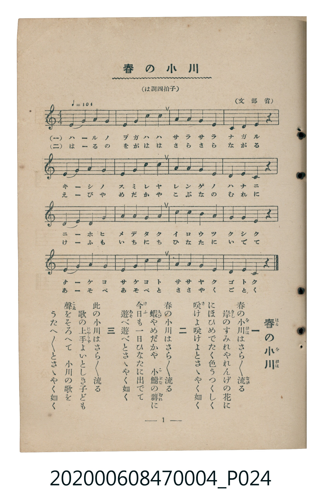

# 春の小川

> Re:Shōka 使用 AI 協助辨識與重建樂譜，可能會有錯誤。歡迎回報。

<audio controls src="haru_no_ogawa.mp3"></audio>

- 文部省唱歌
- 臺灣教育會公認《新定兒童唱歌》尋常科第四學年用（2020.006.0847.0004）

## 說明

原書資訊與歌詞全文（對應 P024.jpg，書頁 p. 1，第一學期第 1 首）：
調性與拍號：は調四拍子（C 大調 4/4 拍，♩=104，文部省）

## 歌詞

```text
一
春（はる）の小川（をがは）はさら／＼流（なが）る
岸（きし）のすみれやれんげの花（はな）に
にほひめでたく色（いろ）うつくしく
咲（さ）けよ咲けよとさゝやく如（ごと）く

二
春の小川はさら／＼流る
蝦（えび）やめだかや　小鮒（こぶな）の群（むれ）に
今日（けふ）も一日（いちにち）ひなたに出（い）でて
遊（あそ）べ遊べとさゝやく如く

三
此（こ）の小川はさら／＼流る
歌（うた）の上手（じゃうず）よいとしき子ども
聲（こゑ）をそろへて　小川の歌を
うたへ／＼とさゝやく如く
```

## ABC

```abc
X:1
T:春の小川
M:4/4
L:1/16
Q:1/4=104
K:C
V:V1 name="Piano" snm="Pia"
[V:V1]
E4 G4 A4 G4 | E4 G4 c4 c4 | G4 G4 E4 D4 | C4 D4 E4 z4 |
w: 1.~ハ _ ル ノ | ヲ ガ ハ ハ | サ ラ サ ラ | ナ ガ ル
w: 2.~は _ る の | を が は は | さ ら さ ら | な が る
w: 3.~こ _ の を | が は は _ | さ ら さ ら | な が る
E4 G4 A4 G4 | E4 G4 c4 c4 | G4 G4 E4 D4 | D4 E4 C4 z4 |
w: 1.~キ _ シ ノ | ス ミ レ ヤ | レ ン ゲ ノ | ハ ナ ニ
w: 2.~え _ び や | め だ か や | こ ぶ な の | む れ に
w: 3.~う _ た の | じゃう ず よ _ | い と し き | こ ど も
D4 E4 D4 G4 | A4 A4 G4 A4 | c4 c4 B4 A4 | G4 G4 E4 z4 |
w: 1.~ニ _ ホ ヒ | メ デ タ ク | イ ロ ウ ツ | ク シ ク
w: 2.~け _ ふ も | い ち に ち | ひ な た に | い で て
w: 3.~こ _ ゑ を | そ ろ へ て | を が は の | う た を
E4 G4 A4 G4 | E4 G4 c4 c4 | A4 A4 G4 E4 | D4 E4 C4 z4 |
w: 1.~サ _ ケ ヨ | サ ケ ヨ ト | サ サ ヤ ク | ゴ ト ク
w: 2.~あ _ そ べ | あ そ べ と | さ さ や く | ご と く
w: 3.~う _ た へ | う た へ と | さ さ や く | ご と く
```

## TMD 檔案連結

- [主旋律 TMD 檔案](haru_no_ogawa.tmd) [[在 TMD Studio 編輯](https://tmdlang.github.io/Tmd-TS/#tmd=s7IKdvYPcrWy4qpTUCpJTLdSSM7PyUlNLsnMz7MqzsjMK0nNjM_KTMmPL87Iz05Ugisry88pzU21Si9KTEmNN4k3MjAyiDcwMIs3sDAxBzIMTBBKi_NLi5JTrYqTM_Lzc-JLUitKkvLzsxHyBUX5Zal5iXlANQVFIBtTwIoQClLLMlNSQdKpKZkl-UWZiTlI7kgtKga7FWxJfElRYl5xclFmAcgDCFUlGalAx-YllpQWpaKLFqcmFufnFStxaWkpPJux9HHjuqcb-p9un6ugpcWlaKtgaGDCZW-r4MxlY6JvYgfS-2xa-8vmFc_nND6dsvHZ2h6weS_adz1vXPxs6swXTZuezWl-2rrmxarexw1dz6ZteLpu1tPWSc9XL4Uof9zQ_XRD99MdO54vn_h8zZqns2c_Xbvj6c4tz6eseL-nAxSOesBw1AOFI5BhYPJ-T6cSF5e-loIttQCXgoLC0775z2bveLG5_cWKrhcd7UB3vVg572nrCqDfgK54uqH3WXunQoCBkYleVkH6-z09QMUvFzQqFOgpGAJ5QHc_2dEAdPezOfOBbAVDhZfLpgEd-n7PLJDhL1btf9awHGRsd--LmfOBoo8b1wMFgX4FijxdOwFohbPC0yXLgWIKwFBVAIoCTX00c6UtMLRBtsFCGGgmF8hEoG0gChg9QK1Awx43dQOl4FEFEmya9LixBygFFl__uHHq4yage_rf79nzbCvQHKCuVUAFINmmbnAIbNoBFu193DgdYtbjxpmPG_c_bup53NQCJic_bgQauu5F10aorY2rwCpXg_QDqceNux83bnrc1Pi4cfnjxvmPG_tfdG4CKwXqB_oIqLTtceMSoDjQDiAJtnYSRMVUsPTEx00dQBEI43HjCrCz54Lsb-x_uqwJrHIKUBysuB8SFLt6oEEB9z6mf6F-fDF3GdgIINoM9jnQXUDHLnjc2A1iNzQA9b9cNwmsBujZbTAPrnu-bwk4TBuA4YDw8pPdXc-mQ2Jg4uPGrWATm4BRAxMEunohOFgWgvUAvQUMcmCwrH7avguiACwODKtlIONeNnaBRZseNwJjECixEygCJDHDAe73HZ1gv68Fu65xMnIawBkIwLQNVg2MCmBSBGl4sqPrWScwAQEFZzxuagZLzQL7BuIJoPXA6AIl1MeNK4FeBAdlIyTeJj9umghWCkwZQAcCU88OoHcgQQl2xTpQHm-aBEkiIDuBKiBOwu4voDrKszQUKGjpc3F5JBaV-uX7pyeWJ1oFZCbm5TvUGNRUg-xRsDHRsgMzsBUnCpBc_WJhj4KGiQLQO8_XN-jAywBNLBqAtkEN0wBq1LRSeNzcD8R7gHg1EPcp1ADJTQqPm9ZAZfpBIk1bgayVcBqkpguqZjXQNGRDd_WADG1cDzG0qRvIXgc2YhKQ1QORAWKgSONUoGgnnAaJrIKoAeqCG1qjYKxgqmAGxBCWYRwI1QBZpkC-EZBlCCSNFQwUasDqfQxBrutX0KXAR_Ews4xAjloPMotsj8DNMgaJTwaZBTQHZAqIjzBHlyiT8KeEXT0UpYSmtdBI2w4Lt6adQNZ8IAaFyxJwKIFYm4EywBCFhi0oTIFh14wUacgpoQNiaCNIUwvY0EYgbwEQA4MUIgIMFmBJBvUsJJAbgBgUOEjJi3BKAKUDQ9SUAPQTKPbI9RFqSugAxx65HkFNCW1gs4AugaiDlWpA1iygDpBNINEWIF4BxNOBuBduAyjdNhGRHnZ0UlYyAP0FLhlmAzE4vTYvBOJ2oO37gRic9puWAEWA6aZpGZCGhAowPYPCG0hjTQ8ToekBmPGAnoB5EmgwMIhANEgEGBXgIAQFz2q4muVAvAw5PYDi2wicHszA6cIMVBqAU4U5mA1JGaglQze4ZCDXR6jpYSI4Dsn1CJaSoQkYONCSYS6Q1Qukd4DVopc7kDQDSi1Ak4EyBNMCsB1HWdkAKidBZcNGIL0CVoJCeY-bO-AiIHXAEISG5RawHM600ARNC0DPNu4EewkoAuWBEj60SAQXh6CAAxfdjVOgmaKfcNkASRfGOMqGreAwJ9dHqGmhCZwWyPUIrrJhB3I8g9MCcWbVcnHp2ikgNSsUgFxlLgA)]
- [鋼琴伴奏 TMD 檔案](haru_no_ogawa_piano.tmd) [[在 TMD Studio 編輯](https://tmdlang.github.io/Tmd-TS/#tmd=s7IKdvYPcrWy4tLSUng2Y-njxnVPN_Q_3T73_Z6Ol917nk_Y8mTPlqdL-593drzf06mgpcWlaKtgaGDCZW-r4MxlY6JvYsdVp6D0bFr7y-YVz-c0Pp2y8dnaHiWQ2Iv2Xc8bFz-bOvNF06Znc5qftq55sar3cUPXs2kbnq6b9bR10vPVSyHKHzd0P93Q_XTHjufLJz5fs-bp7NlP1-54unPL8ykrgM4wMjAy0DMwMNMzsDAxBzIMTIAuUeLi8kgsKvXL909PLE-0CshMzMsP8nCoMaip5lIAAhsTLTswQ19LwRYdKAAtebKj4cXCHgUNEwWgf5-vb9BRCDAwMtHLKkjXxKJBSx9mmAZQo6aVwuPmfiDeA8SrgbhPoQZIblJ43LQGKtMPEmnaCmSthNMgNV1QNauBpiEbuqsHZGjjeoihTd1A9jqwEZOArB6IDBADRRqnAkU74TRIZBVEDVAX3NAaherctFoFYwVTBTMgrgGzDONAqAbIMgXyjYAsQyBprGCgUAPW5GMIcmK_gi4F3oqHmWUEctl6kFlk-wZuljFIfDLILKA5IFNAfIQ5ukSZhD857OqhKDk0rYXG3HZYuDXtBLLmAzEoXJaAQwnE2gyUAYYoNGxBYQoMu2akmENODh0QQxtBmlrAhjYCeQuAGBikEBFgsDxu3Ab1LCSQG4AYFDhIaQwS__hSAigdGKKmBKCfQLFHro9QU0IHOPbI9QhqSmgDmwV0CURd44zHTc0g0ceNs4A6QDaBRFuAeAUQTwfiXrgNoHTbRER62NFJWfEA9Be4eJgNxOD02rwQiNuBtu8HYnDab1oCFAGmm6ZlQBoSKsD0DApvII01PUyEpgdgxgN6AuZJoMHAIALRIBFgVICDEBQ8q-FqlgPxMuT0AIpvI3B6MAOnCzNQaQBOFeZgNiRloJYM3eCSgVwfoaaHieA4JNcjWEqGJmDgQEuGuUBWL5DeAVaLXu5A0gwotQBNBsoQTAvA-oiysgFUToLKho1AegWsBIXyHjd3wEVA6oAhCA3LLWA5nGmhCZoWgJ5t3An2ElAEygMlfGiRCC4OQQEHLrobp0AzRT_hsgGSLoxxlA1bwWFOro9Q00ITOC2Q6xFcZcMO5HgGpwXizKrF0rTwwdG0eLa18dmGLS861jyf1fK0o-3F8sVPJ_U83bMM0mhCqowLahUM4xVM44HhCCSAWQ2TYxoPpuBy8fAQx6ocu14oA0UzVAyuxgSkGUxQZjXYCIgIusXAMNS1U0AKxmgfw1gFdCEjTCFjsJAyFwA)]

## 分析

```text
================================================================================
📊 TMD Song Profile: [ 春の小川 ]
================================================================================
⏱  Duration:       0:36 (36.9s), 16 measures total
🎼 Key & Tempo:    首調基準 C, != 104.0 BPM, <4/4>
   - 分析範圍：      由實際發聲的音符與和弦推測調性；播放脈絡另行呈現
🎤 人聲音域:    C4 (MIDI 60) – C5 (MIDI 72) [跨度: 12 個半音 / 1.0 個八度, 難度: easy]
   - 最低音:  C4 in [HaruNoOgawa #1 @ m.4, 0:06]
   - 最高音: C5 in [HaruNoOgawa #1 @ m.2, 0:03]
   - 適合: soprano, mezzo-soprano, contralto, tenor, baritone, bass
🏛  結構:      HaruNoOgawa (36.9s)
⚡ 編曲密度:        Peak 1 軌道同時演奏
🗝  調性診斷：       C 調性不明確（純淨自然大調，未偵測到可信轉調）
   - 風格氣質:    純淨自然大調（陽光明朗、易唱易記，無明顯調外色彩）
   - 轉調歷程:    全曲維持單一推測調性（未偵測到可信轉調）
   - 核心骨幹音:  G, E, C, A, D
   - 調性數值:    C 調性不明確 [相關度: 0.80, 穩定度: Ambiguous, 自然音純度: 100.0%]
   - 候選調性 (K-S): C 大調 (0.80), G 大調 (0.77), E 小調 (0.77)
   - 五度圈歷程:   +0
   - 各段落調性細節:
     • [HaruNoOgawa #1]: C 調性不明確 (r: 0.80, 自然音純度: 100.0%)

  [ 五度圈游移軌跡 ]
              [C ]*
         F            G  
      Bb               D  
      Eb               A  
         Ab           E  
            Db       B  
               F# 
     (* = active key center)

  [ 十二半音累積音高分佈 ]
     C  : ███████████████           18.3%
     C# :                            0.0%
     D  : █████████                 11.7%
     D# :                            0.0%
     E  : ███████████████████       23.3%
     F  :                            0.0%
     F# :                            0.0%
     G  : ████████████████████████  30.0%
     G# :                            0.0%
     A  : ████████████              15.0%
     A# :                            0.0%
     B  : █                          1.7%
--------------------------------------------------------------------------------
Assignment 軌道音域：
  - Piano         : C4 – C5 (12 個半音 / 1.0 個八度, 60 個音符)
================================================================================
```


## 原書掃描頁




