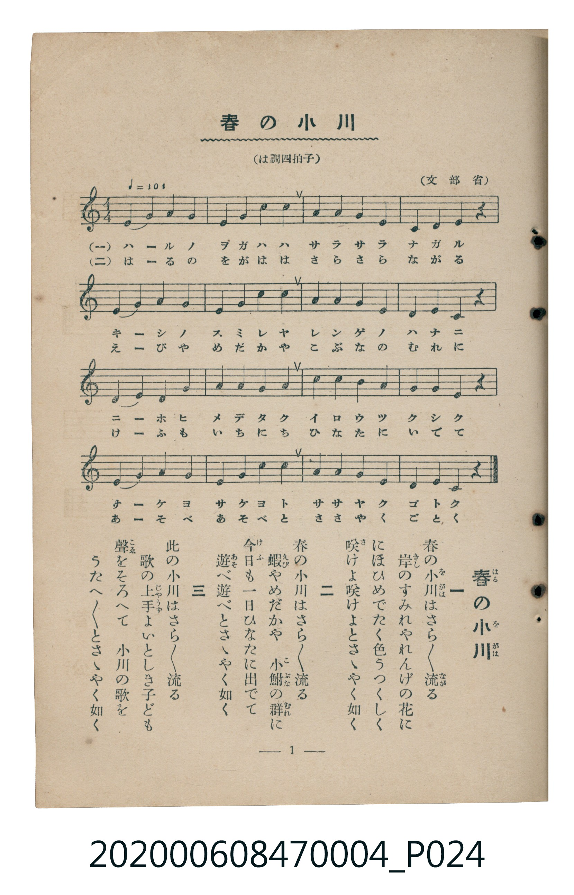

# 春の小川

<audio controls src="haru_no_ogawa.mp3"></audio>

- 文部省唱歌
- 臺灣教育會公認《新定兒童唱歌》尋常科第四學年用（2020.006.0847.0004）

## 說明

原書資訊與歌詞全文（對應 P024.jpg，書頁 p. 1，第一學期第 1 首）：
調性與拍號：は調四拍子（C 大調 4/4 拍，♩=104，文部省）

## 歌詞

```text
一
春（はる）の小川（をがは）はさら／＼流（なが）る
岸（きし）のすみれやれんげの花（はな）に
にほひめでたく色（いろ）うつくしく
咲（さ）けよ咲けよとさゝやく如（ごと）く

二
春の小川はさら／＼流る
蝦（えび）やめだかや　小鮒（こぶな）の群（むれ）に
今日（けふ）も一日（いちにち）ひなたに出（い）でて
遊（あそ）べ遊べとさゝやく如く

三
此（こ）の小川はさら／＼流る
歌（うた）の上手（じゃうず）よいとしき子ども
聲（こゑ）をそろへて　小川の歌を
うたへ／＼とさゝやく如く
```

## ABC

```abc
X:1
T:春の小川
C:TMD (Chen, Chih-Han / aguai)
M:4/4
L:1/16
Q:1/4=104
K:C
V:V1 name="Piano" snm="Pia"
[V:V1]
e4 g4 a4 g4 | c4 a4 c4 a4 | g4 g4 e4 d4 | c4 d4 e4 z4 |
e4 g4 a4 g4 | c4 a4 c4 a4 | g4 g4 e4 d4 | e4 d4 c4 z4 |
d4 e4 g4 a4 | g4 a4 g4 e4 | c4 c4 a4 g4 | a4 g4 e4 z4 |
d4 e4 g4 a4 | g4 a4 g4 e4 | g4 g4 e4 d4 | e4 d4 c4 z4 |
```

## TMD 檔案連結

- [主旋律 TMD 檔案](haru_no_ogawa.tmd)
- [鋼琴伴奏 TMD 檔案](haru_no_ogawa_piano.tmd)

## 分析

```text
================================================================================
📊 TMD Song Profile: [ 春の小川 ]
================================================================================
⏱  Duration:       0:36 (36.9s), 16 measures total
🎼 Key & Tempo:    首調基準 C, != 104.0 BPM, <4/4>
   - 分析範圍：      由實際發聲的音符與和弦推測調性；播放脈絡另行呈現
🎤 人聲音域:    C4 (MIDI 60) – C5 (MIDI 72) [跨度: 12 個半音 / 1.0 個八度, 難度: easy]
   - 最低音:  C4 in [HaruNoOgawa #1 @ m.4, 0:06]
   - 最高音: C5 in [HaruNoOgawa #1 @ m.2, 0:02]
   - 適合: soprano, mezzo-soprano, contralto, tenor, baritone, bass
🏛  結構:      HaruNoOgawa (36.9s)
⚡ 編曲密度:        Peak 1 軌道同時演奏
🗝  調性診斷：       G 調性不明確（純淨自然大調，未偵測到可信轉調）
   - 風格氣質:    純淨自然大調（陽光明朗、易唱易記，無明顯調外色彩）
   - 轉調歷程:    全曲維持單一推測調性（未偵測到可信轉調）
   - 核心骨幹音:  G, E, A, C, D
   - 調性數值:    G 調性不明確 [相關度: 0.76, 穩定度: Ambiguous, 自然音純度: 100.0%]
   - 候選調性 (K-S): G 大調 (0.76), C 大調 (0.73), E 小調 (0.70)
   - 五度圈歷程:   +1
   - 各段落調性細節:
     • [HaruNoOgawa #1]: G 調性不明確 (r: 0.76, 自然音純度: 100.0%)

  [ 五度圈游移軌跡 ]
               C  
         F           [G ]*
      Bb               D  
      Eb               A  
         Ab           E  
            Db       B  
               F# 
     (* = active key center)

  [ 十二半音累積音高分佈 ]
     C  : ████████████              15.0%
     C# :                            0.0%
     D  : ███████████               13.3%
     D# :                            0.0%
     E  : █████████████████         21.7%
     F  :                            0.0%
     F# :                            0.0%
     G  : ████████████████████████  30.0%
     G# :                            0.0%
     A  : ████████████████          20.0%
     A# :                            0.0%
     B  :                            0.0%
--------------------------------------------------------------------------------
Assignment 軌道音域：
  - Piano         : C4 – C5 (12 個半音 / 1.0 個八度, 60 個音符)
================================================================================
```


## 原書掃描頁




