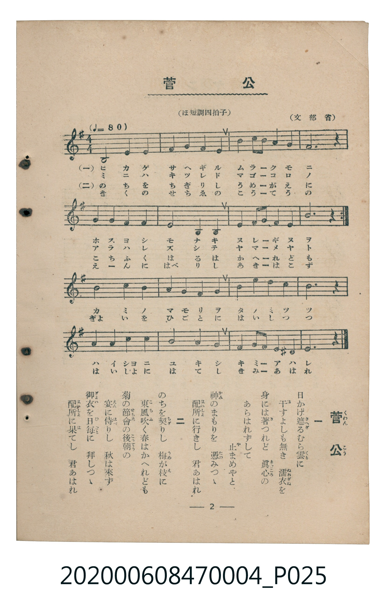

# 菅公

<audio controls src="kanko.mp3"></audio>

- 文部省唱歌
- 臺灣教育會公認《新定兒童唱歌》尋常科第四學年用（2020.006.0847.0004）

## 說明

原書資訊與歌詞全文（對應 P025.jpg，書頁 p. 2，第一學期第 2 首）：
調性與拍號：ほ短調四拍子（e 小調 4/4 拍，♩=80，文部省）

## 歌詞

```text
一
日（ひ）かげ遮（さへぎ）るむら雲（ぐも）に
干（ほ）すよしも無（な）き　濡衣（ぬれぎぬ）を
身（み）には著（き）つれど　眞心（まごころ）の
あらはれずして　止（や）まめやと
神（かみ）のまもりを　憑（たの）みつゝ
配所（はいしょ）に行（ゆ）きし　君（きみ）あはれ

二
のちを契（ちぎ）りし　梅（うめ）が枝（え）に
東風（こち）吹（ふ）く春（はる）はかへれども
菊（きく）の節會（せちゑ）の後朝（こうてう）の
宴（えん）に侍（はべ）りし　秋（あき）は來（こ）ず
御衣（ぎょい）を日毎（ひごと）に　拜（はい）しつゝ
配所（はいしょ）に果（は）てし　君あはれ
```

## 原書掃描頁



## 分析

```text
================================================================================
📊 TMD Song Profile: [ 菅公 ]
================================================================================
⏱  Duration:       0:48 (48.0s), 16 measures total
🎼 Key & Tempo:    首調基準 G, != 80.0 BPM, <4/4>
   - 分析範圍：      由實際發聲的音符與和弦推測調性；播放脈絡另行呈現
🎤 人聲音域:    B3 (MIDI 59) – E5 (MIDI 76) [跨度: 17 個半音 / 1.4 個八度, 難度: challenging]
   - 最低音:  B3 in [Kanko #1 @ m.1, 0:00]
   - 最高音: E5 in [Kanko #1 @ m.3, 0:06]
   - 適合: soprano, mezzo-soprano, contralto, tenor, baritone, bass
🏛  結構:      Kanko (48.0s)
⚡ 編曲密度:        Peak 1 軌道同時演奏
🗝  調性診斷：       E 小調（純淨自然小調，未偵測到可信轉調）
   - 風格氣質:    純淨自然小調（陰鬱抒情、旋律集中，無明顯調外色彩）
   - 轉調歷程:    全曲維持單一推測調性（未偵測到可信轉調）
   - 核心骨幹音:  B, E, A, G, C
   - 調性數值:    E 小調 [相關度: 0.77, 穩定度: Moderate, 自然音純度: 98.3%]
   - 候選調性 (K-S): E 小調 (0.77), E 大調 (0.67), B 小調 (0.61)
   - 五度圈歷程:   +4
   - 各段落調性細節:
     • [Kanko #1]: E 小調 (r: 0.77, 自然音純度: 98.3%, 調外音: D#)

  [ 五度圈游移軌跡 ]
               C  
         F            G  
      Bb               D  
      Eb               A  
         Ab          [E ]*
            Db       B  
               F# 
     (* = active key center)

  [ 十二半音累積音高分佈 ]
     C  : █████                      7.5%
     C# :                            0.0%
     D  : ██                         2.5%
     D# : █                          1.7%
     E  : ███████████████           21.7%
     F  :                            0.0%
     F# : █████                      7.5%
     G  : ████████                  11.7%
     G# :                            0.0%
     A  : █████████                 13.3%
     A# :                            0.0%
     B  : ████████████████████████  34.2%
--------------------------------------------------------------------------------
Assignment 軌道音域：
  - Piano         : B3 – E5 (17 個半音 / 1.4 個八度, 49 個音符)
================================================================================
```

## ABC

```abc
X:1
T:菅公
C:TMD (Chen, Chih-Han / aguai)
M:4/4
L:1/16
Q:1/4=80
K:Em
V:V1 name="Piano" snm="Pia"
[V:V1]
B8 e4 f4 | g4 a4 b4 b4 | e4 d2 c2 b4 a4 | b12 z4 |
g4 a4 b4 g4 | e8 B4 B4 | e4 g2 b2 a4 g4 | e12 z4 |
b8 c4 b4 | a8 b4 b4 | c4 b4 a4 g4 | f12 z4 |
g4 b4 e4 d4 | c8 b8 | a4 g2 f2 e4 ^d4 | e12 z4 |
```

- [主旋律 TMD 檔案](kanko.tmd)
- [鋼琴伴奏 TMD 檔案](kanko_piano.tmd)
