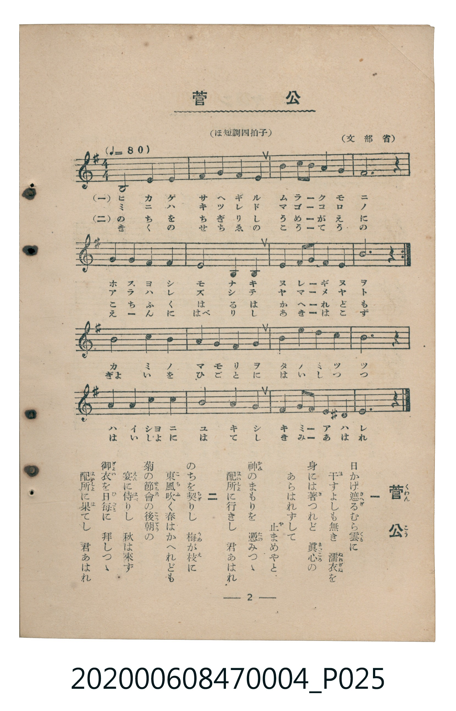

# 菅公

> Re:Shōka 使用 AI 協助辨識與重建樂譜，可能會有錯誤。歡迎回報。

<audio controls src="kanko.mp3"></audio>

- 文部省唱歌
- 臺灣教育會公認《新定兒童唱歌》尋常科第四學年用（2020.006.0847.0004）

## 說明

原書資訊與歌詞全文（對應 P025.jpg，書頁 p. 2，第一學期第 2 首）：
調性與拍號：ほ短調四拍子（e 小調 4/4 拍，♩=80，文部省）

## 跨冊／重複收錄參照

> 同名異曲（各冊收錄之不同詞曲版本）

- **[同名異曲]** 楊金土手抄《唱歌帖》第 8 冊・VIII（2020.006.0843）：[**〈菅公〉**](../../../shokacho/vol_08/p011_kanko/index.md)（`F` / `4/4` — [原始 TMD](../../../shokacho/vol_08/p011_kanko/kanko.tmd)）
- 總表：[跨冊重複與同名歌曲總索引](../../../duplicate_songs.md)

## 歌詞

```text
一
日かげ遮（さへぎ）るむら雲（くも）に
干（ほ）すよしも無き　濡衣（ぬれぎぬ）を
身には著（き）つれど　眞心（まごころ）の
あらはれずして
止（や）まめやと、
神（かみ）のまもりを　憑（たの）みつゝ
配所（はいしょ）に行きし　君あはれ。

二
のちを契（ちぎ）りし　梅（うめ）が枝（え）に
東風（こち）吹（ふ）く春はかへれども
菊の節會（せちゑ）の後朝（こうてう）の
宴に侍（はべ）りし　秋は來ず
御衣（ぎょい）を日毎（ひごと）に　拜（はい）しつゝ
配所（はいしょ）に果（は）てし　君あはれ
```

## ABC

```abc
X:1
T:菅公
M:4/4
L:1/16
Q:1/4=80
K:Em
V:V1 name="Piano" snm="Pia"
[V:V1]
B,8 E4 E4 | F4 G4 F4 E4 | B4 c2 B2 A4 G4 | F12 z4 |
G4 G4 F4 F4 | E8 B,4 B,4 | E4 F2 G2 F4 E4 | B12 z4 |
B,8 E4 E4 | F4 G4 F4 E4 | B4 c2 B2 A4 G4 | F12 z4 |
G4 G4 F4 F4 | E8 B,4 B,4 | E4 F2 G2 F4 E4 | B12 z4 |
B8 c4 B4 | A4 G4 F4 G4 | B4 e4 d4 c4 | B12 z4 |
A4 A4 c4 c4 | B8 A4 G4 | F4 G2 F2 E4 ^D4 | E12 z4 |
```

## TMD 檔案連結

- [主旋律 TMD 檔案](kanko.tmd) [[在 TMD Studio 編輯](https://tmdlang.github.io/Tmd-TS/#tmd=s7IKdvYPcrWy4qpTUCpJTLdSSM7PyUlNLsnMz7MqzsjMK0nNjM_KTMmPL87Iz05Ugisry88pzU21Si9KTEmNN4k3MjAyiDcwMIs3sDAxBzIMTBBKi_NLi5JTrYqTM_Lzc-JLUitKkvLzs9Hl4wsS01OtAowQ4gVF-WWpeYl5QL0FRSCXpIA1IxSklmWmpIKki5MT8-LLUosy0zJTU5DcmFpUDPYHxIKSosS84uSizAKQ5xCq0lPzilKtkjMyc1KKUvPii_Pz0hGSJRmpQF9mZBaX5BdVKnFpaSm86G992rpGQUuLS9FWwcKAy95WwZ0rO7XSVsE1l8vGRN_EDqT52bT2l80rns9pfDpl47O1PWADX7Tvet64-NnUmS-aNj2b0ww05cWq3scNXc-mbXi6btbT1knPVy-FKH_c0P10Q_fTHTueL5_4fM2ap7NnP1274-nOLc-nrHi_pwMU1nrAsNYDhTWQYWDyfk-nEheXvpaCLbUAl4KCwtO--c9m73ixuf3Fiq4XHe1Ad71YOe9p6wqg34CueLqh91l7p0KAgZGpXlZB-vs9PUDFLxc0KhToKRgBeUB3P9nRAHT3sznzgWwFI4WXy6YBHfp-zyyQ4S9W7X_WsBxkbHfvi5nzgaKPG3c_n78WKA70LlDw6doJQFtSFZ5u6AeKKQADVgEoCjT40cyVthYGIPtgYQw0lQtkJtA-EPVs-tLHjd2PGye9bFwHNOJx49THjTseN_YBlT1u6n7c1PC4qfPl7E1gqf7HTU0g8cbVYB_vhIjuBgvNfNwEZE8HqnjesvBxIzCqGp7tX_hi4WKwmjWPm3qAhgIZYHMngT21azXQpMeN619MnA5WBHQv0KAlYKUrgfqfz5n3dH8zWGrf48YpjxsnP26CqFkH0v-4sQnoNqB-sAZgiEx_3LgM7KW1i0CamlrAavc9bmoEsh83rnjc0AiSfr50HthMoKf3Q0wDKwIa1gV0GcjdbRPBCuYDpcAK9oNdNRek-WVr77POBrD0-seNQFOBPgZGMChMXiwEOqMXJNLQ8HTCbJDzIG5raIIE-K4eiLOB9i0E2vR0KcQaYGhBQrsLovfZolaweBvQ4WCTe57NmwsW6UAE_rO5G18uAqVvUKg0LgRKPJ2wE8zdClbU_2wGMF6BTgT6cgc0RJuawMHeD7Rn3fP1DcBcBdYAdCnQOUC3gILi6b6eZ3MgtgHNbQOGKJBEhPnTdVuADniyDxgNkBAA2olw-fPlQNvWP9kH1AZOtk_3wRNAHzCYgOEFiX1gmnu2HuhnoPgmcMQCPQLyGMjz3XPggQsWBEYqEWH_bB5UG5gLdDN6JID0U57RoUBBS5-LyzsxLzvfKiAzMS_focagRqEaZIWCjYWWHZiBrXxRgGRzYEJR0DAB5VVgLOjACwVNLBqAFkEN0wBq1FQwfLZmoZXC4-ZJCo-mNCg8bloNxJsUaoDkVqDoDCC9DkivBok0LwDilVB164HsRWDRbrAICBsgmQ4GRlDD50M0AZU-bu4HG74WyGoB4jVA3Ak2Zh5QdAvU8M1A_lqwaB9WwzWAKR_u9MZ1EF2NC4E6J4F0gViNfUBeF5CeDhZpA_Iaoep6gLgDLLqaoNMbe6Ga-sEWgTTNhlo1ES4yGWwBRN0yMBskCnEWiuE1CsbxCrpgaAZigIkaBXMQZQjEYAZU0BhImgBJI6gcVBkMGoCEwKUA7oSxqwdHwtBReLF2ztMN-57N6Xza3_tiWduLFTOAtYCCVQ0pSQYYEE07gfQKIL0dHFuLoPEMDHdgDINEgGENjGNIrIISUg9YdBPBcG9aBE5roOQCMgCUZHZBjdkOFAGHcPMScLKBWAmMESAfJNpBRJIBxRgokQDTODBmQbG1Hmo6MIkC2SAREGsHVBSUZFaCXdFEOMl0AJWBLABmJahRO6HGINJjE1LSAmYloINAorOwJRlQ5MMTB5iogaQREASnJzABFQQqMMRIR1gSDW2SIq1ci7vs6yS_7AMlM0gJACqhQGUNtBwCpuPHzavA6RQU5fvBchA1LWA1LbiTGCgBgKomaNwCyzhombQJiKcAMTC3AFMGJMmB5YEpAlgjgUWWYC0yoMFhAgo7cCDB4gEeWRBFZkBsClVIckgCW30UhSQoozYBMyQ4ey4Hl_WgkFoGTfnA8h5SRoBLfmh9AM7k4OwHLSNwhigsqED1UTtSACLKXEi26gXi_VBRUBYDZz9g7sUSrKBABGFQaKGGGFoyBydQcPI0VUdLz4iwreXi0rVTANfgCkCGMhcXAA)]
- [鋼琴伴奏 TMD 檔案](kanko_piano.tmd) [[在 TMD Studio 編輯](https://tmdlang.github.io/Tmd-TS/#tmd=s7IKdvYPcrWy4tLSUnjR3_q0dc37PR0vu_c8n7DlyZ4tT5f2P-_seL-nU0FLi0vRVsHCgMveVsGdKzu10lbBNZfLxkTfxI6rTkHp2bT2l80rns9pfDpl47O1PUogsRftu543Ln42deaLpk3P5jQDjX6xqvdxQ9ezaRuerpv1tHXS89VLIcofN3Q_3dD9dMeO58snPl-z5uns2U_X7ni6c8vzKSuArjEyMDLQMzAw0zOwMDEHMgxMgA5S4uLyTszLzrcKyEzMyw_ycKgxqFGo5lIAAhsLLTswQ19LwRYdKADNf7Kj4cXCHgUNE4WnG_qfr2_QUQgwMDLVyypI18SiQUsfZpgGUKOmguGzNQutFB43T1J4NKVB4XHTaiDepFADJLcCRWcA6XVAejVIpHkBEK-EqlsPZC8Ci3aDRUDYAMl0MDCCGj4fogmo9HFzP9jwtUBWCxCvAeJOsDHzgKJboIZvBvLXgkX7sBqu8WRXD9zpjesguhoXAnVOAukCsRr7gLwuID0dLNIG5DVC1fUAcQdYdDVBpzf2QjX1gy0CaZoNtWoiXGQy2AKIumVgNkgU4iwUw2sUjOMVdMHQDMQAEzUK5iDKEIjBDKigMZA0AZJGUDmoMhg0AAlx4U8Yu3pwJAwdhRdr5zzdsO_ZnM6n_b0vlrW9WDHjxcz5ClY1pCQZYEA07QTSK4D0dnBsLYLGMzDcgTEMEgGGNTCOIbEKSkg9YNFNBMO9aRE4rYGSC8gAUJLZBTVmO1AEHMLNS8DJBmIlMEaAfJBoBxFJBhRjoEQCTOPAmAXF1nqo6cAkCmSDRECsHVBRUJJZCXZFE-Ek0wFUBrIAmJWgRu2EGoNIj01ISQuYlYAOAonOwpZkQJEPTxxgogaSRkAQnJ7ABFQQqMAQIx1hSTS0SYq0ci3usq-T_LIPlMwgJQCohAKVNdByCJiOHzevAqdTUJTvB8tB1LSA1bTgTmKgBND3uKkdGrfAMg5aJm0C4ilADMwtwJQBSXJgeWCKeNwITrpAEluRAQ0OE1DYgQMJFg_wyIIoMgNiU6hCkkMSWEtRFJKgjNoEzJDg7LkcXNaDQmoZNOUDy3tIGQEu-aH1ATiTg7MftIzAGaKwoALVR-1IAYgocyHZqheI90NFQVkMnP2AuRdLsIICEYRBoYUaYmjJHJxAwcnTVB0tPSPCthalAvdBqcBNoBU4UKCgFqg5HpQFoBTIMFQ-kDAHso2AOQNN2gBoD8QcqKApRB2cbwykgHqxmYrVmEHmHKigCZAC2wU0CxjSQKYpJg9uNoiBYQTcHrgmkAgBh4FMAUajrp0COCYVkBnKXFwA)]

## 分析

```text
================================================================================
📊 TMD Song Profile: [ 菅公 ]
================================================================================
⏱  Duration:       1:12 (72.0s), 24 measures total
🎼 Key & Tempo:    首調基準 G, != 80.0 BPM, <4/4>
   - 分析範圍：      由實際發聲的音符與和弦推測調性；播放脈絡另行呈現
🎤 人聲音域:    B3 (MIDI 59) – E5 (MIDI 76) [跨度: 17 個半音 / 1.4 個八度, 難度: challenging]
   - 最低音:  B3 in [Kanko #1 @ m.1, 0:00]
   - 最高音: E5 in [Kanko #1 @ m.19, 0:54]
   - 適合: soprano, mezzo-soprano, contralto, tenor, baritone, bass
🏛  結構:      Kanko (72.0s)
⚡ 編曲密度:        Peak 1 軌道同時演奏
🗝  調性診斷：       E 小調（純淨自然小調，未偵測到可信轉調）
   - 風格氣質:    純淨自然小調（陰鬱抒情、旋律集中，無明顯調外色彩）
   - 轉調歷程:    全曲維持單一推測調性（未偵測到可信轉調）
   - 核心骨幹音:  B, F#, E, G, A
   - 調性數值:    E 小調 [相關度: 0.75, 穩定度: Moderate, 自然音純度: 98.9%]
   - 候選調性 (K-S): E 小調 (0.75), B 大調 (0.68), B 小調 (0.66)
   - 五度圈歷程:   +4
   - 各段落調性細節:
     • [Kanko #1]: E 小調 (r: 0.75, 自然音純度: 98.9%, 調外音: D#)

  [ 五度圈游移軌跡 ]
               C  
         F            G  
      Bb               D  
      Eb               A  
         Ab          [E ]*
            Db       B  
               F# 
     (* = active key center)

  [ 十二半音累積音高分佈 ]
     C  : █████                      5.6%
     C# :                            0.0%
     D  : █                          1.1%
     D# : █                          1.1%
     E  : ██████████████████        21.1%
     F  :                            0.0%
     F# : ██████████████████        21.7%
     G  : ████████████              13.9%
     G# :                            0.0%
     A  : ██████                     6.7%
     A# :                            0.0%
     B  : ████████████████████████  28.9%
--------------------------------------------------------------------------------
Assignment 軌道音域：
  - Piano         : B3 – E5 (17 個半音 / 1.4 個八度, 77 個音符)
================================================================================
```


## 原書掃描頁




