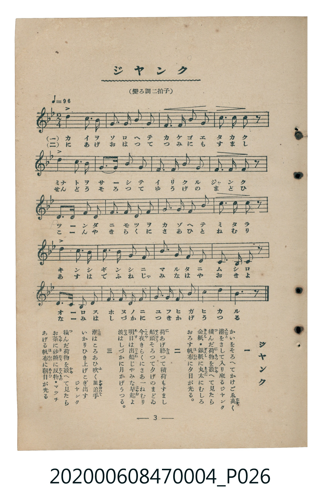

# ジヤンク

> Re:Shōka 使用 AI 協助辨識與重建樂譜，可能會有錯誤。歡迎回報。

- **NEUTRINO 歌聲合成版**：<br><audio controls src="janku_neutrino.mp3"></audio>
- **鋼琴伴奏版**：<br><audio controls src="janku.mp3"></audio>


- 臺灣教育會公認《新定兒童唱歌》尋常科第四學年用（2020.006.0847.0004）

## 說明

原書資訊與歌詞全文（對應 P026.jpg，書頁 p. 3，第一學期第 3 首）：
調性與拍號：變ろ調二拍子（降 B 大調 2/4 拍，♩=96）


## 歌詞

```text
一
かいをそろへてかけごゑ高く
港をさして入り來るジヤンク
積んだ荷物を數へて見たら
金紙・銀紙に丸太にむしろ
おろす帆布に夕日が光る。

二
荷あげ終つて積荷もすまし
船頭そろつて夕げのまどゐ
今夜きらくにさあ一ねむり
明日は出船じやみな早起よ
波はしづかに月かげうつる。

三
潮はころあひ吹く風追手
いかりひき上げこぎ出すジヤンク
積んだ荷物を數へて見たら
お茶に砂糖に反物・マッチ
あげる帆布に朝日が光る
```

## ABC

```abc
X:1
T:ジヤンク
M:2/4
L:1/16
Q:1/4=96
K:Bb
V:V1 name="Piano" snm="Pia"
[V:V1]
d4 c3 B | G3 G B2 G2 | F3 F B2 G2 | c3 c c2 z2 |
w: 1.~カ イ ヲ | ソ ロ ヘ テ | カ ケ ゴ ヱ | タ カ ク
w: 2.~に あ げ | お は っ て | つ み に も | す ま し
w: 3.~し ほ は | こ ろ あ ひ | ふ く か ぜ | お ひ て
d4 c3 B | G3 G B2 G2 | F3 F B2 G2 | F3 F F2 z2 |
w: 1.~ミ ト ヲ | サ _ シ テ | イ リ ク ル | ジャ ン ク
w: 2.~せ ど う | そ ろ っ て | ゆ ふ げ の | ま ど ゐ
w: 3.~い り ひ | き あ げ _ | こ ぎ だ す | ジャ ン ク
D3 D F2 D2 | F3 F D2 F2 | G3 G F2 B2 | c3 c c2 z2 |
w: 1.~ツ _ ン ダ | ニ モ ツ ヲ | カ ゾ ヘ テ | ミ タ ラ
w: 2.~こ _ ん や | き ら く に | さ あ ひ と | ね む り
w: 3.~つ _ ん だ | に も つ を | か ぞ へ て | み た ら
d4 c3 B | c3 B G2 F2 | B3 G F2 D2 | C3 B, C2 z2 |
w: 1.~キ ン シ | ギ ン シ ニ | マ ル タ ニ | ム シ ロ
w: 2.~あ す は | で ふ ね じゃ | み な は や | お き よ
w: 3.~お ちゃ に | さ た う に | た ん も の | マ ッ チ
D3 C B,2 D2 | F3 F D2 F2 | G3 G F2 B2 | c4 d4 |
w: 1.~オ _ ロ ス | ホ ヌ ノ ニ | ユ フ ヒ ガ | ヒ カ
w: 2.~な _ み は | し づ か に | つ き か げ | う つ
w: 3.~あ _ げ る | ほ ぬ の に | あ さ ひ が | ひ か
B6 z2 |
w: 1.~ル
w: 2.~る
w: 3.~る
```

## TMD 檔案連結

- [主旋律 TMD 檔案](janku.tmd) [[在 TMD Studio 編輯](https://tmdlang.github.io/Tmd-TS/#tmd=s7IKdvYPcrWy4qpTUCpJTLdSSM7PyUlNLsnMz7MqzsjMK0nNjM_KTMmPL87Iz05Ugisry88pzU21Si9KTEmNN4k3MjAyiDcwMIs3sDAxBzIMTBBKi_NLi5JTrYqTM_Lzc-JLUitKkvLzs9Hl4wsS01OtAgyMzBAyBUX5Zal5iXlA3QVFILekgLUjFKSWZaakgqSLkxPz4stSizLTMlNTkFyZWlQM9gnEipKixLzi5KLMApD3EKrSU_OKUq2SMzJzUopS8-KL8_PSEZIlGalAf4J1FuQXIdmdX5SZnplnVZKYWQ60Oz8tLTM5MzFHiUtLS-Fx047HzUseN29-3LReQUuLS9FWwdKMy95WwUmHy8ZI38QOZMiL9l3PGxc_mzrzRdOmZ3Oan7auebGq93FD17NpG56um_W0ddLz1UufTtn4bG3P44bupxu6n-7Y8Xz5xOdr1jydPfvp2h1Pd255PmXF-z0doKDXAwa9HijogQwDk_d7OpW4uPS1FGypBbgUFBSe9s1_NnvHi83tL1Z0vehoB7rrxcp5T1tXPJvWDnTF0w29z9o7FUDxp5dVkP5-Tw9Q8csFjQoFegrGQB7Q3U92NADd_WzOfCBbwVjh5bJpQIe-3zMLZPiLVfufNSwHGdvd-2LmfKDoi3Vdj5t6geJPdvUABZ-unQC05eXMXgUnhadLlgPFFYABqQCUARr-aOZKW0szoGlcILOA9oCox43djxtbHjdNetw4F2jS48YdjxuXgQUnPm6c8rhp4svVMx439oOUPtuxHqxu6uPG6UBFT1uXPm7qerKv7XFTN3JUgpQ-X9n7uGny48YFL3q3P-9cCdT2bCrQYJDZL5YBzZ7_uKkTpO5l-8TnW2Y-bt79sqsBxGhc_WTHjqdLVgEZj5saQPY09UJcCfLm48aZT3e0Pd3RDJR-umTqs-lLHzf2PG3tBDmgoQniq1094IDq3f64selx46TnW4HkEqC1QBeBBJuAXKA1-4BGg9V17Hy5YC3M6yB1QHOB2h43rgMrArp8AtjY3V1Pl8x53Aj0VScwNEDOAwVDEzAQHzeuBTm1qQscRDP6wK5a_7R9F9Dsx40zHje1PG7c_7hx1bPpK19sBTqgA6xu8yKgInA4AlUDA2T1szkdYAbQ6jaQS5C8tAMcVM_2Ap0E1DIZ7FSgNzY9nQC0oP_lohUv9u991tkNCSegbcDY6AJKA137ZAeQATQRGBN9QBeBvE5mRAEj4EXPNqA7ny9oer55GigC-ntBGpp3P26e97i5-XFzI0QdKNSBrodH1LM5c5EjCqSI8pwGBQpa-lxcXol52aVWAZmJefkONQY11SAbFGwMzbTswCxsGVwBks9eLOxR0DBReLqh__n6Bh14rtTEogFoEdQwDaBGTStg4bVa4dGUBjiuAYosgfMeN28Ci-xFElkLEmmeAeW1wXUhzHnctBEssgXKWwFXsx9JzWqwyHowzwBMIjtuVw_IcY0YjmtsQhjROAks0oUksh4sAvEAMO7hupC81LgfLAIxGZiR4GpmIqnZBxaZjum4GmBZpguGRmDSEChiFg9mAilDCKULFDSFCAIpJEGIHiMwbQASAZvpYwgJP4i5oPAH0_Cwh_DWgkMdxGoDmwXTAQptUFiDZDZCZfZDZVaDQ1hXAWw7xC4jiOehdgGDE0LDghLCWw_Ei8GsZRATgQEIkdkP1Q0KOIjMTKjMPnCAodhlDAlEmF274aaDxCdD3dgLdQUwq0NN3ApV1w8q1cGsOVAZmPs2QV0GsQt__tjVQ1H-aJ6PngSbkRJccwc4vLdi5KHtGPkDOVetQkr7j5shSREksgNJzWKwXZvx54_ZGBZPRkrFK8GBNhdDTS9UHuIkkBpIToHkiDawCMThoIQBU7MPw-RN1M4fCEEwCy2LAKMClMhBiQAU8MiZBJJkQMlpO1gUlkVgWWkVNCOAAhsiA6w_QCkcJLQZRy6ZDTYQlE5BHoakPEjgzEVKuyj5BBh4EHVbwUEHYq2Dpt19UJmVQFUTUG0D55MWsCw4vTch0jlIphfKa4KaCYJIOaixD4gXgFmgvIjXcwSqkk7KskoLRlaBJN_HzQiRbqQkvggsAtEFiklY-kSuSsAlMWZ1g5QtQcUdSGQl_qyCyBioWQXYsoEncUjGgIh2gkX6oQkenkcbpyJlgyakbPC4EV7PNa5FMgdiF6TMQM8qkOQOpMDJHcxFzgRgATAXOROBBUCZBm99AgxWaJYARgKIbICkDWAEQEQXQdWAAh61PgGW5Kg1DTjjgWSApT8wmDFzCiQlwnMLMEQhKRSacoFhCQpJUAqFZj9gKCLSNMh-UOhBZNZC9YDCDpQP0PMJJEsjciYo5SPqNFC9BFEDbANCZaA-bpwHxDvALFitBq0nG-eD3UhUJgH2xyhrbyHSBmomgaSW7eCYWIeUSTaj1CeQ7APSNQ9JDaQtBWldIatZgG4ysBWBN5MgWlewpIzcKoJU3MuRRLYiJXdgLwGuC6mh1wiu7IB60TMbcrutF-yBDqyZBBrfiPoExgJnCWj2AOUHRO6A5iQjSJ4xjIew0FtckJQGyyGQygMS-oiiE1KdgFIQJMwhMqB2FSjtIGRAqRBiAiiMMXMIpJ0FK6MRraDlUB6ovgDpA3e1mtGSJ7D2AipHzliwCgJYAQFDDTOTQORBKhZCjIPkPeScB0zzwNoMOU_CcvlkaOsOXnfB_d0MxI1w6wi0u6aA84kpuflkFUY-gSazpp1wEUTz53FzD1ikDyMPIDVtmqeCRSBNmsdNa-BqICLIdQNGxwPaSkPHOHMShvOheQKWE0AikP4FRHQptKiC8BDVDXLPBZxL4GoQLTNIrYhsF0IXzEOIehen8-EVEjC3APMM-RUSUCeUhmVMCETPgKtgqRScZUARC0luoIYXSLQHHKHI2QxUcIP4U8GRBtKzBioDaxghOlKQSEPYjp4l4baD8xkkh0FiBSK6FFp1IDIIrBMEzHVQGVgVA2n2gURg1RMkzLHaDs6hiAIB4g-oD-GdpDXQ7IewHdZVA_odWmX2QGVAPIgczEbsttdycenaKYAHGhSADGUuAA)]
- [鋼琴伴奏 TMD 檔案](janku_piano.tmd) [[在 TMD Studio 編輯](https://tmdlang.github.io/Tmd-TS/#tmd=s7IKdvYPcrWy4tLSUnjctONx85LHzZsfN61_v6fjZfee5xO2PNmz5enS_uedHe_3dCpoaXEp2ipYmnHZ2yo46XDZGOmb2HHVKSi9aN_1vHHxs6kzXzRtejan-Wnrmhereh83dD2btuHpullPWyc9X7306ZSNz9b2PG7ofrqh--mOHc-XT3y-Zs3T2bOfrt3xdOeW51NWAK00MjAy0DMwMNMzsDAxBzIMTIC2KoFsKElMt1IoSy0qzszPsyrITMzLj08sKkrMS0_NTc0rQShJLctMSc1LTrVKTcksyS_KTMxR4uLySszLLrUKAOkK8nCoMaip5lIAAhtDMy07MEtfS8EWHSgAnfdkR8OLhT0KGiYKTzf0P1_foKMQYGBkppdVkK6JRYOWPswwDaBGTStggK5WeDSlAY5rgCJL4LzHzZvAInuRRNaCRJpnQHltcF0Icx43bQSLbIHyVsDV7EdSsxossh7MMwCTyI7b1QNyXCOG4xqbEEY0TgKLdCGJrAeLQDzwuHEZXBeSlxr3g0UgJj9ugpgHEpmJpGYfWGQ6puNqFIwVdMHQCEwaAkXM4sFMIGUIoXSBgqYQQSCFJAjRYwSmDUAiYDN9DCHhBzEXFP5gGh72EN5acKiDWG1gs2A6QKENCmuQzEaozH6ozGpwCOsqgG2H2GUE8TzULmBwQmhYUEJ464F4MZi1DGIiMAAhMvuhukEBB5GZCZXZBw4wFLuMIYEIs2s33HSQ-GSoG3uhrnjcuAlq4laoun4g7gaz5kBlYO7bBHUZxC78-WNXD0X5o3k-ehJsRkpwzR3g8N6KkYe2Y-QP5Fy1CintP26GJEWQyA4kNYvBdm3Gnz9mY1g8GSkVrwQH2lwMNb1QeYiTQGogOQWSI9rAIhCHgxIGTM0-DJM3UTt_IATBLLQsAowKUCIHJQJQwCNnEkiSASWn7WBRWBaBZaVV0IwACmyIDLAeAaVwkNBmHLlkNthAUDoFeRiS8iCBMxcp7aLkE2DgQdRtBQcdiLUOmnb3QWVWAlVNQLUNnE9awLLg9N6ESOcgmV4orwlqJggi5aDGPiBeAGaB8iJezxGoSjopyyotGFkFknwfNyNEupGS-CKwCEQXKCZh6RO5KgGXxJjVDVK2BBV3IJGV-LMKImOgZpXHTRAHQEIaYWgnWKQfmuDhebRxKlI2aELKBo8b4fVc41okcyB2QcoM9KwCSe5ACpzcwVzkTAAWAHORMxFYAJRp8NYnwGCFZglgJIDIBkjaAEYARHQRVA0o4FHrE2BJjlrTgDMeSAZY-gODGTOnQFIiPLcAQxSSQqEpFxiWoJAEpVBo9gOGIiJNg-wHhR5EZi1UDyjsQPkAPZ9AsjQiZ4JSPqJOA9VLEDWPm0B5BSQD9XHjPCDeAWbBajVoPdk4H-xGojIJsDlIWXsLkTZQMwkktWwHx8Q6pEyyGaU-gWQfkK55SGogbSlI6wpZzQJ0k4GtCLyZBNG6giVl5FYRpOJejiSyFSm5P26E5FJIwCLUgCs7oF70zIbcbusFe6ADayaBxjeiPoGxwFkCmj1A-QGRO6A5yQiSZwzjISz0FhckpcFyCKTygIQ-ouiEVCegFAQJc4gMqF0FSjsIGVAqhJgACmPMHAJpZ8HKaEQraDmUB6ovQPqAgfi4qRkteQJrL6By5IwFqyCAFRAw1DAzCUQepGIhxDhI3kPOecA0D6zNkPMkLJdPhrbu4HUX3N_NQNwIt45Au2sKOJ-YkptPVmHkE2gya9oJF0E0fx4394BF-jDyAFLTpnkqWATSpHnctAauBiKCXDdgdDygrTR0jDMnYTgfmidgOQEkAulfQESXQosqCA9R3SD3XMC5BK4G0TKD1IrIdiF0wTyEqHdxOh9eIQFzCzDPkF8hAXVCaVjGhED0DLgKlkrBWQYUsZDkBmp4gUR7wBGKnM1ABTeIPxUcaSA9a6AysIYRoiMFiTSE7ehZEm47OJ9BchgkViCiS6FVByKDwDpBwFwHlYFVMZBmH0gEVj1Bwhyr7eAciigQIP6A-hDeSVoDzX4I22FdNaDfoVVmD1QGxIPIwWzEbnstyjiDD_I4gwmJwwx4MjEwzuMVog1jwSkHyDKNBzFRxAxI7bURZ50JkGGCYhmQQdgutGYvyV6DW0uU19AbEDQPSdRymMSQRLIX1Qkgi4HpSddOAZykon2A-hAcI2SOMZijzAUA)]

## 分析

```text
================================================================================
📊 TMD Song Profile: [ ジヤンク ]
================================================================================
⏱  Duration:       0:26 (26.2s), 21 measures total
🎼 Key & Tempo:    首調基準 B,, != 96.0 BPM, <2/4>
   - 分析範圍：      由實際發聲的音符與和弦推測調性；播放脈絡另行呈現
🎤 人聲音域:    A#3 (MIDI 58) – D5 (MIDI 74) [跨度: 16 個半音 / 1.3 個八度, 難度: moderate]
   - 最低音:  A#3 in [Janku #1 @ m.16, 0:19]
   - 最高音: D5 in [Janku #1 @ m.1, 0:00]
   - 適合: soprano, mezzo-soprano, contralto, tenor, baritone, bass
🏛  結構:      Janku (26.2s)
⚡ 編曲密度:        Peak 1 軌道同時演奏
🗝  調性診斷：       F 大調（純淨自然大調，未偵測到可信轉調）
   - 風格氣質:    純淨自然大調（陽光明朗、易唱易記，無明顯調外色彩）
   - 轉調歷程:    全曲維持單一推測調性（未偵測到可信轉調）
   - 核心骨幹音:  F, C, D, A#, G
   - 調性數值:    F 大調 [相關度: 0.77, 穩定度: Moderate, 自然音純度: 100.0%]
   - 候選調性 (K-S): F 大調 (0.77), A# 大調 (0.74), D 小調 (0.63)
   - 五度圈歷程:   -1
   - 各段落調性細節:
     • [Janku #1]: F 大調 (r: 0.77, 自然音純度: 100.0%)

  [ 五度圈游移軌跡 ]
               C  
        [F ]*          G  
      Bb               D  
      Eb               A  
         Ab           E  
            Db       B  
               F# 
     (* = active key center)

  [ 十二半音累積音高分佈 ]
     C  : ███████████████████████   21.5%
     C# :                            0.0%
     D  : ██████████████████████    20.9%
     D# :                            0.0%
     E  :                            0.0%
     F  : ████████████████████████  22.8%
     F# :                            0.0%
     G  : ██████████████████        17.1%
     G# :                            0.0%
     A  :                            0.0%
     A# : ███████████████████       17.7%
     B  :                            0.0%
--------------------------------------------------------------------------------
Assignment 軌道音域：
  - Piano         : A#3 – D5 (16 個半音 / 1.3 個八度, 72 個音符)
================================================================================
```


## 原書掃描頁




