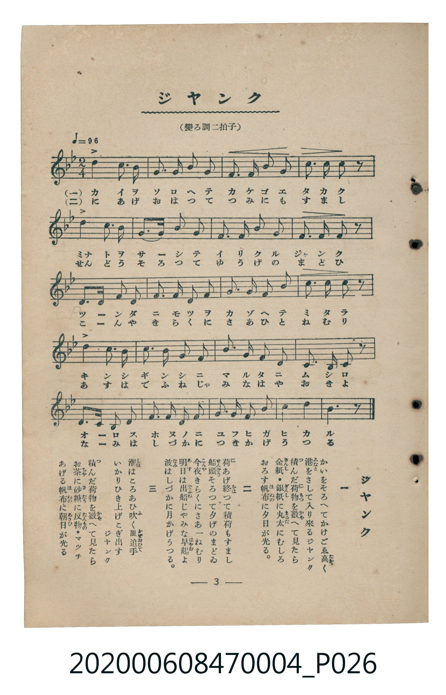

# ジャンク

<audio controls src="janku.mp3"></audio>

- 臺灣教育會公認《新定兒童唱歌》尋常科第四學年用（2020.006.0847.0004）

## 說明

原書資訊與歌詞全文（對應 P026.jpg，書頁 p. 3，第一學期第 3 首）：
調性與拍號：變ろ調二拍子（降 B 大調 2/4 拍，♩=96）

## 歌詞

```text
一
かいをそろへてかけごゑ高（たか）く
港（みなと）をさして入（い）り來（く）るジヤンク
積（つ）んだ荷物（にもつ）を數（かぞ）へて見（み）たら
金紙（きんし）・銀紙（ぎんし）に丸太（まるた）にむしろ
おろす帆布（ほぬの）に夕日（ゆふひ）が光（ひか）る。

二
荷（に）あげ終（を）つて積荷（つみに）もすまし
船頭（せんどう）そろつて夕（ゆふ）げのまどゐ
今夜（こんや）きらくにさあ一（ひと）ねむり
明日（あす）は出船（でふね）じやみな早起（はやおき）よ
波（なみ）はしづかに月（つき）かげうつる。

三
潮（しほ）はころあひ吹（ふ）く風追手（かぜおひて）
いかりひき上（あ）げこぎ出（だ）すジヤンク
積（つ）んだ荷物（にもつ）を數（かぞ）へて見（み）たら
お茶（ちや）に砂糖（さたう）に反物（たんもの）・マツチ
あげる帆布（ほぬの）に朝日（あさひ）が光（ひか）る
```

## 原書掃描頁



## 分析

```text
================================================================================
📊 TMD Song Profile: [ ジャンク ]
================================================================================
⏱  Duration:       0:25 (25.0s), 20 measures total
🎼 Key & Tempo:    首調基準 B,, != 96.0 BPM, <2/4>
   - 分析範圍：      由實際發聲的音符與和弦推測調性；播放脈絡另行呈現
🎤 人聲音域:    F4 (MIDI 65) – F5 (MIDI 77) [跨度: 12 個半音 / 1.0 個八度, 難度: easy]
   - 最低音:  F4 in [Janku #1 @ m.8, 0:08]
   - 最高音: F5 in [Janku #1 @ m.18, 0:22]
   - 適合: soprano, mezzo-soprano, contralto, tenor, baritone, bass
🏛  結構:      Janku (25.0s)
⚡ 編曲密度:        Peak 1 軌道同時演奏
🗝  調性診斷：       G 小調（純淨自然小調，未偵測到可信轉調）
   - 風格氣質:    純淨自然小調（陰鬱抒情、旋律集中，無明顯調外色彩）
   - 轉調歷程:    全曲維持單一推測調性（未偵測到可信轉調）
   - 核心骨幹音:  C, D, G, A#, F
   - 調性數值:    G 小調 [相關度: 0.79, 穩定度: Moderate, 自然音純度: 100.0%]
   - 候選調性 (K-S): G 小調 (0.79), A# 大調 (0.68), F 大調 (0.56)
   - 五度圈歷程:   +1
   - 各段落調性細節:
     • [Janku #1]: G 小調 (r: 0.79, 自然音純度: 100.0%)

  [ 五度圈游移軌跡 ]
               C  
         F           [G ]*
      Bb               D  
      Eb               A  
         Ab           E  
            Db       B  
               F# 
     (* = active key center)

  [ 十二半音累積音高分佈 ]
     C  : ████████████████████████  22.0%
     C# :                            0.0%
     D  : ████████████████████████  22.0%
     D# : ██                         2.0%
     E  :                            0.0%
     F  : ██████████                 9.3%
     F# :                            0.0%
     G  : ███████████████████████   20.7%
     G# :                            0.0%
     A  : ████                       3.3%
     A# : ███████████████████████   20.7%
     B  :                            0.0%
--------------------------------------------------------------------------------
Assignment 軌道音域：
  - Piano         : F4 – F5 (12 個半音 / 1.0 個八度, 73 個音符)
================================================================================
```

## ABC

```abc
X:1
T:ジャンク
C:TMD (Chen, Chih-Han / aguai)
M:2/4
L:1/16
Q:1/4=96
K:Bb
V:V1 name="Piano" snm="Pia"
[V:V1]
d4 c3 b | g3 a b2 c2 | d2 d2 e2 d2 | c3 d c2 z2 |
d2 d2 c3 b | g3 a b2 c2 | d2 c2 b2 g2 | f2 a2 g2 z2 |
b3 b g2 f2 | g2 b2 c2 d2 | c2 b2 g2 b2 | c2 c2 d2 z2 |
d3 e d2 c2 | b2 g2 f4 | g3 g f2 g2 | b2 c2 d2 z2 |
g3 a b2 g2 | f2 b2 d2 f2 | d3 b c2 g2 | b2 c2 b2 z2 |
```

- [主旋律 TMD 檔案](janku.tmd)
- [鋼琴伴奏 TMD 檔案](janku_piano.tmd)
