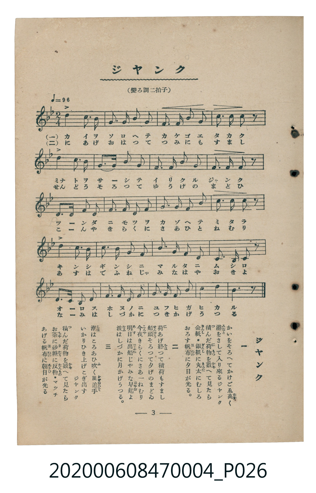

# ジヤンク

> Re:Shōka 使用 AI 協助辨識與重建樂譜，可能會有錯誤。歡迎回報。

- **鋼琴伴奏版**：<br><audio controls src="janku.mp3"></audio>
- **NEUTRINO 歌聲合成版**：<br><audio controls src="janku_neutrino.mp3"></audio>

- 臺灣教育會公認《新定兒童唱歌》尋常科第四學年用（2020.006.0847.0004）

## 說明

原書資訊與歌詞全文（對應 P026.jpg，書頁 p. 3，第一學期第 3 首）：
調性與拍號：變ろ調二拍子（降 B 大調 2/4 拍，♩=96）


## 歌詞

```text
一
かいをそろへてかけごゑ高く
港をさして入り來るジヤンク
積んだ荷物を數へて見たら
金紙・銀紙に丸太にむしろ
おろす帆布に夕日が光る。

二
荷あげ終つて積荷もすまし
船頭そろつて夕げのまどゐ
今夜きらくにさあ一ねむり
明日は出船じやみな早起よ
波はしづかに月かげうつる。

三
潮はころあひ吹く風追手
いかりひき上げこぎ出すジヤンク
積んだ荷物を數へて見たら
お茶に砂糖に反物・マッチ
あげる帆布に朝日が光る
```

## ABC

<div class="abc-score" data-abc-src="janku.abc" aria-label="五線譜載入中"></div>

[下載 ABC 原始檔](janku.abc)

## TMD 檔案連結

- [主旋律 TMD 檔案](janku.tmd) [[在 TMD Studio 編輯](https://tmdlang.github.io/Tmd-TS/#tmd=s7IKdvYPcrWy4qpTUCpJTLdSSM7PyUlNLsnMz7MqzsjMK0nNjM_KTMmPL87Iz05Ugisry88pzU21Si9KTEmNN4k3MjAyiDcwMIs3sDAxBzIMTBBKi_NLi5JTrYqTM_Lzc-JLUitKkvLzs9Hl4wsS01OtAgyMzBAyBUX5Zal5iXlA3QVFILekgLUjFKSWZaakgqSLkxPz4stSizLTMlNTkFyZWlQM9gnEipKixLzi5KLMApD3EKrSU_OKUq2SMzJzUopS8-KL8_PSEZIlGalAf4J1FuQXIdmdX5SZnplnVZKYWQ60Oz8tLTM5MzEHWb4kIx8YPgUZlVYZmcUlQPXJiTnx2Yl5wGDU0lJ43LTjcfOSx82bHzetV9DS4lK0VbA047K3VXDS4bIx0jexA5n0on3X88bFz6bOfNG06dmc5qeta16s6n3c0PVs2oan62Y9bZ30fPXSp1M2Plvb87ih--mG7qc7djxfPvH5mjVPZ89-unbH051bnk9Z8X5PByh-9IDxoweKHyDDwOT9nk4lLi59LQVbagEuBQWFp33zn83e8WJz-4sVXS862oHuerFy3tPWFc-mtQNd8XRD77P2TgVQJOtlFaS_39MDVPxyQaNCgZ6CMZAHdPeTHQ1Adz-bMx_IVjBWeLlsGtCh7_fMAhn-YtX-Zw3LQcZ2976YOR8o-mJd1-OmXqD4k109QMGnaycAbXk5s1fBSeHpkuVAcQVgQCoAZYCGP5q50tbSDGgaF8gsoD0g6nFj9-PGlsdNkx43zgWa9Lhxx-PGZWDBiY8bpzxumvhy9YzHjf0gpc92rAerm_q4cTpQ0dPWpY-bup7sa3vc1I0clSClz1f2Pm6a_LhxwYve7c87VwK1PZsKNBhk9otlQLPnP27qBKl72T7x-ZaZj5t3v-xqADEaVz_ZsePpklVAxuOmBpA9Tb0QV4K8-bhx5tMdbU93NAOlny6Z-mz60seNPU9bO0EOaGiC-GpXDzigerc_bmx63Djp-VYguQRoLdBFIMEmIBdozT6g0WB1HTtfLlgL8zpIHdBcoLbHjevAioAunwA2dnfX0yVzHjcCfdUJDA2Q80DB0AQMxMeNa0FObeoCB9GMPrCr1j9t3wU0-3HjjMdNLY8b9z9uXPVs-soXW4EO6ACr27wIqAgcjkDVwABZ_WxOB5gBtLoN5BIkL-0AB9WzvUAnAbVMBjsV6I1NTycALeh_uWjFi_17n3V2Q8IJaBswNrqA0kDXPtkBZABNBMZEH9BFIK-TGVHACHjRsw3ozucLmp5vngaKgP5ekIbm3Y-b5z1ubn7c3AhRBwp1oOvhEfVszlzkiAIpojynQYGClj4Xl1diXnapVUBmYl6-Q41BTTXIBgUbQzMtOzALWwZXgOSzFwt7FDRMFJ5u6H--vkEHnis1sWgAWgQ1TAOoUdMKWHitVng0pQGOa4AiS-C8x82bwCJ7kUTWgkSaZ0B5bXBdCHMeN20Ei2yB8lbA1exHUrMaLLIezDMAk8iO29UDclwjhuMamxBGNE4Ci3QhiawHi0A8AIx7uC4kLzXuB4tATAZmJLiamUhq9oFFpmM6rgZYlumCoRGYNASKmMWDmUDKEELpAgVNIYJACkkQoscITBuARMBm-hhCwg9iLij8wTQ87CG8teBQB7HawGbBdIBCGxTWIJmNUJn9UJnV4BDWVQDbDrHLCOJ5qF3A4ITQsKCE8NYD8WIwaxnERGAAQmT2Q3WDAg4iMxMqsw8cYCh2GUMCEWbXbrjpIPHJUDf2Ql0BzOpQE7dC1fWDSnUwaw5UBua-TVCXQezCnz929VCUP5rnoyfBZqQE19wBDu-tGHloO0b-QM5Vq5DS_uNmSFIEiexAUrMYbNdm_PljNobFk5FS8UpwoM3FUNMLlYc4CaQGklMgOaINLAJxOChhwNTswzB5E7XzB0IQzELLIsCoACVyUCIABTxyJoEkGVBy2g4WhWURWFZaBc0IoMCGyADrD1AKBwltxpFLZoMNBKVTkIchKQ8SOHOR0i5KPgEGHkTdVnDQgVjroGl3H1RmJVDVBFTbwPmkBSwLTu9NiHQOkumF8pqgZoIgUg5q7APiBWAWKC_i9RyBqqSTsqzSgpFVIMn3cTNCpBspiS8Ci0B0gWISlj6RqxJwSYxZ3SBlS1BxBxJZiT-rIDIGalYBtmzgSRySMSCinWCRfmiCh-fRxqlI2aAJKRs8boTXc41rkcyB2AUpM9CzCiS5AylwcgdzkTMBWADMRc5EYAFQpsFbnwCDFZolgJEAIhsgaQMYARDRRVA1oIBHrU-AJTlqTQPOeCAZYOkPDGbMnAJJifDcAgxRSAqFplxgWIJCEpRCodkPGIqINA2yHxR6EJm1UD2gsAPlA_R8AsnSiJwJSvmIOg1UL0HUANuAUBmojxvnAfEOMAtWq0Hrycb5YDcSlUmA_THK2luItIGaSSCpZTs4JtYhZZLNKPUJJPuAdM1DUgNpS0FaV8hqFqCbDGxF4M0kiNYVLCkjt4ogFfdyJJGtSMkd2EuA60Jq6DWCKzugXvTMhtxu6wV7oANrJoHGN6I-gbHAWQKaPUD5AZE7oDnJCJJnDOMhLPQWFySlwXIIpPKAhD6i6IRUJ6AUBAlziAyoXQVKOwgZUCqEmAAKY8wcAmlnwcpoRCtoOZQHqi9A-sBdrWa05AmsvYDKkTMWrIIAVkDAUMPMJBB5kIqFEOMgeQ855wHTPLA2Q86TsFw-Gdq6g9ddcH83A3Ej3DoC7a4p4HxiSm4-WYWRT6DJrGknXATR_Hnc3AMW6cPIA0hNm-apYBFIk-Zx0xq4GogIct2A0fGAttLQMc6chOF8aJ6A5QSQCKR_ARFdCi2qIDxEdYPccwHnErgaRMsMUisi24XQBfMQot7F6Xx4hQTMLcA8Q36FBNQJpWEZEwLRM-AqWCoFZxlQxEKSG6jhBRLtAUcocjYDFdwg_lRwpIH0rIHKwBpGiI4UJNIQtqNnSbjt4HwGyWGQWIGILoVWHYgMAusEAXMdVAZWxUCafSARWPUECXOstoNzKKJAgPgD6kN4J2kNNPshbId11YB-h1aZPVAZEA8iB7MRu-21XFy6dgrggQYFIEOZCwA)]
- [鋼琴伴奏 TMD 檔案](janku_piano.tmd) [[在 TMD Studio 編輯](https://tmdlang.github.io/Tmd-TS/#tmd=s7IKdvYPcrWy4qpTUCpJTLdSyC8qychPL0osyKi0ysgsLskvykxOzInPTsxLVIIrKs4vLUpOjS9ITE-1CjAwMlPi0tJSeNy043HzksfNmx83rX-_p-Nl957nE7Y82bPl6dL-550d7_d0KmhpcSnaKliacdnbKjjpcNkY6ZvYgcx80b7reePiZ1Nnvmja9GxO89PWNS9W9T5u6Ho2bcPTdbOetk56vnrp0ykbn63tedzQ_XRD99MdO54vn_h8zZqns2c_Xbvj6c4tz6esAFppZGBkoGdgYKZnYGFiDmQYmABtRbi6LLWoODM_z6ogMzEvPz6xqCgxLz01NzWvBKEktSwzJTUvOdUqNSUT5PXEHCUuLq_EvOxSqwCQriAPhxqDmmouBSCwMTTTsgOz9LUUbNGBAtB5T3Y0vFjYo6BhovB0Q__z9Q06CqDA0ssqSNfEokFLH2aYBlCjphUwQFcrPJrSAMc1QJElcN7j5k1gkb1IImtBIs0zoLw2uC6EOY-bNoJFtkB5K-Bq9iOpWQ0WWQ_mGYBJZMft6gE5rhHDcY1NCCMaJ4FFupBE1oNFIB543LgMrgvJS437wSIQkx83QcwDicxEUrMPLDId03E1CsYKumBoBCYNgSJm8WAmkDKEULpAQVOIIJBCEoToMQLTBiARsJk-hpDwg5gLCn8wDQ97CG8tONRBrDawWTAdoNAGhTVIZiNUZj9UZjU4hHUVwLZD7DKCeB5qFzA4ITQsKCG89UC8GMxaBjERGIAQmf1Q3aCAg8jMhMrsAwcYil3GkECE2bUbbjpIfDLUjb1QVzxu3AQ1cStUXT8Qd4NZc6AyMPdtgroMYhf-_LGrh6L80TwfPQk2IyW45g5weG_FyEPbMfIHcq5ahZT2HzdDkiJIZAeSmsVguzbjzx-zMSyejJSKV4IDbS6Gml6oPMRJIDWQnALJEW1gEYjDQQkDpmYfhsmbqJ0_EIJgFloWAUYFKJGDEgEo4JEzCSTJgJLTdrAoLIvAstIqaEYABTZEBliPgFI4SGgzjlwyG2wgKJ2CPAxJeZDAmYuUdlHyCTDwIOq2goMOxFoHTbv7oDIrgaomoNoGzictYFlwem9CpHOQTC-U1wQ1EwSRclBjHxAvALNAeRGv5whUJZ2UZZUWjKwCSb6PmxEi3UhJfBFYBKILFJOw9IlclYBLYszqBilbgoo7kMhK_FkFkTFQs8rjJogDICGNMLQTLNIPTfDwPNo4FSkbNCFlg8eN8HqucS2SORC7IGUGelaBJHcgBU7uYC5yJgALgLnImQgsAMo0eOsTYLBCswQwEkBkAyRtACMAIroIqgYU8Kj1CbAkR61pwBkPJAMs_YHBjJlTICkRnluAIQpJodCUCwxLUEiCUig0-wFDEZGmQfaDQg8isxaqBxR2oHyAnk8gWRqRM0EpH1GngeoliJrHTaC8ApKB-rhxHhDvALNgtRq0nmycD3YjUZkE2BykrL2FSBuomQSSWraDY2IdUibZjFKfQLIPSNc8JDWQthSkdYWsZgG6ycBWBN5MgmhdwZIycqsIUnEvRxLZipTcHzdCcikkYBFqwJUdUC96ZkNut_WCPdCBNZNA4xtRn8BY4CwBzR6g_IDIHdCcZATJM4bxEBZ6iwuS0mA5BFJ5QEIfUXRCqhNQCoKEOUQG1K4CpR2EDCgVQkwAhTFmDoG0s2BlNKIVtBzKA9UXIH3AQHzc1IyWPIG1F1A5csaCVRDACggYapiZBCIPUrEQYhwk7yHnPGCaB9ZmyHkSlssnQ1t38LoL7u9mIG6EW0eg3TUFnE9Myc0nqzDyCTSZNe2EiyCaP4-be8AifRh5AKlp0zwVLAJp0jxuWgNXAxFBrhswOh7QVho6xpmTMJwPzROwnAASgfQvIKJLoUUVhIeobpB7LuBcAleDaJlBakVkuxC6YB5C1Ls4nQ-vkIC5BZhnyK-QgDqhNCxjQiB6BlwFS6XgLAOKWEhyAzW8QKI94AhFzmagghvEnwqONJCeNVAZWMMI0ZGCRBrCdvQsCbcdnM8gOQwSKxDRpdCqA5FBYJ0gYK6DysCqGEizDyQCq54gYY7VdnAORRQIEH9AfQjvJK2BZj-E7bCuGtDv0CqzByoD4kHkYDZit70WZZzBB3mcwYTEYQY8mRgY5_EK0Yax4JQDZJnGg5goYgak9tqIs84EyDBBsQzIIGwXWrOXZK_BrSXKa-gNCJqHJGo5TGJIItmL6gSQxcD0pGunAE5S0T5AfQiOETLHGMxR5gIA)]

## 分析

```text
================================================================================
📊 TMD Song Profile: [ ジヤンク ]
================================================================================
⏱  Duration:       0:26 (26.2s), 21 measures total
🎼 Key & Tempo:    首調基準 B,, != 96.0 BPM, <2/4>
   - 分析範圍：      由實際發聲的音符與和弦推測調性；播放脈絡另行呈現
🎤 人聲音域:    A#3 (MIDI 58) – D5 (MIDI 74) [跨度: 16 個半音 / 1.3 個八度, 難度: moderate]
   - 最低音:  A#3 in [Janku #1 @ m.16, 0:19]
   - 最高音: D5 in [Janku #1 @ m.1, 0:00]
   - 適合: soprano, mezzo-soprano, contralto, tenor, baritone, bass
🏛  結構:      Janku (26.2s)
⚡ 編曲密度:        Peak 1 軌道同時演奏
🗝  調性診斷：       F 大調（純淨自然大調，未偵測到可信轉調）
   - 風格氣質:    純淨自然大調（陽光明朗、易唱易記，無明顯調外色彩）
   - 轉調歷程:    全曲維持單一推測調性（未偵測到可信轉調）
   - 核心骨幹音:  F, C, D, A#, G
   - 調性數值:    F 大調 [相關度: 0.77, 穩定度: Moderate, 自然音純度: 100.0%]
   - 候選調性 (K-S): F 大調 (0.77), A# 大調 (0.74), D 小調 (0.63)
   - 五度圈歷程:   -1
   - 各段落調性細節:
     • [Janku #1]: F 大調 (r: 0.77, 自然音純度: 100.0%)

  [ 五度圈游移軌跡 ]
               C  
        [F ]*          G  
      Bb               D  
      Eb               A  
         Ab           E  
            Db       B  
               F# 
     (* = active key center)

  [ 十二半音累積音高分佈 ]
     C  : ███████████████████████   21.5%
     C# :                            0.0%
     D  : ██████████████████████    20.9%
     D# :                            0.0%
     E  :                            0.0%
     F  : ████████████████████████  22.8%
     F# :                            0.0%
     G  : ██████████████████        17.1%
     G# :                            0.0%
     A  :                            0.0%
     A# : ███████████████████       17.7%
     B  :                            0.0%
--------------------------------------------------------------------------------
Assignment 軌道音域：
  - Piano         : A#3 – D5 (16 個半音 / 1.3 個八度, 72 個音符)
================================================================================
```


## 原書掃描頁




