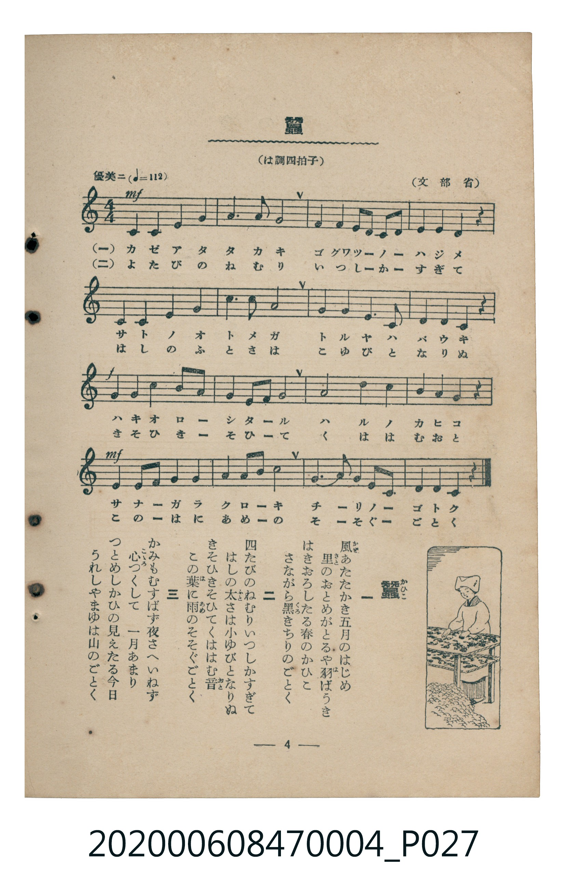

# 蠶

> Re:Shōka 使用 AI 協助辨識與重建樂譜，可能會有錯誤。歡迎回報。

<audio controls src="kaiko.mp3"></audio>

- 文部省唱歌
- 臺灣教育會公認《新定兒童唱歌》尋常科第四學年用（2020.006.0847.0004）

## 說明

原書資訊與歌詞全文（對應 P027.jpg，書頁 p. 4，第一學期第 4 首）：
調性與拍號：は調四拍子（C 大調 4/4 拍，「優美ニ（♩=112）」，文部省）

## 歌詞

```text
一
風（かぜ）あたたかき五月（ごぐゎつ）のはじめ
里（さと）のおとめがとるや羽（は）ばうき
はきおろしたる春（はる）のかひこ
さながら黒（くろ）きちりのごとく

二
四たびのねむりいつしかすぎて
はしの太（ふと）さは小（こ）ゆびとなりぬ
きそひきそひてくははむ音（おと）
この葉（は）に雨（あめ）のそそぐごとく

三
かみもむすばず夜（よる）さへいねず
心（こゝろ）つくして　一月（ひとつき）あまり
つとめしかひの見（み）えたる今日（けふ）
うれしやまゆは山（やま）のごとく
```

## ABC

```abc
X:1
T:蠶
M:4/4
L:1/16
Q:1/4=112
K:C
V:V1 name="Piano" snm="Pia"
[V:V1]
!mf! C4 C4 E4 G4 | A6 A2 G8 | F4 F4 E2 D2 C2 D2 | E4 E4 D4 z4 |
C4 C4 E4 G4 | c6 c2 A8 | G4 G4 E6 C2 | D4 D4 C4 z4 |
!f! G4 G4 c4 B2 A2 | G4 G2 F2 G8 | A8 d4 c4 | B4 A4 G4 z4 |
!mf! E4 E2 F2 G4 G4 | A4 A2 B2 c8 | G6 A2 G4 E2 C2 | D4 D4 C4 z4 |
```

## TMD 檔案連結

- [主旋律 TMD 檔案](kaiko.tmd) [[在 TMD Studio 編輯](https://tmdlang.github.io/Tmd-TS/#tmd=s7IKdvYPcrWy4qpTUCpJTLdSSM7PyUlNLsnMz7MqzsjMK0nNjM_KTMmPL87Iz05Ugisry88pzU21Si9KTEmNN4k3MjAyiDcwMIs3sDAxBzIMTBBKi_NLi5JTrYqTM_Lzc-JLUitKkvLzsxHyBUX5Zal5iXlANQVFIBtTwIoQClLLMlNSQdKpKZkl-UWZiTlI7kgtKga7FWxJfElRYl5xclFmAcgDCFUlGalAx5bnFwGt1dJSeLFgm4KWFpeirYKhoRGXva2CM5eNib6JHUj9s2ntL5tXPJ_T-HTKxmdre8BmvGjf9bxx8bOpM180bXo2p_lp65oXq3ofN3Q9m7bh6bpZT1snPV-9FKL8cUP30w3dT3fseL584vM1a57Onv107Y6nO7c8n7Li_Z4OUCjpAUNJDxRKQIaByfs9nUpcXPpaCrbUAlwKCgpP--Y_m73jxeb2Fyu6XnS0A931YuW8p60rgH4DuuLpht5n7Z0KAQZG5npZBenv9_QAFb9c0KhQoKcAdFAP0N1PdjQA3f1sznwgW8FE4eWyaUCHvt8zC2T4i1X7nzUsBxnb3fti5nyg6OPG9UBBoF-BIk_XTgBa4azwdMlyoJgCMFQVgKJAUx839DxtWfV8X9_j5m6gikczV9oCAx9o7OMGkDQ82IEiXCBrgE4AUS8XgQLucWP348Y5IMWNTY8b54MRUKT3ya4pz-Z0gBVMedw44XFT3-PGJWBl64COetw443FTI9iU9h6woqmPG4HGQaS7gGyg9OPGHjCj-3FTy_N9e8HK1oPVbHjc2Aa0A6QfbFgvSE8TkJwOsr-p-9mMpRDVQDbMUKCjNj1unAzRA7RtFcj4ps6XuyeBlfYD9YOVAk1Z-LgJ6ASgHqDLVwClIL7e1QOOwNmzwX7cDFaw9nFTA1hxC9B3YOuB1sx83Aj07DK464Ci654uWQW2ZivMm0AXrH-6oR8sOBkk0gT0EdBQoH2rwCaugegHOmcu2OVwxjKQY0HmAn3X8HL-ZrARoCADxQ9Yz2SghS8mAlMFPMBWv5wNiawmYLjCQgRoHBBNQPPmDqghQI_sf9wEVN8A9hEwyGc9XQKM6I7HTUAECVagJ3aA_b4WKAsOnf3NEB89bpoLC1BguADdCwyEZY8bGoBpB5YsgF4B2gqUhSgDpp59QI9DLAeKQlIAJESBSte9WAZKnEBHgVUDGaCIfrK769l0SFxPBAYuPATaHjcB0850YMIBmwoM2vVPN24EOx4kAgsBmMeBeijP3lCgoKXPxeWdmJmdbxWQmZiX71BjUKNQDbJCwcZCyw7MwFaqKEAy94uFPQoaJgrApPF8fYMOvCjQxKIBaBHUMA2gRk0rhcdNq0G-b9oDJheByf1AsgZKg_irgXgtmA0R3wIW3fC4eb3C4-YWIN4DxH1gGijd3A-W3gEimxdCtSHbu6sHbG8HONTng8nNYHIdxPxGiF3AVATEXQh7G1sg8Qwmp0OsbeyGWds4EyzeByaXoVoLDMzctFoFQwVdMDYGYlMgrlEwA5K6QBLEA8EaYPGoC8bGCkZAtUZAEZBqEDYCYgOQGnCaxx0fu3ooi4-t4IADhw4wUEHhsArif7AYJFAfN61BhAtULTgem0GhA6L7wTITwPpBoYGIQcyoaFwPDVJYJACzBTTIV0CMa5wKVQWLislgI9vAcqDIA9ErwDIgx0KiDVgeoUcDZgwYxoEDHkhB4gIkBpIBYZAqkPoacNiDMEgvMXGwo5OiOIAmYVCIQUL_cfNaWDpr2g4W3Q9N9qBQh8UDSBck9CFxAYo9kA4IbxJYHySwsMZCLzjM5oLJTWCyF564YaKQRA9L3iAZuKXQWASRIEsbwDxIPEBiETk7AHMDLJTBMWAODH5YwJsgZQdYpBiBFIFV1gDVgrIMRDMRkQGs_aiRIbogfgcn_MfNK6G-BPsZGjkohVRzIzQqQJEEiUJ4CQUpwCDZBmwCjggBJ3JghoAEOiR4QXEJCvYmsOZGqBwo08AiBBRVUIuh0TYBHo1T4NGBiDjUMgpS2kCiAFFGmQEDHZpTYBkEVmwZ48ggtVxcunYK4EpFAchQ5uICAA)]
- [鋼琴伴奏 TMD 檔案](kaiko_piano.tmd) [[在 TMD Studio 編輯](https://tmdlang.github.io/Tmd-TS/#tmd=s7IKdvYPcrWy4tLSUnixYNv7PR0vu_c8n7DlyZ4tT5f2P-_seL-nU0FLi0vRVsHQ0IjL3lbBmcvGRN_EjqtOQenZtPaXzSuez2l8OmXjs7U9SiCxF-27njcufjZ15oumTc_mND9tXfNiVe_jhq5n0zY8XTfraeuk56uXQpQ_buh-uqH76Y4dz5dPfL5mzdPZs5-u3fF055bnU1YAnWFkYGSgZ2BgpmdgYWIOZBiYAF2ixMXlnZiZnW8VkJmYlx_k4VBjUKNQzaUABDYWWnZghr6Wgi06UACa_2RHw4uFPQoaJgpPN_Q_X9-goxBgYGSul1WQrolFg5Y-zDANoEZNK4XHTauB_MdNe8DkIjC5H0jWQGkQfzUQrwWzIeJbwKIbHjevV3jc3ALEe4C4D0wDpZv7wdI7QGTzQqg2ZHt39YDt7QApaJwPJjeDyXUQ8xshdj1uagDiLoS9jS1gVUvA5HSItY3dMGsbZ4LF-8DkMlRrgYGZm1arYKigC8bGQGwKxDUKZkBSF0iCeCBYo2ACJEHYWMEIqNYIKAJSDcJGQGwAUsOFPz529VAWH1vBAQcOHWCggsJhFcT_YDFIoD5uWoMIF6hacDw2g0IHRPeDZSaA9YNCAxGDmFHRuB4apLBIeNwIcgQoUFdAjGucClUFi4rJYCPbwHKgyAPRK8AyIMdCou1xI8yR8GjAjAHDOHDAAylIXIDEQDIgDFIFUl8DDnsQBuklJg52dFIUB9AkDAoxSOg_bl4LS2dN28Gi-6HJHhTqsHgA6YKEPiQuQLEH0gHhTQLrgwQW1ljoBYfZXDC5CUz2whM3TBSS6GHJGyQDtxQaiyASZGkDmAeJB0gsImcHYG6AhTI4BsyBwQ8LeBOk7ACLFCOQIrDKGqBaUJaBaCYiMoAFIDUyRBfE7-CE_7h5JdSXYD9DIwelkGpuhEYFKJIgUQgvoSAFGCTbgE3AESHgRA7MEJBAhwQvKC5Bwd4E1twIlQNlGliEgKIKajE02ibAo3EKPDoQEYdaRkFKG0gUIMooM2CgQ3MKLIPAii1jHBmkFqVO8UGpU0ygdQow-8UrmMZDSWDhB2RCCHQZ03gwA0QZAA0nTjNUE5JCvHrxugJdJ5rZ-LlQ_cAg0bVTAIeKAjJDmYsLAA)]

## 分析

```text
================================================================================
📊 TMD Song Profile: [ 蠶 ]
================================================================================
⏱  Duration:       0:34 (34.3s), 16 measures total
🎼 Key & Tempo:    首調基準 C, != 112.0 BPM, <4/4>
   - 分析範圍：      由實際發聲的音符與和弦推測調性；播放脈絡另行呈現
🎤 人聲音域:    C4 (MIDI 60) – D5 (MIDI 74) [跨度: 14 個半音 / 1.2 個八度, 難度: moderate]
   - 最低音:  C4 in [Kaiko #1 @ m.1, 0:00]
   - 最高音: D5 in [Kaiko #1 @ m.11, 0:22]
   - 適合: soprano, mezzo-soprano, contralto, tenor, baritone, bass
🏛  結構:      Kaiko (34.3s)
⚡ 編曲密度:        Peak 1 軌道同時演奏
🗝  調性診斷：       C 大調（純淨自然大調，未偵測到可信轉調）
   - 風格氣質:    純淨自然大調（陽光明朗、易唱易記，無明顯調外色彩）
   - 轉調歷程:    全曲維持單一推測調性（未偵測到可信轉調）
   - 核心骨幹音:  G, C, A, E, D
   - 調性數值:    C 大調 [相關度: 0.90, 穩定度: Moderate, 自然音純度: 100.0%]
   - 候選調性 (K-S): C 大調 (0.90), G 大調 (0.80), A 小調 (0.62)
   - 五度圈歷程:   +0
   - 各段落調性細節:
     • [Kaiko #1]: C 大調 (r: 0.90, 自然音純度: 100.0%)

  [ 五度圈游移軌跡 ]
              [C ]*
         F            G  
      Bb               D  
      Eb               A  
         Ab           E  
            Db       B  
               F# 
     (* = active key center)

  [ 十二半音累積音高分佈 ]
     C  : ███████████████████       22.5%
     C# :                            0.0%
     D  : ██████████                11.7%
     D# :                            0.0%
     E  : ███████████               13.3%
     F  : ████                       5.0%
     F# :                            0.0%
     G  : ████████████████████████  28.3%
     G# :                            0.0%
     A  : █████████████             15.8%
     A# :                            0.0%
     B  : ███                        3.3%
--------------------------------------------------------------------------------
Assignment 軌道音域：
  - Piano         : C4 – D5 (14 個半音 / 1.2 個八度, 62 個音符)
================================================================================
```


## 原書掃描頁




