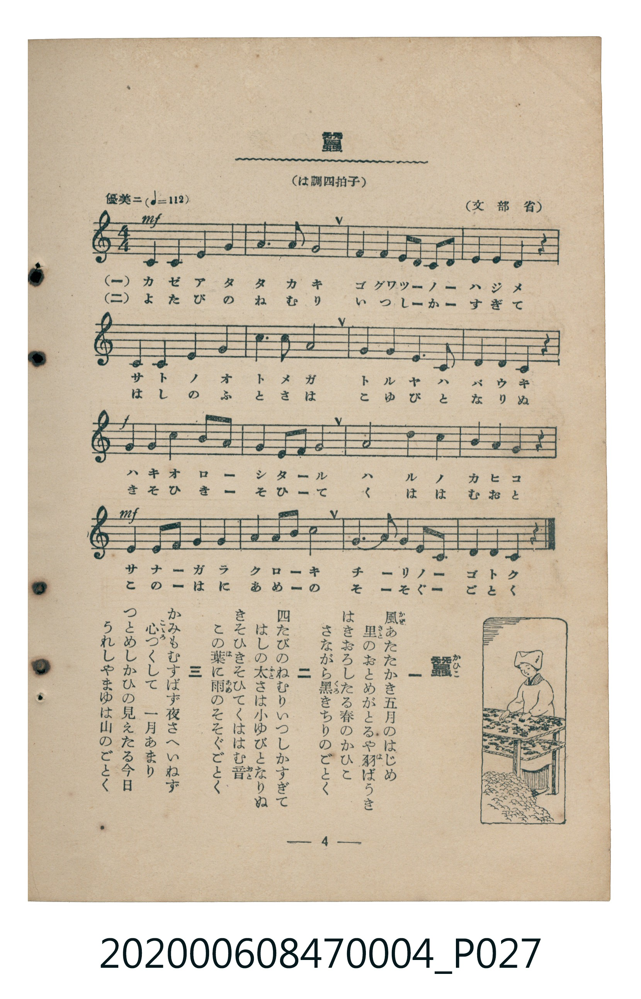

# 蠶

> Re:Shōka 使用 AI 協助辨識與重建樂譜，可能會有錯誤。歡迎[回報](https://github.com/TMDLang/reshoka/issues)。

- **鋼琴伴奏版**：<br><audio controls src="kaiko.mp3"></audio>
- **NEUTRINO 歌聲合成版**：<br><audio controls src="kaiko_neutrino.mp3"></audio>

- 文部省唱歌
- 臺灣教育會公認《新定兒童唱歌》尋常科第四學年用（2020.006.0847.0004）

## 說明

原書資訊與歌詞全文（對應 P027.jpg，書頁 p. 4，第一學期第 4 首）：
調性與拍號：は調四拍子（C 大調 4/4 拍，「優美ニ（♩=112）」，文部省）


## 歌詞

```text
一
風（かぜ）あたたかき五月（ごぐゎつ）のはじめ
里（さと）のおとめがとるや羽（は）ばうき
はきおろしたる春（はる）のかひこ
さながら黒（くろ）きちりのごとく

二
四たびのねむりいつしかすぎて
はしの太（ふと）さは小（こ）ゆびとなりぬ
きそひきそひてくははむ音（おと）
この葉（は）に雨（あめ）のそそぐごとく

三
かみもむすばず夜（よる）さへいねず
心（こゝろ）つくして　一月（ひとつき）あまり
つとめしかひの見（み）えたる今日（けふ）
うれしやまゆは山（やま）のごとく
```

## ABC

<div class="abc-score" data-abc-src="kaiko.abc" aria-label="五線譜載入中"></div>

[下載 ABC 原始檔](kaiko.abc)

## TMD 檔案連結

- [主旋律 TMD 檔案](kaiko.tmd) [[在 TMD Studio 編輯](https://tmdlang.github.io/Tmd-TS/#tmd=s7IKdvYPcrWy4qpTUCpJTLdSSM7PyUlNLsnMz7MqzsjMK0nNjM_KTMmPL87Iz05Ugisry88pzU21Si9KTEmNN4k3MjAyiDcwMIs3sDAxBzIMTBBKi_NLi5JTrYqTM_Lzc-JLUitKkvLzsxHyBUX5Zal5iXlANQVFIBtTwIoQClLLMlNSQdKpKZkl-UWZiTlI7kgtKga7FWxJfElRYl5xclFmAcgDCFUlGalAx5bnFyFZCzQoPTPPKjc_L6kU6DlkiZKMfKDHCjIqrTIyi0E2JifmxGcn5iH5H2pfQWJ6qlWAgZG5EpeWlsKLBdsUtLS4FG0VDA2NuOxtFZy5bEz0TexAup5Na3_ZvOL5nManUzY-W9sDNulF-67njYufTZ35omnTsznNT1vXvFjV-7ih69m0DU_XzXraOun56qUQ5Y8bup9u6H66Y8fz5ROfr1nzdPbsp2t3PN255fmUFe_3dIBCXw8Y-nqg0AcyDEze7-lU4uLS11KwpRbgUlBQeNo3_9nsHS82t79Y0fWiox3orhcr5z1tXQH0G9AVTzf0PmvvVACFhl5WQfr7PT1AxS8XNCoU6CkAHdQDdPeTHQ1Adz-bMx_IVjBReLlsGtCh7_fMAhn-YtX-Zw3LQcZ2976YOR8o-rhxPVAQ6FegyNO1E4BWOCs8XbIcKKYADFUFoCjQ1McNPU9bVj3f1_e4uRuo4tHMlbbAwAca-7gBJA0PdqAIF8gaoBNA1MtFoIB73Nj9uHEOSHFj0-PG-WAEFOl9smvKszkdYAVTHjdOeNzU97hxCVjZOqCjHjfOeNzUCDalvQesaOrjRqBxEOkuIBso_bixB8zoftzU8nzfXrCy9WA1Gx43tgHtAOkHG9YL0tMEJKeD7G_qfjZjKUQ1kA0zFOioTY8bJ0P0AG1bBTK-qfPl7klgpf1A_WClQFMWPm4COgGoB-jyFUApiK939YAjcPZssB83gxWsfdzUAFbcAvQd2HqgNTMfNwI9uwzuOqDouqdLVoGt2QrzJtAF659u6AcLTgaJNAF9BDQUaN8qsIlrIPqBzpkLdjmcsQzkWJC5QN81vJy_GWwEKMhA8QPWMxlo4YuJwFQBD7DVL2dDIqsJGK6wEAEaB0QT0Ly5A2oI0CP7HzcB1TeAfQQM8llPlwAjuuNxExBBghXoiR1gv68FyoJDZ38zxEePm-bCAhQYLkD3AgNh2eOGBmDagSULoFeAtgJlIcqAqWcf0OMQy4GikBQACVGg0nUvloESJ9BRYNVABiiin-zuejYdEtcTgYELD4G2x03AtDMdmHDApgKDdv3TjRvBjgeJwEIA5nGgHsqzNxQoaOlzcXknZmbnWwVkJublO9QY1FSDbFCwsdCyAzOwFSoKkLz9YmGPgoaJAjBlPF_foAMvCTSxaADaAzVMA6hR00rhcdNqkOeb9oDJRWByP5CsgdIg_mogXgtmQ8S3gEU3PG5er_C4uQWI9wBxH5gGSjf3g6V3gMjmhVBtyPbu6gHb2wEO9PlgcjOYXAcxvxFiFzARAXEXwt7GFkg0g8npEGsbu2HWNs4Ei_eByWWo1tYoVOem1SoYKuiCsTEQmwJxjYIZkNQFkiAeCNYAS0ddMDZWMAKqNQKKgFSDsBEQG4DUgI30MQSFxGogHxR2IHIRmNwPNgVCg_iQsIOZDgo7kCgw7NaBGMDQA5F9EElgyIEkd4DFFgLJeIR1RiDNHSAZYJCByM1gEmQKJMgg1kGCDG4dMMhAqpaAyelgshsqMxPMA9kMCi4Uu4xB8iB1wIwDNrUJajZCJ0huAxDPQvIa2HVNEH1TwSTIJwhXgNwI0QGxC3-y3tVDWbLeCk5_4EQGDF9QcloFSUZgMUjafNy0BpG8oGrB2aEZlMhAdD9YZgJYPyhRITICZopuXA9NmbC0DCxcoCl3BcQ4YLBAVMFS9GSwkW1gOVAeANErwDIgx0JSP7BUR0_NmAnZMA4cDUAKkqRBYiAZEAapAqmvASdhEAbpRU_KW8GpDhyH4PQICi9IqgSJQVIkKLzg8Q1VC84CwPCCqIGFF0g_KFVBEj9aOgYGASI9gvMBMKAgKWUFNG1BAgqRjieDzWoDy4FSPoiGBRRIBpTmQQGFmY7BOqH6e8FskFtBMqDcBnEHJAfA7NoENR2Rc3qBuAkstw9uGwgSk453dFKUjqGlKSjVQVLw4-a1sCKvaTtYdD-0BAalXFhaBumCpGBIegblAEiBBeJNAuuDJDisKbkXnO7mgslNYBIYBNByFiYKKX9hJS0kQKGWQnMCiARZ2gDmQdIyJCcgl8zAghmWUsGp2ByYhGGJ1wSpZIYlbCOQIrDKGqBaUOkN0YyWoKGFKbjQASdlUMBBCqrtYDFw0QZOvrAEDUkQiEQNLZYhpTww0EC6QIkPPTlDktVcMAlJPCARSFghxJCTGNwmaFYAkZCQAvEgiRmUANETMyQ5gpNmUyOYDcpEiOIaYhMoS8FsAvuyEaniABfQIJmJYDFQxiMyKQNbsdQokrsgKQdc9D5uXglNI-AUA03aKK2N5kZoQgYlcUgGgDc1IC0RSMENNgFHcgYXs8BggSRZSOIE5QRQMDSBNTdC5UDFNiw5gxI61GJoop8AzwRT4IkZkexRGxuQZgMkASMaG2bAJAstq2FFNKz9YUxkEQ1OHeCCGBR6kHQDTkXg9I3S2gCGHSxFQ3IALEWDWyGQAhysFz1FQwpNSNEMSaGgPAAJLkTaQ05noJQOSdGQNA-qAiABhShMQakePUWDi_SmHrA8uEJoAjUWEEUtpMhHqgrA8hCbwCrgTSDsNtVycenaKYCb1gpAhjIXAA)]
- [鋼琴伴奏 TMD 檔案](kaiko_piano.tmd) [[在 TMD Studio 編輯](https://tmdlang.github.io/Tmd-TS/#tmd=s7IKdvYPcrWy4qpTUCpJTLdSyC8qychPL0osyKi0ysgsLskvykxOzInPTsxLVIIrKs4vLUpOjS9ITE-1CjAwMlfi0tJSeLFg2_s9HS-79zyfsOXJni1Pl_Y_7-x4v6dTQUuLS9FWwdDQiMveVsGZy8ZE38QOZNSzae0vm1c8n9P4dMrGZ2t7wMa_aN_1vHHxs6kzXzRtejan-Wnrmhereh83dD2btuHpullPWyc9X70UovxxQ_fTDd1Pd-x4vnzi8zVrns6e_XTtjqc7tzyfsgLoDCMDIwM9AwMzPQMLE3Mgw8AE6BIlLi7vxMzsfKuAzMS8_CAPhxqDmmouBSCwsdCyAzP0tRRs0YEC0PgnOxpeLOxR0DBReLqh__n6Bh0FkL_1sgrSNbFo0NKHGaYB1KhppfC4aTWQ_7hpD5hcBCb3A8kaKA3irwbitWA2RHwLWHTD4-b1Co-bW4B4DxD3gWmgdHM_WHoHiGxeCNWGbO-uHrC9HSAFjfPB5GYwuQ5ifiPErsdNDUDchbC3sQWsagmYnA6xtrEbZm3jTLB4H5hchmptjUJ1blqtgqGCLhgbA7EpENcomAFJXSAJ4oFgjYIJkARhYwUjoFojoAhINQgbAbEBSA3YSB9DUEisBvJBYQciF4HJ_WBTIDSIDwk7mOmgsAOJAsNuHYgBDD0Q2QeRBIYcSHIHWGwhkIxHWGcE0twBkgEGGYjcDCZBpkCCDGIdJMjg1gGDDKRqCZicDia7oTIzwTyQzaDgQrHLGCQPUve4EeSNx01NULMROkFyG4B4FpLXwK5rguibCiZBPkG4AuRGiA6IXfiT9a4eypL1VnD6AycyYPiCktMqSDICi0HS5uOmNYjkBVULzg7NoEQGovvBMhPA-kGJCpERMFN043poyoSl5ceNIEeAAmAFxDhgsEBUwVL0ZLCRbWA5UB4A0SvAMiDHQlL_40aYI-GpGTMhG8aBowFIQZI0SAwkA8IgVSD1NeAkDMIgvehJeSs41YHjEJweQeEFSZUgMUiKBIUXPL6hasFZABheEDWw8ALpB6UqSOJHS8fAIECkR3A-AAYUJKWsgKYtSEAh0vFksFltYDlQygfRsIACyYDSPCigMNMxWCdUfy-YDXIrSAaU2yDugOQAmF2boKYjck4vEDeB5fbBbQNBYtLxjk6K0jG0NAWlOkgKfty8FlbkNW0Hi-6HlsCglAtLyyBdkBQMSc-gHAApsEC8SWB9kASHNSX3gtPdXDC5CUwCgwBazsJEIeUvrKSFBCjUUmhOAJEgSxvAPEhahuQE5JIZWDDDUio4FZsDkzAs8ZoglcywhG0EUgRWWQNUCyq9IZrREjS0MAUXOuCkDAo4SEG1HSwGLtrAyReWoCEJApGoocUypJQHBhpIFyjxoSdnSLKaCyYhiQckAgkrhBhyEoPbBM0KIBISUiAeJDGDEiB6YoYkR3DSbGoEs0GZCFFcQ2wCZSmYTWBfNiJVHOACGiQzESwGynhEJmVgQ4YaRXIXJOWAi97HzSuhaQScYqBJG6W10dwITcigJA7JAPCmBqQlAim4wSbgSM7gYhYYLJAkC0mcoJwACoYmsOZGqByo2IYlZ1BCh1oMTfQT4JlgCjwxI5I9amMD0myAJGBEY8MMmGShZTWsiIa1P4yJLKLBqQNcEINCD5JuwKkInL5RWhvAsIOlaEgOgKVocCsEUoCD9aKnaEihCSmaISkUlAcgwYVIe8jpDJTSISkakuZBVQAkoBCFKSjVo6docJHe1AOWB1cITaDGAqKohRT5SFUBWB5iE1gFvAmE3aZalJa1D3LL2gTasgbWnvEKpvFQEtgEBDIhBLqMaTyYAaIMoL4grBmqCUkhXr14XYGuE81s_FyofmCI6NopgAMl2scwVgHBMULmGIM5ylwA)]

## 分析

```text
================================================================================
📊 TMD Song Profile: [ 蠶 ]
================================================================================
⏱  Duration:       0:34 (34.3s), 16 measures total
🎼 Key & Tempo:    首調基準 C, != 112.0 BPM, <4/4>
   - 分析範圍：      由實際發聲的音符與和弦推測調性；播放脈絡另行呈現
🎤 人聲音域:    C4 (MIDI 60) – D5 (MIDI 74) [跨度: 14 個半音 / 1.2 個八度, 難度: moderate]
   - 最低音:  C4 in [Kaiko #1 @ m.1, 0:00]
   - 最高音: D5 in [Kaiko #1 @ m.11, 0:22]
   - 適合: soprano, mezzo-soprano, contralto, tenor, baritone, bass
🏛  結構:      Kaiko (34.3s)
⚡ 編曲密度:        Peak 1 軌道同時演奏
🗝  調性診斷：       C 大調（純淨自然大調，未偵測到可信轉調）
   - 風格氣質:    純淨自然大調（陽光明朗、易唱易記，無明顯調外色彩）
   - 轉調歷程:    全曲維持單一推測調性（未偵測到可信轉調）
   - 核心骨幹音:  G, C, A, E, D
   - 調性數值:    C 大調 [相關度: 0.90, 穩定度: Moderate, 自然音純度: 100.0%]
   - 候選調性 (K-S): C 大調 (0.90), G 大調 (0.80), A 小調 (0.62)
   - 五度圈歷程:   +0
   - 各段落調性細節:
     • [Kaiko #1]: C 大調 (r: 0.90, 自然音純度: 100.0%)

  [ 五度圈游移軌跡 ]
              [C ]*
         F            G  
      Bb               D  
      Eb               A  
         Ab           E  
            Db       B  
               F# 
     (* = active key center)

  [ 十二半音累積音高分佈 ]
     C  : ███████████████████       22.5%
     C# :                            0.0%
     D  : ██████████                11.7%
     D# :                            0.0%
     E  : ███████████               13.3%
     F  : ████                       5.0%
     F# :                            0.0%
     G  : ████████████████████████  28.3%
     G# :                            0.0%
     A  : █████████████             15.8%
     A# :                            0.0%
     B  : ███                        3.3%
--------------------------------------------------------------------------------
Assignment 軌道音域：
  - Piano         : C4 – D5 (14 個半音 / 1.2 個八度, 62 個音符)
================================================================================
```


## 原書掃描頁




