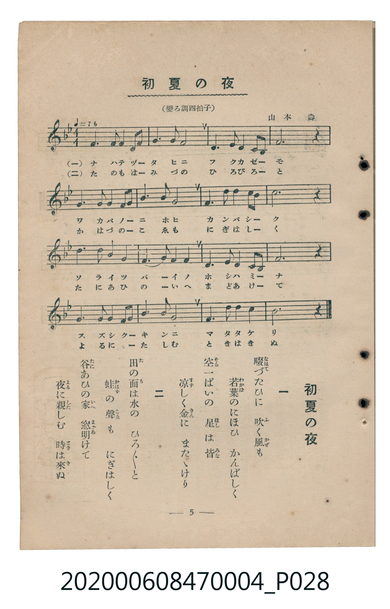

# 初夏の夜

> Re:Shōka 使用 AI 協助辨識與重建樂譜，可能會有錯誤。歡迎回報。

<audio controls src="shoka_no_yoru.mp3"></audio>

- 曲：山本壽
- 臺灣教育會公認《新定兒童唱歌》尋常科第四學年用（2020.006.0847.0004）

## 說明

原書資訊與歌詞全文（對應 P028.jpg，書頁 p. 5，第一學期第 5 首）：
調性與拍號：變ろ調四拍子（降 B 大調 4/4 拍，♩=76）

## 歌詞

```text
一
畷（なはて）づたひに　吹（ふ）く風（かぜ）も
若葉（わかば）のにほひ　かんばしく
空（そら）一ぱいの　星（ほし）は皆（みな）
涼（すず）しく金（きん）に　またゝけり

二
田（た）の面（も）は水（みづ）の　ひろ／″＼と
蛙（かはづ）の聲（こゑ）も　にぎはしく
谷（たに）あひの家（いへ）　窓（まど）明（あ）けて
夜（よる）に親（した）しむ　時（とき）は來（き）ぬ
```

## ABC

```abc
X:1
T:初夏の夜
C:曲：山本壽
M:4/4
L:1/16
Q:1/4=76
K:Bb
V:V1 name="Piano" snm="Pia"
[V:V1]
F6 F2 F4 D2 F2 | G6 G2 F8 | D6 E2 D4 C2 B,2 | F12 z4 |
G6 G2 G4 F2 G2 | B6 B2 G8 | F6 d2 d4 c2 B2 | c12 z4 |
d6 d2 B4 G4 | F6 G2 F4 F4 | D6 E2 D4 C2 B,2 | F12 z4 |
G6 G2 G4 F2 G2 | B6 B2 G8 | F6 d2 d4 c4 | B12 z4 |
```

## TMD 檔案連結

- [主旋律 TMD 檔案](shoka_no_yoru.tmd) [[在 TMD Studio 編輯](https://tmdlang.github.io/Tmd-TS/#tmd=s7IKdvYPcrWy4qpTUCpJTLdSSM7PyUlNLsnMz7MqzsjMK0nNjM_KTMmPL87Iz05Ugisry88pzU21Si9KTEmNN4k3MjAyiDcwMIs3sDAxBzIMTBBKi_NLi5JTrYqTM_Lzc-JLUitKkvLzsxHyBUX5Zal5iXlANQVFIBtTwIoQClLLMlNSQdLFyYl58WWpRZlpmakpCPn8opKMfKBLCjIqrTIyi0vyizKTE3PisxPzkB2cWlQM9hTYNfElRYl5xclFmQUgnyJUlWSkAn1VkpmbGp-fFp-SWIkuVZyaWJyfV6zEpaWl8LRj7tMl_Y8b1z1dMkdBS4tL0VbB3IzL3lbBSYfLxkTfxA6k99nsTe_3zHq6ceOzOWueLt4LNu9F-67njYufTZ35omnTsznNT1vXvFjV-7ih69m0DU_XzXraOun56qVPp2x8trbncUP30w3dT3fseL584vM1a57Onv107Y6nO7c8n7Li_Z4OUKjrAUNdDxTqQIaByfs9nUpcXPpaCrbUAlwKCgpP--Y_m73jxeb2Fyu6XnS0A931YuW8p60rnk1rB7ri6YbeZ-2dCgEGRhZ6WQXp7_f0ABW_XNCoUKCnYArkAd39ZEcD0N3P5swHshVMFV4umwZ0KDBYQIa_WLX_WcNykLHdvS9mzgeKvljX9bipFygO9C5Q8OnaCUBbXs7sVXBSeLpkOVBcARi4CkAZoOGPZq60NTcDmsYFMgtoD4h6PnU7UMfjxlWPG9c_blwGlH3cuPRx4_zHjZseN65-3NDwdMJOsIKtYKn-l4tAofm4sftx4xyQSFMT2GHdS19MBLqy43ETMJKBchvAqteBjGjcDTKroQEk3jQZKPW4cTrQILDlK3eBDZv7uAmouRPopMeNGx83toB0NjQ8mwH0IVAWqH862Lj1z2e1gUX2A90L8gfQiGfb9oCFZj5unAVWBDL7ZftEsGAv0EKwIMgjjxv3gfzVNPdx48THTV2QQNjVA3bHFKB7geqB9oFc_XLuIrBXmiC2PtuwBWbrUqi3QKZtAgb8-z39jxo2v9-z53HjCnA4zJ4JCx1gaEJVv2gEJmug4OTHTUBngYIMrB8YMn1gZbDQeLEBEhXAsF8N1tkEjoR1T9dtA4sDg2UHSLyh4fkqoLeAIkAPrQSKPJvRB-ZC3DsRGI3glLgEGEFAXwBRNyQQXiwDhhpQHdBCiE-nP25qAAX0TKBOoPgKYIhBvPxkHySgIdw1IOMozx5QoKClz8UVDCoi_fIj84tKrQIyE_PyHWoMahSqQRYp2Fho2YEZ2PKmAiSLvFjYo6BhovB0Q__z9Q068AyliUUD0DqoYRpAjZpWCo-bu0ACYPC4uR9MtsH5rVB6D5CsUXjctB9J7SQw2Q0XgQGguuapCHVN68HkajgfZBbETJDKRRj6kQGyc3f1gJzbOB9hdOM6sIFNcD7IKiTnNiI5t3EpXAcqAKnbhFDX1AtWtxmFD3du4woM_cgA6twaBdN4BV0gBFJgljGYrlEwgwgDKagCXaAgUBLEMImHsIziFQxBauEqQNAApBKcSXGng109lKUDSOBBPA2KrcfNE2D85j4oDYptUKzNRqiFpgNIrCIDUHqBxTpIBShIkcxs2g4VBwcsOJXgBljSASLhQeIdEsMQPiSWgYUM1BkTEWrBqQWHcxuRnNsI8jIsRYFY0yE0NB2AMgpuAE8HiAgHs4BxCqRrFAzBooYwaVAqgEa3MRAC0wBQrgZIkpYAdnRSlACa9iJ837wSRDYtgfNboCxQ5COFJjgckdVBEgpGIgFHNqR4gaiD5GJYIYAogrABAoUAOK02IgoBWGYGRRMiu0Od2gjzCLD6QFK3D8k8sNeRzIN4Fxbxy5BdhgHgEQ-KRVBsgmIaHMvwGIZlfjBBtdwPbPFQFvk7ESHQtAtMQvInrAQH0WvBXoPkZKgcuETAkZ2a5yGZCSqKEfXH46aNSOpWYehGBpjR39SBZDDYAfCcC3MKJImAIgySbyFqG5BUIAPUkh1Y04NJRN6H1AEQdWswdCMDynM-SAiiCjnya7m4dO0UkBoKCkCuMhcXAA)]
- [鋼琴伴奏 TMD 檔案](shoka_no_yoru_piano.tmd) [[在 TMD Studio 編輯](https://tmdlang.github.io/Tmd-TS/#tmd=s7IKdvYPcrWy4tLSUnjaMffpkv7HjeueLpnzfk_Hy-49zydsebJny9Ol_c87O97v6VTQ0uJStFUwN-Oyt1Vw0uGyMdE3seOqU1B6NnvT-z2znm7c-GzOmqeL9yqBxF6073reuPjZ1JkvmjY9m9P8tHXNi1W9jxu6nk3b8HTdrKetk56vXvp0ysZna3seN3Q_3dD9dMeO58snPl-z5uns2U_X7ni6c8vzKSuAzjAyMDLQMzAw0zOwMDEHMgxMgC5R4uIKzsjPTvTLj8wvKrUKyEzMyw_ycKgxqFGo5lIAAhsLLTswQ19LwRYdKABtebKj4cXCHgUNE4WnG_qfr2_QUQgwMLLQyypI18SiQUsfZpgGUKOmlcLj5i6QABg8bu4Hk21wfiuU3gMkaxQeN-1HUjsJTHbDRWAAqK55KkJd03owuRrOB5kFMROkchGGfmSA7NxdPSDnNs5HGN24DmxgE5wPsgrJuY1Izm1cCteBCkDqNiHUNfWC1W1G4cOd27gCQz8ygDq3RsE0XkEXCIEUmGUMpmsUzCDCQAqqQBcoCJQEMUziISyjeAVDkFq4ChA0AKnkwp8OdvVQlg4ggQfxNCi2HjdPgPGb-6A0KLZBsTYboRaaDiCxigxA6QUW6yAVoCBFMrNpO1QcHLDgVIIbYEkHiIQHiXdIDEP4kFh-3DgZ6oyJCLXg1ILDuY1Izm0EeRmWokCs6RAamg5AGQU3gKcDRISDWcA4BdI1CoZgUUOYNCgVQKPbGAiBaQAoVwMkSUsAOzopSgBNexG-b14JIpuWwPktUBYo8pFCExyOyOogCQUjkYAjG1K8QNRBcjGsEEAUQdgAgUIAnFYbEYUALDODogmR3aFObYR55HHjDiR1-5DMA3sdyTyId2ERvwzZZRgAHvGgWATFJiimwbEMj2FY5gcTVMv9wLqGssjfiQiBpl1gEpI_YSU4iF4L9hokJ0PlwCUCjuzUPA_JTFBRjKg_HjdtRFK3CkM3MsCM_qYOJIPBDoDnXJhTIEkEFGGQfAtR24CkAhmgluyPGyF1ACLvQ-oAiLo1GLqRAeU5HyQEUYUc-bVY2gk-KO0EE1q0E4BOASdXWAVmEg9OnxBBmKQpUBCYbkE-ATOAQgY0qa3g9gNzCziXQOyHClLkHHLKThz2Ux44ZGVmEgMHzAVLgZwDTF66dgpIKUwBk6vMBQA)]

## 分析

```text
================================================================================
📊 TMD Song Profile: [ 初夏の夜 ]
================================================================================
⏱  Duration:       0:50 (50.5s), 16 measures total
🎼 Key & Tempo:    首調基準 B,, != 76.0 BPM, <4/4>
   - 分析範圍：      由實際發聲的音符與和弦推測調性；播放脈絡另行呈現
🎤 人聲音域:    A#3 (MIDI 58) – D5 (MIDI 74) [跨度: 16 個半音 / 1.3 個八度, 難度: moderate]
   - 最低音:  A#3 in [ShokaNoYoru #1 @ m.3, 0:09]
   - 最高音: D5 in [ShokaNoYoru #1 @ m.7, 0:20]
   - 適合: soprano, mezzo-soprano, contralto, tenor, baritone, bass
🏛  結構:      ShokaNoYoru (50.5s)
⚡ 編曲密度:        Peak 1 軌道同時演奏
🗝  調性診斷：       A# 調性不明確（純淨自然大調，未偵測到可信轉調）
   - 風格氣質:    純淨自然大調（陽光明朗、易唱易記，無明顯調外色彩）
   - 轉調歷程:    全曲維持單一推測調性（未偵測到可信轉調）
   - 核心骨幹音:  F, G, D, A#, C
   - 調性數值:    A# 調性不明確 [相關度: 0.74, 穩定度: Ambiguous, 自然音純度: 100.0%]
   - 候選調性 (K-S): A# 大調 (0.74), F 大調 (0.72), G 小調 (0.64)
   - 五度圈歷程:   -2
   - 各段落調性細節:
     • [ShokaNoYoru #1]: A# 調性不明確 (r: 0.74, 自然音純度: 100.0%)

  [ 五度圈游移軌跡 ]
               C  
         F            G  
     [Bb]*              D  
      Eb               A  
         Ab           E  
            Db       B  
               F# 
     (* = active key center)

  [ 十二半音累積音高分佈 ]
     C  : ███████                    9.2%
     C# :                            0.0%
     D  : █████████████             17.5%
     D# : █                          1.7%
     E  :                            0.0%
     F  : ████████████████████████  31.7%
     F# :                            0.0%
     G  : ██████████████████        24.2%
     G# :                            0.0%
     A  :                            0.0%
     A# : ████████████              15.8%
     B  :                            0.0%
--------------------------------------------------------------------------------
Assignment 軌道音域：
  - Piano         : A#3 – D5 (16 個半音 / 1.3 個八度, 55 個音符)
================================================================================
```


## 原書掃描頁




