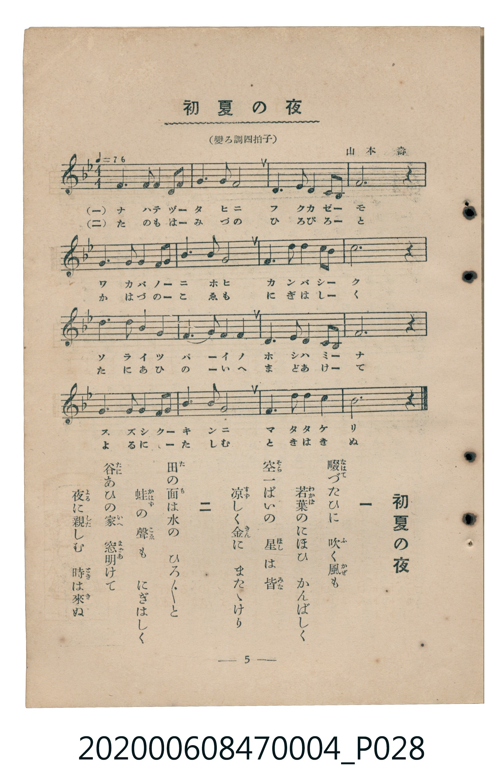

# 初夏の夜

> Re:Shōka 使用 AI 協助辨識與重建樂譜，可能會有錯誤。歡迎[回報](https://github.com/TMDLang/reshoka/issues)。

- **鋼琴伴奏版**：<br><audio controls src="shoka_no_yoru.mp3"></audio>
- **NEUTRINO 歌聲合成版**：<br><audio controls src="shoka_no_yoru_neutrino.mp3"></audio>

- 曲：山本壽
- 臺灣教育會公認《新定兒童唱歌》尋常科第四學年用（2020.006.0847.0004）

## 說明

原書資訊與歌詞全文（對應 P028.jpg，書頁 p. 5，第一學期第 5 首）：
調性與拍號：變ろ調四拍子（降 B 大調 4/4 拍，♩=76）


## 歌詞

```text
一
畷（なはて）づたひに　吹（ふ）く風（かぜ）も
若葉（わかば）のにほひ　かんばしく
空（そら）一ぱいの　星（ほし）は皆（みな）
涼（すず）しく金（きん）に　またゝけり

二
田（た）の面（も）は水（みづ）の　ひろ／″＼と
蛙（かはづ）の聲（こゑ）も　にぎはしく
谷（たに）あひの家（いへ）　窓（まど）明（あ）けて
夜（よる）に親（した）しむ　時（とき）は來（き）ぬ
```

## ABC

<div class="abc-score" data-abc-src="shoka_no_yoru.abc" aria-label="五線譜載入中"></div>

[下載 ABC 原始檔](shoka_no_yoru.abc)

## TMD 檔案連結

- [主旋律 TMD 檔案](shoka_no_yoru.tmd) [[在 TMD Studio 編輯](https://tmdlang.github.io/Tmd-TS/#tmd=s7IKdvYPcrWy4qpTUCpJTLdSSM7PyUlNLsnMz7MqzsjMK0nNjM_KTMmPL87Iz05Ugisry88pzU21Si9KTEmNN4k3MjAyiDcwMIs3sDAxBzIMTBBKi_NLi5JTrYqTM_Lzc-JLUitKkvLzsxHyBUX5Zal5iXlANQVFIBtTwIoQClLLMlNSQdLFyYl58WWpRZlpmakpCPn8opKMfKBLCjIqrTIyi0vyizKTE3PisxPzkB2cWlQM9hTYNfElRYl5xclFmQUgnyJUlWSkAn1VkpmbGp-fFp-SWIkuVZyaWJyfV4xseWZ6Zp5VSWImMIRAoVSeGJ-bmJmXk5iH5ESorQWJ6alWAQZGFkpcWloKTzvmPl3S_7hx3dMlcxS0tLgUbRXMzbjsbRWcdLhsTPRN7EDan83e9H7PrKcbNz6bs-bp4r1gI1-073reuPjZ1JkvmjY9m9P8tHXNi1W9jxu6nk3b8HTdrKetk56vXvp0ysZna3seN3Q_3dD9dMeO58snPl-z5uns2U_X7ni6c8vzKSve7-kAxZoeMNb0QLEGZBiYvN_TqcTFpa-lYEstwKWgoPC0b_6z2TtebG5_saLrRUc70F0vVs572rri2bR2oCuebuh91t6pAAoWvayC9Pd7eoCKXy5oVCjQUzAF8oDufrKjAejuZ3PmA9kKpgovl00DOhQYLCDDX6za_6xhOcjY7t4XM-cDRV-s63rc1AsUB3oXKPh07QSgLS9n9io4KTxdshworgAMXAWgDNDwRzNX2pqbAU3jApkFtAdEPZ-6HajjceOqx43rHzcuA8o-blz6uHH-48ZNjxtXP25oeDphJ1jBVrBU_8tFoNB83Nj9uHEOSKSpCeyw7qUvJgJd2fG4CRjJQLkNYNXrQEY07gaZ1dAAEm-aDJR63DgdaBDY8pW7wIbNfdwE1NwJdNLjxo2PG1tAOhsans0A-hAoC9Q_HWzc-uez2sAi-4HuBfkDaMSzbXvAQjMfN84CKwKZ_bJ9IliwF2ghWBDkkceN-0D-apr7uHHi46YuSCDs6gG7YwrQvUD1QPtArn45dxHYK00QW59t2AKzdSnUWyDTNgED_v2e_kcNm9_v2fO4cQU4HGbPhIUOMDShql80ApM1UHDy4yags0BBBtYPDJk-sDJYaLzYAIkKYNivButsAkfCuqfrtoHFgcGyAyTe0PB8FdBbQBGgh1YCRZ7N6ANzIe6dCIxGcEpcAowgoC-AqBsSCC-WAUMNqA5oIcSn0x83NYACeiZQJ1B8BTDEIF5-sg8S0BDuGpBxlGcPKFDQ0ufiCgYVsX75kflFpVYBmYl5-Q41BjXVIHsUbCy07MAMbFlTAZJDXizsUdAwUXi6of_5-gYdeH7SxKIBaBvUMA2gRk0rhcfNXSABMHjc3A8m2-D8Vii9B0jWKDxu2o-kdhKY7IaLwABQXfNUhLqm9WByNZwPMgtiJkjlIgz9yADZubt6QM5tnI8wunEd2MAmOB9kFZJzG5Gc27gUrgMVgNRtQqhr6gWr24zChzu3cQWGfmQAdW6Ngmm8gi4QAikwyxhM1yiYQYSBFFSBLlAQKAlimMRDWEbxCoYgtXAVIGgAUgk228cQFGpdYFFQfIFiC8RqBZsFiiGIzCRw3MDsAMUIWBwYG6C4ALH2QGUWIdkDshNqjxHIu_MhuoDBBgpmEGs9RBcwaCEyS8GycHuAQQmxpxcciBAWRGYFhj340_WuHsrSNSQxQCIRlPoeN0-A8Zv7oDQo9YLCYDZCLTRdQ1IpMgCFLiwVg1SAkgiSmU3boeLghAJO9bgBlnSNyEiQdAxJsRA-JNUCy0yoMyYi1IJTPw7nNiI5txHkZVgOAbGmQ2hougZlfNwAnq4RCRjMAqZRIF2jYAgWNYRJg-IbmnyNgRCYpoFyNUASd4IGJStQYlkNDlJQAu4DRw8kcmBJGqYbEhUQ0c0wHcAIgMhAzMKeoCFZAhQOoPCFJm1guEJCFeIGUEJHJGioPcDwgyR-UMhBZPpJTNA7OilK0E17EbHZvBJENi2B81ugLFB4IaUOcLpAVgdJ-BiJHpx4IcU_RB2klIUV0ogqAhsgUEiD814jopCGFbagIEQUx1CnNsI8AqzdkdTtQzIP7HUk8yDehSXkZcguwwDwhAxKlaDUCUq54FQLT7GwwhlMkFU6AyMKkjRXgoMexGqGJBlg1EB0wMT7oOLQJA6MBlAkgGRAJS-ipMdfOgMzDTA8QCxQ6QsJV6g9wPAEkTug4vugokCXQXWAXAQJN5ISM7CBTVli3omI0aZdYBJSfsJaDCB6LTiqICUtVA5cYuMo7prnIZkJqvoR7ZXHTRuR1K3C0I0MMJNzUweSwWAHwEtWmFMgSR4UkJByFaK2AUkFMkBtSQAblmASUTZD2hwQdWswdCMDyktmkBBEFfbEvBOaNHdBS1hIE2ItNGIgCR3W0IAk2XlQHfuhzRFQ4ENkVuFOzMAwhujqhpa5oJAEhSokTCFyDcj2QBsUoNCClcy9UJk1GPbUcnHp2ikgtbMVgFxlLgA)]
- [鋼琴伴奏 TMD 檔案](shoka_no_yoru_piano.tmd) [[在 TMD Studio 編輯](https://tmdlang.github.io/Tmd-TS/#tmd=s7IKdvYPcrWy4qpTUCpJTLdSyC8qychPL0osyKi0ysgsLskvykxOzInPTsxLVIIrKs4vLUpOjS9ITE-1CjAwslDi0tJSeNox9-mS_seN654umfN-T8fL7j3PJ2x5smfL06X9zzs73u_pVNDS4lK0VTA347K3VXDS4bIx0TexA5n5bPam93tmPd248dmcNU8X7wXb86J91_PGxc-mznzRtOnZnOanrWterOp93ND1bNqGp-tmPW2d9Hz10qdTNj5b2_O4ofvphu6nO3Y8Xz7x-Zo1T2fPfrp2x9OdW55PWQF0hpGBkYGegYGZnoGFiTmQYWACdIkSF1dwRn52ol9-ZH5RqVVAZmJefpCHQ41BTTWXAhDYWGjZgRn6Wgq26EABaMmTHQ0vFvYoaJgoPN3Q_3x9g44CKBj0sgrSNbFo0NKHGaYB1KhppfC4uQskAAaPm_vBZBuc3wql9wDJGoXHTfuR1E4Ck91wERgAqmueilDXtB5MrobzQWZBzASpXIShHxkgO3dXD8i5jfMRRjeuAxvYBOeDrEJybiOScxuXwnWgApC6TQh1Tb1gdZtR-HDnNq7A0I8MoM6tUTCNV9AFQiAFZhmD6RoFM4gwkIIq0AUKAiVBDJN4CMsoXsEQpBauAgQNQCrBZvsYgkKtCywKii9QbAFZTbvAZoFiCCIzCRw3MDtAMQIWB8YGKC5ArD1QmUVI9oDshNpjBPLufIguYLCBghnEWg_RBQxaiMwssCzcHmBQQuzpBQcihAWRWYFhD_50vauHsnQNSQyQSASlvsfNE2D85j4oDUq9oDCYjVALTdeQVIoMQKELS8UgFaAkgmRm03aoODihgFM9boAlXSMyEiQdQ1IshA9JtY8bJ0OdMRGhFpz6cTi3Ecm5jSAvw3IIiDUdQkPTNSjj4wbwdI1IwGAWMI0C6RoFQ7CoIUwaFN_Q5GsMhMA0DZSrAZK4EzQoWYESy2pwkIIScB84eiCRA0vSMN2QqICIbobpAEYARAZiFvYEDckSoHAAJV1o0gaGK0iuA-oGUEJHJGioPcDwgyR-UMhBZPpJTNA7OilK0E17EbHZvBJENi2B81ugLFB4IaUOcLpAVgdJ-BiJHpx4IcU_RB2klIUV0ogqAhsgUEiD814jopCGFbagIEQUx1CnNsI88rhxB5K6fUjmgb2OZB7Eu7CEvAzZZRgAnpBBqRKUOkEpF5xq4SkWVjiDCbJKZ2BEQZLmSnDQg1jNkCQDjBqIDph4H1QcmsSB0QCKBJAMqORFlPT4S2dgpgGGB4gFKn0h4Qq1BxieIHIHVHwfVBToMqgOkIsg4UZSYgY2bShLzDsRMQqsuxDlJ6zFAKLXgqMKUtJC5cAlNo7irnkekpmgqh_RXnnctBFJ3SoM3cgAMzk3dSAZDHYAvGSFOQWS5EEBCSlXIWobkFQgA9SWxONGSJsDUTZD2hwQdWswdCMDyktmkBBEFfbEvBOaNHdBS1hIE2ItNGIgCR3W0IAk2XlQHfuhzRFQ4ENkVuFOzMAwhujqhpa5oJAEhSokTCFyDcj2QBsUoNCClcy9UJk1GPbUYmlm-yA3s01o0cwGhiy4NIG1_0ziwcUHRBAmaQoUBBYroIgBM4BCBjRpHMHtBxZm4EIMYj9UkCLnkFO14bCf8sAhq2wiMXDAXLAUyDnA1KVrp4CUwKJ9DGMV0IWMwELKXAA)]

## 分析

```text
================================================================================
📊 TMD Song Profile: [ 初夏の夜 ]
================================================================================
⏱  Duration:       0:50 (50.5s), 16 measures total
🎼 Key & Tempo:    首調基準 B,, != 76.0 BPM, <4/4>
   - 分析範圍：      由實際發聲的音符與和弦推測調性；播放脈絡另行呈現
🎤 人聲音域:    A#3 (MIDI 58) – D5 (MIDI 74) [跨度: 16 個半音 / 1.3 個八度, 難度: moderate]
   - 最低音:  A#3 in [ShokaNoYoru #1 @ m.3, 0:09]
   - 最高音: D5 in [ShokaNoYoru #1 @ m.7, 0:20]
   - 適合: soprano, mezzo-soprano, contralto, tenor, baritone, bass
🏛  結構:      ShokaNoYoru (50.5s)
⚡ 編曲密度:        Peak 1 軌道同時演奏
🗝  調性診斷：       A# 調性不明確（純淨自然大調，未偵測到可信轉調）
   - 風格氣質:    純淨自然大調（陽光明朗、易唱易記，無明顯調外色彩）
   - 轉調歷程:    全曲維持單一推測調性（未偵測到可信轉調）
   - 核心骨幹音:  F, G, D, A#, C
   - 調性數值:    A# 調性不明確 [相關度: 0.74, 穩定度: Ambiguous, 自然音純度: 100.0%]
   - 候選調性 (K-S): A# 大調 (0.74), F 大調 (0.72), G 小調 (0.64)
   - 五度圈歷程:   -2
   - 各段落調性細節:
     • [ShokaNoYoru #1]: A# 調性不明確 (r: 0.74, 自然音純度: 100.0%)

  [ 五度圈游移軌跡 ]
               C  
         F            G  
     [Bb]*              D  
      Eb               A  
         Ab           E  
            Db       B  
               F# 
     (* = active key center)

  [ 十二半音累積音高分佈 ]
     C  : ███████                    9.2%
     C# :                            0.0%
     D  : █████████████             17.5%
     D# : █                          1.7%
     E  :                            0.0%
     F  : ████████████████████████  31.7%
     F# :                            0.0%
     G  : ██████████████████        24.2%
     G# :                            0.0%
     A  :                            0.0%
     A# : ████████████              15.8%
     B  :                            0.0%
--------------------------------------------------------------------------------
Assignment 軌道音域：
  - Piano         : A#3 – D5 (16 個半音 / 1.3 個八度, 55 個音符)
================================================================================
```


## 原書掃描頁




