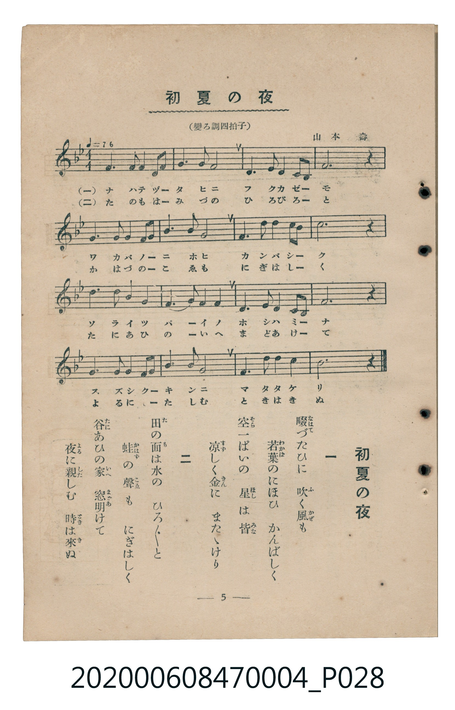

# 初夏の夜

<audio controls src="shoka_no_yoru.mp3"></audio>

- 曲：山本壽
- 臺灣教育會公認《新定兒童唱歌》尋常科第四學年用（2020.006.0847.0004）

## 說明

原書資訊與歌詞全文（對應 P028.jpg，書頁 p. 5，第一學期第 5 首）：
調性與拍號：變ろ調四拍子（降 B 大調 4/4 拍，♩=76）

## 歌詞

```text
一
畷（なはて）づたひに　吹（ふ）く風（かぜ）も
若葉（わかば）のにほひ　かんばしく
空（そら）一ぱいの　星（ほし）は皆（みな）
涼（すず）しく金（きん）に　またゝけり

二
田（た）の面（も）は水（みづ）の　ひろ／″＼と
蛙（かはづ）の聲（こゑ）も　にぎはしく
谷（たに）あひの家（いへ）　窓（まど）明（あ）けて
夜（よる）に親（した）しむ　時（とき）は來（き）ぬ
```

## 原書掃描頁



## 分析

```text
================================================================================
📊 TMD Song Profile: [ 初夏の夜 ]
================================================================================
⏱  Duration:       0:50 (50.5s), 16 measures total
🎼 Key & Tempo:    首調基準 B,, != 76.0 BPM, <4/4>
   - 分析範圍：      由實際發聲的音符與和弦推測調性；播放脈絡另行呈現
🎤 人聲音域:    C4 (MIDI 60) – D5 (MIDI 74) [跨度: 14 個半音 / 1.2 個八度, 難度: moderate]
   - 最低音:  C4 in [ShokaNoYoru #1 @ m.11, 0:34]
   - 最高音: D5 in [ShokaNoYoru #1 @ m.7, 0:20]
   - 適合: soprano, mezzo-soprano, contralto, tenor, baritone, bass
🏛  結構:      ShokaNoYoru (50.5s)
⚡ 編曲密度:        Peak 1 軌道同時演奏
🗝  調性診斷：       A# 調性不明確（純淨自然大調，未偵測到可信轉調）
   - 風格氣質:    純淨自然大調（陽光明朗、易唱易記，無明顯調外色彩）
   - 轉調歷程:    全曲維持單一推測調性（未偵測到可信轉調）
   - 核心骨幹音:  F, G, D, A#, A
   - 調性數值:    A# 調性不明確 [相關度: 0.77, 穩定度: Ambiguous, 自然音純度: 100.0%]
   - 候選調性 (K-S): A# 大調 (0.77), D 小調 (0.75), F 大調 (0.73)
   - 五度圈歷程:   -2
   - 各段落調性細節:
     • [ShokaNoYoru #1]: A# 調性不明確 (r: 0.77, 自然音純度: 100.0%)

  [ 五度圈游移軌跡 ]
               C  
         F            G  
     [Bb]*              D  
      Eb               A  
         Ab           E  
            Db       B  
               F# 
     (* = active key center)

  [ 十二半音累積音高分佈 ]
     C  : █████                      5.4%
     C# :                            0.0%
     D  : ████████████████          18.7%
     D# :                            0.0%
     E  :                            0.0%
     F  : ████████████████████████  27.5%
     F# :                            0.0%
     G  : ███████████████████       21.2%
     G# :                            0.0%
     A  : ███████                    8.3%
     A# : ████████████████          18.7%
     B  :                            0.0%
--------------------------------------------------------------------------------
Assignment 軌道音域：
  - Piano         : C4 – D5 (14 個半音 / 1.2 個八度, 58 個音符)
================================================================================
```

## ABC

```abc
X:1
T:初夏の夜
C:曲：山本壽
M:4/4
L:1/16
Q:1/4=76
K:Bb

V:V1 name="Piano" snm="Pia"

[V:V1]
f6 f2 g2 f2 g2 a2 | b6 g2 f8 | d6 f2 g4 b3 g | a12 z4 |
f6 f2 g2 f2 g2 a2 | b6 g2 f8 | g6 b2 d4 d3 c | d12 z4 |
d6 b2 c4 a4 | b6 g2 f4 d4 | f6 g2 f4 d2 c2 | g12 z4 |
f6 d2 f2 g2 b2 c2 | d6 b2 g8 | f6 g2 b4 c4 | b12 z4 |
```

- [主旋律 TMD 檔案](shoka_no_yoru.tmd)
- [鋼琴伴奏 TMD 檔案](shoka_no_yoru_piano.tmd)
