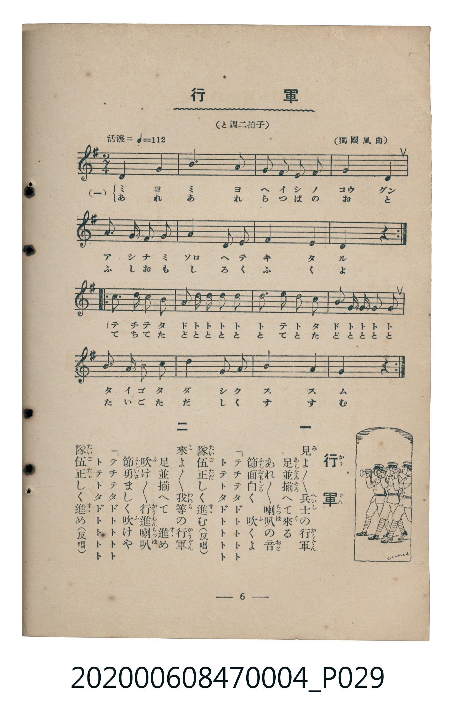

# 行軍

> Re:Shōka 使用 AI 協助辨識與重建樂譜，可能會有錯誤。歡迎回報。

- **鋼琴伴奏版**：<br><audio controls src="kogun.mp3"></audio>
- **NEUTRINO 歌聲合成版**：<br><audio controls src="kogun_neutrino.mp3"></audio>

- 曲：獨國風曲
- 臺灣教育會公認《新定兒童唱歌》尋常科第四學年用（2020.006.0847.0004）

## 說明

原書資訊與歌詞全文（對應 P029.jpg，書頁 p. 6，第一學期第 6 首）：
調性與拍號：と調二拍子（G 大調 2/4 拍，「活潑ニ ♩=112」，獨國風曲）


## 歌詞

```text
一
見（み）よ／＼兵士（へいし）の行軍（かうぐん）
足並（あしなみ）揃（そろ）へて來（く）る
あれ／＼喇叭（らっぱ）の音（おと）
節面白（ふしおもしろ）く　吹（ふ）くよ
「テチテタドトトトト
トテトタドトトトト
隊伍（たいご）正（ただ）しく進（すす）む（反唱）

二
來（こ）よ／＼我等（われら）の行軍（かうぐん）
足並揃（そろ）へて　進（すす）め
吹（ふ）け／＼行進喇叭（かうしんらっぱ）
節勇（ふしいさ）ましく吹けや
「テチテタドトトトト
トテトタドトトトト
隊伍正しく進め（反唱）
```

## ABC

<div class="abc-score" data-abc-src="kogun.abc" aria-label="五線譜載入中"></div>

[下載 ABC 原始檔](kogun.abc)

## TMD 檔案連結

- [主旋律 TMD 檔案](kogun.tmd) [[在 TMD Studio 編輯](https://tmdlang.github.io/Tmd-TS/#tmd=s7IKdvYPcrWy4qpTUCpJTLdSSM7PyUlNLsnMz7MqzsjMK0nNjM_KTMmPL87Iz05Ugisry88pzU21Si9KTEmNN4k3MjAyiDcwMIs3sDAxBzIMTBBKi_NLi5JTrYqTM_Lzc-JLUitKkvLzsxHyBUX5Zal5iXlANQVFIBtTwIoQClLLMlNSQdLFyYl58WWpRZlpmakpCPn8opKMfKBLCjIqrTIyi0vyizKTE3PisxPzkB2cWlQM9hTYNfElRYl5xclFmQUgnyJUlWSkAn2Vm5mTWZJYVIlsRWZ6Zp5VeWpxSWpRXnxuak5-CpI01NCCxPRUqwADI0slLi0thRcLe17s7lXQ0uJStFUwNDTisrdVcOeyMdI3sQNpfDZ70_s9s573rng6p_vlohVALti8F-27njcufjZ15oumTc_mND9tXfNiVe_jhq5n0zY8XTfraeuk56uXPp2y8dnanscN3U83dD_dseP58onP16x5Onv207U7nu7c8nzKivd7OkAxogeMET1QjAAZBibv93QqcXHpaynYUgtwKSgoPO2b_2z2jheb21-s6HrR0Q5014uV8562rng2rR3oiqcbep-1dyqAwkQvqyD9_Z4eoOKXCxoVCvQUzIA8oLuf7GgAuvvZnPlAtoKZwstl04AOBYYMyPAXq_Y_a1gOMra798XM-UDRx40rgIJPdvUARZ6unQC0wl3h6ZLlQDEFYMAqAEWBpj5u6Hm2ZfezvRMfN3crPJq50hYY-o8bQDLIwQ20hgtkCdABYLuWdQNNe9y4Hyj-uKnj_Z7-93v2PG3d-nTxarD4jseNLY8bp4NkG9dB4hYs3v24se1x44THTZNBBoIM2rb5yY5lYLkmoIbHjasghj7rbwYLzn3cBNQJNAVo4rIn-9rAgkDLgLZ2g_SDtDX1QO2f1v60fy1IRRNQw-LHjRsh9r-cvxmsrQsYHlBrn69veDl30fOZe8ESW8E2dz1uAjsBamH_44aGpxN2QhRARZo6wHY29Dxubnvc3Agim_Y_bu583NwBR2AVIBZQBdAl2KRfzup6sgcSIPPBATUF5OO1i2EiC8DWAZ3U_7IBGPJAwZlABPZ0Ayid9PcCEzU8Rnb1gClo2IACFh4jzzomPl8LTB9AdwAd3wMMF2JjBGv4A0MEw0GN4HSNEk4TIZYDLQGqRkQK1CpgAE9GjiBodDztBmUBWFwAw2Qq2Kx9kHAAWgA093FTCxXDHxjg8EAG-gMlYIGKKM_xUKCgpc_F5Z2fXprnaBWQmZiX71BjUFMNskLBxtBMyw7MwlbSKEAy_OOGRmAcA0NTQcNC4emGflBg9fe-WNamAy8qNLFoBtoKNVgDaIihphUwVOaDRMDhswLKqkESRciARGeAeE1LwOR2sEwfRKZp8-OmZRDFTRseN28GM1FtMwLZ1tgEM7OpB2EbXBQhAzKzE8RrBNvWuBFMroOq74KpbYS5GWpXjYJpvIIuGBpC6RoFYygLBI3AIiA5c5BCMxABZkEEQRBuQg3YSB9DSHhAxEBhATMXIYqQgYQSkAcMJRC5HSzTB5FpWg0KJahySDih2GQECQuYgh6ETXBRhAwkhIC8xsVgciOYXAdV3wVTCwwhFDuMwbGFzTdwUVTfrAfz1oDJlaT4xgTkjq1wd0xE8g1MFCEDEgWVBWABUHEANhRUIsA9V4OkCWYRRnJuWgRNnI-bQYkEkpBBjt37uHktJM1AUnFzG1QCIgrStB-RIptXI6VIpPSFkpa3glPgdGh6BNYU0NQ5HW5iL1hFP1QcpB4sDhaB2tTUgd2mGnBSBSVjcPIEJU6YEDSJgtNuDUQaBMF8SAjDk7ABapSAkjIwhCAxBgkjUISCkjE8jGDxD07FwFCCSIFSAUrQg8MIwkbLL-BUDIlhWOiArAOlYEjowJJML1hFP1QckVJAIrA02YHdDnAqJssjO-HWw1ggryzEbg1SEoZ4pQXMmgp18j64k0GewuYVpETfBNKLakcttA5wIqcO6ATWAcAmK3odAKysiK4DIMrBtQAoNwBrTzAJZoNzAyhowKVwMyiVYpIgeVj6hZkBliVKNzylm4DDwxRMgwprSEI3BUMQDU7SYDVmYBqkDlKsG4IhNHsgFdeg2AbFeiOUDXIQJKbBRSbQehiG8CBykMQG0gGVIawLKclDysLHjQuhbGCzDZoewMUmsCCGYVixDJKDFMAgHTAZgroQpR4iAsEBDquat6BEQQMsgiBVNjArQwqenXBxGAukegGUDQPwSAIFNyhaQDQkAiBRAgl8SL0Kq2lh5RSiUsVWEIECF1ZPbkEJ7gaoamj9CS59cGfeBVA2tnIIFJiwbDsFJXhhutAz70y4OIwFsrkRww5g5tW1U4C04RRgLCcQS5kLAA)]
- [鋼琴伴奏 TMD 檔案](kogun_piano.tmd) [[在 TMD Studio 編輯](https://tmdlang.github.io/Tmd-TS/#tmd=s7IKdvYPcrWy4qpTUCpJTLdSyC8qychPL0osyKi0ysgsLskvykxOzInPTsxLVIIrKs4vLUpOjS9ITE-1CjAwslTi0tJSeLGw58Xu3vd7Ol5273k-YcuTPVueLu1_3tnxfk-ngpYWl6KtgqGhEZe9rYI7l42RvokdyLRnsze93zPree-Kp3O6Xy5aAeSCLXnRvut54-JnU2e-aNr0bE7z09Y1L1b1Pm7oejZtw9N1s562Tnq-eunTKRufre153ND9dEP30x07ni-f-HzNmqezZz9du-Ppzi3Pp6wAusTIwMhAz8DATM_AwsQcyDAwATpGiYvLOz-9NM_RKiAzMS8_yMOhxqCmmksBCGwMzbTswCx9LQVbdKAAtODJjobHDY1PdvUAfaugYaHwdEP_8_UNT_t7Xyxr01EAhYVeVkG6JhbNWvowgzWAhhhqWik8bp4PEgGCx80roKwaJFGEDEh0BojXtARMbgfL9EFkmjY_bloGUdy04XHzZjAT1TYjkG2NTTAzm3oQtsFFETIgMztBvEawbY0bweQ6qPoumNpGmJuhdtUomMYr6IKhIZSuUTCGskDQCCwCkjMHKTQDEWAWRBAE4SbUgI30MYSEB0QMFBYwcxGiCBlIKAF5wFACkdvBMn0QmabVoFCCKoeEE4pNRpCwgCnoQdgEF0XIQEIIyGtcDCY3gsl1UPVdMLXAEEKxwxgcW9h8AxdF9c16MG8NmFxJim9MQO7YCnfHRCTfwEQRMiDR7seNbWCB6Y-bJoMN7UT2XA2SJphFGMm5aRE0cT5uBiUSSEIGOXbv4-a1kDQDScXNbVAJiChI035EimxejZQikdIXSlreCk6B06Hp8XETKBWD_DEdbmIvWEU_VBykHiwOFoHa1NSB3aYacFIFJWNw8gQlTpgQNImC024NRBoEwXxICMOTsAFqlICSMjCEIDEGCSNQhIKSMTyMYPEPTsXAUIJIgVIBStCDwwjCRssv4FQMiWFY6ICsA6VgSOjAkkwvWEU_VByRUkAisDTZgd0OcComyyM74dbDWCCvLMRuDVIShnilBcyaCnXyPriTQZ7C5hWkRN8E0otqRy1qLeCDXAuYQCsBYLkUrxBtGIuVYRoPZJnGA5k41SKUgMQMkGx1Iq_u6QTWPcAqDr3uAVaFRNc9EOXg2geUCx83N4JJMBucC0FRAi79m0G5A5MEycPyDcwMsCxRuuE5zAQcD6ZgGlRJQDKYKRiCaHBWAqsxA9MgdZDqxBAModkSqZoApTJQamuEskEOgqQwcFENtB6GITyIHCSRg3RAZQjrQspqkDL4ceNCKPtxIzQbNIKLa2AFAMOw6gAkByn4QTpgMgR1IUpbRASCAxzWJNiCEgUNsAiCNBWARQikwNsJF4exQKoXQNkwAI8kUHCDogVEQyIAEiWQwIfU57AaHlY-IipzbAUgKHBh9fMWlOBugKqG1tvgUg93obEAysZW_oECE1ZcTEEJXpgu9EJjJlwcxgLZ3IhhB1r2xVFooGZ7bEUBWIy0YkPXTgFSXkX7ABUh8YwQPCeQHNhYJHljFNUmKKqN4KqVuQA)]

## 分析

```text
================================================================================
📊 TMD Song Profile: [ 行軍 ]
================================================================================
⏱  Duration:       0:17 (17.1s), 16 measures total
🎼 Key & Tempo:    首調基準 G, != 112.0 BPM, <2/4>
   - 分析範圍：      由實際發聲的音符與和弦推測調性；播放脈絡另行呈現
🎤 人聲音域:    D4 (MIDI 62) – E5 (MIDI 76) [跨度: 14 個半音 / 1.2 個八度, 難度: moderate]
   - 最低音:  D4 in [KogunA #1 @ m.1, 0:00]
   - 最高音: E5 in [KogunB #1 @ m.11, 0:11]
   - 適合: soprano, mezzo-soprano, contralto, tenor, baritone, bass
🏛  結構:      KogunA (8.6s) -> KogunB (8.6s)
⚡ 編曲密度:        Peak 1 軌道同時演奏
🗝  調性診斷：       G 大調（推測轉調經歷 1 次）
   - 風格氣質:    純淨自然大調（陽光明朗、易唱易記，無明顯調外色彩）
   - 轉調歷程:    G 大調起奏 ➔ [KogunB] 轉至 G 大調 (+5 半音 / 五度圈 -1 步)
   - 核心骨幹音:  D, G, A, B, F#
   - 調性數值:    G 大調 [相關度: 0.90, 穩定度: Moderate, 自然音純度: 100.0%]
   - 候選調性 (K-S): G 大調 (0.90), D 大調 (0.87), B 小調 (0.68)
   - 五度圈歷程:   +2 -> +1
   - 各段落調性細節:
     • [KogunA #1]: D 大調 (r: 0.90, 自然音純度: 100.0%)
     • [KogunB #1]: G 大調 (r: 0.86, 自然音純度: 100.0%)

  [ 五度圈游移軌跡 ]
               C  
         F           [G ]*
      Bb              [D ]*
      Eb               A  
         Ab           E  
            Db       B  
               F# 
     (* = active key center)

  [ 十二半音累積音高分佈 ]
     C  : ███████                    7.5%
     C# :                            0.0%
     D  : ████████████████████████  25.0%
     D# :                            0.0%
     E  : ███████                    7.5%
     F  :                            0.0%
     F# : ████████                   8.3%
     G  : ████████████████████      20.8%
     G# :                            0.0%
     A  : ███████████████           15.8%
     A# :                            0.0%
     B  : ██████████████            15.0%
--------------------------------------------------------------------------------
Assignment 軌道音域：
  - Piano         : D4 – E5 (14 個半音 / 1.2 個八度, 48 個音符)
================================================================================
```


## 原書掃描頁




