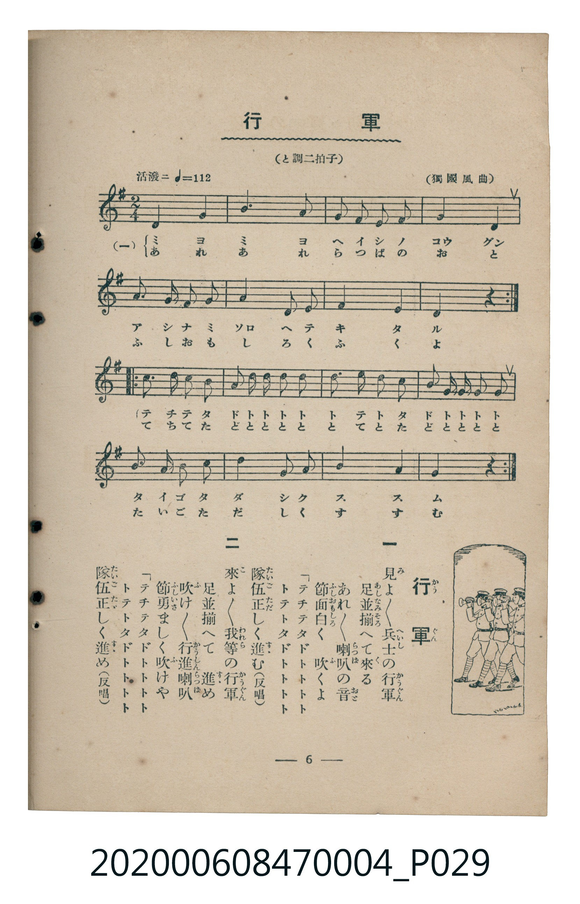

# 行軍

> Re:Shōka 使用 AI 協助辨識與重建樂譜，可能會有錯誤。歡迎回報。

- **鋼琴伴奏版**：<br><audio controls src="kogun.mp3"></audio>
- **NEUTRINO 歌聲合成版**：<br><audio controls src="kogun_neutrino.mp3"></audio>

- 曲：獨國風曲
- 臺灣教育會公認《新定兒童唱歌》尋常科第四學年用（2020.006.0847.0004）

## 說明

原書資訊與歌詞全文（對應 P029.jpg，書頁 p. 6，第一學期第 6 首）：
調性與拍號：と調二拍子（G 大調 2/4 拍，「活潑ニ ♩=112」，獨國風曲）


## 歌詞

```text
一
見（み）よ／＼兵士（へいし）の行軍（かうぐん）
足並（あしなみ）揃（そろ）へて來（く）る
あれ／＼喇叭（らっぱ）の音（おと）
節面白（ふしおもしろ）く　吹（ふ）くよ
「テチテタドトトトト
トテトタドトトトト
隊伍（たいご）正（ただ）しく進（すす）む（反唱）

二
來（こ）よ／＼我等（われら）の行軍（かうぐん）
足並揃（そろ）へて　進（すす）め
吹（ふ）け／＼行進喇叭（かうしんらっぱ）
節勇（ふしいさ）ましく吹けや
「テチテタドトトトト
トテトタドトトトト
隊伍正しく進め（反唱）
```

## ABC

```abc
X:1
T:行軍
C:曲：獨國風曲
M:2/4
L:1/16
Q:1/4=112
K:G
V:V1 name="Piano" snm="Pia"
[V:V1]
D4 G4 | B6 A2 | G2 F2 E2 F2 | G4 D4 |
w: 1.~ミ ヨ | ミ ヨ | ヘ イ シ ノ | カウ グン
w: 2.~あ れ | あ れ | ら っ ぱ の | お と
w: 3.~コ ヨ | コ ヨ | ワ レ ラ ノ | カウ グン
w: 4.~ふ け | ふ け | かう しん らっ ぱ | _ _
A3 G F2 G2 | A4 D2 E2 | F4 E4 | D4 z4 |
w: 1.~ア シ ナ ミ | ソロ ヘ テ | ク _ | ル
w: 2.~ふ し お も | し ろ く | ふ く | よ
w: 3.~ア シ ナ ミ | ソロ ヘ テ | ス ス | メ
w: 4.~ふ し い さ | ま し く | ふ け | や
c3 d c2 B2 | A2 d d d2 d2 | d3 e d2 c2 | B2 G G G2 G2 |
w: 1.~テ チ テ タ | ド ト ト ト ト | ト テ ト タ | ド ト ト ト ト
w: 2.~て ち て た | ど と と と と | と て と た | ど と と と と
B2 A2 B2 c2 | d4 G2 A2 | B4 A4 | G4 z4 |
w: 1.~タ イ ゴ タ | ダ シ ク | ス ス | ム
w: 2.~た い ご た | だ し く | す す | め
```

## TMD 檔案連結

- [主旋律 TMD 檔案](kogun.tmd) [[在 TMD Studio 編輯](https://tmdlang.github.io/Tmd-TS/#tmd=s7IKdvYPcrWy4qpTUCpJTLdSSM7PyUlNLsnMz7MqzsjMK0nNjM_KTMmPL87Iz05Ugisry88pzU21Si9KTEmNN4k3MjAyiDcwMIs3sDAxBzIMTBBKi_NLi5JTrYqTM_Lzc-JLUitKkvLzsxHyBUX5Zal5iXlANQVFIBtTwIoQClLLMlNSQdLFyYl58WWpRZlpmakpCPn8opKMfKBLCjIqrTIyi0vyizKTE3PisxPzkB2cWlQM9hTYNfElRYl5xclFmQUgnyJUlWSkAn2Vm5mTWZJYVIlsRWZ6Zp5VeWpxSWpRXnxuak5-ClBaS0vhxcKeF7t7FbS0uBRtFQwNjbjsbRXcuWyM9E3sQLqfzd70fs-s570rns7pfrloBZALNvRF-67njYufTZ35omnTsznNT1vXvFjV-7ih69m0DU_XzXraOun56qVPp2x8trbncUP30w3dT3fseL584vM1a57Onv107Y6nO7c8n7Li_Z4OULjrAcNdDxTuQIaByfs9nUpcXPpaCrbUAlwKCgpP--Y_m73jxeb2Fyu6XnS0A931YuW8p60rnk1rB7ri6YbeZ-2dCgEGRpZ6WQXp7_f0ABW_XNCoUKCnYAbkAd39ZEcD0N3P5swHshXMFF4umwZ0KDBkQIa_WLX_WcNykLHdvS9mzgeKPm5cARR8sqsHKPJ07QSgFe4KT5csB4opAANWASgKNPVxQ8-zLbuf7Z34uLlb4dHMlbbA0H_cAJJBDm6gNVwgS4AOANu1rBto2uPG_UDxx00d7_f0v9-z52nr1qeLV4PFdzxubHncOB0k27gOErdg8e7HjW2PGyc8bpoMMhBk0LbNT3YsA8s1ATU8blwFMfRZfzNYcO7jJqBOoClAE5c92dcGFgRaBrS1G6QfpK2pB2r_tPan_WtBKpqAGhY_btwIsf_l_M1gbV3A8IBa-3x9w8u5i57P3AuW2Aq2uetxE9gJUAv7Hzc0PJ2wE6IAKtLUAbazoedxc9vj5kYQ2bT_cXPn4-YOOAKrALGAKoAuwSb9clbXkz2QAJkPDqgpIB-vXQwTWQC2Duik_pcNwJAHCs4EIrCnG0DppL8XmKjhMbKrB0xBwwYUsPAYedYx8flaYPoAugPo-B5guBAbI1jDHxgiGA5qBKdrlHCaCLEcaAlQNSJSoFYBA3gycgRBo-NpNygLwOICGCZTwWbtg4QD0AKguY-bWqgY_sAAhwcy0B8oAQtURHmOhwIFLX0uLu_89NI8R6uAzMS8fIcag5pqkBUKNoZmWnZgFraSRgGS4R83NALjGBiaChoWCk839IMCq7_3xbI2HXhRoYlFM9BWqMEaQEMMNa2AoTIfJAIOnxVQVg2SKEIGJDoDxGtaAia3g2X6IDJNmx83LYMobtrwuHkzmIlqmxHItsYmmJlNPQjb4KIIGZCZnSBeI9i2xo1gch1UfRdMbSPMzVC7ahRM4xV0wdAQStcoGENZIGgEFgHJmYMUmoEIMAsiCIJwE2rARvoYQsIDIgYKC5i5CFGEDCSUgDxgKIHI7WCZPohM02pQKEGVQ8IJxSYjSFjAFPQgbIKLImQgIQTkNS4GkxvB5Dqo-i6YWmAIodhhDI4tbL6Bi6L6Zj2YtwZMriTFNyYgd2yFu2Mikm9goggZkCioLAALgIoDsKGgEgHuuRokTTCLMJJz0yJo4nzcDEokkIQMcuzex81rIWkGkoqb26ASEFGQpv2IFNm8GilFIqUvlLS8FZwCp0PTI7CmgKbO6XATe8Eq-qHiIPVgcbAI1KamDuw21YCTKigZg5MnKHHChKBJFJx2ayDSIAjmQ0IYnoQNUKMElJSBIQSJMUgYgSIUlIzhYQSLf3AqBoYSRAqUClCCHhxGEDZafgGnYkgMw0IHZB0oBUNCB5ZkesEq-qHiiJQCEoGlyQ7sdoBTMVke2Qm3HsYCeWUhdmuQkjDEKy1g1lSok_fBnQzyFDavICX6JpBeVDtqoXWAEzl1QCewDgA2WdHrAGBlRXQdAFEOrgVAuQFYe4JJMBucG0BBAy6Fm0GpFJMEycPSL8wMsCxRuuEp3QQcHqZgGlRYQxK6KRiCaHCSBqsxA9MgdZBi3RAModkDqbgGxTYo1huhbJCDIDENLjKB1sMwhAeRgyQ2kA6oDGFdSEkeUhY-blwIZQObbdD0AC42gQUxDMOKZZAcpAAG6YDJENSFKPUQEQgOcFjVvAUlChpgEQSpsoFZGVLw7ISLw1gg1QugbBiARxIouEHRAqIhEQCJEkjgQ-pVWE0LK6cQlSq2gggUuLB6cgtKcDdAVUPrT3DpgzvzLoCysZVDoMCEZdspKMEL04WeeWfCxWEskM2NGHYAM6-unQKkDacAYzmBWMpcAA)]
- [鋼琴伴奏 TMD 檔案](kogun_piano.tmd) [[在 TMD Studio 編輯](https://tmdlang.github.io/Tmd-TS/#tmd=s7IKdvYPcrWy4tLSUnixsOfF7t73ezpedu95PmHLkz1bni7tf97Z8X5Pp4KWFpeirYKhoRGXva2CO5eNkb6JHVedgtKz2Zve75n1vHfF0zndLxetAHKVQMIv2nc9b1z8bOrMF02bns1pftq65sWq3scNXc-mbXi6btbT1knPVy99OmXjs7U9jxu6n27ofrpjx_PlE5-vWfN09uyna3c83bnl-ZQVQJcYGRgZ6BkYmOkZWJiYAxkGJkDHKHFxeeenl-Y5WgVkJublB3k41BjUVHMpAIGNoZmWHZilr6Vgiw4UgBY82dHwuKHxya4eoG8VNCwUnm7of76-4Wl_74tlbToKAQZGlnpZBemaWDRr6cMM1gAaYqhppfC4eT5IBAgeN6-AsmqQRBEyINEZIF7TEjC5HSzTB5Fp2vy4aRlEcdOGx82bwUxU24xAtjU2wcxs6kHYBhdFyIDM7ATxGsG2NW4Ek-ug6rtgahthbobaVaNgGq-gC4aGULpGwRjKAkEjsAhIzhyk0AxEgFkQQRCEm1ADNtLHEBIeEDFQWMDMRYgiZCChBOQBQwlEbgfL9EFkmlaDQgmqHBJOKDYZQcICpqAHYRNcFCEDCSEgr3ExmNwIJtdB1XfB1AJDCMUOY3BsYfMNXBTVN-vBvDVgciUpvjEBuWMr3B0TkXwDE0XIgES7Hze2gQWmP26aDDa0E9lzNUiaYBZhJOemRdDE-bgZlEggCRnk2L2Pm9dC0gwkFTe3QSUgoiBN-xEpsnk1UopESl8oaXkrOAVOh6bHx02gVAzyx3S4ib1gFf1QcZB6sDhYBGpTUwd2m2rASRWUjMHJE5Q4YULQJApOuzUQaRAE8yEhDE_CBqhRAkrKwBCCxBgkjEARCkrG8DCCxT84FQNDCSIFSgUoQQ8OIwgbLb-AUzEkhmGhA7IOlIIhoQNLMr1gFf1QcURKAYnA0mQHdjvAqZgsj-yEWw9jgbyyELs1SEkY4pUWMGsq1Mn74E4GeQqbV5ASfRNIL6odtai1gA9yLWACrQSA5VK8QrRhLFaGaTyQZRoPZOJUi1ACEjNAstWJvLqnE1j3AKs49LoHWBUSXfdAlINrH1AufNzcCCbBbHAuBEUJuPRvBuUOTBIkD8s3MDPAskTphucwE3A8mIJpUCUByWCmYAiiwVkJrMYMTIPUQaoTQzCEZkukagKUykCprRHKBjkIksLARTXQehiG8CBykEQO0gGVIawLKatByuDHjQuh7MeN0GzQCC6ugRUADMOqA5AcpOAH6YDJENSFKG0REQgOcFiTYAtKFDTAIgjSVAAWIZACbydcHMYCqV4AZcMAPJJAwQ2KFhANiQBIlEACH1Kfw2p4WPmIqMyxFYCgwIXVz1tQgrsBqhpab4NLPdyFxgIoG1v5BwpMWHExBSV4YbrQC42ZcHEYC2RzI4YdaNkXR6GBmu2xFQVgMdKKDV07BUh5Fe0DVITEM0LwnEByYGOR5I1RVJugqDaCq1bmAgA)]

## 分析

```text
================================================================================
📊 TMD Song Profile: [ 行軍 ]
================================================================================
⏱  Duration:       0:17 (17.1s), 16 measures total
🎼 Key & Tempo:    首調基準 G, != 112.0 BPM, <2/4>
   - 分析範圍：      由實際發聲的音符與和弦推測調性；播放脈絡另行呈現
🎤 人聲音域:    D4 (MIDI 62) – E5 (MIDI 76) [跨度: 14 個半音 / 1.2 個八度, 難度: moderate]
   - 最低音:  D4 in [KogunA #1 @ m.1, 0:00]
   - 最高音: E5 in [KogunB #1 @ m.11, 0:11]
   - 適合: soprano, mezzo-soprano, contralto, tenor, baritone, bass
🏛  結構:      KogunA (8.6s) -> KogunB (8.6s)
⚡ 編曲密度:        Peak 1 軌道同時演奏
🗝  調性診斷：       G 大調（推測轉調經歷 1 次）
   - 風格氣質:    純淨自然大調（陽光明朗、易唱易記，無明顯調外色彩）
   - 轉調歷程:    G 大調起奏 ➔ [KogunB] 轉至 G 大調 (+5 半音 / 五度圈 -1 步)
   - 核心骨幹音:  D, G, A, B, F#
   - 調性數值:    G 大調 [相關度: 0.90, 穩定度: Moderate, 自然音純度: 100.0%]
   - 候選調性 (K-S): G 大調 (0.90), D 大調 (0.87), B 小調 (0.68)
   - 五度圈歷程:   +2 -> +1
   - 各段落調性細節:
     • [KogunA #1]: D 大調 (r: 0.90, 自然音純度: 100.0%)
     • [KogunB #1]: G 大調 (r: 0.86, 自然音純度: 100.0%)

  [ 五度圈游移軌跡 ]
               C  
         F           [G ]*
      Bb              [D ]*
      Eb               A  
         Ab           E  
            Db       B  
               F# 
     (* = active key center)

  [ 十二半音累積音高分佈 ]
     C  : ███████                    7.5%
     C# :                            0.0%
     D  : ████████████████████████  25.0%
     D# :                            0.0%
     E  : ███████                    7.5%
     F  :                            0.0%
     F# : ████████                   8.3%
     G  : ████████████████████      20.8%
     G# :                            0.0%
     A  : ███████████████           15.8%
     A# :                            0.0%
     B  : ██████████████            15.0%
--------------------------------------------------------------------------------
Assignment 軌道音域：
  - Piano         : D4 – E5 (14 個半音 / 1.2 個八度, 48 個音符)
================================================================================
```


## 原書掃描頁




