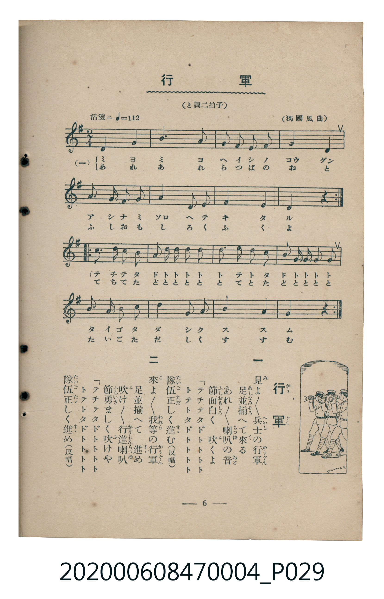

# 行軍

<audio controls src="kogun.mp3"></audio>

- 曲：獨國風曲
- 臺灣教育會公認《新定兒童唱歌》尋常科第四學年用（2020.006.0847.0004）

## 說明

原書資訊與歌詞全文（對應 P029.jpg，書頁 p. 6，第一學期第 6 首）：
調性與拍號：と調二拍子（G 大調 2/4 拍，「活潑ニ ♩=112」，獨國風曲）

## 歌詞

```text
一
見（み）よ／＼兵士（へいし）の行軍（かうぐん）
足並（あしなみ）揃（そろ）へて來（く）る
あれ／＼喇叭（らっぱ）の音（おと）
節面白（ふしおもしろ）く　吹（ふ）くよ
「テチテタドトトトト
トテトタドトトトト
隊伍（たいご）正（ただ）しく進（すす）む（反唱）

二
來（こ）よ／＼我等（われら）の行軍
足並揃へて　進（すす）め
吹（ふ）け／＼行進喇叭（かうしんらっぱ）
節勇（ふしいさ）ましく吹けや
「テチテタドトトトト
トテトタドトトトト
隊伍正しく進め（反唱）
```

## 原書掃描頁



## 分析

```text
================================================================================
📊 TMD Song Profile: [ 行軍 ]
================================================================================
⏱  Duration:       0:34 (34.3s), 32 measures total
🎼 Key & Tempo:    首調基準 G, != 112.0 BPM, <2/4>
   - 分析範圍：      由實際發聲的音符與和弦推測調性；播放脈絡另行呈現
🎤 人聲音域:    D4 (MIDI 62) – E5 (MIDI 76) [跨度: 14 個半音 / 1.2 個八度, 難度: moderate]
   - 最低音:  D4 in [KogunA #1 @ m.1, 0:00]
   - 最高音: E5 in [KogunB #1 @ m.18, 0:18]
   - 適合: soprano, mezzo-soprano, contralto, tenor, baritone, bass
🏛  結構:      KogunA (8.6s) -> KogunA (8.6s) -> KogunB (8.6s) -> KogunB (8.6s)
⚡ 編曲密度:        Peak 1 軌道同時演奏
🗝  調性診斷：       G 大調（純淨自然大調，未偵測到可信轉調）
   - 風格氣質:    純淨自然大調（陽光明朗、易唱易記，無明顯調外色彩）
   - 轉調歷程:    全曲維持單一推測調性（未偵測到可信轉調）
   - 核心骨幹音:  D, G, B, A, C
   - 調性數值:    G 大調 [相關度: 0.90, 穩定度: High, 自然音純度: 100.0%]
   - 候選調性 (K-S): G 大調 (0.90), D 大調 (0.75), B 小調 (0.64)
   - 五度圈歷程:   +1 -> +1 -> +1 -> +1
   - 各段落調性細節:
     • [KogunA #1]: G 大調 (r: 0.88, 自然音純度: 100.0%)
     • [KogunA #2]: G 大調 (r: 0.88, 自然音純度: 100.0%)
     • [KogunB #1]: G 大調 (r: 0.77, 自然音純度: 100.0%)
     • [KogunB #2]: G 大調 (r: 0.77, 自然音純度: 100.0%)

  [ 五度圈游移軌跡 ]
               C  
         F           [G ]*
      Bb               D  
      Eb               A  
         Ab           E  
            Db       B  
               F# 
     (* = active key center)

  [ 十二半音累積音高分佈 ]
     C  : ████████████              12.5%
     C# :                            0.0%
     D  : ████████████████████████  25.0%
     D# :                            0.0%
     E  : ██                         2.5%
     F  :                            0.0%
     F# : █████                      5.0%
     G  : ████████████████████      20.8%
     G# :                            0.0%
     A  : ███████████████           15.8%
     A# :                            0.0%
     B  : ██████████████████        18.3%
--------------------------------------------------------------------------------
Assignment 軌道音域：
  - Piano         : D4 – E5 (14 個半音 / 1.2 個八度, 96 個音符)
================================================================================
```

## ABC

```abc
X:1
T:行軍
C:曲：獨國風曲
M:2/4
L:1/16
Q:1/4=112
K:G

V:V1 name="Piano" snm="Pia"

[V:V1]
d4 g4 | b6 a2 | g2 e2 f2 g2 | a4 d4 |
g3 a b2 c2 | d4 f2 g2 | b4 a4 | g4 z4 |
d4 g4 | b6 a2 | g2 e2 f2 g2 | a4 d4 |
g3 a b2 c2 | d4 f2 g2 | b4 a4 | g4 z4 |
d2 d2 d2 d2 | e d c2 b2 d2 | c2 c2 c2 c2 | d c b2 a2 d2 |
g2 a2 b2 c2 | d4 f2 g2 | b4 a4 | g4 z4 |
d2 d2 d2 d2 | e d c2 b2 d2 | c2 c2 c2 c2 | d c b2 a2 d2 |
g2 a2 b2 c2 | d4 f2 g2 | b4 a4 | g4 z4 |
```

- [主旋律 TMD 檔案](kogun.tmd)
- [鋼琴伴奏 TMD 檔案](kogun_piano.tmd)
