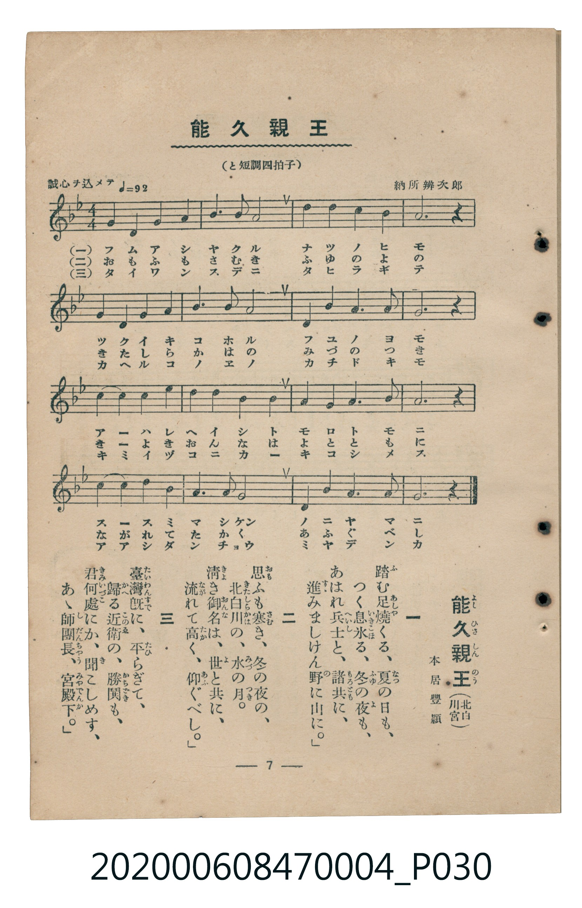

# 能久親王

<audio controls src="yoshihisa_shinno.mp3"></audio>

- 詞：本居豐穎
- 曲：納所辨次郎
- 臺灣教育會公認《新定兒童唱歌》尋常科第四學年用（2020.006.0847.0004）

## 說明

原書資訊與歌詞全文（對應 P030.jpg，書頁 p. 7，第一學期第 7 首）：
標題：能久親王（北白川宮）
調性與拍號：と短調四拍子（g 小調 4/4 拍，「誠心ヲ込メテ ♩=92」）

## 歌詞

```text
一
踏（ふ）む足燒（あしや）くる、夏（なつ）の日（ひ）も、
つく息氷（いきこほ）る、冬（ふゆ）の夜（よ）も、
あはれ兵士（へいし）と、諸共（もろとも）に、
進（すゝ）みましけん野（の）に山（やま）に。」

二
思（おも）ふも寒（さむ）き、冬の夜の、
北白川（きたしらかは）の、水（みづ）の月（つき）。
清（きよ）き御名（おんな）は、世（よ）と共に、
流（なが）れて高（たか）く、仰（あふ）ぐべし。」

三
臺灣既（たいわんすで）に、平（たひ）らぎて、
歸（かへ）る近衞（このゑ）の、勝鬨（かちどき）も、
君何處（きみいづこ）にか、聞（き）こしめす、
あゝ師團長（しだんちゃう）、宮殿下（みやでんか）。」
```

## ABC

```abc
X:1
T:能久親王
C:曲：納所辨次郎
M:4/4
L:1/16
Q:1/4=92
K:Gm
V:V1 name="Piano" snm="Pia"
[V:V1]
G4 G4 A4 A4 | B6 c2 A8 | d4 d4 G4 A4 | B12 z4 |
B4 B4 A4 G4 | c6 d2 e8 | d4 c4 B4 A4 | G12 z4 |
d4 d4 c4 B4 | c6 d2 e4 d4 | c4 B4 A4 G4 | A12 z4 |
B4 A4 G4 D4 | G6 A2 B4 c4 | d6 B2 G6 A2 | G12 z4 |
```

## TMD 檔案連結

- [主旋律 TMD 檔案](yoshihisa_shinno.tmd) [[在 TMD Studio 編輯](https://tmdlang.github.io/Tmd-TS/#tmd=s7IKdvYPcrWy4tLSUnjRvPfJztYXy1Y97-tW0NLiUrRVsDTisrdVcNLhyk6ttFVwz-WyMdE3seOqU1B6sXLe-z2zns1Z83Rj64uNE56v7FMCCT-bvQko_HxL77POhhf7Vjxbs_BlM0TmRfuu542Ln02d-aJp07M5zU9b17xY1fu4oevZtA1P18162jrp-eqlT6dsfLa253FD99MN3U937Hi-fOLzNWuezp79dO2Opzu3PJ-y4v2eDiMDIwM9AwMzPQMLE3Mgw8Dk_Z5OJS4ufS0FW2oBLgUFhad985_N3vFic_uLFV0vOtqB7gJ6-WnrimfT2oGueLqh91l7p0KAgbGBXlZB-vs9PUDFLxc0KhToKZgDeUB3P9nRAHT3sznzgWwFc4WXy6YBHQoMHJDhz1bMfLmwB8hBDnOQsT3Tn8_c-3T73Kfr1gFVg5S-WLX_WcNykAu6e1_MnA_U87hxxfP5a4HiwJABCj5dOwGoM13h6YZ-oJgCMIIUgKJANzxu6HmxasHT_c2Pmze92LfncfPCx81tCo9mrrS1NHrcAFTRyQWyAOhOsD07-oHGPG7cChR_3NTwYtvm5-2TwCJNjxunP25qAYk39j9u6n7c0Ph0CUTxqseNS8Di655NXwoWAUY_UHsTUA3IUKA0UM-zxvXPNmwHS7c8bux93Dj5ceNusDqwWW1rIBY_bmqDmPV0yRyQSFMHmllAh6x_3NTztHXr08WrwXp2gE2cDta2AqjuxeodT1s3gjU3PW4C2rQCyADLroaa8rIB6EKgzpmPm-aCJfY_btwH8mDjxMdNk1-294FlQYEP1PN0I8QsoB37YKYAndMLCbddPeCobACaA9TSBbMJ6I-mp-shQTcVGJJgQWBKB3kU4jkgCXUNPL7BqoHunQ8Oa6CGbqBfIaEBVPpswxawAqBbgaEMDu45wMABigCDFxSRQGeB3bKjFWoQJOwae5_uW_h0AlAFxIHAcF8FFl8PNPTJDmCChIVy4wpguCFC6dnWRlj8AlMpMBJ6Hjcue7l6BlgQ6EZgWgUnBqApuzfAEgk45TROeNy4E-QJpIDaAUnIkAJg-iKYIS2Pm4DJCeimmY8bl8Mj6enOzTAFkLQEFO8D2g5z2dodYGlg-AAZoCT0Yv_EFwuBhRFQEGjWusdNE-Hh9rR77ss1oEIDrH7h48aV0OCCJ6qnE2Y_2Tv1xcypsAgABjEwtpcCzYK6CKgTmK4aIRaANYOsAUZSI8jhiKTZNPfpjtVP58x4ORWS0oEpagHYdwsfNzU_bgQnbaCL1q17tm7_kx2gzA6yDJS0loOVgYMUEmhAEykvw6BAQUufiysyvzgjMyOzODE4IzMvL98qIDMxL9-hxqBGoRpkmYKNhZYdmIGtEFWAlGUvFvYoaJiASpnn6xt04CWfJhYNQCuhhmkANWpaKTxungoKpeYFILJpEZjcDiRrgGJLQEqB_PVA9mowGyLeBdbRAib7wOQkqAxIPzJAtm5XD8i6RrDmpiZw1GyFs4GaG0EOAfEbgOxehHVQVW1gHevA7A6oDIiHy7odnSDrmvaDNYB88rh5PZjcDNHctBNiXXM7EHcjrIPoAPvocfNKsG6QNSDfgZyAxboaBbN4BV0IYQ4nahQMgaSughGEC4I1CsZAEoQRamHKINAAJALOmbjje1cPZfENjjdgnMLDpWkt1OegkAH5ejZafENSyDIwCYnvFVAZIuIbFJPAIgNMTgdb1wnR3AgJdGCJhxSTIHFwBDQuBZPg-G4EORMkA0sV2KyDxjfI3Y-bZ4BJMBvsK5BbQS4H8VfA2RBfQ3Q0gkmQ0-Dhgct3kCgDYXAMguOyBhjPoAg0VjBBiWyQKFwlNKGQEtk7OimKbEiGbt4DJvvB5Bqo50BBBEkCkAz_uBmaq8DeftwMCgSIGEQEJAPLJtjCHzm6wRkUFvWgDA8K58kQCxtXgaMc5iyQDEQ1KE1BSXiRAEuF2CyERjjEneD0Bc3mrVBjYcm5Gx7JMAvBesDyML8vhMpACgUMCxE5FxahqBEOkoGIoCcLeOYnMsaBDUfKYhzkA2iMQ9mgsAHF3jxIeAB9_LhpI1gGLWuAQgpW6ANVExnjq0DKG3vARoPJRlBJAYo9kMUgPtDYRkjig0ZAIyh-QTJbgXgClL0TLAMqInBZCI1xSCWFqKoeNzdA_QGL8cbHzYuBkssQNoIDASQFTO7AEh_C3gzP_1hshORyRFQao-RgoDhIGhTjkLQBinmEHNacXsvFpWungFbhKwCFlLm4AA)]
- [鋼琴伴奏 TMD 檔案](yoshihisa_shinno_piano.tmd) [[在 TMD Studio 編輯](https://tmdlang.github.io/Tmd-TS/#tmd=s7IKdvYPcrWy4tLSUnjRvPfJztYXy1Y97-t-v6fjZfee5xO2PNmz5enS_uedHe_3dCpoaXEp2ipYGnHZ2yo46XBlp1baKrjnctmY6JvYcdUpKL1YOe_9nlnP5qx5urH1xcYJz1f2KYGEn83eBBR-vqX3WWfDi30rnq1Z-LIZIvOifdfzxsXPps580bTp2Zzmp61rXqzqfdzQ9WzahqfrZj1tnfR89dKnUzY-W9vzuKH76Ybupzt2PF8-8fmaNU9nz366dsfTnVueT1kBdKuRgZGBnoGBmZ6BhYk5kGFgAnSuEhdXZH5xRmZGZnFicEZmXl6-VUBmYl5-kIdDjUGNQjWXAhDYWGjZgRn6Wgq26EABaNOTHQ0vFvYoaJgoPN3Q_3x9g45CgIGxgV5WQbomFg1a-mDDahTM4hV0IYQ5nKhRMASSugpGEC4I1igYA0kQRqiFKYNAA5AIF34n7uohx4kgW0AYbCnY-hqg00B2GiuYoLgPJApXCfUbKe7b0UmO-2AhA7Md1XUgGYgIuh_ggUuk84BpidzgQ1hrjBI0QHGQNMh1EH-AXImQwxqEtTiSqw9KcjWBJleQEfEK0WbxubFAu4EsYxCLsCiCBfQBkGkYC6IMgPZDfQURQ1ZmBGQagZgmQIYJSAToWYjJuO1AmAhXDDUam4FwEWR7EYaDWHidiGDDLSHSjcBQ17VTQAt4BexCylxcAA)]

## 分析

```text
================================================================================
📊 TMD Song Profile: [ 能久親王 ]
================================================================================
⏱  Duration:       0:41 (41.7s), 16 measures total
🎼 Key & Tempo:    首調基準 B,, != 92.0 BPM, <4/4>
   - 分析範圍：      由實際發聲的音符與和弦推測調性；播放脈絡另行呈現
🎤 人聲音域:    D4 (MIDI 62) – D#5 (MIDI 75) [跨度: 13 個半音 / 1.1 個八度, 難度: moderate]
   - 最低音:  D4 in [YoshihisaShinno #1 @ m.13, 0:33]
   - 最高音: D#5 in [YoshihisaShinno #1 @ m.6, 0:14]
   - 適合: soprano, mezzo-soprano, contralto, tenor, baritone, bass
🏛  結構:      YoshihisaShinno (41.7s)
⚡ 編曲密度:        Peak 1 軌道同時演奏
🗝  調性診斷：       G 小調（純淨自然小調，未偵測到可信轉調）
   - 風格氣質:    純淨自然小調（陰鬱抒情、旋律集中，無明顯調外色彩）
   - 轉調歷程:    全曲維持單一推測調性（未偵測到可信轉調）
   - 核心骨幹音:  G, A, A#, D, C
   - 調性數值:    G 小調 [相關度: 0.83, 穩定度: High, 自然音純度: 100.0%]
   - 候選調性 (K-S): G 小調 (0.83), G 大調 (0.54), A# 大調 (0.46)
   - 五度圈歷程:   +1
   - 各段落調性細節:
     • [YoshihisaShinno #1]: G 小調 (r: 0.83, 自然音純度: 100.0%)

  [ 五度圈游移軌跡 ]
               C  
         F           [G ]*
      Bb               D  
      Eb               A  
         Ab           E  
            Db       B  
               F# 
     (* = active key center)

  [ 十二半音累積音高分佈 ]
     C  : ████████████              12.5%
     C# :                            0.0%
     D  : ███████████████           15.8%
     D# : █████                      5.0%
     E  :                            0.0%
     F  :                            0.0%
     F# :                            0.0%
     G  : ████████████████████████  25.0%
     G# :                            0.0%
     A  : █████████████████████     21.7%
     A# : ███████████████████       20.0%
     B  :                            0.0%
--------------------------------------------------------------------------------
Assignment 軌道音域：
  - Piano         : D4 – D#5 (13 個半音 / 1.1 個八度, 50 個音符)
================================================================================
```


## 原書掃描頁




