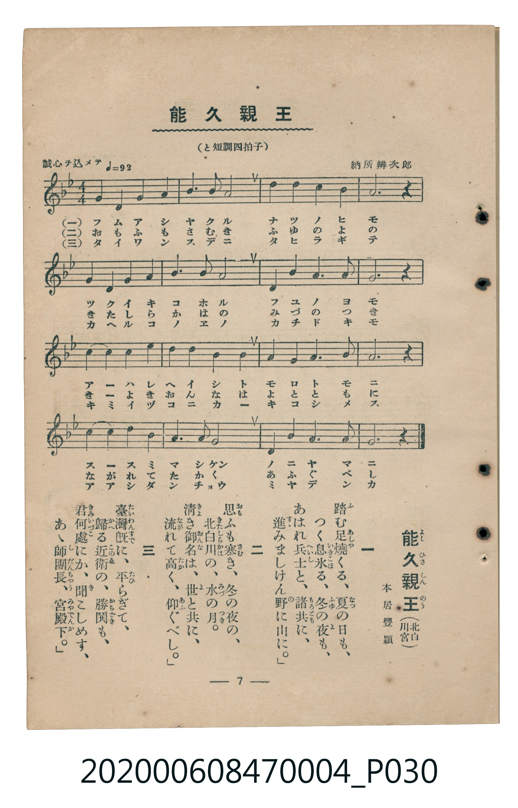

# 能久親王

> Re:Shōka 使用 AI 協助辨識與重建樂譜，可能會有錯誤。歡迎回報。

- **NEUTRINO 歌聲合成版**：<br><audio controls src="yoshihisa_shinno_neutrino.mp3"></audio>
- **鋼琴伴奏版**：<br><audio controls src="yoshihisa_shinno.mp3"></audio>


- 詞：本居豐穎
- 曲：納所辨次郎
- 臺灣教育會公認《新定兒童唱歌》尋常科第四學年用（2020.006.0847.0004）

## 說明

原書資訊與歌詞全文（對應 P030.jpg，書頁 p. 7，第一學期第 7 首）：
標題：能久親王（北白川宮）
調性與拍號：と短調四拍子（g 小調 4/4 拍，「誠心ヲ込メテ ♩=92」，納所辨次郎 作曲）

## 歌詞

```text
一
踏（ふ）む足燒（あしや）くる、夏（なつ）の日（ひ）も、
つく息氷（いきこほ）る、冬（ふゆ）の夜（よ）も、
あはれ兵士（へいし）と、諸共（もろとも）に、
進（すゝ）みましけん野（の）に山（やま）に。」

二
思（おも）ふも寒（さむ）き、冬（ふゆ）の夜（よ）の、
北白川（きたしらかは）の、水（みづ）の月（つき）。
清（きよ）き御名（おんな）は、世（よ）と共（とも）に、
流（なが）れて高（たか）く、仰（あふ）ぐべし。」

三
臺灣既（たいわんすで）に、平（たひ）らぎて、
歸（かへ）る近衞（このゑ）の、勝鬨（かちどき）も、
君何處（きみいづこ）にか、聞（き）こしめす、
あゝ師團長（しだんちゃう）、宮殿下（みやでんか）。」
```

## ABC

```abc
X:1
T:能久親王
C:曲：納所辨次郎
M:4/4
L:1/16
Q:1/4=92
K:Gm
V:V1 name="Piano" snm="Pia"
[V:V1]
G4 D4 G4 A4 | B6 B2 A8 | d4 d4 c4 B4 | A12 z4 |
w: 1.~フ ム ア シ | ヤ ク ル | ナ ツ ノ ヒ | モ
w: 2.~お も ふ も | さ む き | ふ ゆ の よ | の
w: 3.~タ イ ワ ン | ス デ ニ | タ ヒ ラ ギ | テ
G4 D4 G4 A4 | B6 B2 A8 | D4 A4 A6 B2 | G12 z4 |
w: 1.~ツ ク イ キ | コ ホ ル | フ ユ ノ ヨ | モ
w: 2.~き た し ら | か は の | み づ の つ | き
w: 3.~カ ヘ ル コ | ノ ヱ ノ | カ チ ド キ | モ
c4 c4 c4 e4 | d4 d4 B4 B4 | A4 G4 A6 B2 | A12 z4 |
w: 1.~ア _ ハ レ | ヘ イ シ ト | モ ロ ト モ | ニ
w: 2.~き よ き お | ん な は _ | よ と と も | に
w: 3.~キ ミ イ ヅ | コ ニ カ _ | キ コ シ メ | ス
c4 c4 d4 B4 | A6 A2 G8 | D4 B4 A6 A2 | G12 z4 |
w: 1.~ス _ ス ミ | マ シ ケ | ノ ニ ヤ マ | ニ
w: 2.~な が れ て | た か く | あ ふ ぐ べ | し
w: 3.~ア ア シ ダ | ン チャ ウ | ミ ヤ デ ン | カ
```

## TMD 檔案連結

- [主旋律 TMD 檔案](yoshihisa_shinno.tmd) [[在 TMD Studio 編輯](https://tmdlang.github.io/Tmd-TS/#tmd=s7IKdvYPcrWy4qpTUCpJTLdSSM7PyUlNLsnMz7MqzsjMK0nNjM_KTMmPL87Iz05Ugisry88pzU21Si9KTEmNN4k3MjAyiDcwMIs3sDAxBzIMTBBKi_NLi5JTrYqTM_Lzc-JLUitKkvLzsxHyBUX5Zal5iXlANQVFIBtTwIoQClLLMlNSQdLFyYl58WWpRZlpmakpCPn8opKMfKBLCjIqrTIyi0vyizKTE3PisxPzkB2cWlQM9hTYNfElRYl5xclFmQUgnyJUlWSkAn0FMaRSiUtLS-FF894nO1tfLFv1vK9bQUuLS9FWwdKIy95WwUmHKzu10lbBPZfLxkTfxA5kxouV897vmfVszpqnG1tfbJzwfGUf2OhnszcBhZ9v6X3W2fBi34pnaxa-bIbIvGjf9bxx8bOpM180bXo2p_lp65oXq3ofN3Q9m7bh6bpZT1snPV-99OmUjc_W9jxu6H66ofvpjh3Pl098vmbN09mzn67d8XTnludTVrzf0wEKfz1g-OuBwh_IMDB5v6dTiYtLX0vBllqAS0FB4Wnf_Gezd7zY3P5iRdeLjnagu4Beftq64tm0dqArnm7ofdbeqRBgYGygl1WQ_n5PD1DxywWNCgV6CuZAHtDdT3Y0AN39bM58IFvBXOHlsmlAhwIDB2T4sxUzXy7sAXKQwxxkbM_05zP3Pt0-9-m6dUDVIKUvVu1_1rAc5ILu3hcz5wP1PG5c8Xz-WqA4MGSAgk_XTgDqTFd4uqEfKKYAjCAFoCjQDY8bel6sWvB0f_Pj5k0v9u153LzwcXObwqOZK20tjR43gFSgxZPCk71zwBHYyQWyGegBsAN29APNf9y4FSj-uKnhxbbNz9sngUWaHjdOf9zUAhJv7H_c1P24ofHpEojiVY8bl4DF1z2bvhQsAjL2cVMTUA3IUKA0UM-zxvXPNmwHS7c8bux93Dj5ceNusDqwWW1rIBY_bmqDmPV0yRyQSFMHmllAh6x_3NTztHXr08WrwXp2gE2cDta2AqjuxeodT1s3gjU3PW4C2rQCyADLroaa8rIB6EKgzpmPm-aCJfY_btwH8mDjxMdNk1-294FlQbEC1PN0I8QsoB37YKYAndMLCbddPeA4bgCaA9TSBbMJ6I-mp-shQTcVGJJgQWAWIOTRxnVQJ8JTB1g10BPzwREAVNENDAC40mcbtoAVAD0ADHpwHMwBGgQUAYY5MNo7gW4FO3BHK9QgqD29T_ctfDoBqALiamBkrAKLrwca-mQHMPnCXbQCGpiYwfhsayMsAQDTNzCWeh43Lnu5egZYEOheYCoHpxagibs3wFIROGk1TnjcuBPkIaSQ3AHJApCiY_oimCEtj5uA6Q3ovpmPG5fDrX-6czNMASSxAcX7gLbDXLZ2B1gaGFZABiiNvdg_8cVCYDEGFASate5x00R4GD7tnvtyDai4Aatf-LhxJTTo4Knu6YTZT_ZOfTFzKiwygMENTA5LgWZBXQTUCUx4jRALwJpB1gAjrBHkcETabZr7dMfqp3NmvJwKyQrAJLcA7LuFj5uaHzeCkwTQRevWPVu3_8kOUDEBsgyU9paDlYGDFBJoQBMpL_2gQEFLn4srMh9YNQIricRgYA2Zl28VkJmYl-9QY1BTDbJLwcZCyw7MwFb6KkAKwRcLexQ0TEDF0_P1DTrwIlMTiwagjVDDNIAaNa0UHjdPBQVS8wIQ2bQITG4HkjVAsSUgpUD-eiB7NZgNEe8C62gBk31gchJUBqQfGSBbt6sHZF0jWHNTEzhmtsLZQM2NIIeA-A1Adi_COqiqNrCOdWB2B1QGxMNl3Y5OkHVN-8EaQD553LweTG6GaG7aCbGuuR2IuxHWQXSAffS4eSVYN8gakO9ATsBiXY2CWbyCroIxiACzzEFEjYIhkNQFkmAuCNYoGIPUAbERWAIkApcEQQOQENhMH0OQhVOBfFDUAElg1IDI7WBNoKgBqYdFDcx4UNSAdLSAyT4wOQkqA9IPg2D3QewxAoUjWBcwHoAkMLRhbEicQOyBxAncHqiqNrCOdWB2B1QGxMNijzEkaEEqQW4HRQaI3AzRBYwMsD3QyIDbA9EB9gMoMkC6QeZDIgPdHvzZZFcPZdkEnNyB4Q1PTk1roQkGlKBAiWU2WjaBZKxlYBKSTVZAZYjIJqAMACxoweR0sHWdEM2NkLQKrDOQMgBIHJxuG5eCSXA2aQQ5EyQDy0zYrINmE5C7HzfPAJNgNthXILeCXA7ir4CzIb6G6GgEkyCnwcMDl-9IySZwaaigIUw3rpwCTvHA2IGnL6BrICkIlMJAqQcSO4icAslby8AkKKeA6BUEcwooD4CiBUROB9vTCTEPGC1gM6DRgsgp4BQMjBZYTgHRS6DRgjungFwKig8QCWaD_QGJD4hbN8LZEH9CdDSCSZCbIGGA3T8EKpROinIKpBJp3gMm-8HkGmjKAKcvYPxAqpjHzdByHJxiHjeD0g9EDCICkoEVzGhpCSOngKsEWK4BVTGgIJkM5q0CRwrMSSBxiFpQZoSS8CoIln2xWQfNKRBXgjMmtFpphRoLyjEgF8PyBsw6sA6ILNTfC6EykCoIw7oacP0AwybgCIbVHKDcglRzIDISJJPgq07AVQgk8fSDyTXQJAVOZtBsA6pgQJGAqDRAEQMTA9GLoBFDIJOAKwRYhgFVMJAYAfFWgUlQZoUlXojaFXASUgVBYgR3JoG4C5wZoZVKK9Q8UGaBuBGSMWD2gHVAZME-BalaiFQBEZ1JgB1DyjIJKOqhmQTKBiUpUMjOAycFkPseN20EyyAXxZAsAWmbQdQSmU1WgTQ09oCNBpONoJoJFMQgi0F8YMpthORXaMptRGqlNU4AkyCngmRAVRIuC6EZBdKWRLQoHzc3QF0LySiNj5sXA6Ug9SPURki-gnquHdnz4DyFxUZEXoHlDngmAFLwOgNap4DkEbL46xR4koCwIAkNEkEQUUgEIbVioC0ucLKDtdCAqgllF0h26AGbCSaBMQOpO0A2gviQmEHUKUgtNWC8QNTshMYL7uwCaUEi2pGgCIG4G1ZHwqMEbhUkd4E9A4oQiLLN8AoH1apaLi5dOwW0Do0CUEiZCwA)]
- [鋼琴伴奏 TMD 檔案](yoshihisa_shinno_piano.tmd) [[在 TMD Studio 編輯](https://tmdlang.github.io/Tmd-TS/#tmd=s7IKdvYPcrWy4tLSUnjRvPfJztYXy1Y97-t-v6fjZfee5xO2PNmz5enS_uedHe_3dCpoaXEp2ipYGnHZ2yo46XBlp1baKrjnctmY6JvYcdUpKL1YOe_9nlnP5qx5urH1xcYJz1f2KYGEn83eBBR-vqX3WWfDi30rnq1Z-LIZIvOifdfzxsXPps580bTp2Zzmp61rXqzqfdzQ9WzahqfrZj1tnfR89dKnUzY-W9vzuKH76Ybupzt2PF8-8fmaNU9nz366dsfTnVueT1kBdKuRgZGBnoGBmZ6BhYk5kGFgAnSuEhdXZH5xRmZGZnFicEZmXl6-VUBmYl5-kIdDjUFNNZcCENhYaNmBGfpaCrboQAFo0ZMdDS8W9ihomCg83dD_fH2DjkKAgbGBXlZBuiYWDVr6MMM0gBo1rRQeN08F8h83LwCRTYvA5HYgWQMUWwJSCuSvB7JXg9kQ8S6wjhYw2QcmJ0FlQPqRAbJ1u3pA1jWCNTc1gcjGrXA2UHMjyCEgfgOQ3YuwDqqqDaxjHZjdAZUB8XBZt6MTZF3TfrAGkE8eN68Hk5shmpt2QqxrbgfiboR1EB1gHz1uXgnWDbIG5DuQE7BYV6NgFq-gq2AMIsAscxBRo2AIJHWBJJgLgjUKxiB1QGwElgCJwCVB0AAkBDbTxxBk4VQgHxQ1QBIYNSByO1gTKGpA6mFRAzMeFDUgHS1gsg9MToLKgPTDINh9EHuMQOEI1gWMByAJDG0YGxInEHsgcQK3B6qqDaxjHZjdAZUB8bDYYwwJWpBKkNtBkQEiN0N0ASMDbA80MuD2QHSA_QCKDJBukPmQyEC3B3822dVDWTYBJ3dgeMOTU9NaaIIBJShQYpmNlk0gGWsZmIRkkxVQGSKyCSgDPG6cDyang63rhGhuhKTVx43AqIdnAJA4ON02LgWT4GzSCHImSAaWmbBZB80mIHc_bp4BJsFssK9AbgW5HMRfAWdDfA3R0QgmQU6Dhwcu35GSTeDSUEFDmG5cOQWc4oGxA09fQNdAUhAohYFSDyR2EDkFkreWgUlQTgHRKwjmFFAeAEULiJwOtqcTYh4wWsBmQKMFkVPAKRgYLbCcAqKXQKMFd04BuRQUHyASzAb7AxIfELduhLMh_oToaASTIDdBwgC7fwhUKJ0U5RRIJdK8B0z2g8k10JQBTl_A-IFUMY-boeU4OMU8bgalH4gYRAQkAyuY0dISRk4BVwmwXAOqYkBBMhnMWwWOFJiTQOIQtaDMCCXhVRAs-2KzDppTIK4EZ0xotdIKNRaUY0AuhuUNmHVgHRBZqL8XQmUgVRCGdTXg-gGGTcARDKs5QLkFqeZAZCRIJsFXnYCrEEji6QeTa6BJCpzMoNkGVMGAIgFRaYAiBiYGohdBI4ZAJgFXCLAMA6pgIDEC4q0Ck6DMCku8ELUr4CSkCoLECO5MAnEXODNCK5VWqHmgzAJxIyRjwOwB64DIgn0KUrUQqQIiOpMAm3eUZRJQ1EMzCZQNSlKgkJ0HTgog9z1u2giWQS6KIVkC0jaDqCUym6wCaWjsARsNJhtBNRMoiEEWg_jAlNsIya_QlNuI1EprnAAmQU4FyYCqJFwWQjMKpC2JaFE-bm6AuhaSURofNy8GSkHqR6iNkHwF9Vw7sufBeQqLjYi8Assd8EwApOB1BrROAckjZPHXKfAkAWFBEhokgiCikAhCasVAW1zgZAdroQFVE8oukOzQAzYTTAJjBlJ3gGwE8SExg6hTkFpqwHiBqNkJjRfc2QXSgkS0I0ERAnE3rI6ERwncKkjuAnsGFCEQZZvhFQ6qVbU4-jM-yP0ZE1r0Z0AxGa8QbRafGwuMaCDLJZagmBGQ4QykQUkDIguiDWjSkCTefchuQVcFYhF2HznVNzAXQUMDESporgOzEOqwu5ig68gqNxG2ItwEs9ccVRA9SIHS2EIQmFJ17RTQEmu0j2Es2D5sUka4pYzhUspcAA)]

## 分析

```text
================================================================================
📊 TMD Song Profile: [ 能久親王 ]
================================================================================
⏱  Duration:       0:41 (41.7s), 16 measures total
🎼 Key & Tempo:    首調基準 B,, != 92.0 BPM, <4/4>
   - 分析範圍：      由實際發聲的音符與和弦推測調性；播放脈絡另行呈現
🎤 人聲音域:    D4 (MIDI 62) – D#5 (MIDI 75) [跨度: 13 個半音 / 1.1 個八度, 難度: moderate]
   - 最低音:  D4 in [YoshihisaShinno #1 @ m.1, 0:00]
   - 最高音: D#5 in [YoshihisaShinno #1 @ m.9, 0:22]
   - 適合: soprano, mezzo-soprano, contralto, tenor, baritone, bass
🏛  結構:      YoshihisaShinno (41.7s)
⚡ 編曲密度:        Peak 1 軌道同時演奏
🗝  調性診斷：       G 小調（純淨自然小調，未偵測到可信轉調）
   - 風格氣質:    純淨自然小調（陰鬱抒情、旋律集中，無明顯調外色彩）
   - 轉調歷程:    全曲維持單一推測調性（未偵測到可信轉調）
   - 核心骨幹音:  A, G, A#, D, C
   - 調性數值:    G 小調 [相關度: 0.60, 穩定度: Moderate, 自然音純度: 100.0%]
   - 候選調性 (K-S): G 小調 (0.60), A 小調 (0.51), D 大調 (0.50)
   - 五度圈歷程:   +1
   - 各段落調性細節:
     • [YoshihisaShinno #1]: G 小調 (r: 0.60, 自然音純度: 100.0%)

  [ 五度圈游移軌跡 ]
               C  
         F           [G ]*
      Bb               D  
      Eb               A  
         Ab           E  
            Db       B  
               F# 
     (* = active key center)

  [ 十二半音累積音高分佈 ]
     C  : ███████                   10.0%
     C# :                            0.0%
     D  : ██████████                15.0%
     D# : █                          1.7%
     E  :                            0.0%
     F  :                            0.0%
     F# :                            0.0%
     G  : ███████████████           21.7%
     G# :                            0.0%
     A  : ████████████████████████  35.0%
     A# : ███████████               16.7%
     B  :                            0.0%
--------------------------------------------------------------------------------
Assignment 軌道音域：
  - Piano         : D4 – D#5 (13 個半音 / 1.1 個八度, 49 個音符)
================================================================================
```


## 原書掃描頁




