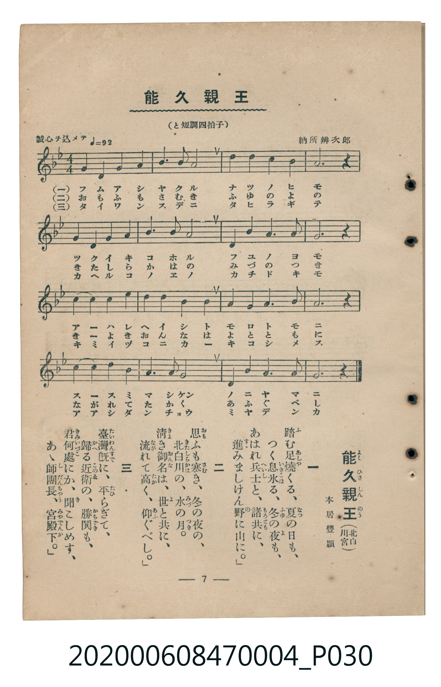

# 能久親王

> Re:Shōka 使用 AI 協助辨識與重建樂譜，可能會有錯誤。歡迎回報。

- **鋼琴伴奏版**：<br><audio controls src="yoshihisa_shinno.mp3"></audio>
- **NEUTRINO 歌聲合成版**：<br><audio controls src="yoshihisa_shinno_neutrino.mp3"></audio>

- 詞：本居豐穎
- 曲：納所辨次郎
- 臺灣教育會公認《新定兒童唱歌》尋常科第四學年用（2020.006.0847.0004）

## 說明

原書資訊與歌詞全文（對應 P030.jpg，書頁 p. 7，第一學期第 7 首）：
標題：能久親王（北白川宮）
調性與拍號：と短調四拍子（g 小調 4/4 拍，「誠心ヲ込メテ ♩=92」，納所辨次郎 作曲）


## 歌詞

```text
一
踏（ふ）む足燒（あしや）くる、夏（なつ）の日（ひ）も、
つく息氷（いきこほ）る、冬（ふゆ）の夜（よ）も、
あはれ兵士（へいし）と、諸共（もろとも）に、
進（すゝ）みましけん野（の）に山（やま）に。」

二
思（おも）ふも寒（さむ）き、冬（ふゆ）の夜（よ）の、
北白川（きたしらかは）の、水（みづ）の月（つき）。
清（きよ）き御名（おんな）は、世（よ）と共（とも）に、
流（なが）れて高（たか）く、仰（あふ）ぐべし。」

三
臺灣既（たいわんすで）に、平（たひ）らぎて、
歸（かへ）る近衞（このゑ）の、勝鬨（かちどき）も、
君何處（きみいづこ）にか、聞（き）こしめす、
あゝ師團長（しだんちゃう）、宮殿下（みやでんか）。」
```

## ABC

<div class="abc-score" data-abc-src="yoshihisa_shinno.abc" aria-label="五線譜載入中"></div>

[下載 ABC 原始檔](yoshihisa_shinno.abc)

## TMD 檔案連結

- [主旋律 TMD 檔案](yoshihisa_shinno.tmd) [[在 TMD Studio 編輯](https://tmdlang.github.io/Tmd-TS/#tmd=s7IKdvYPcrWy4qpTUCpJTLdSSM7PyUlNLsnMz7MqzsjMK0nNjM_KTMmPL87Iz05Ugisry88pzU21Si9KTEmNN4k3MjAyiDcwMIs3sDAxBzIMTBBKi_NLi5JTrYqTM_Lzc-JLUitKkvLzsxHyBUX5Zal5iXlANQVFIBtTwIoQClLLMlNSQdLFyYl58WWpRZlpmakpCPn8opKMfKBLCjIqrTIyi0vyizKTE3PisxPzkB2cWlQM9hTYNfElRYl5xclFmQUgnyJUlWSkAn0FMaQS2YbM9Mw8q9zUzKxMLD6AmlmQmJ5qFWBgbKDEpaWl8KJ575OdrS-WrXre162gpcWlaKtgacRlb6vgpMOVnVppq-Cey2Vjom9iBzLmxcp57_fMejZnzdONrS82Tni-sg9s-rPZm4DCz7f0PutseLFvxbM1C182Q2RetO963rj42dSZL5o2PZvT_LR1zYtVvY8bup5N2_B03aynrZOer176dMrGZ2t7Hjd0P93Q_XTHjufLJz5fs-bp7NlP1-54unPL8ykr3u_pAEWcHjDi9EARB2QYmLzf06nExaWvpWBLLcCloKDwtG_-s9k7Xmxuf7Gi60VHO9BdQC8_bV3xbFo70BVPN_Q-a-9UAIWdXlZB-vs9PUDFLxc0KhToKZgDeUB3P9nRAHT3sznzgWwFc4WXy6YBHQoMHJDhz1bMfLmwB8hBDnOQsT3Tn8_c-3T73Kfr1gFVg5S-WLX_WcNykAu6e1_MnA_U87hxxfP5a4HiwJABCj5dOwGoM13h6YZ-oJgCMIIUgKJANzxu6HmxasHT_c2Pmze92LfncfPCx81tCo9mrrS1NHrcAFKBFk8KT_bOAUdgJxfIZqAHwA7Y0Q80_3HjVqD446aGF9s2P2-fBBZpetw4_XFTC0i8sf9xU_fjhsanSyCKVz1uXAIWX_ds-lKwCMjYx01NQDUgQ4HSQD3PGtc_27AdLN3yuLH3cePkx427werAZrWtgVj8uKkNYtbTJXNAIk0daGYBHbL-cVPP09atTxevBuvZATZxOljbCqC6F6t3PG3dCNbc9LgJaNMKIAMsuxpqyssGoAuBOmc-bpoLltj_uHEfyIONEx83TX7Z3geWBcUKUM_TjRCzgHbsg5kCdE4vJNx29YDjuAFoDlBLF8wmoD-anq6HBN1UYEiCBYFZgJBHG9dBnQhPHWDVQE_MB0cAUEU3MADgSp9t2AJWAPQAMOjBcTAHaBBQBBjmwGjvBLoV7MAdrVCDoPb0Pt238OkEoAqIq4GRsQosvh5o6JMdwOQLd9EKaGBiBuOzrY2wBABM38BY6nncuOzl6hlgQaB7gakcnFqAJu7eAEtF4KTVOOFx406Qh5BCcgckC0CKjumLYIa0PG4Cpjeg-2Y-blwOt_7pzs0wBZDEBhTvA9oOc9naHWBpYFgBGaA09mL_xBcLgcUYUBBo1rrHTRPhYfi0e-7LNaDiBqx-4ePGldCgg6e6pxNmP9k79cXMqbDIAAY3MDksBZoFdRFQJzDhNUIsAGsGWQOMsEaQwxFpt2nu0x2rn86Z8XIqJCsAk9wCsO8WPm5qftwIThJAF61b92zd_ic7QMUEyDJQ2lsOVgYOUkigAU2kvPSDAgUtfS6uyHxgnQqsXRKDgVVrXr5VQGZiXr5DjUFNNcguBRsLLTswA1vpqwApBF8s7FHQMAEVT8_XN-jAi0xNLBqANkIN0wBq1LRSeNw8FRRIzQtAZNMiMLkdSNYAxZaAlAL564Hs1WA2RLwLrKMFTPaByUlQGZB-ZIBs3a4ekHWNYM1NTeCY2QpnAzU3ghwC4jcA2b0I66Cq2sA61oHZHVAZEA-XdTs6QdY17QdrAPnkcfN6MLkZorlpJ8S65nYg7kZYB9EB9tHj5pVg3SBrQL4DOQGLdTUKZvEKugrGIALMMgcRNQqGQFIXSIK5IFijYAxSB8RGYAmQCFwSBA1AQmAzfQxBFk4F8kFRAySBUQMit4M1gaIGpB4WNTDjQVED0tECJvvA5CSoDEg_DILdB7HHCBSOYF3AeACSwNCGsSFxArEHEidwe6Cq2sA61oHZHVAZEA-LPcaQoAWpBLkdFBkgcjNEFzAywPZAIwNuD0QH2A-gyADpBpkPiQx0e_Bnk109lGUTcHIHhjc8OTWthSYYUIICJZbZaNkEkrGWgUlINlkBlSEim4AyALCgBZPTwdZ1QjQ3QtIqsM5AygAgcXC6bVwKJsHZpBHkTJAMLDNhsw6aTUDuftw8A0yC2WBfgdwKcjmIvwLOhvgaoqMRTIKcBg8PXL4jJZvApaGChjDduHIKOMUDYweevoCugaQgUAoDpR5I7CByCiRvLQOToJwColcQzCmgPACKFhA5HWxPJ8Q8YLSAzYBGCyKngFMwMFpgOQVEL4FGC-6cAnIpKD5AJJgN9gckPiBu3QhnQ_wJ0dEIJkFugoQBdv8QqFA6KcopkEqkeQ-Y7AeTa6ApA5y-gPEDqWIeN0PLcXCKedwMSj8QMYgISAZWMKOlJYycAq4SYLkGVMWAgmQymLcKHCkwJ4HEIWpBmRFKwqsgWPbFZh00p0BcCc6Y0GqlFWosKMeAXAzLGzDrwDogslB_L4TKQKogDOtqwPUDDJuAIxhWc4ByC1LNgchIkEyCrzoBVyGQxNMPJtdAkxQ4mUGzDaiCAUUCotIARQxMDEQvgkYMgUwCrhBgGQZUwUBiBMRbBSZBmRWWeCFqV8BJSBUEiRHcmQTiLnBmhFYqrVDzQJkF4kZIxoDZA9YBkQX7FKRqIVIFRHQmAXYMKcskoKiHZhIoG5SkQCE7D5wUQO573LQRLINcFEOyBKRtBlFLZDZZBdLQ2AM2Gkw2gmomUBCDLAbxgSm3EZJfoSm3EamV1jgBTIKcCpIBVUm4LIRmFEhbEtGifNzcAHUtJKM0Pm5eDJSC1I9QGyH5Cuq5dmTPg_MUFhsReQWWO-CZAEjB6wxonQKSR8jir1PgSQLCgiQ0SARBRCERhNSKgba4wMkO1kIDqiaUXSDZoQdsJpgExgyk7gDZCOJDYgZRpyC11IDxAlGzExovuLMLpAWJaEeCIgTiblgdCY8SuFWQ3AX2DChCIMo2wyscVKtqubh07RTQOjQKQCFlLgA)]
- [鋼琴伴奏 TMD 檔案](yoshihisa_shinno_piano.tmd) [[在 TMD Studio 編輯](https://tmdlang.github.io/Tmd-TS/#tmd=s7IKdvYPcrWy4qpTUCpJTLdSyC8qychPL0osyKi0ysgsLskvykxOzInPTsxLVIIrKs4vLUpOjS9ITE-1CjAwNlDi0tJSeNG898nO1hfLVj3v636_p-Nl957nE7Y82bPl6dL-550d7_d0KmhpcSnaKlgacdnbKjjpcGWnVtoquOdy2Zjom9iBzH6xct77PbOezVnzdGPri40Tnq_sA1v5bPYmoPDzLb3POhte7FvxbM3Cl80QmRftu543Ln42deaLpk3P5jQ_bV3zYlXv44auZ9M2PF0362nrpOerlz6dsvHZ2p7HDd1PN3Q_3bHj-fKJz9eseTp79tO1O57u3PJ8ygqgW40MjAz0DAzM9AwsTMyBDAMToHOVuLgi84szMoGhkBickZmXl28VkJmYlx_k4VBjUFPNpQAENhZadmCGvpaCLTpQAFr0ZEfDi4U9ChomCk839D9f36CjAAovvayCdE0sGrT0YYZpADVqWik8bp4K5D9uXgAimxaBye1AsgYotgSkFMhfD2SvBrMh4l1gHS1gsg9MToLKgPQjA2TrdvWArGsEa25qApGNW-FsoOZGkENA_AYguxdhHVRVG1jHOjC7AyoD4uGybkcnyLqm_WANIJ88bl4PJjdDNDfthFjX3A7E3QjrIDrAPnrcvBKsG2QNyHcgJ2CxrkbBLF5BV8EYRIBZ5iCiRsEQSOoCSTAXBGsUjEHqgNgILAESgUuCoAFICGymjyHIwqlAPihqgCQwakDkdrAmUNSA1MOiBmY8KGpAOlrAZB-YnASVAemHQbD7IPYYgcIRrAsYD0ASGNowNiROIPZA4gRuD1RVG1jHOjC7AyoD4mGxxxgStCCVILeDIgNEboboAkYG2B5oZMDtgegA-wEUGSDdIPMhkYFuD_5ssquHsmwCTu7A8IYnp6a10AQDSlCgxDIbLZtAMtYyMAnJJiugMkRkE1AGeNw4H0xOB1vXCdHcCEmrjxuBUQ_PACBxcLptXAomwdmkEeRMkAwsM2GzDppNQO5-3DwDTILZYF-B3ApyOYi_As6G-BqioxFMgpwGDw9cviMlm8CloYKGMN24cgo4xQNjB56-gK6BpCBQCgOlHkjsIHIKJG8tA5OgnAKiVxDMKaA8AIoWEDkdbE8nxDxgtIDNgEYLIqeAU3DjLDAJEQdFDMwsXDkF5FJQfIBIMBvsD0h8QHIkJD4QOQWioxFMgtwECQPs_iFQoXRSlFMglUjzHjDZDybXQFMGOH0B4wdSxTxuhpbj4BTzuBmUfiBiEBGQDKxgRktLGDkFXCXAcg2oigEFyWQwbxU4UmBOAolD1IIyI5SEV0Gw7IvNOmhOgbgSnDGh1Uor1FhQjgG5GJY3YNaBdUBkof5eCJWBVEEY1tWA6wcYNgFHMKzmAOUWpJoDkZEgmQRfdQKuQiAJvR9MroEmKXAyg2YbUAUDigREpQGKGJgYiF4EjRgCmQRcIcAyDKiCgcQIiLcKTIIyKyzxQtSugJOQKggSI7gzCcRd4MwIdf0uqHmgzAJxIyRjwOwB64DIgn0KUrUQqQIiOpMAm3eUZRJQ1EMzCZQNSlKgkJ0HTgog9z1u2giWQS6KIVkC0jaDqCUym6wCaWjsARsNJhtBNRMoiEEWg_jAlNsIya_QlNuI1EprnAAmQU4FyYCqJFwWQjMKpC2JaFE-bm6AuhaSURofNy8GSkHqR6iNkHwF9Vw7sufBeQqLjYi8Assd8EwApOB1BrROAckjZPHXKfAkAWFBEhokgiCikAhCasVAW1zgZAdroQFVE8oukOzQAzYTTAJjBlJ3gGwE8SExg6hTkFpqwHiBqNkJjRfc2QXSgkS0I0ERAnE3rI6ERwncKkjuAnsGFCEQZZvhFQ6qVbU4-jM-yP0ZE1r0Z0AxGa8QbRafGwuMaCDLJZagmBGQ4QykQUkDIguiDWjSkCTefchuQVcFYhF2HznVNzAXQUMDESporgOzEOqwu5ig68gqNxG2ItwEs9ccVRA9SIHS2EIQmFJ17RTQEmu0j2Es2D5sUka4pYzhUspcAA)]

## 分析

```text
================================================================================
📊 TMD Song Profile: [ 能久親王 ]
================================================================================
⏱  Duration:       0:41 (41.7s), 16 measures total
🎼 Key & Tempo:    首調基準 B,, != 92.0 BPM, <4/4>
   - 分析範圍：      由實際發聲的音符與和弦推測調性；播放脈絡另行呈現
🎤 人聲音域:    D4 (MIDI 62) – D#5 (MIDI 75) [跨度: 13 個半音 / 1.1 個八度, 難度: moderate]
   - 最低音:  D4 in [YoshihisaShinno #1 @ m.1, 0:00]
   - 最高音: D#5 in [YoshihisaShinno #1 @ m.9, 0:22]
   - 適合: soprano, mezzo-soprano, contralto, tenor, baritone, bass
🏛  結構:      YoshihisaShinno (41.7s)
⚡ 編曲密度:        Peak 1 軌道同時演奏
🗝  調性診斷：       G 小調（純淨自然小調，未偵測到可信轉調）
   - 風格氣質:    純淨自然小調（陰鬱抒情、旋律集中，無明顯調外色彩）
   - 轉調歷程:    全曲維持單一推測調性（未偵測到可信轉調）
   - 核心骨幹音:  A, G, A#, D, C
   - 調性數值:    G 小調 [相關度: 0.60, 穩定度: Moderate, 自然音純度: 100.0%]
   - 候選調性 (K-S): G 小調 (0.60), A 小調 (0.51), D 大調 (0.50)
   - 五度圈歷程:   +1
   - 各段落調性細節:
     • [YoshihisaShinno #1]: G 小調 (r: 0.60, 自然音純度: 100.0%)

  [ 五度圈游移軌跡 ]
               C  
         F           [G ]*
      Bb               D  
      Eb               A  
         Ab           E  
            Db       B  
               F# 
     (* = active key center)

  [ 十二半音累積音高分佈 ]
     C  : ███████                   10.0%
     C# :                            0.0%
     D  : ██████████                15.0%
     D# : █                          1.7%
     E  :                            0.0%
     F  :                            0.0%
     F# :                            0.0%
     G  : ███████████████           21.7%
     G# :                            0.0%
     A  : ████████████████████████  35.0%
     A# : ███████████               16.7%
     B  :                            0.0%
--------------------------------------------------------------------------------
Assignment 軌道音域：
  - Piano         : D4 – D#5 (13 個半音 / 1.1 個八度, 49 個音符)
================================================================================
```


## 原書掃描頁




