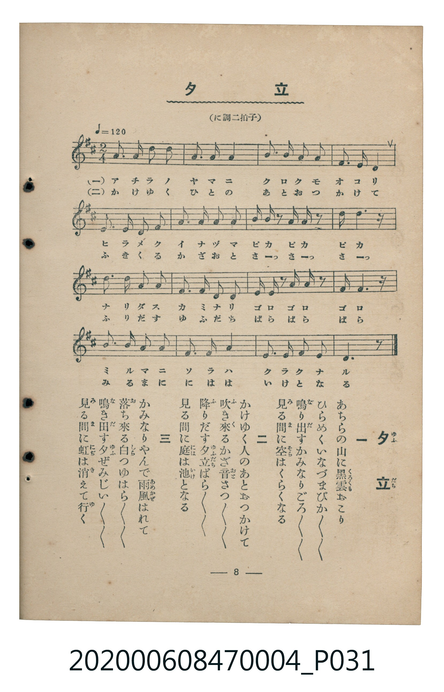

# 夕立

> Re:Shōka 使用 AI 協助辨識與重建樂譜，可能會有錯誤。歡迎回報。

- **鋼琴伴奏版**：<br><audio controls src="yudachi.mp3"></audio>
- **NEUTRINO 歌聲合成版**：<br><audio controls src="yudachi_neutrino.mp3"></audio>

- 臺灣教育會公認《新定兒童唱歌》尋常科第四學年用（2020.006.0847.0004）

## 說明

原書資訊與歌詞全文（對應 P031.jpg，書頁 p. 8，第一學期第 8 首）：
調性與拍號：に調二拍子（D 大調 2/4 拍，♩=120）

## 跨冊／重複收錄參照

> 同曲（文部省唱歌〈夕立〉；收錄於《新定兒童唱歌》四年級與《唱歌帖》P128）

- **[同曲]** 楊金土手抄《唱歌帖》第 1 冊（2020.006.0843）：[**〈夕立〉**](../../../shokacho/vol_01/p128_yudachi/index.md)（`D` / `2/4` — [原始 TMD](../../../shokacho/vol_01/p128_yudachi/yudachi.tmd)）
- 總表：[跨冊重複與同名歌曲總索引](../../../duplicate_songs.md)

## 歌詞

```text
一
あちらの山（やま）に黒雲（くろくも）おこり
ひらめくいなづまぴか／＼／＼
鳴（な）り出（だ）すかみなりごろ／＼／＼
見（み）る間（ま）に空（そら）はくらくなる

二
かけゆく人（ひと）のあとおつかけて
吹（ふ）き來（く）るかざ音（おと）さつ／＼／＼
降（ふ）りだす夕立（ゆふだち）ばら／＼／＼
見る間に庭（には）は池（いけ）となる

三
かみなりやんで雨風（あめかぜ）はれて
落（お）ち來（く）る白（しら）つゆはら／＼／＼
鳴（な）き出（だ）す夕（ゆふ）ぜみじい／＼／＼
見る間に虹（にじ）は消（き）えて行（ゆ）く
```

## ABC

```abc
X:1
T:夕立
M:2/4
L:1/16
Q:1/4=120
K:D
V:V1 name="Piano" snm="Pia"
[V:V1]
A2 A2 d2 d2 | A3 A A4 | B3 B A2 A2 | F3 E D4 |
w: 1.~ア チ ラ ノ | ヤ マ ニ | ク ロ ク モ | オ コ リ
w: 2.~か け ゆ く | ひ と の | あ と お っ | か け て
w: 3.~か み な り | や ん で | あ め か ぜ | は れ て
E3 E D2 F2 | A3 A A2 A2 | B B z2 A A z2 | d2 d4 z2 |
w: 1.~ヒ ラ メ ク | イ ナ ヅ マ | ピ カ ピ カ | ピ カ
w: 2.~ふ き く る | か ざ お と | さ っ さ っ | さ っ
w: 3.~お ち く る | し ら つ ゆ | は ら は ら | は ら
d3 d A2 A2 | F3 F D2 D2 | E E z2 A A z2 | E2 E4 z2 |
w: 1.~ナ リ ダ ス | カ ミ ナ リ | ゴ ロ ゴ ロ | ゴ ロ
w: 2.~ふ り だ す | ゆ ふ だ ち | ば ら ば ら | ば ら
w: 3.~な き だ す | ゆ ふ ぜ み | じ い じ い | じ い
B3 B A2 A2 | F3 F A4 | E3 E F2 E2 | D6 z2 |
w: 1.~ミ ル マ ニ | ソ ラ ハ | ク ラ ク ナ | ル
w: 2.~み る ま に | に は は | い け と な | る
w: 3.~み る ま に | に じ は | き え て ゆ | く
```

## TMD 檔案連結

- [主旋律 TMD 檔案](yudachi.tmd) [[在 TMD Studio 編輯](https://tmdlang.github.io/Tmd-TS/#tmd=s7IKdvYPcrWy4qpTUCpJTLdSSM7PyUlNLsnMz7MqzsjMK0nNjM_KTMmPL87Iz05Ugisry88pzU21Si9KTEmNN4k3MjAyiDcwMIs3sDAxBzIMTBBKi_NLi5JTrYqTM_Lzc-JLUitKkvLzsxHyBUX5Zal5iXlANQVFIBtTwIoQClLLMlNSQdLFyYl58WWpRZlpmakpCPn8opKMfKBLCjIqrTIyi0vyizKTE3PisxPzkB2cWlQM9hTYNfElRYl5xclFmQUgnyJUlWSkAn1VnpoIZBQpcWlpKTxdMvX56m4FLS0uRVsFQyMDLntbBRcuGyN9EzuQrhftu543Ln42deaLpk3P5jQ_bV3zYlXv44auZ9M2PF0362nrpOerlz6dsvHZ2p7HDd1PN3Q_3bHj-fKJz9eseTp79tO1O57u3PJ8yor3ezpAAagHDEA9UAACGQYm7_d0KnFx6Wsp2FILcCkoKDztm_9s9o4Xm9tfrOh60dEOdNeLlfOetq54Nq0d6IqnG3qftXcqBBgYG-plFaS_39MDVPxyQaNCgZ6CBZAHdPeTHQ1Adz-bMx_IVrBQeLlsGtCh7_fMAhn-YtX-Zw3LQcZ2976YOR8o-rhxNVDwya4eoMjTtROAVrgAQ3Q5UEwBGIIKQFGgqY9mrrQFhizQHC6QKUAbQNTjxqbHjQsfN3U-blz3dONGoNbHTS2PG_cBlQFNfbl70svZm0CCjf2Pm3rBZBNYqutx4-THTV0QIzaB9Dc1gqQbgZpXPW5cCjTiceOWx43d7_f0v9-zB0KCVL_cvAVs3iqQMU1dT9t3gbkLwKbOBGp43LgfZEQT0IYpQDvR9b9YBjQSqGE_WH_3y2mTwVyog5-vhBg3F-gisMh6sJuBDKDTgIZ2Q_y-qwficKBlEx83tQFln-yCaNz0uBGYUEChAQ6ZFWCfLoGqbFwGjtwJO8FKt4LV9T7Z1wYJIIiDwEqnvZy_GSwI1AwxbirQFIygmAn0HcwgkH8XAEMAkhPA8QB011aw4EKwERvAfsIIDUggAP3-dNdasHGrgb6G-P3ZRmCwAkWAcTIRLAL0DiIQdnTCAwEW4sCobwIatfzl7BUvF4EyDCgQQBELVDMHGp5NPdBweDFhL8SPYImFaOHwfCZEdjosJpaAPQTUj-EJlCTR2IuWJIABAg8NsMgcsHtnAL2FLzRezITEEjA0ZkBDY1sHWAQY6EAukLHsxcIeiNFgkX6QEZTnfyhQ0NLn4oosTUlMzsi0CshMzMt3qDGoqQbZoWBjaKZlB2ZhK3gUIPkf6DgFDROFpxv6n69v0IGXFppYNACtghqmAdSoaaXwuGkRKGqbG8HkSjDZByRrgPQSMG8eEHeDNEFEm9aDRdfCWSD9IPFVIF7TZrAYiA0CyNbt6gFZ1wgyCpjIwIrbwOx-iAGNm8C8FUC8DmFdYxNctAvMAjkKJI5kTuMyLNbt6ESybj-YhLgQZAzIvS1g3mSg-HJ065oa4TrnQMXBfm3qwWZdjYKpgi4YG8bBCIgYSBRCg0TMwLQZXHWNgjFYxEjBEKYGbJ6PIch5i4B8ULSAyJVgsg-sBxQtILWwiIGZDooOiDgkakAskBmQqAHLACMHFDUodhlBwhIoCwxLkJo2MLsfohMYJ2Cd0FiB2wUMJoR4F5i1GCoDcRHINFBAodhljLBrP5gEuQUUIRBXtkBdCYkSDLugkQLSNwcqA_UxMFqQ7cKfXXb1UJRdmieBE_hKIF4IThKghAFyPSSzdAFxK5g1DyLePAUotxqcXJDZEBmQfggfM_1Cs8tWcIrrhWYTYJkFTY-Q1DkNni1WQMWnAg3eA4oNkCASByIHcgRUANNGaI6BmLcQw8bpYF4nNAtCMi8kEkCiYA8isRF5BsJHsa4GmOYRKR-UC1DzCyR3mAGhAVQMRNcg5S8QBIshcgwwZiDpHxI3oHQBSh-QuIHIQGIHkncgeQkSI_FgMQQbIgMyYTXULrAoUo7ZCk3lkIgBqQSlTOT0D4kaSB6ByABjAxjyYLuQ2BAZWA5CswucY0CmgOQhUYJs13Ro-odECiz3IiIFYheCDcszID6yXQQqmE7Kcgw4QQHLncfNDeAEsROSPMAp_3HzfCQVEPEt4DIMnKCQ2BAZSNWDkaAwcgywUAE2C8BpciZUM6Sy2QoXB2VfUIBsQEq_CDZEBkf6Rc4u4EoFnA5wWQeqQiBVEMjQGUAMqnpAYgg2RAYkBuGjWAdN-OCkj155GIOzEAiDMpURWoYBZTNIVsPMLtBkBY0YUKLYCc0ukEQPixqIGogMJDrAyQqJDZGBVD14sws0VkCJciZUHyjBgviQeIEkc0hChcQFJAkj2BAZzCQMtgucXaCVHTRKcNkFqkIg1RAiUiB2IdgQGZAYpGoiKrsA-5GUZZf5oGTQvBpahUDaXiDX7wXzQIUbqFyGJhpoGwwoCmVBWzdA_agAS0YBN4qAZQmwSwROeSAtIC-D8yWo1AAX4LDUCW4ugWt1UFUDSfcgB8CahtgsgmYR_BaBwhvZol6w6A4gBrWzEPUMzNdoFuFuVxkjtb1g9Q1IBsQGZimoHLasMR-aASCRAGJBS1xgJCDqGFBZjN72gkQEpK6B1COwGgRbtgAlP0h5DgoaUEIDqYYEDSSpQmIB0RaCtpGg8QBrQ0HiAas94CxB2B5IJCDs6YWKd4CjAblmgfkaYU8tF5eunQK0A6MAZCpzAQA)]
- [鋼琴伴奏 TMD 檔案](yudachi_piano.tmd) [[在 TMD Studio 編輯](https://tmdlang.github.io/Tmd-TS/#tmd=s7IKdvYPcrWy4tLSUni6ZOrz1d3v93S87N7zfMKWJ3u2PF3a_7yz4_2eTgUtLS5FWwVDIwMue1sFFy4bI30TO646BaUX7bueNy5-NnXmi6ZNz-Y0P21d82JV7-OGrmfTNjxdN-tp66Tnq5c-nbLx2dqexw3dTzd0P92x4_nyic_XrHk6e_bTtTue7tzyfMoKoJVGBkYGegYGZnoGFibmQIaBCdBWJS6uyNKUxOSMTKuAzMS8_CAPhxqDmmouBSCwMTTTsgOz9LUUbNGBAtCGJzsaXizsUdAwUXi6of_5-gYdhQADY0O9rIJ0TSwatPRhhmkANWpaKTxuWgTkP25uBJMrwWQfkKwB0kvAvHlA3A3SBBFtWg8WXQtngfSDxFeBeE2bwWIgNgggW7erB2RdI8iox40TwYrbwOx-iAGNm8C8FUC8DmFdYxNctAvMAjkKJI5kTuMyLNbt6ESybj-YhLgQZAzIvS1g3mSg-HJ065oa4TrnQMXBfm3qwWZdjYKpgi4YG8bBCIgYSBRCg0TMwLQZXHWNgjFYxEjBEKYGbJ6PIch5i4B8ULSAyJVgsg-sBxQtILWwiIGZDooOiDgkakAskBmQqAHLACMHFDUodhlBwhIoCwxLkJo2MLsfohMYJ2Cd0FiB2wUMJoR4F5i1GCoDcRHINFBAodhljLBrP5gEuQUUIRBXtkBdCYkSDLugkQLSNwcqA_UxMFqQ7cKfXXb1UJRdmieBE_hKIF4IThKghAFyPSSzdAFxK5g1DyLePAUotxqcXJDZEBmQfggfM_1Cs8tWcIrrhWaTx02gVIlI_tPg2WIFVHwq0OA9oNgACSJxIHIgR0AFMG2E5hiIeQsxbJwO5nVCsyAk80IiASQK9iASG5FnIHwU62qAaR6R8kG5ADW_QHKHGRAaQMVAdA1S_gJBsBgixwBjBpL-IXEDSheg9AGJG4gMJHYgeQeSlyAxEg8WQ7AhMiATVkPtAosi5Zit0FQOiRiQSlDKRE7_kKiB5BGIDDA2gCEPtguJDZGB5SA0u8A5BmQKSB4SJch2TYemf0ikwHIvIlIgdiHYsDwD4iPbRaCC6aQsx4ATFLDcedzcAE4QOyHJA5zyHzfPR1IBEd8CLsPACQqJDZGBVD0YCQojxwALlceNC8BpciZUM6Sy2QoXB2VfUIBsQEq_CDZEBkf6Rc4u4EoFnA5wWQeqQiBVEMjQGUAMqnpAYgg2RAYkBuGjWAdN-OCkj155GIOzEAiDMpURWoYBZTNIVsPMLtBkBY0YUKLYCc0ukEQPixqIGogMJDrAyQqJDZGBVD14sws0VkCJciZUHyjBgviQeIEkc0hChcQFJAkj2BAZzCQMtgucXaCVHTRKcNkFqkIg1RAiUiB2IdgQGZAYpGoiKrsAW3yUZZf5oGTQvBpahUDaXiDX7wXzQIUbqFyGJhpoGwwoCmVBWzdA_agAS0YBN4qAZcnjxn3glAfSAvIyOF-CSg1wAQ5LneDmErhWB1U1kHQPcgCsaYjNImgWwW8RKLyRLeoFi-4AYlA7C1HPwHyNZhHudpUxUtsLVt-AZEBsYJaCymHLGvOhGQASCSAWtMQFRgKijgGVxehtL0hEQOoaSD0Cq0GwZQtQ8oOU56CgASU0kGpI0ECSKiQWEG0haBsJGg-wNhQkHrDaA84ShO2BRALCnl6oeAc4GpBrFpivEfbUovVffJD7LxbQ7gswwOMVTOOhZI2CCZCJnWMaj6wQRTNUCqoBTEDUG0BJJFuAHMIWo-pF2IxLMyoPqh7uKrA4XD8wWHTtFKAhE-1jGKuAzDVC5RqDucpcAA)]

## 分析

```text
================================================================================
📊 TMD Song Profile: [ 夕立 ]
================================================================================
⏱  Duration:       0:16 (16.0s), 16 measures total
🎼 Key & Tempo:    首調基準 D, != 120.0 BPM, <2/4>
   - 分析範圍：      由實際發聲的音符與和弦推測調性；播放脈絡另行呈現
🎤 人聲音域:    D4 (MIDI 62) – D5 (MIDI 74) [跨度: 12 個半音 / 1.0 個八度, 難度: easy]
   - 最低音:  D4 in [Yudachi #1 @ m.4, 0:03]
   - 最高音: D5 in [Yudachi #1 @ m.1, 0:00]
   - 適合: soprano, mezzo-soprano, contralto, tenor, baritone, bass
🏛  結構:      Yudachi (16.0s)
⚡ 編曲密度:        Peak 1 軌道同時演奏
🗝  調性診斷：       D 調性不明確（純淨自然大調，未偵測到可信轉調）
   - 風格氣質:    純淨自然大調（陽光明朗、易唱易記，無明顯調外色彩）
   - 轉調歷程:    全曲維持單一推測調性（未偵測到可信轉調）
   - 核心骨幹音:  A, D, E, F#, B
   - 調性數值:    D 調性不明確 [相關度: 0.84, 穩定度: Ambiguous, 自然音純度: 100.0%]
   - 候選調性 (K-S): D 大調 (0.84), A 大調 (0.84), F# 小調 (0.57)
   - 五度圈歷程:   +2
   - 各段落調性細節:
     • [Yudachi #1]: D 調性不明確 (r: 0.84, 自然音純度: 100.0%)

  [ 五度圈游移軌跡 ]
               C  
         F            G  
      Bb              [D ]*
      Eb               A  
         Ab           E  
            Db       B  
               F# 
     (* = active key center)

  [ 十二半音累積音高分佈 ]
     C  :                            0.0%
     C# :                            0.0%
     D  : ██████████████████        26.3%
     D# :                            0.0%
     E  : ███████████               16.7%
     F  :                            0.0%
     F# : █████████                 13.2%
     G  :                            0.0%
     G# :                            0.0%
     A  : ████████████████████████  35.1%
     A# :                            0.0%
     B  : ██████                     8.8%
--------------------------------------------------------------------------------
Assignment 軌道音域：
  - Piano         : D4 – D5 (12 個半音 / 1.0 個八度, 54 個音符)
================================================================================
```


## 原書掃描頁




