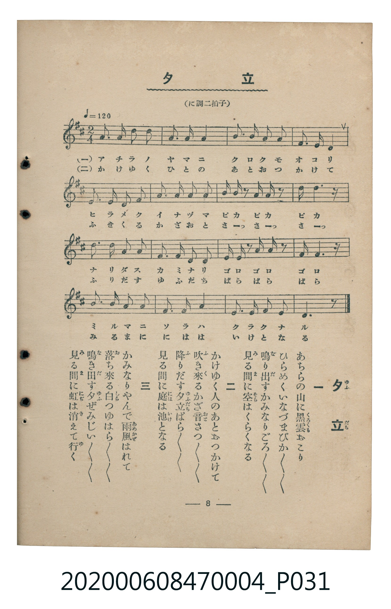

# 夕立

<audio controls src="yudachi.mp3"></audio>

- 臺灣教育會公認《新定兒童唱歌》尋常科第四學年用（2020.006.0847.0004）

## 說明

原書資訊與歌詞全文（對應 P031.jpg，書頁 p. 8，第一學期第 8 首）：
調性與拍號：に調二拍子（D 大調 2/4 拍，♩=120）

## 歌詞

```text
一
あちらの山（やま）に黒雲（くろくも）おこり
ひらめくいなづまぴか／＼／＼
鳴（な）り出（だ）すかみなりごろ／＼／＼
見（み）る間（ま）に空（そら）はくらくなる

二
かけゆく人（ひと）のあとおつかけて
吹（ふ）き來（く）るかざ音（おと）さつ／＼／＼
降（ふ）りだす夕立（ゆふだち）ばら／＼／＼
見る間に庭（には）は池（いけ）となる

三
かみなりやんで雨風（あめかぜ）はれて
落（お）ち來る白（しら）つゆはら／＼／＼
鳴（な）き出（だ）す夕（ゆふ）ぜみじい／＼／＼
見る間に虹（にじ）は消（き）えて行（ゆ）く
```

## ABC

```abc
X:1
T:夕立
C:TMD (Chen, Chih-Han / aguai)
M:2/4
L:1/16
Q:1/4=120
K:D
V:V1 name="Piano" snm="Pia"
[V:V1]
d2 f2 a2 d2 | b3 a a4 | g3 g f2 g2 | e2 f2 d4 |
f3 a d2 c2 | b3 c d2 b2 | a b z2 a b z2 | a2 d4 z2 |
d3 f d2 a2 | b3 g a2 f2 | e f z2 g a z2 | e2 a4 z2 |
a3 b a2 f2 | d3 e f4 | e3 f g2 e2 | d6 z2 |
```

## TMD 檔案連結

- [主旋律 TMD 檔案](yudachi.tmd)
- [鋼琴伴奏 TMD 檔案](yudachi_piano.tmd)

## 分析

```text
================================================================================
📊 TMD Song Profile: [ 夕立 ]
================================================================================
⏱  Duration:       0:16 (16.0s), 16 measures total
🎼 Key & Tempo:    首調基準 D, != 120.0 BPM, <2/4>
   - 分析範圍：      由實際發聲的音符與和弦推測調性；播放脈絡另行呈現
🎤 人聲音域:    D4 (MIDI 62) – F#5 (MIDI 78) [跨度: 16 個半音 / 1.3 個八度, 難度: moderate]
   - 最低音:  D4 in [Yudachi #1 @ m.1, 0:00]
   - 最高音: F#5 in [Yudachi #1 @ m.9, 0:08]
   - 適合: soprano, mezzo-soprano, tenor, baritone
🏛  結構:      Yudachi (16.0s)
⚡ 編曲密度:        Peak 1 軌道同時演奏
🗝  調性診斷：       D 大調（純淨自然大調，未偵測到可信轉調）
   - 風格氣質:    純淨自然大調（陽光明朗、易唱易記，無明顯調外色彩）
   - 轉調歷程:    全曲維持單一推測調性（未偵測到可信轉調）
   - 核心骨幹音:  D, A, F#, B, E
   - 調性數值:    D 大調 [相關度: 0.98, 穩定度: High, 自然音純度: 100.0%]
   - 候選調性 (K-S): D 大調 (0.98), B 小調 (0.68), A 大調 (0.67)
   - 五度圈歷程:   +2
   - 各段落調性細節:
     • [Yudachi #1]: D 大調 (r: 0.98, 自然音純度: 100.0%)

  [ 五度圈游移軌跡 ]
               C  
         F            G  
      Bb              [D ]*
      Eb               A  
         Ab           E  
            Db       B  
               F# 
     (* = active key center)

  [ 十二半音累積音高分佈 ]
     C  :                            0.0%
     C# : ██                         2.6%
     D  : ████████████████████████  26.3%
     D# :                            0.0%
     E  : █████████                  9.6%
     F  :                            0.0%
     F# : ████████████████          17.5%
     G  : ████████                   8.8%
     G# :                            0.0%
     A  : █████████████████████     22.8%
     A# :                            0.0%
     B  : ███████████               12.3%
--------------------------------------------------------------------------------
Assignment 軌道音域：
  - Piano         : D4 – F#5 (16 個半音 / 1.3 個八度, 54 個音符)
================================================================================
```


## 原書掃描頁




