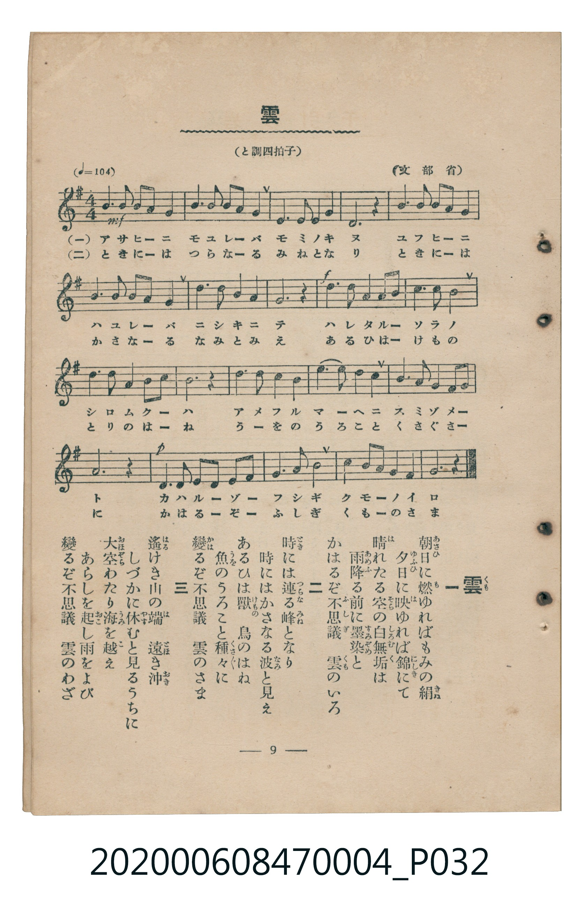

# 雲

<audio controls src="kumo.mp3"></audio>

- 文部省唱歌
- 臺灣教育會公認《新定兒童唱歌》尋常科第四學年用（2020.006.0847.0004）

## 說明

原書資訊與歌詞全文（對應 P032.jpg，書頁 p. 9，第一學期第 9 首）：
調性與拍號：と調四拍子（G 大調 4/4 拍，♩=104，文部省）

## 歌詞

```text
一
朝日（あさひ）に燃（も）ゆればもみの絹（きぬ）
夕日（ゆふひ）に映（は）ゆれば錦（にしき）にて
晴（は）れたる空（そら）の白無垢（しろむく）は
雨（あめ）降（ふ）る前（まへ）に墨染（すみぞめ）と
かはるぞ不思議（ふしぎ）　雲（くも）のいろ

二
時（とき）には連（つらな）る峰（みね）となり
時にはかさなる波（なみ）と見（み）え
あるひは獸（けもの）　鳥（とり）のはね
魚（うを）のうろこと種々（くさぐさ）に
變（かは）るぞ不思議　雲のさま

三
遙（はる）けき山（やま）の端（は）　遠（とほ）き沖（おき）
しづかに休（やす）むと見るうちに
大空（おほぞら）わたり海（うみ）を越（こ）え
あらしを起（おこ）し雨をよび
變るぞ不思議　雲のわざ
```

## 原書掃描頁



## 分析

```text
================================================================================
📊 TMD Song Profile: [ 雲 ]
================================================================================
⏱  Duration:       0:46 (46.2s), 20 measures total
🎼 Key & Tempo:    首調基準 G, != 104.0 BPM, <4/4>
   - 分析範圍：      由實際發聲的音符與和弦推測調性；播放脈絡另行呈現
🎤 人聲音域:    D4 (MIDI 62) – E5 (MIDI 76) [跨度: 14 個半音 / 1.2 個八度, 難度: moderate]
   - 最低音:  D4 in [Kumo #1 @ m.1, 0:00]
   - 最高音: E5 in [Kumo #1 @ m.7, 0:13]
   - 適合: soprano, mezzo-soprano, contralto, tenor, baritone, bass
🏛  結構:      Kumo (46.2s)
⚡ 編曲密度:        Peak 1 軌道同時演奏
🗝  調性診斷：       G 大調（純淨自然大調，未偵測到可信轉調）
   - 風格氣質:    純淨自然大調（陽光明朗、易唱易記，無明顯調外色彩）
   - 轉調歷程:    全曲維持單一推測調性（未偵測到可信轉調）
   - 核心骨幹音:  B, A, G, D, E
   - 調性數值:    G 大調 [相關度: 0.83, 穩定度: Moderate, 自然音純度: 100.0%]
   - 候選調性 (K-S): G 大調 (0.83), D 大調 (0.76), B 小調 (0.66)
   - 五度圈歷程:   +1
   - 各段落調性細節:
     • [Kumo #1]: G 大調 (r: 0.83, 自然音純度: 100.0%)

  [ 五度圈游移軌跡 ]
               C  
         F           [G ]*
      Bb               D  
      Eb               A  
         Ab           E  
            Db       B  
               F# 
     (* = active key center)

  [ 十二半音累積音高分佈 ]
     C  : ███████                    6.0%
     C# :                            0.0%
     D  : █████████████████████     18.0%
     D# :                            0.0%
     E  : █████████████             11.3%
     F  :                            0.0%
     F# : █████                      4.7%
     G  : ██████████████████████    19.3%
     G# :                            0.0%
     A  : ███████████████████████   20.0%
     A# :                            0.0%
     B  : ████████████████████████  20.7%
--------------------------------------------------------------------------------
Assignment 軌道音域：
  - Piano         : D4 – E5 (14 個半音 / 1.2 個八度, 78 個音符)
================================================================================
```

## ABC

```abc
X:1
T:雲
C:TMD (Chen, Chih-Han / aguai)
M:4/4
L:1/16
Q:1/4=104
K:G

V:V1 name="Piano" snm="Pia"

[V:V1]
!mf! d4 g2 a2 b2 a2 g4 | a4 a2 b2 c2 a2 b4 | d4 e4 f4 g4 | d12 z4 |
d4 g2 a2 b2 a2 g4 | a4 a2 b2 c2 a2 b4 | e6 d2 b4 a4 | g12 z4 |
!f! d4 d4 e4 d2 b2 | c8 b4 a4 | g4 a4 b4 c2 b2 | a12 z4 |
b4 b4 c4 b4 | a4 d4 b4 g4 | e4 f4 g4 b2 a2 | e12 z4 |
!p! d4 d2 e2 g2 f2 g2 a2 | b8 d4 b4 | a4 g2 e2 d4 f4 | g12 z4 |
```

- [主旋律 TMD 檔案](kumo.tmd)
- [鋼琴伴奏 TMD 檔案](kumo_piano.tmd)
