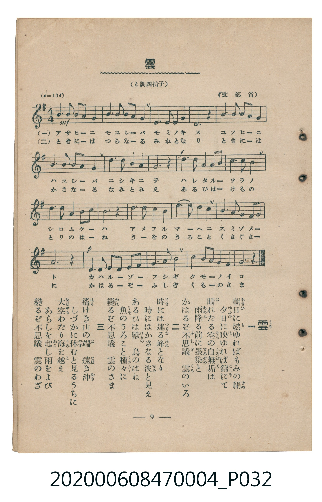

# 雲

> Re:Shōka 使用 AI 協助辨識與重建樂譜，可能會有錯誤。歡迎回報。

- **NEUTRINO 歌聲合成版**：<br><audio controls src="kumo_neutrino.mp3"></audio>
- **鋼琴伴奏版**：<br><audio controls src="kumo.mp3"></audio>


- 文部省唱歌
- 臺灣教育會公認《新定兒童唱歌》尋常科第四學年用（2020.006.0847.0004）

## 說明

原書資訊與歌詞全文（對應 P032.jpg，書頁 p. 9，第一學期第 9 首）：
調性與拍號：と調四拍子（G 大調 4/4 拍，♩=104，文部省）

## 歌詞

```text
一
朝日（あさひ）に燃（も）ゆればもみの絹（きぬ）
夕日（ゆふひ）に映（は）ゆれば錦（にしき）にて
晴（は）れたる空（そら）の白無垢（しろむく）は
雨（あめ）降（ふ）る前（まへ）に墨染（すみぞめ）と
かはるぞ不思議（ふしぎ）　雲（くも）のいろ

二
時（とき）には連（つらな）る峰（みね）となり
時にはかさなる波（なみ）と見（み）え
あるひは獸（けもの）　鳥（とり）のはね
魚（うを）のうろこと種々（くさぐさ）に
變（かは）るぞ不思議　雲のさま

三
遙（はる）けき山（やま）の端（は）　遠（とほ）き沖（おき）
しづかに休（やす）むと見るうちに
大空（おほぞら）わたり海（うみ）を越（こ）え
あらしを起（おこ）し雨をよび
變るぞ不思議　雲のわざ
```

## ABC

```abc
X:1
T:雲
M:4/4
L:1/16
Q:1/4=104
K:G
V:V1 name="Piano" snm="Pia"
[V:V1]
!mf! B6 B2 B2 A2 G4 | B6 B2 B2 A2 G4 | E6 E2 E4 G4 | D12 z4 |
w: 1.~ア サ ヒ _ ニ | モ ユ レ _ バ | モ ミ ノ キ | ヌ
w: 2.~と き に _ は | つ ら な _ る | み ね と な | り
w: 3.~は る け _ き | や ま の _ は | と ほ き お | き
B6 B2 B2 A2 G4 | B6 B2 B2 A2 G4 | d6 d2 B4 A4 | G12 z4 |
w: 1.~ユ フ ヒ _ ニ | ハ ユ レ _ バ | ニ シ キ ニ | テ
w: 2.~と き に _ は | か さ な _ る | な み と み | え
w: 3.~し づ か _ に | や す む _ と | み る う ち | に
!f! d6 d2 A4 A2 B2 | c6 c2 B8 | d6 d2 A4 B2 c2 | B12 z4 |
w: 1.~ハ レ タ ル _ | ソ ラ ノ | シ ロ ム ク _ | ハ
w: 2.~あ る ひ は _ | け も の | と り の は _ | ね
w: 3.~お ほ ぞ ら _ | わ た り | う み を こ _ | え
d6 d2 c4 B4 | e6 e2 d4 c4 | B6 A2 G4 F2 G2 | A12 z4 |
w: 1.~ア メ フ ル | マ _ ヘ ニ | ス ミ ゾ メ _ | ト
w: 2.~う _ を の | う ろ こ と | く さ ぐ さ _ | に
w: 3.~あ ら し を | お こ し _ | あ め を よ _ | び
!p! D6 D2 E2 D2 E2 F2 | G6 A2 B8 | c4 B2 A2 G4 F4 | G12 z4 |
w: 1.~カ ハ ル _ ゾ _ | フ シ ギ | ク モ _ ノ イ | ロ
w: 2.~か は る _ ぞ _ | ふ し ぎ | く も _ の さ | ま
w: 3.~か は る _ ぞ _ | ふ し ぎ | く も _ の わ | ざ
```

## TMD 檔案連結

- [主旋律 TMD 檔案](kumo.tmd) [[在 TMD Studio 編輯](https://tmdlang.github.io/Tmd-TS/#tmd=s7IKdvYPcrWy4qpTUCpJTLdSSM7PyUlNLsnMz7MqzsjMK0nNjM_KTMmPL87Iz05Ugisry88pzU21Si9KTEmNN4k3MjAyiDcwMIs3sDAxBzIMTBBKi_NLi5JTrYqTM_Lzc-JLUitKkvLzsxHyBUX5Zal5iXlANQVFIBtTwIoQClLLMlNSQdKpKZkl-UWZiTlI7kgtKga7FWxJfElRYl5xclFmAcgDCFUlGalAx-YllpQWpaKLlqcmAhlFSlxaWgovZ29S0NLiUrRVMDQw4bK3VXDnsjHRN7EDaXk2rf1l84rncxqfTtn4bG0P2JgX7bueNy5-NnXmi6ZNz-Y0P21d82JV7-OGrmfTNjxdN-tp66Tnq5dClD9u6H66ofvpjh3Pl098vmbN09mzn67d8XTnludTVrzf0wEKPj1g8OmBgg_IMDB5v6dTiYtLX0vBllqAS0FB4Wnf_Gezd7zY3P5iRdeLjnagu16snPe0dQXQb0BXPN3Q-6y9UyHAwNhIL6sg_f2eHqDilwsaFQr0FCyBPKC7n-xoALr72Zz5QLaCpcLLZdOADn2_ZxbI8Ber9j9rWA4ytrv3xcz5QNHHjSuAgkC_AkWerp0AtMJd4emS5UAxBWCoKgBFgaY-mrnSFhjaINtgIQw0kwtkItA2EPVsztxn05cCdT9ubHrcOPVx4yaggseNq5-3N4MEm5pA3Ka2x009jxs3ALmPG_c_blz3fOtOsJbex41rQAaCvL9kKtQgoOrGrXCDns1YAFa6Htmglz3LwIKrHzdOB5oCUfm4cRnYRTO3IGkAqp7_uKn7-cpdYMG5j5uAQQJUve75zL3PWxY-nbcILD79cVPv46aGx439YNn1IINezgZFP8hfTSBfv5wJtAfI3Qo2t_tpJ4S773HjDoj9TxeteDZ_MlhwJtib8yAagSENMu5xYzfQYKBOoMSTHb3PGua-WLsBYiLYF30gpQ0NwGQOFuyHhl3juseNLUDXQQJ9Vw_Ei0ApoJoVSH5f_7JhMVhwCdCLjxtXQV25GWIF0DVrIU4BSj1u6oKaAtEJdhkw6oAS3c82QwJkFVAPRMOLZd0QI8DcDohXgGEC1LMJqPl5L9D7QOmJ4MhdB_XEZkiSWAG0CuYJoDVrwcG6dhZYDhiVk2ByQDYwKUwGani-Yt3jhlZoCIAcNQFIQvwITsfrgOYB5UBBCfEhcmhCgg9sIlDnPmg6BSevl40zIakCqAVs3ERg2D3duBGc4FqAiqGpYjXQWFjiAZrWCEl8wFDbDVbQ-2wTMFcBRbogQQ8JDWDsLQW7afWTPRNhJgLtA7oPmKRAIQh2KDBdL4T6A5jTYEkSaNJucFoBJ8wmoK-BCbbr2dbt0FCCBHzTpBfbIF4HpjCUeABygKl30guoBqBxEBXTgekXKP64CSi4GRp2OMMLZO00kCLKyzIoUNDS5-LyLs3NtwrITMzLd6gxqKkGWaBgY6FlB2ZgK0AVIOXYi4U9ChqmCk839D9f36ADL_U0sWgAWgM1TAOoUdNK4XHTIlDQNG1VeNw8CYj3AHE3UKQGSINlmpcB8RqozAQUmflgsg-sfy1UpgdkPBIAiS0Dq5uKZgOyU3b1gJzSuAIcS71AvBqisHE9xIjGJWBLOoGsVRCZJqgjG_eD9YCsh-lfBZFp6sJ0Cg4boE6pUajOTatVMFbQBUJjIDRSMASyarCImMWDhYAUmAURNIUIQqABdp1gi3wMQe5bBJaDBT2QBQwWkB5Q8IJloEEPYk1Ak5kPDniQ7rVQmR4ku0HugAQ8RDUk6OE2QNxgBAkPsApoiIBY6yF6gSEOcR0kzEEsqOuAIQ7RsxaqHyIPCXEMN-CyAeIGY5AKEB9iPrCcgaqFmNcC1bsPiNehuA5m6m6oamBOhsqAeOhumA5VvRRUrYBZIJfUgEs83BlrVw9FGau5H2f2AaXdx03b4RkHkeXasGQfiDlrwKrBqb0ZknZBIbQXzF8JJkEZEQKwZC2wlY3AhICRgUDZBZaNINkDxAbJdGA6prEJ7AyIaZvA5HqYY4CRB5IDqwBGF5pjsOUiU7CIKVjGCCwCEkfNQdXAHAlTB1JjBFRdo2ACFjGBmomSr4DhhSv3gOIelNK2Q_MNIse1YaYauDnA2AOGO4gFTjXgUIfIrITmQiQXgHMV1B5ocCPnHRAPJLMfnndAJkMCGzPdNkHdC8oZm8CqYekflE9AMk3QnIHkAlCeguecmUB2A5gFsg0p94LNBPkaWMtCZUC-Q3cBJEdD8tk8sL5OaBhAQ6cRWBLB8z2hHLWjk7KqCpxjmiE5ZgE4scETHziXoCVWSNXWvBBMTgWTqyEyzfPAvD1gcgaYhGaHpp1gHrhqa9oH1Q9Siau6AlczkPSOnBdAjkRzDjC44ZY2TYLrgss09YLFJoNJkNkgGXDmByYkEAkqPsCJCuEcRB4C5Q1jYI6A5TPkPARTA8o1IFlg_QUWMQPLgERhuiA50zweSCFXVdshkQ0MelDAg5IBNCFCMwlKooFVbOCAmwpmQTMOMNghKkGBjpT9gIEOEQUlpn1QvVgrKmBoo1cFoIyMnmxh2RkUziC1IB0IcVBIg8IZOVvAkjMoy4KKCxALtZqC6gVlXaipIBMIZV1Q9QmqfiB6kLPUZKgMOOMg6WiEmd8EMpdAlgL2SCmrpLCU8U2gTAKrdqDNJGCswDIaOC1CKy9EKQ_SB2pKwdqGkKwFqpJAetBzA5bMBLIUzSHQSgtsLKi8ArfX5sGz2Faw7HQwiaj74JkGUhFBHALPaJCMBMrXKA6pAWcf1ExTXQCseCAtOiAFbOZBSGDegFVToKoIFn-QrAXPPljrMqQ6CkuSAQY7JBP0QzMMJCtAghySNED1Fry0h2ZCSJsQ1hoEtdogAY5mPlJWwlbOw2osYAEGrqsgpT0klCEy08GhjEiuoAwDCmNY9oJmGHDoYrUbnIk208ZucG0EkpmGYXctF5eunQKoa6UApJW5AA)]
- [鋼琴伴奏 TMD 檔案](kumo_piano.tmd) [[在 TMD Studio 編輯](https://tmdlang.github.io/Tmd-TS/#tmd=s7IKdvYPcrWy4tLSUng5e9P7PR0vu_c8n7DlyZ4tT5f2P-_seL-nU0FLi0vRVsHQwITL3lbBncvGRN_EjqtOQenZtPaXzSuez2l8OmXjs7U9SiCxF-27njcufjZ15oumTc_mND9tXfNiVe_jhq5n0zY8XTfraeuk56uXQpQ_buh-uqH76Y4dz5dPfL5mzdPZs5-u3fF055bnU1YAnWFkYGSgZ2BgpmdgYWIOZBiYAF2ixMXlXZqbbxWQmZiXH-ThUGNQU82lAAQ2Flp2YIa-loItOlAAmv5kR8OLhT0KGqYKTzf0P1_foKMQYGBspJdVkK6JRYOWPswwDaBGTSuFx02LgPzHTVsVHjdPAuI9QNwNFKkB0mCZ5mVAvAYqMwFFZj6Y7APrXwuV6QEZjwRAYsvA6qai2YDslF09IKc0rgApbOwF4tUQhY3rIUY0LgFb0glkrYLINEEd2bgfrAdkPUz_KohMUxemU3DYAHVKjUJ1blqtgrGCLhAaA6GRgiGQVYNFxCweLASkwCyIoClEEAINsOsEW-RjCHLfIrAcLOiBLGCwgPSAghcsAw16EGsCmsx8cMCDdK-FyvQg2Q1yByTgIaohQQ-3AeIGI0h4gFVAQwTEWg_RCwxxiOsgYQ5iQV0HDHGInrVQ_RB5SIhjuAGXDRA3GINUgPgQ8x83ToSqhZjXAtW7D4jXobgOZupuqOrHjSC7QTIgHrobpkNVLwVikC8gLqnhwp-xdvVQlLGa-3FmH1Dafdy0HZ5xEFmuDUv2gZizBqwanNqbIWkXFEJ7wfyVYBKUESEAS9YCW9kITAgYGQiUXWDZCJI9QGyQTAemYxqbwM6AmLYJTK6HOQYYeSA5sApgdKE5BlsuMgWLmIJljMAiIHHUHFQNzJEwdSA1RkDVNQomYBETqJko-QoYXrhyDyjuQSltOzTfIHJcG2aqgZsDjD1guINY4FQDDnWIzEpoLkRyAThXQe2BBjdy3gHxQDL74XkHZDIksDHTbRPUvaCcsQmsGpb-QfkEJNMEzRlILgDlKXjOmQlkN4BZINuQci_YTJCvHzcuhMqAfIfuAkiOhuSzeWB9ndAwgIZOI7Akgud7QjlqRydlVRU4xzRDcswCcGKDJz5wLkFLrJCqrXkhmJwKJldDZJrngXl7wOQMMAnNDk07wTxw1da0D6ofpBJXdQWuZiDpHTkvgByJ5hxgcMMtbZoE1wWXaeoFi00GkyCzQTLgzA9MSCASVHyAExXCOYg8BMobxsAcActnyHkIpgaUa0CywPoLLGIGlgGJwnRBcqZ5PJBCrqq2QyIbGPSggAclA2hChGYSlEQDq9jAATcVzIJmHGCwQ1SCAh0p-wEDHSIKSkz7oHqxVlTA0EavCkAZGT3ZwrIzKJxBakE6EOKgkAaFM3K2gCVnUJYFFRcgFmo1BdULyrpQU0EmEMq6oOoTVP1A9CBnqclQGXDGQdLRCDO_CWQugSwFbFtSVklhKeObQJkEVu1Am0nAWIFlNHBahFZeiFIepA_UlIK1DSFZC1QlgfSg5wYsmQlkKZpDoJUW2FhQeQVur82DZ7GtYNnpYBJR98EzDaQigjgEntEgGQmUr1EcUgPOPqiZproAWPFAWnRACtjMg5DAvAGrpkBVESz-IFkLnn2w1mVIdRSWJAMMdkgm6IdmGEhWgAQ5JGmA6i14aQ_NhJA2Iaw1CGq1QQIczXykrIStnIfVWMACDFxXQUp7SChDZKaDQxmRXEEZBhTGsOwFzTDg0MVqNzgTbaaN3eDaCCQzDcPuWuSelQ9yz8oE2rMCxhQ4co3BJKgZH69gFK9gAibhXIgaOBdEGaBrhRXJqAYAlYDlEVwQG0gh9MMMB2qBSoOUorgOr_2o-mE8CA0RQzEMbjua3-CeAWlAtgnT4aBw1bVTAAVttI9hLNh0ON8IjW8M5ytzAQA)]

## 分析

```text
================================================================================
📊 TMD Song Profile: [ 雲 ]
================================================================================
⏱  Duration:       0:46 (46.2s), 20 measures total
🎼 Key & Tempo:    首調基準 G, != 104.0 BPM, <4/4>
   - 分析範圍：      由實際發聲的音符與和弦推測調性；播放脈絡另行呈現
🎤 人聲音域:    D4 (MIDI 62) – E5 (MIDI 76) [跨度: 14 個半音 / 1.2 個八度, 難度: moderate]
   - 最低音:  D4 in [Kumo #1 @ m.4, 0:06]
   - 最高音: E5 in [Kumo #1 @ m.14, 0:30]
   - 適合: soprano, mezzo-soprano, contralto, tenor, baritone, bass
🏛  結構:      Kumo (46.2s)
⚡ 編曲密度:        Peak 1 軌道同時演奏
🗝  調性診斷：       G 大調（純淨自然大調，未偵測到可信轉調）
   - 風格氣質:    純淨自然大調（陽光明朗、易唱易記，無明顯調外色彩）
   - 轉調歷程:    全曲維持單一推測調性（未偵測到可信轉調）
   - 核心骨幹音:  B, G, D, A, E
   - 調性數值:    G 大調 [相關度: 0.83, 穩定度: Moderate, 自然音純度: 100.0%]
   - 候選調性 (K-S): G 大調 (0.83), B 小調 (0.78), D 大調 (0.61)
   - 五度圈歷程:   +1
   - 各段落調性細節:
     • [Kumo #1]: G 大調 (r: 0.83, 自然音純度: 100.0%)

  [ 五度圈游移軌跡 ]
               C  
         F           [G ]*
      Bb               D  
      Eb               A  
         Ab           E  
            Db       B  
               F# 
     (* = active key center)

  [ 十二半音累積音高分佈 ]
     C  : ██████                     7.3%
     C# :                            0.0%
     D  : ████████████████          19.3%
     D# :                            0.0%
     E  : ███████                    8.0%
     F  :                            0.0%
     F# : ██                         2.7%
     G  : ████████████████          20.0%
     G# :                            0.0%
     A  : ███████████               13.3%
     A# :                            0.0%
     B  : ████████████████████████  29.3%
--------------------------------------------------------------------------------
Assignment 軌道音域：
  - Piano         : D4 – E5 (14 個半音 / 1.2 個八度, 73 個音符)
================================================================================
```


## 原書掃描頁




