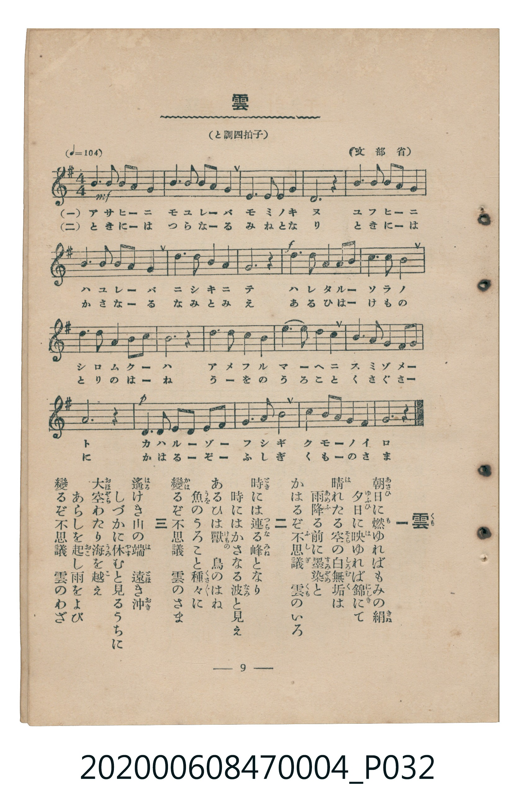

# 雲

> Re:Shōka 使用 AI 協助辨識與重建樂譜，可能會有錯誤。歡迎回報。

- **鋼琴伴奏版**：<br><audio controls src="kumo.mp3"></audio>
- **NEUTRINO 歌聲合成版**：<br><audio controls src="kumo_neutrino.mp3"></audio>

- 文部省唱歌
- 臺灣教育會公認《新定兒童唱歌》尋常科第四學年用（2020.006.0847.0004）

## 說明

原書資訊與歌詞全文（對應 P032.jpg，書頁 p. 9，第一學期第 9 首）：
調性與拍號：と調四拍子（G 大調 4/4 拍，♩=104，文部省）


## 歌詞

```text
一
朝日（あさひ）に燃（も）ゆればもみの絹（きぬ）
夕日（ゆふひ）に映（は）ゆれば錦（にしき）にて
晴（は）れたる空（そら）の白無垢（しろむく）は
雨（あめ）降（ふ）る前（まへ）に墨染（すみぞめ）と
かはるぞ不思議（ふしぎ）　雲（くも）のいろ

二
時（とき）には連（つらな）る峰（みね）となり
時にはかさなる波（なみ）と見（み）え
あるひは獸（けもの）　鳥（とり）のはね
魚（うを）のうろこと種々（くさぐさ）に
變（かは）るぞ不思議　雲のさま

三
遙（はる）けき山（やま）の端（は）　遠（とほ）き沖（おき）
しづかに休（やす）むと見るうちに
大空（おほぞら）わたり海（うみ）を越（こ）え
あらしを起（おこ）し雨をよび
變るぞ不思議　雲のわざ
```

## ABC

<div class="abc-score" data-abc-src="kumo.abc" aria-label="五線譜載入中"></div>

[下載 ABC 原始檔](kumo.abc)

## TMD 檔案連結

- [主旋律 TMD 檔案](kumo.tmd) [[在 TMD Studio 編輯](https://tmdlang.github.io/Tmd-TS/#tmd=s7IKdvYPcrWy4qpTUCpJTLdSSM7PyUlNLsnMz7MqzsjMK0nNjM_KTMmPL87Iz05Ugisry88pzU21Si9KTEmNN4k3MjAyiDcwMIs3sDAxBzIMTBBKi_NLi5JTrYqTM_Lzc-JLUitKkvLzsxHyBUX5Zal5iXlANQVFIBtTwIoQClLLMlNSQdKpKZkl-UWZiTlI7kgtKga7FWxJfElRYl5xclFmAcgDCFUlGalAx-YllpQWpaKLlqcmAhlFCGGgDemZeVa5-XlJpUBfI0uUZOQDfVyQUWmVkVkMckpyYk58dmIeUsBAHVKQmJ5qFWBgbKTEpaWl8HL2JgUtLS5FWwVDAxMue1sFdy4bE30TO5CuZ9PaXzaveD6n8emUjc_W9oBNetG-63nj4mdTZ75o2vRsTvPT1jUvVvU-buh6Nm3D03WznrZOer56KUT544bupxu6n-7Y8Xz5xOdr1jydPfvp2h1Pd255PmXF-z0doGjRA0aLHihagAwDk_d7OpW4uPS1FGypBbgUFBSe9s1_NnvHi83tL1Z0vehoB7rrxcp5T1tXAP0GdMXTDb3P2jsVQKGhl1WQ_n5PD1DxywWNCgV6CpZAHtDdT3Y0AN39bM58IFvBUuHlsmlAh77fMwtk-ItV-581LAcZ2937YuZ8oOjjxhVAQaBfgSJP104AWuGu8HTJcqCYAjBUFYCiQFMfzVxpCwxtkG2wEAaayQUyEWgbiHo2Z-6z6UuBuh83Nj1unPq4cRNQwePG1c_bm0GCTU0gblPb46aex40bgNzHjfsfN657vnUnWEvv48Y1IANB3l8yFWoQUHXjVrhBz2YsACtdj2zQy55lYMHVjxunA02BqHzcuAzsoplbkDQAVc9_3NT9fOUusODcx03AIAGqXvd85t7nLQufzlsEFp_-uKn3cVPD48Z-sOx6kEEvZ4OiH-SvJpCvX84E2gPkbgWb2_20E8Ld97hxB8T-p4tWPJs_GSw4E-zNeRCNwJAGGfe4sRtoMFAnUOLJjt5nDXNfrN0AMRHsiz6Q0oYGYDIHC_ZDw65x3ePGFqDrIIG-qwfiRaAUUM0KJL-vf9mwGCy4BOjFx42roK7cDLEC6Jq1EKcApR43dUFNgegEuwwYdUCJ7mebIQGyCqgHouHFsm6IEWBuB8QrwDAB6tkE1Py8F-h9oPREcOSug3piMyRJrABaBfME0Jq14GBdOwssB4zKSTA5IBuYFCYDNTxfse5xQys0BECOmgAkIX4Ep-N1QPOAcqCghPgQOTQhwQc2EahzHzSdgpPXy8aZkFQB1AI2biIw7J5u3AhOcC1AxdBUsRpoLCzxAE1rhCQ-YKjtBivofbYJmKuAIl2QoIeEBjD2loLdtPrJnokwE4H2Ad0HTFKgEAQ7FJiuF0L9AcxpsCQJNGk3OK2AE2YT0NfABNv1bOt2aChBAr5p0ottEK8DUxhKPAA5wNQ76QVUA9A4iIrpwPQLFH_cBBTcDA07nOEFsnYaSBHlZRkUKGjpc3F5l-bmWwVkJublO9QY1FSDLFCwsdCyAzOwFaAKkHLsxcIeBQ1Thacb-p-vb9CBl3qaWDQArYEapgHUqGml8LhpEShomrYqPG6eBMR7gLgbKFIDpMEyzcuAeA1UZgKKzHww2QfWvxYq0wMyHgmAxJaB1U1FswHZKbt6QE5pXAGOpV4gXg1R2LgeYkTjErAlnUDWKohME9SRjfvBekDWw_Svgsg0dWE6BYcNUKfUKFTnptUqGCvoAqExEBopGAJZNVhEzOLBQkAKzIIImkIEIdAAu06wRT6GIPctAsvBgh7IAgYLSA8oeMEy0KAHsSagycwHBzxI91qoTA-S3SB3QAIeohoS9HAbIG4wgoQHWAU0RECs9RC9wBCHuA4S5iAW1HXAEIfoWQvVD5GHhDiGG3DZAHGDMUgFiA8xH1jOQNVCzGuB6t0HxOtQXAczdTdUNTAnQ2VAPHQ3TIeqXgqqVsAskEtqwCUe7oy1q4eijNXcjzP7gNLu46bt8IyDyHJtWLIPxJw1YNXg1N4MSbugENoL5q8Ek6CMCAFYshbYykZgQsDIQKDsAstGkOwBYoNkOjAd09gEdgbEtE1gcj3MMcDIA8mBVQCjC80x2HKRKVjEFCxjBBYBiaPmoGpgjoSpA6kxAqquUTABi5hAzUTJV8DwwpV7QHEPSmnbofkGkePaMFMN3Bxg7AHDHcQCpxpwqENkVkJzIZILwLkKag80uJHzDogHktkPzzsgkyGBjZlum6DuBeWMTWDVsPQPyicgmSZozkByAShPwXPOTCC7AcwC2YaUe8FmgnwNrGWhMiDfobsAkqMh-WweWF8nNAygodMILIng-Z5QjtrRSVlVBc4xzZAcswCc2OCJD5xL0BIrpGprXggmp4LJ1RCZ5nlg3h4wOQNMQrND004wD1y1Ne2D6gepxFVdgasZSHpHzgsgR6I5BxjccEubJsF1wWWaesFik8EkyGyQDDjzAxMSiAQVH-BEhXAOIg-B8oYxMEfA8hlyHoKpAeUakCyw_gKLmIFlQKIwXZCcaR4PpJCrqu2QyAYGPSjgQckAmhChmQQl0cAqNnDATQWzoBkHGOwQlaBAR8p-wECHiIIS0z6oXqwVFTC00asCUEZGT7aw7AwKZ5BakA6EOCikQeGMnC1gyRmUZUHFBYiFWk1B9YKyLtRUkAmEsi6o-gRVPxA9yFlqMlQGnHGQdDTCzG8CmUsgSwF7pJRVUljK-CZQJoFVO9BmEjBWYBkNnBahlReilAfpAzWlYG1DSNYCVUkgPei5AUtmAlmK5hBopQU2FlRegdtr8-BZbCtYdjqYRNR98EwDqYggDoFnNEhGAuVrFIfUgLMPaqapLgBWPJAWHZACNvMgJDBvwKopUFUEiz9I1oJnH6x1GVIdhSXJAIMdkgn6oRkGkhUgQQ5JGqB6C17aQzMhpE0Iaw2CWm2QAEczHykrYSvnYTUWsAAD11WQ0h4SyhCZ6eBQRiRXUIYBhTEse0EzDDh0sdoNzkSbaWM3uDYCyUzDsLuWi0vXTgHUtVIA0spcAA)]
- [鋼琴伴奏 TMD 檔案](kumo_piano.tmd) [[在 TMD Studio 編輯](https://tmdlang.github.io/Tmd-TS/#tmd=s7IKdvYPcrWy4qpTUCpJTLdSyC8qychPL0osyKi0ysgsLskvykxOzInPTsxLVIIrKs4vLUpOjS9ITE-1CjAwNlLi0tJSeDl70_s9HS-79zyfsOXJni1Pl_Y_7-x4v6dTQUuLS9FWwdDAhMveVsGdy8ZE38QOZNSzae0vm1c8n9P4dMrGZ2t7wMa_aN_1vHHxs6kzXzRtejan-Wnrmhereh83dD2btuHpullPWyc9X70UovxxQ_fTDd1Pd-x4vnzi8zVrns6e_XTtjqc7tzyfsgLoDCMDIwM9AwMzPQMLE3Mgw8AE6BIlLi7v0tx8q4DMxLz8IA-HGoOaai4FILCx0LIDM_S1FGzRgQLQ9Cc7Gl4s7FHQMFV4uqH_-foGHQWQt_WyCtI1sWjQ0ocZpgHUqGml8LhpEZD_uGmrwuPmSUC8B4i7gSI1QBos07wMiNdAZSagyMwHk31g_WuhMj0g45EASGwZWN1UNBuQnbKrB-SUxhUghY29QLwaorBxPcSIxiVgSzqBrFUQmSaoIxv3g_WArIfpXwWRaerCdAoOG6BOqVGozk2rVTBW0AVCYyA0UjAEsmqwiJjFg4WAFJgFETSFCEKgAXadYIt8DEHuWwSWgwU9kAUMFpAeUPCCZaBBD2JNQJOZDw54kO61UJkeJLtB7oAEPEQ1JOjhNkDcYAQJD7AKaIiAWOsheoEhDnEdJMxBLKjrgCEO0bMWqh8iDwlxDDfgsgHiBmOQChAfYv7jxolQtRDzWqB69wHxOhTXwUzdDVX9uBFkN0gGxEN3w3So6llADPIFxCU1XPgz1q4eijJWcz_O7ANKu4-btsMzDiLLtWHJPhBz1oBVg1N7MyTtgkJoL5i_EkyCMiIEYMlaYCsbgQkBIwOBsgssG0GyB4gNkunAdExjE9gZENM2gcn1MMcAIw8kB1YBjC40x2DLRaZgEVOwjBFYBCSOmoOqgTkSpg6kxgioukbBBCxiAjUTJV8BwwtX7gHFPSilbYfmG0SOa8NMNXBzgLEHDHcQC5xqwKEOkVkJzYVILgDnKqg90OBGzjsgHkhmPzzvgEyGBDZmum2CuheUMzaBVcPSPyifgGSaoDkDyQWgPAXPOTOB7AYwC2QbUu4Fmwny9ePGhVAZkO_QXQDJ0ZB8Ng-srxMaBtDQaQSWRPB8TyhH7eikrKoC55hmSI5ZAE5s8MQHziVoiRVStTUvBJNTweRqiEzzPDBvD5icASah2aFpJ5gHrtqa9kH1g1Tiqq7A1QwkvSPnBZAj0ZwDDG64pU2T4LrgMk29YLHJYBJkNkgGnPmBCQlEgooPcKJCOAeRh0B5wxiYI2D5DDkPwdSAcg1IFlh_gUXMwDIgUZguSM40jwdSyFXVdkhkA4MeFPCgZABNiNBMgpJoYBUbOOCmglnQjAMMdohKUKAjZT9goENEQYlpH1Qv1ooKGNroVQEoI6MnW1h2BoUzSC1IB0IcFNKgcEbOFrDkDMqyoOICxEKtpqB6QVkXairIBEJZF1R9gqofiB7kLDUZKgPOOEg6GmHmN4HMJZClgG1LyiopLGV8EyiTwKodaDMJGCuwjAZOi9DKC1HKg_SBmlKwtiEka4GqJJAe9NyAJTOBLEVzCLTSAhsLKq_A7bV58Cy2FSw7HUwi6j54poFURBCHwDMaJCOB8jWKQ2rA2Qc101QXACseSIsOSAGbeRASmDdg1RSoKoLFHyRrwbMP1roMqY7CkmSAwQ7JBP3QDAPJCpAghyQNUL0FL-2hmRDSJoS1BkGtNkiAo5mPlJWwlfOwGgtYgIHrKkhpDwlliMx0cCgjkisow4DCGJa9oBkGHLpY7QZnos20sRtcG4FkpmHYXYvcs_JB7lmZQHtWwJgCR64xmAQ14-MVjOIVTMAknAtRA-eCKAN0rbAiGdUAoBKwPIILYgMphH6Y4UAtUGmQUhTX4bUfVT-MB6EhYiiGwW1H8xvcMyANyDZhOhwUrrp2CqCgjfYxjAWbDucbofGN4XxlLgA)]

## 分析

```text
================================================================================
📊 TMD Song Profile: [ 雲 ]
================================================================================
⏱  Duration:       0:46 (46.2s), 20 measures total
🎼 Key & Tempo:    首調基準 G, != 104.0 BPM, <4/4>
   - 分析範圍：      由實際發聲的音符與和弦推測調性；播放脈絡另行呈現
🎤 人聲音域:    D4 (MIDI 62) – E5 (MIDI 76) [跨度: 14 個半音 / 1.2 個八度, 難度: moderate]
   - 最低音:  D4 in [Kumo #1 @ m.4, 0:06]
   - 最高音: E5 in [Kumo #1 @ m.14, 0:30]
   - 適合: soprano, mezzo-soprano, contralto, tenor, baritone, bass
🏛  結構:      Kumo (46.2s)
⚡ 編曲密度:        Peak 1 軌道同時演奏
🗝  調性診斷：       G 大調（純淨自然大調，未偵測到可信轉調）
   - 風格氣質:    純淨自然大調（陽光明朗、易唱易記，無明顯調外色彩）
   - 轉調歷程:    全曲維持單一推測調性（未偵測到可信轉調）
   - 核心骨幹音:  B, G, D, A, E
   - 調性數值:    G 大調 [相關度: 0.83, 穩定度: Moderate, 自然音純度: 100.0%]
   - 候選調性 (K-S): G 大調 (0.83), B 小調 (0.78), D 大調 (0.61)
   - 五度圈歷程:   +1
   - 各段落調性細節:
     • [Kumo #1]: G 大調 (r: 0.83, 自然音純度: 100.0%)

  [ 五度圈游移軌跡 ]
               C  
         F           [G ]*
      Bb               D  
      Eb               A  
         Ab           E  
            Db       B  
               F# 
     (* = active key center)

  [ 十二半音累積音高分佈 ]
     C  : ██████                     7.3%
     C# :                            0.0%
     D  : ████████████████          19.3%
     D# :                            0.0%
     E  : ███████                    8.0%
     F  :                            0.0%
     F# : ██                         2.7%
     G  : ████████████████          20.0%
     G# :                            0.0%
     A  : ███████████               13.3%
     A# :                            0.0%
     B  : ████████████████████████  29.3%
--------------------------------------------------------------------------------
Assignment 軌道音域：
  - Piano         : D4 – E5 (14 個半音 / 1.2 個八度, 73 個音符)
================================================================================
```


## 原書掃描頁




