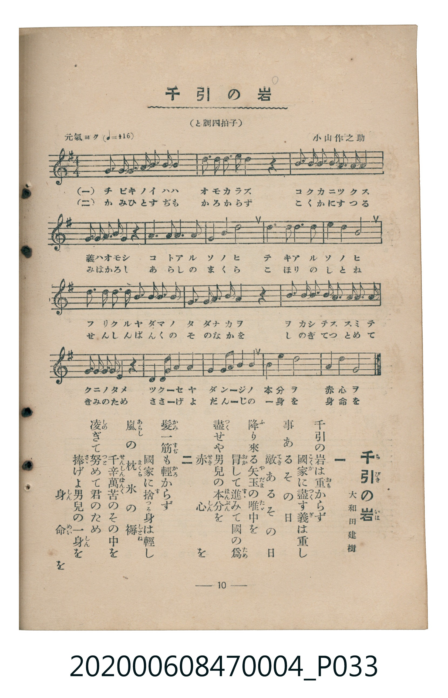

# 千引の岩

> Re:Shōka 使用 AI 協助辨識與重建樂譜，可能會有錯誤。歡迎回報。

<audio controls src="chibiki_no_iwa.mp3"></audio>

- 詞：大和田建樹
- 曲：小山作之助
- 臺灣教育會公認《新定兒童唱歌》尋常科第四學年用（2020.006.0847.0004）

## 說明

原書資訊與歌詞全文（對應 P033.jpg，書頁 p. 10，第一學期第 10 首）：
調性與拍號：と調四拍子（G 大調 4/4 拍，「元氣ヨク（♩=116）」）

## 歌詞

```text
一
千引（ちびき）の岩（いは）は重（おも）からず
國家（こくか）に盡（つく）す義（ぎ）は重（おも）し
事（こと）あるその日（ひ）　敵（てき）あるその日
降（ふ）り來（く）る矢玉（やだま）の唯中（ただなか）を
冒（をか）して進（すす）みて國（くに）の爲（ため）
盡（つく）せや男兒（だんじ）の本分（ほんぶん）を　赤心（せきしん）を

二
髪（かみ）一筋（ひとすぢ）も輕（かろ）からず
國家に捨（す）つる身（み）は輕（かろ）し
嵐（あらし）の枕（まくら）　氷（こほり）の褥（しとね）
千辛萬苦（せんしんばんく）のその中（なか）を
凌（しの）ぎて努（つと）めて君（きみ）のため
捧（ささ）げよ男兒の一身（いっしん）を　身命（しんめい）を
```

## ABC

```abc
X:1
T:千引の岩
C:曲：小山作之助
M:4/4
L:1/16
Q:1/4=116
K:G
V:V1 name="Piano" snm="Pia"
[V:V1]
D3 E G3 A B2 B2 B4 | c3 B A3 G A4 z4 | B3 A G3 A B3 A G3 A | B3 A G3 F G4 z4 |
A6 A2 F6 D2 | G4 A4 B8 | d6 d2 B6 B2 | e4 d4 A8 |
d3 d d3 d B3 G B3 d | A3 D F3 D D4 z4 | G3 A G3 A B3 c d3 B | A3 B A3 G E4 z4 |
D4 D2 G2 B4 B4 | G4 G2 B2 d4 d4 | B4 d4 B8 | A4 B4 G8 |
```

## TMD 檔案連結

- [主旋律 TMD 檔案](chibiki_no_iwa.tmd) [[在 TMD Studio 編輯](https://tmdlang.github.io/Tmd-TS/#tmd=s7IKdvYPcrWy4qpTUCpJTLdSSM7PyUlNLsnMz7MqzsjMK0nNjM_KTMmPL87Iz05Ugisry88pzU21Si9KTEmNN4k3MjAyiDcwMIs3sDAxBzIMTBBKi_NLi5JTrYqTM_Lzc-JLUitKkvLzsxHyBUX5Zal5iXlANQVFIBtTwIoQClLLMlNSQdKpKZkl-UWZiTlI7kgtKga7FWxJfElRYl5xclFmAcgDCFUlGalAx2ZkFgO1V6ILF-QkJqcqcWlpKTztbX66Z-rjxnVPN61U0NLiUrRVMDQ047K3VXDnsjHRN7ED6Xyxct77PbOeLln-dFLP8ykbnu7e9WzFTrCZz2ZvAsls6H-6ceOTvXOe7Ox-2rUSLPOifdfzxsXPps580bTp2Zzmp61rXqzqfdzQ9WzahqfrZj1tnfR89dKnUzY-W9vzuKH76Ybupzt2PF8-8fmaNU9nz366dsfTnVueT1nxfk8HKJj1gMGsBwpmIMPA5P2eTiUuLn0tBVtqAS4FBYWnffOfzd7xYnP7ixVdLzrage4C-vpp64pn09qBrni6ofdZe6dCgIGxsV5WQfr7PT1AxS8XNCoU6CkYGgC5QIc_2dEAdPizOfOBbKCgwstl04BOBQYPyPgXq_Y_a1gOMri798XM-UDRx40rgIJA3wJFnq6dALTEXQEYxEAxBWC4KwBFgcY-buh52tr8bMPix80rHjetByp6NHOlLTCGgCY_bgCq6OQCmQ60GuwHcGQCFT1uXPi4cfPjRpACSNyCBVseNwKNAIqsf9kOlAKKdD1uagKLdD9uApJgpz6d0_103Taw9OTHjf1AObCK1c9nLwQLLgEKgkVmPt8HMbcPh6HTwW7bBdQPMQsYn0DRpsdN3Y8b5wLd9Wz6UrAUMA0BfdPwbOpWMHcZzOEoKkFmvZwJsQGorvNxU9eTfW1gLtg5Td3P5y963gcM8I7HTUCfLnjcuA_q_Snrn-xYC1Y5Hyy-Cuqnpklg_7ZNAuuZBPPpdKATXjYAHQXUMBOIwIL7gYLAkIHYBwwNiNHPOyDK5j9uagRFBtA4jGCaDXTO8ynbgUkeLL7gcRMwKGZA9D-bs-ZpB8QTu8Hi24AkxGnAAHmxdcnT_c1g2dnAMAG5DCYLifZdPeBQWb0KrAYYVvuBssDE8HwtxKGbgGEO9sMisK6mF9DUAYxtSAhjRDvQZ896QfkO5u8lwIB9sQvoXaAIyHRgPGOYAo7np1tBaRgcaSAhqP_mQZTuAwVaEzBuwPG8YTssRQA93QVR-WIJJC0AAx_oZGBsgQMTmKJf7Jv9YsKaF93LoOEACiVQODxu3AAmIYG8DpJOYPGMFsPtPTCz14FV94EiswsSasB4AqfLpkaQ4ITZYEFgWEM8CzQXFLcgU571LgfLAUtLoKeAcpMeN3VAIhZscwMsmICJbzFyXIFictfqpxP3Qh0BdDXIshaEAykvwqBAQUufi8s5IzMpMzvTL9-zPNEqIDMxL9-hxqBGoRpkk4KNoZmWHZiFrQRVgJRjLxb2KGgYKwDL9efrG3TgxZ4mFg1AC6GGaQA1alopPG5uBPIfN09WeNy0FszqA7KWgFn9cBIEaoDiq8Aii4Cs1WDWSiBrF1QeBkDqNoNkm9bD1XUDcQtcbCdUJbJjdvWAHNPYDVLUuB-IN4FZK4B4Jpi1CKy9CWEJRG1TL5zVCWTNwnRM42Sw_n646avhZi4B6gKJITmmRsE0XkEXCM3iFQzBDCMFYyAJwyBYo2ACpo2BciDaEErrKhjAVUDUGqGYgcyvARcJuGN1Vw84Vk3Ji1VgUQ8Od6CnkeJsO46YgoDHzR3gYAQFNEwEFHsgVXvhIn1w1iRM05rbEHohqYls07Ckjf0ghY3ABIQU89MxHdEISyOQNAHSg1AFzPpQVfvgIrAEDlGNbhoo9cBU7gar6sJiGswGUIqFsUABgAzgKQw1LZjDEhpy8oElKIhCsCKEADiF1sB1wdTCkicMApMysiY0FSB2jYIZkiyyWXAzCCTTHZ2UFT5TQSHVvApcMECSyONmSOHTAMTzwCxQIgElG3D8g8VBMQAqWh43g0oJZABKhOCSAyQLTvCgRAkpckDk4-b5UDGsSWw2WBmwLARHKIS1Ac4Cl4fwKJ8L5QGrLzALWMY1YckTEJPA6kAeAdZa4IIHWrg1gUtfoBhyAQSNERgNiTVDKG0KTx3AZABNFkAWtNRCTkOwoga1CDKBmmtMKG6BbV1KiiBYjIKKfrDHgfH3uHkhlvgCVQwgAK4cmveAWeCcBk4JMFUNMFXNm-GqdoD5sEKkRgHYPoOygc00uHrMNAJsqcHU7W_GqQ5L-ugFKQRXT6BUAGxsQGMQ1XhgiwNmKJAFdWwjKG0AmyBIqhbAVIFSF1TVDDAJMh2iChiYUDawUQJXj5nOELLAlgtOdfA0BklBiAoMWNuhJx94igIzQIkIVnwg6kFYEQSThRUjMBpW1iFEMAsp9OILZiaiCKrl4tK1U0BuJykA-cpcAA)]
- [鋼琴伴奏 TMD 檔案](chibiki_no_iwa_piano.tmd) [[在 TMD Studio 編輯](https://tmdlang.github.io/Tmd-TS/#tmd=s7IKdvYPcrWy4tLSUnja2_x0z9THjeueblr5fk_Hy-49zydsebJny9Ol_c87O97v6VTQ0uJStFUwNDTjsrdVcOeyMdE3seOqU1B6sXLe-z2zni5Z_nRSz_MpG57u3vVsxU4lkMyz2ZtAMhv6n27c-GTvnCc7u592rQTLvGjf9bxx8bOpM180bXo2p_lp65oXq3ofN3Q9m7bh6bpZT1snPV-99OmUjc_W9jxu6H66ofvpjh3Pl098vmbN09mzn67d8XTnludTVgCdaWRgZKBnYGCmZ2BhYg5kGJgAXarExeWckZmUmZ3pl-9ZnmgVkJmYlx_k4VBjUKNQzaUABDaGZlp2YJa-loItOlAA2vNkR8OLhT0KGsYKQOc_X9-goxBgYGysl1WQrolFg5Y-2LAaBdN4BV0gNItXMAQzjBSMgSQMg2CNggmYNgbKgWhDKK2rYABXAVFrhGIGMr-GC7_bd_WA3W5KmttRbTGHeQHZYTCnQhSCFSEEwH6vgeuCqYV5HAaBgYSsCU0FiF2jYIYki2wW3AwCAbCjk6zIg9oJoyHuMoTSpnD_Az0K9TiQBY1x5FCCRRNq9JlAzTUm5HpgEicn-iBuQyQrYBpEdxjcrWAGyHmwoEekTlj0wWRhUQCjYekEIYIZwehRDzMTEX212LKoD0oWNYHmUKCT4hWiDWNhFDADARkmsUBPxAP9hiGNoQmkBqQ22jQeognMwDQWmzVABkIHDuegmI3bQUZArlFuLDBesKoiyIdbAzcXGIi6dgrI4aiAha_MBQA)]

## 分析

```text
================================================================================
📊 TMD Song Profile: [ 千引の岩 ]
================================================================================
⏱  Duration:       0:33 (33.1s), 16 measures total
🎼 Key & Tempo:    首調基準 G, != 116.0 BPM, <4/4>
   - 分析範圍：      由實際發聲的音符與和弦推測調性；播放脈絡另行呈現
🎤 人聲音域:    D4 (MIDI 62) – E5 (MIDI 76) [跨度: 14 個半音 / 1.2 個八度, 難度: moderate]
   - 最低音:  D4 in [ChibikiNoIwa #1 @ m.1, 0:00]
   - 最高音: E5 in [ChibikiNoIwa #1 @ m.8, 0:14]
   - 適合: soprano, mezzo-soprano, contralto, tenor, baritone, bass
🏛  結構:      ChibikiNoIwa (33.1s)
⚡ 編曲密度:        Peak 1 軌道同時演奏
🗝  調性診斷：       B 小調（純淨自然小調，未偵測到可信轉調）
   - 風格氣質:    純淨自然小調（陰鬱抒情、旋律集中，無明顯調外色彩）
   - 轉調歷程:    全曲維持單一推測調性（未偵測到可信轉調）
   - 核心骨幹音:  B, D, A, G, F#
   - 調性數值:    B 小調 [相關度: 0.79, 穩定度: Moderate, 自然音純度: 98.3%]
   - 候選調性 (K-S): B 小調 (0.79), G 大調 (0.74), D 大調 (0.73)
   - 五度圈歷程:   +5
   - 各段落調性細節:
     • [ChibikiNoIwa #1]: B 小調 (r: 0.79, 自然音純度: 98.3%, 調外音: C)

  [ 五度圈游移軌跡 ]
               C  
         F            G  
      Bb               D  
      Eb               A  
         Ab           E  
            Db      [B ]*
               F# 
     (* = active key center)

  [ 十二半音累積音高分佈 ]
     C  : █                          1.7%
     C# :                            0.0%
     D  : ██████████████████        22.1%
     D# :                            0.0%
     E  : ███                        3.7%
     F  :                            0.0%
     F# : ███                        4.2%
     G  : ███████████████           18.7%
     G# :                            0.0%
     A  : ████████████████          20.0%
     A# :                            0.0%
     B  : ████████████████████████  29.6%
--------------------------------------------------------------------------------
Assignment 軌道音域：
  - Piano         : D4 – E5 (14 個半音 / 1.2 個八度, 81 個音符)
================================================================================
```


## 原書掃描頁




