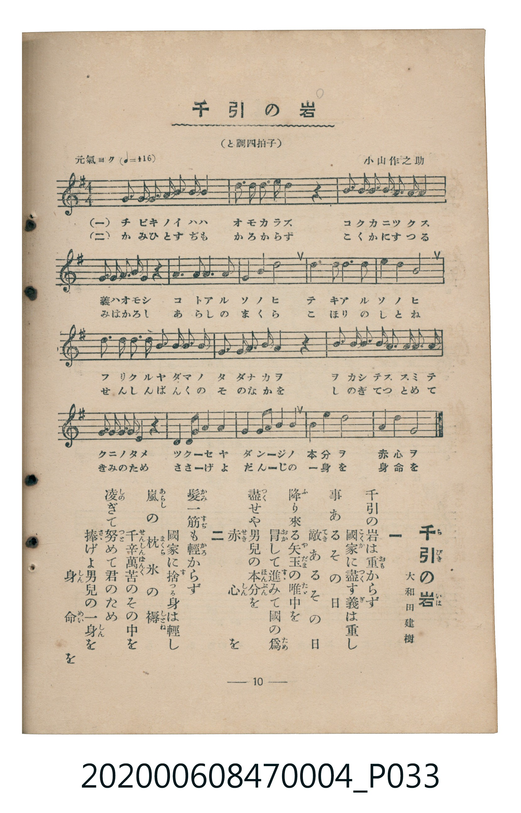

# 千引の岩

> Re:Shōka 使用 AI 協助辨識與重建樂譜，可能會有錯誤。歡迎回報。

- **鋼琴伴奏版**：<br><audio controls src="chibiki_no_iwa.mp3"></audio>
- **NEUTRINO 歌聲合成版**：<br><audio controls src="chibiki_no_iwa_neutrino.mp3"></audio>

- 詞：大和田建樹
- 曲：小山作之助
- 臺灣教育會公認《新定兒童唱歌》尋常科第四學年用（2020.006.0847.0004）

## 說明

原書資訊與歌詞全文（對應 P033.jpg，書頁 p. 10，第一學期第 10 首）：
調性與拍號：と調四拍子（G 大調 4/4 拍，「元氣ヨク（♩=116）」）


## 歌詞

```text
一
千引（ちびき）の岩（いは）は重（おも）からず
國家（こくか）に盡（つく）す義（ぎ）は重（おも）し
事（こと）あるその日（ひ）　敵（てき）あるその日
降（ふ）り來（く）る矢玉（やだま）の唯中（ただなか）を
冒（をか）して進（すす）みて國（くに）の爲（ため）
盡（つく）せや男兒（だんじ）の本分（ほんぶん）を　赤心（せきしん）を

二
髪（かみ）一筋（ひとすぢ）も輕（かろ）からず
國家に捨（す）つる身（み）は輕（かろ）し
嵐（あらし）の枕（まくら）　氷（こほり）の褥（しとね）
千辛萬苦（せんしんばんく）のその中（なか）を
凌（しの）ぎて努（つと）めて君（きみ）のため
捧（ささ）げよ男兒の一身（いっしん）を　身命（しんめい）を
```

## ABC

<div class="abc-score" data-abc-src="chibiki_no_iwa.abc" aria-label="五線譜載入中"></div>

[下載 ABC 原始檔](chibiki_no_iwa.abc)

## TMD 檔案連結

- [主旋律 TMD 檔案](chibiki_no_iwa.tmd) [[在 TMD Studio 編輯](https://tmdlang.github.io/Tmd-TS/#tmd=s7IKdvYPcrWy4qpTUCpJTLdSSM7PyUlNLsnMz7MqzsjMK0nNjM_KTMmPL87Iz05Ugisry88pzU21Si9KTEmNN4k3MjAyiDcwMIs3sDAxBzIMTBBKi_NLi5JTrYqTM_Lzc-JLUitKkvLzsxHyBUX5Zal5iXlANQVFIBtTwIoQClLLMlNSQdKpKZkl-UWZiTlI7kgtKga7FWxJfElRYl5xclFmAcgDCFUlGalAx2ZkFgO1V6ILF-QkJqciBIEWpGfmWeWmZmZlYnFtflFJRj7Q2wUZlVADM5MTc-KzE_OQQgfqmoLE9FSrAANjYyUuLS2Fp73NT_dMfdy47ummlQpaWlyKtgqGhmZc9rYK7lw2JvomdiDtL1bOe79n1tMly59O6nk-ZcPT3buerdgJNvjZ7E0gmQ39TzdufLJ3zpOd3U-7VoJlXrTvet64-NnUmS-aNj2b0_y0dc2LVb2PG7qeTdvwdN2sp62Tnq9e-nTKxmdrex43dD_d0P10x47nyyc-X7Pm6ezZT9fueLpzy_MpK97v6QBFoh4wEvVAkQhkGJi839OpxMWlr6VgSy3ApaCg8LRv_rPZO15sbn-xoutFRzvQXUBfP21d8WxaO9AVTzf0PmvvVAAFm15WQfr7PT1AxS8XNCoU6CkYGgC5QIc_2dEAdPizOfOBbKCgwstl04BOBQYPyPgXq_Y_a1gOMri798XM-UDRx40rgIJA3wJFnq6dALTEXQEYxEAxBWC4KwBFgcY-buh52tr8bMPix80rHjetByp6NHOlLTCGgCY_bgCq6OQCmQ60GuwHcGQCFT1uXPi4cfPjRpACSNyCBVseNwKNAIqsf9kOlAKKdD1uagKLdD9uApJgpz6d0_103Taw9OTHjf1AObCK1c9nLwQLLgEKgkVmPt8HMbcPh6HTwW7bBdQPMQsYn0DRpsdN3Y8b5wLd9Wz6UrAUMA0BfdPwbOpWMHcZzOEoKkFmvZwJsQGorvNxU9eTfW1gLtg5Td3P5y963gcM8I7HTUCfLnjcuA_q_Snrn-xYC1Y5Hyy-Cuqnpklg_7ZNAuuZBPPpdKATXjYAHQXUMBOIwIL7gYLAkIHYBwwNiNHPOyDK5j9uagRFBtA4jGCaDXTO8ynbgUkeLL7gcRMwKGZA9D-bs-ZpB8QTu8Hi24AkxGnAAHmxdcnT_c1g2dnAMAG5DCYLifZdPeBQWb0KrAYYVvuBssDE8HwtxKGbgGEO9sMisK6mF9DUAYxtSAhjRDvQZ896QfkO5u8lwIB9sQvoXaAIyHRgPGOYAo7np1tBaRgcaSAhqP_mQZTuAwVaEzBuwPG8YTssRQA93QVR-WIJJC0AAx_oZGBsgQMTmKJf7Jv9YsKaF93LoOEACiVQODxu3AAmIYG8DpJOYPGMFsPtPTCz14FV94EiswsSasB4AqfLpkaQ4ITZYEFgWEM8CzQXFLcgU571LgfLAUtLoKeAcpMeN3VAIhZscwMsmICJbzFyXIFictfqpxP3Qh0BdDXIshaEAykvwqBAQUufi8s5IzMpMzvTL9-zPNEqIDMxL9-hxqCmGmSRgo2hmZYdmIWtAFWAFGMvFvYoaBgrAIv15-sbdOClniYWDUD7oIZpADVqWik8bm4E8h83T1Z43LQWzOoDspaAWf1wEgRqgOKrwCKLgKzVYNZKIGsXVB4GQOo2g2Sb1sPVdQNxC1xsJ1QlsmN29YAc09gNUtS4H4g3gVkrgHgmmLUIrL0JYQlEbVMvnNUJZM3CdEzjZLD-frjpq-FmLgHqAokhOaZGwVBBFwgNobSRgjGYNobSukAVpmDaFEqbQWldBQO4ClQ9xkBTIGZBaKAKsF0-hkDnAcMfJAKLAQgbEgcQNtDhQAwzGRQHEHFILEDYkHiAqIlHUrsZIg-NCYhaSFwgxHeiuskIErRgeWhEQNiQqICwQXY3IeyBqYdGBoQNiQ4MNwGjA2IGJEIgbEiUQNiQSIG5CX_a39UDTvum5KV9YH0ITp1AlyCl7O2YSQicniHgcXMHOLGBkiNMBJTGQar2wkX64KxJmKY1tyH0QvIc2aZhyUH7QQobgRGLlD-mYzqiEZaTIDkHpAehClg-QlXtg4vAigGIanTTQHkMpnI3WFUXFtNgNoASE4wFCgBkgJEPIXnGGMpHzmWw3ATJWxCMzIeZAdINoWE5FQZheRkhi86vAeZvVL3ItiDlG1BebloHFoGlKAgbkqYw8gE0b0IgKFWB8swiFDFQjoWkBJhIH5w1CcMnoHSFpBtcllBkIlJ5sB-iBpqsIOZDEhaGv4AJC9kVnWB9MHUQU0ChBElcMBFY-QZRj-YvaIkBU7sbrK4Lq4kwe0AJDMYChQOqvwjUp52U1adTQcm6eRW4dIXk58fNkPq0AYjngVmgHA2KB3BmBYuDsguojH7cDKr4kAEoZsGVIUgWXDqBYhpSi4LIx83zoWJYy4PZYGXAygWc-yCsDXAWuIqH58-5UB6wQQZmAauKJiwFGMQksDqQR4DtMHCxDa2vm8ANCqAYUl5GrTFNMepHzNwOy2XE1qlGKHXqVEjcQ2MBwobEA4QNiQkIuw8aEwgZSNqCxQZGCoeKweIDog8SIxBxSJzAxJHz0WyoCkh0INgbkNiQvAAKXkiUwHigSIGwIdGC4S6YidCIgbAhUQPLE6DIgYkTyAfAni4ldSss9YNaG-BEAgzhx80LsaRtULsQBMCtkeY9YBa4CgHnGpiqBpiq5s1wVTvAfFjtWKMA7J1B2cBOGlw9Zn4C9tNg6vY341SHJS_1ghSCG0WgHAPsakBTO6rxwP4GzFAgC-rYRlA-AnZAkFQtgKkCRTtU1QwwCTIdogoYmFA2sEsCV4-ZJxGywH4LTnU42riGCmawZITIbqYwITADpBCWJeGNWHj1CpOFVbOIpjKMhV6JwiCiEofJwMyEq0CqXmFZGZKoIFkGkqwwMymkiQtp5MJYoKoDYgIkS0BUNsBFYVUyKGnBxGAVJEjlbCQlzdOQObBiAuEvoG2w9jzIwO14VSMVEb0QNdBUBmFD0hmGH4GpC2oiEgtWMIDSGkLlArgorDIFpTUYC2IPxNVLHjc3Y3U1vMhB9iOKtxbCOi1YVXPVcnHp2ikg93YVgHxlLgA)]
- [鋼琴伴奏 TMD 檔案](chibiki_no_iwa_piano.tmd) [[在 TMD Studio 編輯](https://tmdlang.github.io/Tmd-TS/#tmd=s7IKdvYPcrWy4qpTUCpJTLdSyC8qychPL0osyKi0ysgsLskvykxOzInPTsxLVIIrKs4vLUpOjS9ITE-1CjAwNlbi0tJSeNrb_HTP1MeN655uWvl-T8fL7j3PJ2x5smfL06X9zzs73u_pVNDS4lK0VTA0NOOyt1Vw57Ix0TexA5n5YuW893tmPV2y_OmknudTNjzdvevZip1g257N3gSS2dD_dOPGJ3vnPNnZ_bRrJVjmRfuu542Ln02d-aJp07M5zU9b17xY1fu4oevZtA1P18162jrp-eqlT6dsfLa253FD99MN3U937Hi-fOLzNWuezp79dO2Opzu3PJ-yAuhMIwMjAz0DAzM9AwsTcyDDwAToUiUuLueMzKTM7Ey_fM_yRKuAzMS8_CAPhxqDmmouBSCwMTTTsgOz9LUUbNGBAtCaJzsaXizsUdAwVgC6_vn6Bh0FUEDpZRWka2LRoKUPM0wDqFHTSuFxcyOQ_7h5ssLjprVgVh-QtQTM6oeTIFADFF8FFlkEZK0Gs1YCWbug8jAAUrcZJNu0Hq6uG4hb4GI7oSqRHbOrB-SYxm6Qosb9QLwJzFoBxDPBrEVg7U0ISyBqm3rhrE4gaxamYxong_X3w01fDTdzCVAXSAzJMTUKhgq6QGgIpY0UjMG0MZTWBaowBdOmUNoMSusqGMBVoOoxBpoCMQtCA1WA7fIxBDoPGP4gEVgMQNiQOICwgQ4HYpjJoDiAiENiAcKGxANETTyS2s0QeWhMQNRC4gIhvhPVTUaQoAXLQyMCwoZEBYQ9AxwVcHtg6qGRAWFDogPDTcDogJgBiRAIGxIlEDYkUmBuwp_2d_WA074peWn_-b6V4NQJdAlSyt6OmYTA6RkCHjd3gBMbKDnCREBpHKRqL1ykD86ahGlacxtCLyTPkW0alhy0H6SwERixSPljOqYjGmE5CZJzQHoQqoBlK1TVPrgIrBiAqEY3DZTHYCp3g1V1YTENZgMoMcFYoABABhj5EJJnjKF85FwGy02QvAXByHyYGSDdEBqWU2EQlpcRsuj8GmD-RtWLbAtSvgHl5aZ1YBFYioKwIWkKIx9A8yYEglIVKM8sQhED5VhISoCJ9MFZkzB8AkpXSLrBZQlFJiKVB_shaqDJCmI-JGFh-AuYsJBd0QnWB1MHMQUUSpDEBROBlW8Q9Wj-gpYYMLW7weq6sJoIsweUwGAsUDig-otAfdpJWX06FZSsm1eBS1dIfn7cDKlPG4B4HpgFytGgeABnVrA4KLuAyujHzaCKDxmAYhZcGYJkwaUTKKYhtSiIfNw8HyqGtTyYDVYGrFzAuQ_C2gBngat4eP6cC-U9bgQXh8CoftyEpQCDmARWB_LI48Zl4GIbWl83gRsUQDGkvIxaY5pi1I-YuR2Wy4itU41Q6tSpkLiHxgKEDYkHCBsSExB2HzQmEDKQtAWLDYwUDhWDxQdEHyRGIOKQOIGJI-ej2VAVkOhAsDcgsSF5ARS8kCiB8UCRAmFDogXDXTAToREDYUOiBpYnQJEDEyeQD4DNV0rqVljqB7U2wIkEGMKPmxdiSdugdiEIgFsjzXvALHAVAs41MFUNMFXNm-GqdoD5sNqxRuHZnDVQ9tMOWB2LLT-92Aoz-en-ZpzqsOSlXpBCcKMIlGMeN86HpnZU4x83gooAsKFAFtSxjaB89LgJ1HiAqVoAUwWKdqiqGWASZDpEFTAwoewXu0ANA4h6zDyJkH06Ed5wwFCHo41rqGAGS0aI7GYKEwIzQAphWRLeiIVXrzBZWDWLaCrDWOiVKAwiKnGYDMxMuAqk6hWWlSGJCpJlIMkKM5NCmriQRi6MBao6ICZAsgREZQNcFFYlg5IWTAxWQYJUzkZS0jwNmQMrJhD-AtoGa8-DDNyOVzVSEdELUQNNZRA2JJ1h-BGYuqAmIrFgBQMorSFULoCLwipTUFqDsSD2QFy95HFzM1ZXw4scZD-ieGshrNOCVTVXLbbOrg9yZ9cE2tcFpqx4hWjDWBhVo2ACZJjEAtNiPDCJYkhjaAKpAamNNo2HaAIzMI3FZg2QgdCBwzkoZuN2kBGQa5QbC8xeWFUR5MOtgZsLDENdOwXkYIz2AUpgiBmBxZS5AA)]

## 分析

```text
================================================================================
📊 TMD Song Profile: [ 千引の岩 ]
================================================================================
⏱  Duration:       0:33 (33.1s), 16 measures total
🎼 Key & Tempo:    首調基準 G, != 116.0 BPM, <4/4>
   - 分析範圍：      由實際發聲的音符與和弦推測調性；播放脈絡另行呈現
🎤 人聲音域:    D4 (MIDI 62) – E5 (MIDI 76) [跨度: 14 個半音 / 1.2 個八度, 難度: moderate]
   - 最低音:  D4 in [ChibikiNoIwa #1 @ m.13, 0:24]
   - 最高音: E5 in [ChibikiNoIwa #1 @ m.2, 0:02]
   - 適合: soprano, mezzo-soprano, contralto, tenor, baritone, bass
🏛  結構:      ChibikiNoIwa (33.1s)
⚡ 編曲密度:        Peak 1 軌道同時演奏
🗝  調性診斷：       D 大調（純淨自然大調，未偵測到可信轉調）
   - 風格氣質:    純淨自然大調（陽光明朗、易唱易記，無明顯調外色彩）
   - 轉調歷程:    全曲維持單一推測調性（未偵測到可信轉調）
   - 核心骨幹音:  D, A, B, G, E
   - 調性數值:    D 大調 [相關度: 0.83, 穩定度: Moderate, 自然音純度: 100.0%]
   - 候選調性 (K-S): D 大調 (0.83), G 大調 (0.72), B 小調 (0.61)
   - 五度圈歷程:   +2
   - 各段落調性細節:
     • [ChibikiNoIwa #1]: D 大調 (r: 0.83, 自然音純度: 100.0%)

  [ 五度圈游移軌跡 ]
               C  
         F            G  
      Bb              [D ]*
      Eb               A  
         Ab           E  
            Db       B  
               F# 
     (* = active key center)

  [ 十二半音累積音高分佈 ]
     C  :                            0.0%
     C# :                            0.0%
     D  : ████████████████████████  27.1%
     D# :                            0.0%
     E  : █████                      5.4%
     F  :                            0.0%
     F# :                            0.0%
     G  : █████████████████         19.6%
     G# :                            0.0%
     A  : ████████████████████████  27.1%
     A# :                            0.0%
     B  : ██████████████████        20.8%
--------------------------------------------------------------------------------
Assignment 軌道音域：
  - Piano         : D4 – E5 (14 個半音 / 1.2 個八度, 80 個音符)
================================================================================
```


## 原書掃描頁




