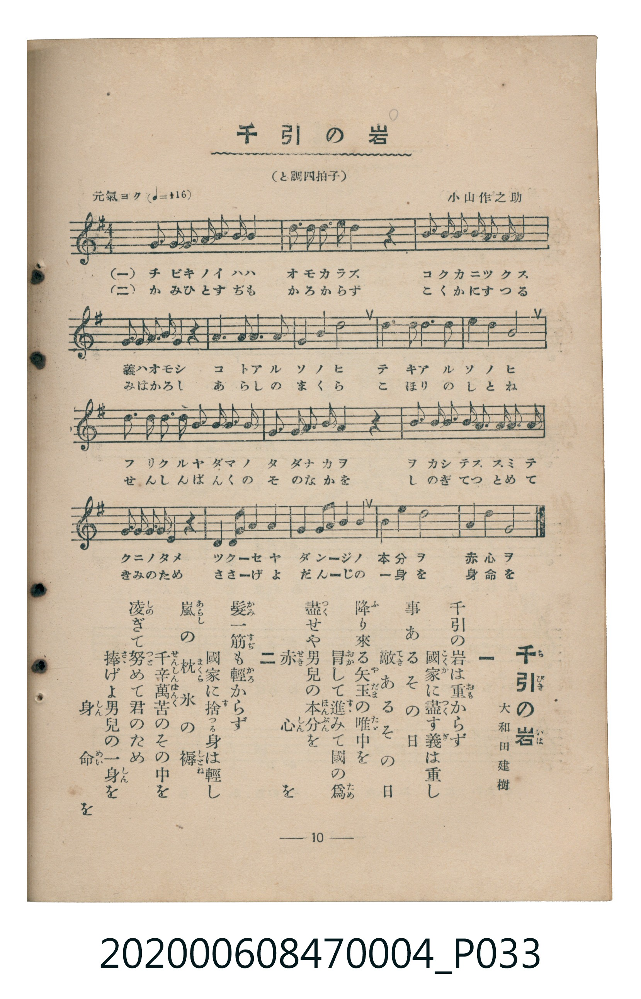

# 千引の岩

> Re:Shoka 使用 AI 辨識樂譜，可能會有錯誤。歡迎回報。

<audio controls src="chibiki_no_iwa.mp3"></audio>

- 詞：大和田建樹
- 曲：小山作之助
- 臺灣教育會公認《新定兒童唱歌》尋常科第四學年用（2020.006.0847.0004）

## 說明

原書資訊與歌詞全文（對應 P033.jpg，書頁 p. 10，第一學期第 10 首）：
調性與拍號：と調四拍子（G 大調 4/4 拍，「元氣ヨク（♩=116）」）

## 歌詞

```text
一
千引（ちびき）の岩（いは）は重（おも）からず
國家（こくか）に盡（つく）す義（ぎ）は重（おも）し
事（こと）あるその日（ひ）　敵（てき）あるその日
降（ふ）り來（く）る矢玉（やだま）の唯中（ただなか）を
冒（をか）して進（すす）みて國（くに）の爲（ため）
盡（つく）せや男兒（だんじ）の本分（ほんぶん）を　赤心（せきしん）を

二
髪（かみ）一筋（ひとすぢ）も輕（かろ）からず
國家に捨（す）つる身（み）は輕（かろ）し
嵐（あらし）の枕（まくら）　氷（こほり）の褥（しとね）
千辛萬苦（せんしんばんく）のその中（なか）を
凌（しの）ぎて努（つと）めて君（きみ）のため
捧（ささ）げよ男兒の一身（いっしん）を　身命（しんめい）を
```

## ABC

```abc
X:1
T:千引の岩
C:曲：小山作之助
M:4/4
L:1/16
Q:1/4=116
K:G
V:V1 name="Piano" snm="Pia"
[V:V1]
D3 E G3 A B2 B2 B4 | c3 B A3 G A4 z4 | B3 A G3 A B3 A G3 A | G3 E D3 E G4 z4 |
A6 A2 F6 D2 | G6 A2 B8 | d6 d2 B6 G2 | e4 d4 A8 |
d3 e d3 B G3 A B3 G | A3 B A3 F D4 z4 | G3 A G3 A B3 c d3 B | A3 B A3 G E4 z4 |
D4 G2 B2 d8 | e4 d2 B2 G8 | B6 c2 d8 | A4 A4 G8 |
```

## TMD 檔案連結

- [主旋律 TMD 檔案](chibiki_no_iwa.tmd) [[在 TMD Studio 編輯](https://tmdlang.github.io/Tmd-TS/#tmd=s7IKdvYPcrWy4qpTUCpJTLdSSM7PyUlNLsnMz7MqzsjMK0nNjM_KTMmPL87Iz05Ugisry88pzU21Si9KTEmNN4k3MjAyiDcwMIs3sDAxBzIMTBBKi_NLi5JTrYqTM_Lzc-JLUitKkvLzsxHyBUX5Zal5iXlANQVFIBtTwIoQClLLMlNSQdKpKZkl-UWZiTlI7kgtKga7FWxJfElRYl5xclFmAcgDCFUlGalAx2ZkFgO1V6ILF-QkJqcqcWlpKTztbX66Z-rjxnVPN61U0NLiUrRVMDQ047K3VXDnsjHRN7ED6Xyxct77PbOeLln-dFLP8ykbnu7e9WzFTrCZz2ZvAsls6H-6ceOTvXOe7Ox-2rUSLPOifdfzxsXPps580bTp2Zzmp61rXqzqfdzQ9WzahqfrZj1tnfR89dKnUzY-W9vzuKH76Ybupzt2PF8-8fmaNU9nz366dsfTnVueT1nxfk8HKJj1gMGsBwpmIMPA5P2eTiUuLn0tBVtqAS4FBYWnffOfzd7xYnP7ixVdLzrage4C-vpp64pn09qBrni6ofdZe6dCgIGxsV5WQfr7PT1AxS8XNCoU6CkYGgC5QIc_2dEAdPizOfOBbKCgwstl04BOBQYPyPgXq_Y_a1gOMri798XM-UDRx40rgIJA3wJFnq6dALTEXQEYxEAxBWC4KwBFgcY-buh52tr8bMPix80rHjetByp6NHOlLTCGgCY_bgCq6OQCmQ60GuwHcGQCFT1uXPi4cfPjRpACSNyCBVseNwKNAIqsf9kOlAKKdD1uagKLdD9uApJgpz6d0_103Taw9OTHjf1AObCK1c9nLwQLLgEKgkVmPt8HMbcPh6HTwW7bBdQPMQsYn0DRpsdN3Y8b5wLd9Wz6UrAUMA0BfdPwbOpWMHcZzOEoKkFmvZwJsQGorvNxU9eTfW1gLtg5Td3P5y963gcM8I7HTUCfLnjcuA_q_Snrn-xYC1Y5Hyy-Cuqnpklg_7ZNAuuZBPPpdKATXjYAHQXUMBOIwIL7gYLAkIHYBwwNiNHPOyDK5j9uagRFBtA4jGCaDXTO8ynbgUkeLL7gcRMwKGZA9D-bs-ZpB8QTu8Hi24AkxGnAAHmxdcnT_c1g2dnAMAG5DCYLifZdPeBQWb0KrAYYVvuBssDE8HwtxKGbgGEO9sMisK6mF9DUAYxtSAhjRDvQZ896QfkO5u8lwIB9sQvoXaAIyHRgPGOYAo7np1tBaRgcaSAhqP_mQZTuAwVaEzBuwPG8YTssRQA93QVR-WIJJC0AAx_oZGBsgQMTmKJf7Jv9YsKaF93LoOEACiVQODxu3AAmIYG8DpJOYPGMFsPtPTCz14FV94EiswsSasB4AqfLpkaQ4ITZYEFgWEM8CzQXFLcgU571LgfLAUtLoKeAcpMeN3VAIhZscwMsmICJbzFyXIFictfqpxP3Qh0BdDXIshaEAykvwqBAQUufi8s5IzMpMzvTL9-zPNEqIDMxL9-hxqBGoRpkk4KNoZmWHZiFrQRVgJRjLxb2KGgYKwDL9efrG3TgxZ4mFg1AC6GGaQA1alopPG5uBPIfN09WeNy0FszqA7KWgFn9cBIEaoDiq8Aii4Cs1WDWSiBrF1QeBkDqNoNkm9bD1XUDcQtcbCeQheyQXT0ghzR2gxQ07gfiTWDWCiCeCWYtAmttQlgAUdvUC2d1AlmzMB3SOBmsvx9u-mq4mUuAukBiUIfUKJjGK-gCoVm8giGYYaRgDCRhGARrFEzAtDFQDkQbQmldBQO4CohaIxQzkPk14KIAd2zu6gHHpil5sQks4qFxhhxX23HEEAQ8bu4AByEokGEioFgDqdqLJNYHJidhmtXchlAFSUN4zYKYBGGhm4YlVewHKWwEJhukOJ-O6YhGWOqApAaQHoQqYIaHqtqHJAZO3mC16GaBUg1M1W6wqi4sZsHMB6VUGAvkfWQAT12Q-AcmLvRkhpx4YMkJklR0FcwhaiEQrBFmEEINLHHCIDAhI2tCUwHSXaNghiQLMwfFDAKJdEcnZUXOVFBYNa8CFweQJPK4GVLkNADxPDALlEhAyQYc_2BxUByACpTHzaDyARmAEiG4zADJgpM7KFFCChoQ-bh5PlQMaxKbDVYGLAHBUQphbYCzwMkEHulzoTxgpQVmAUu2Jix5AmISWB043zQuAxc50GKtCVzmAsWQix9IsoDSxmgFiCE8dcAKH2DagCYl5BQE04Wq2wRuKoGYBbZvKSl-YPEJKu7B3gbG3uPmhVhiC1QZgABMxx4wG5TX0FWCAg2sEpgGQORmsOrHTTuwqAXZCWyjwcWAjTWwHsz0AmyrwdTsb4bbgK4OS1rpBSkEV1KgFAFsbkBjE80pjaAkDjYUzIJ6sBFLSmkClb4QlQtAJCjNgTzYOAOLqSA7gUENFwM2VMB6MM2FyIAAsCUDswFDHTz1oaYtQ1DxhJ604KkNlLZA6Qq5nIEoQS5XQCqQyyqICuSyCFSZYpoBK4tgNIYZXLVcXLp2CsjNJgUgX5kLAA)]
- [鋼琴伴奏 TMD 檔案](chibiki_no_iwa_piano.tmd) [[在 TMD Studio 編輯](https://tmdlang.github.io/Tmd-TS/#tmd=s7IKdvYPcrWy4tLSUnja2_x0z9THjeueblr5fk_Hy-49zydsebJny9Ol_c87O97v6VTQ0uJStFUwNDTjsrdVcOeyMdE3seOqU1B6sXLe-z2zni5Z_nRSz_MpG57u3vVsxU4lkMyz2ZtAMhv6n27c-GTvnCc7u592rQTLvGjf9bxx8bOpM180bXo2p_lp65oXq3ofN3Q9m7bh6bpZT1snPV-99OmUjc_W9jxu6H66ofvpjh3Pl098vmbN09mzn67d8XTnludTVgCdaWRgZKBnYGCmZ2BhYg5kGJgAXarExeWckZmUmZ3pl-9ZnmgVkJmYlx_k4VBjUKNQzaUABDaGZlp2YJa-loItOlAA2vNkR8OLhT0KGsYKQOc_X9-goxBgYGysl1WQrolFg5Y-2LAaBdN4BV0gNItXMAQzjBSMgSQMg2CNggmYNgbKgWhDKK2rYABXAVFrhGIGMr-GC7_bd_WA3W5KmtshpgOdju4JZKfBHAtxiK6COUQtBII1wgxCqIF5HQaBwYSsCU0FSHeNghmSLMwcFDMIBMGOTrKiD-JxKG2MFgGGcP_DIg_oe2hgIYcRTBeqbhO4qQTcDkzi5EQfqssMQdGH7jC4W0EuA7kKOR4gSpDDHaQCOS4hKpDjCpSUMc2AxRWMxjCDqxZbDvVByaEm0AwKDM54hWjDWBgFzD9Ahkks0DPxQK9hSGNoAqkBqY02jYdoAjMwjcVmDZCB0IHDOShm43aQEZBrlBsLjBasqmC-wukcuDVwc4GBqGungByOClj4ylwA)]

## 分析

```text
================================================================================
📊 TMD Song Profile: [ 千引の岩 ]
================================================================================
⏱  Duration:       0:33 (33.1s), 16 measures total
🎼 Key & Tempo:    首調基準 G, != 116.0 BPM, <4/4>
   - 分析範圍：      由實際發聲的音符與和弦推測調性；播放脈絡另行呈現
🎤 人聲音域:    D4 (MIDI 62) – E5 (MIDI 76) [跨度: 14 個半音 / 1.2 個八度, 難度: moderate]
   - 最低音:  D4 in [ChibikiNoIwa #1 @ m.1, 0:00]
   - 最高音: E5 in [ChibikiNoIwa #1 @ m.8, 0:14]
   - 適合: soprano, mezzo-soprano, contralto, tenor, baritone, bass
🏛  結構:      ChibikiNoIwa (33.1s)
⚡ 編曲密度:        Peak 1 軌道同時演奏
🗝  調性診斷：       G 調性不明確（純淨自然大調，未偵測到可信轉調）
   - 風格氣質:    純淨自然大調（陽光明朗、易唱易記，無明顯調外色彩）
   - 轉調歷程:    全曲維持單一推測調性（未偵測到可信轉調）
   - 核心骨幹音:  D, G, A, B, E
   - 調性數值:    G 調性不明確 [相關度: 0.82, 穩定度: Ambiguous, 自然音純度: 100.0%]
   - 候選調性 (K-S): G 大調 (0.82), D 大調 (0.81), B 小調 (0.65)
   - 五度圈歷程:   +1
   - 各段落調性細節:
     • [ChibikiNoIwa #1]: G 調性不明確 (r: 0.82, 自然音純度: 100.0%)

  [ 五度圈游移軌跡 ]
               C  
         F           [G ]*
      Bb               D  
      Eb               A  
         Ab           E  
            Db       B  
               F# 
     (* = active key center)

  [ 十二半音累積音高分佈 ]
     C  : ███                        2.5%
     C# :                            0.0%
     D  : ████████████████████████  22.9%
     D# :                            0.0%
     E  : ███████                    6.7%
     F  :                            0.0%
     F# : ███                        2.9%
     G  : ████████████████████████  22.5%
     G# :                            0.0%
     A  : ███████████████████████   22.1%
     A# :                            0.0%
     B  : █████████████████████     20.4%
--------------------------------------------------------------------------------
Assignment 軌道音域：
  - Piano         : D4 – E5 (14 個半音 / 1.2 個八度, 79 個音符)
================================================================================
```


## 原書掃描頁




