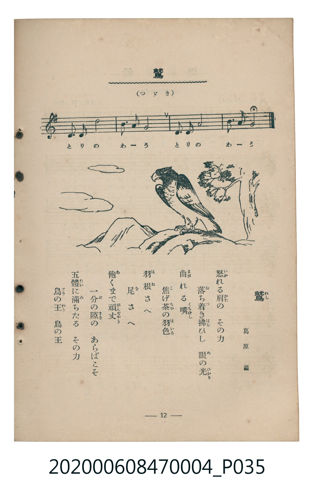

# 鷲

> Re:Shōka 使用 AI 協助辨識與重建樂譜，可能會有錯誤。歡迎回報。

- **鋼琴伴奏版**：<br><audio controls src="washi.mp3"></audio>
- **NEUTRINO 歌聲合成版**：<br><audio controls src="washi_neutrino.mp3"></audio>

- 詞：葛原𦱳
- 曲：小松耕輔
- 臺灣教育會公認《新定兒童唱歌》尋常科第四學年用（2020.006.0847.0004）

## 說明

原書資訊與歌詞全文（對應 P034.jpg–P035.jpg，書頁 pp. 11–12，第二學期第 1 首）：
調性與拍號：と調三拍子（G 大調 3/4 拍）
速度指示：勇壯ニ（♩=96）


## 歌詞

```text
怒（いか）れる肩（かた）の　その力
落（お）ち着（つ）き拂（はら）ひし　眼（め）の光（ひかり）
曲（まが）れる嘴（くちばし）　焦（こ）げ茶（ちゃ）の羽色（はいろ）
羽根（はね）さへ　尾（を）さへ　飽（あ）くまで頑丈（がんぢゃう）
一分（いちぶ）の隙（すき）の　あらばこそ
五體（ごたい）に滿（み）ちたる　その力
鳥（とり）の王（わう）　鳥の王
```

## ABC

<div class="abc-score" data-abc-src="washi.abc" aria-label="五線譜載入中"></div>

[下載 ABC 原始檔](washi.abc)

## TMD 檔案連結

- [主旋律 TMD 檔案](washi.tmd) [[在 TMD Studio 編輯](https://tmdlang.github.io/Tmd-TS/#tmd=s7IKdvYPcrWy4qpTUCpJTLdSSM7PyUlNLsnMz7MqzsjMK0nNjM_KTMmPL87Iz05Ugisry88pzU21Si9KTEmNN4k3MjAyiDcwMIs3sDAxBzIMTBBKi_NLi5JTrYqTM_Lzc-JLUitKkvLzsxHyBUX5Zal5iXlANQVFIBtTwIoQClLLMlNSQdKpKZkl-UWZiTlI7kgtKga7FWxJfElRYl5xclFmAcgDCFUlGalAxybmZeYi6wUalZ6ZZ1WSmAn0HMiD5YnxuYmZeTmJeSnIqkoy8oH-LMiotMrILAY5IDkxJz47MQ8pOKDWFySmp1oFGBib6AIJUyUuLS2Fl9s3KWhpcSnaKliacdnbKrhz2Rjrm9iBdL5YOe_9nlkvJs5-2jf_w7KNm8HGPZu9CSj4dEP_s7n7XjRMfbFnClj4Rfuu542Ln02d-aJp07M5zU9b17xY1fu4oevZtA1P18162jrp-eqlT6dsfLa253FD99MN3U937Hi-fOLzNWuezp79dO2Opzu3PJ-y4v2eDlBE6QEjSg8UUUCGgcn7PZ1KXFz6Wgq21AJcCgoKQC89m73jxeb2Fyu6XnS0A90F9O3T1hXPprUDXfF0Q--z9k4FUEjpZRWkP2qYDAovEPP9nh6gvpcLGhUKCvQUDA2BUoZGQEGgT57s6gH65Nmc-UC2gqHCy2XTgE4HhhXIuher9j9rWA6yqLv3xcz5QNHHjSuAgk92dAJFnq6dALTUXeHpkuVAMQVg-CsARYG6QVpfNsx_umvZs57250t2gUK-u_3p4vWPm7uBOh7NXGlraQZSB1L4rGESUOxxY8vjRqBk5-OmnsdN3S-aVoIFux83Am3tfNy47nFDw-PGuUDG067ZYKdN2AtW0QWWXvh8bgOYuwTM7X3W3QTmrn_cBPQLUGTT48bpQCOez9kDEm9qhBj6tBUoC1QGlO1-3AQyCuwiUFoBiu573NgDd9HTGVvAgv1Ayx43bgAaB5ICmtiyDCw-GWzipBc928DchY-bmiF2PN-390UnxMD1IF82wUIIKPFswU6YxFqw6qmPG3cADX26YR_YmcCQQQi-XAzxMdBnQEGgO4DuW_5ywcQnOzrA4kBXTn7cuAho8ePGNqgdT3Y0PO0AciDhC3Q40HUgR72cNRMsOBMYVkjh2wQMLrDngAbNBevfNeXl6ilgpVOAUQE0Bax69bPd-8GCQBIU-iCppm70KHq5eSlY0QpI0ILCog8U_4-bgI4HuRDkqc1LIeIgDZTnEShQ0NLn4gpPBJa0VgGZiXn5DjUGNdUgGxRsDM207MAsbFlTAZQfdjS8WNijoGGiACwtnq9v0IHnJ00sGoAWQQ0Dhg2QAU5IPUC6qRskDgQ1IDGwDDD41oHouUgyQAE4AAYkxASQTFMnkgwMQG2rUTCNV9AFQiBlCGbowukaBWMkESMoG0QDdUF5MAhRaQiUgamDQQOYaWD7fEAubQELgFwH8iBEGuRLmLUgGaho43ywz0A-hYmsA6tBtQQkvhBuKsTPqPIQX4KcgT_KdvWQGWVdkGAHlhsguhcpYtaDZEC5YRNIZjpCpqkRKcJAngQrgLgfZBwFcWaIEl8QGeQ4A7EhKo2AMjDdeOKsCx7KIB_CwrwXbjjIm5B47AR7BKZiOkIF0LvI8QWKR5hKhK_Ji7UdnWTG2j5w2APLO4yM1g-Lzw1osdY4GSwzCSzb1IwUgfDIBqZwYOGMLeYgsWEEjxVoTILCBxIJRvBMB6NrFEygfOSsBVKNMA6mFgaRIm4fNIB7cGa2fqgKUNRugEcPUsQBfQwRg_sZPR6R4h_qd3T34I0_YBOIzPiDBPdaIJ4KjYYdkFhqmgTmTYWKIEVfE1iiHxr5IPZyqAwwDQA1TgayoFUfRvRBspAZPCsh4ggSe2aIHAn3OjSSENGHFOdA9SCGORZtiBiEBSzEl7Bg34GIH6BfIWIQ36LbD_IyRB7iaZgJy5FUQFIGqudJikJg9U5RXQdKfNvgOQkSHzPBvF6oCHoUggsaYOYEKwLlSZAMrEJEBmiZDxER0NDHlvkQoYee-RAlLQk1HcR3sIAH5RhYwM-EikF8iTPqoJ6FmQDJkBAVsJoRBoksM5-2riUzwqaAQxxUMYOiDsReDQ39_fConA-RAZeosHiB1HGghgmkmoPkU_yNE7BPTIE5DuInWL6DVXNG8OhAiktE7QiLIfRsijfOpkDDGOJBWIivRgrx_VAxiEehKlCKVEicwDwMMwNJBdntkx3NmLEG7pcRirUV4PjowshMTeCKrnkPUAJe3kHijDQdWBonsFiDQcxYQ8hgRhoRuhCRtgIaCRDXohsAcjIsEjDKNcp0c9VycenaKYB7CApAhjIXAA)]
- [鋼琴伴奏 TMD 檔案](washi_piano.tmd) [[在 TMD Studio 編輯](https://tmdlang.github.io/Tmd-TS/#tmd=s7IKdvYPcrWy4qpTUCpJTLdSyC8qychPL0osyKi0ysgsLskvykxOzInPTsxLVIIrKs4vLUpOjS9ITE-1CjAwNtEFEqZKXFpaCi-3b3q_p-Nl957nE7Y82bPl6dL-550d7_d0KmhpcSnaKliacdnbKrhz2Rjrm9iBjHuxct77PbNeTJz9tG_-h2UbN4PteDYbaMispxv6n83d96Jh6os9U8DCL9p3PW9c_GzqzBdNm57NaX7auubFqt7HDV3Ppm14um7W09ZJz1cvfTpl47O1PY8bup9u6H66Y8fz5ROfr1nzdPbsp2t3PN255fmUFUDXGRkYGegZGJjpGViYmAMZBiZABypxcYUnFmdkWgVkJublB3k41BjUVHMpAIGNoZmWHZilr6Vgiw4UgOY_2dHwYmGPgoaJAtDNz9c36CiAAkUvqyBdE4sGLX2YYY8bW4CMx43dj5t6gHRTN0gcCGpAYmCZ-Y8b14HouUgyQAE4eNy4EGICSKapE0kGBqC21SiYxivoAiGQMgQzdOF0jYIxkogRlA2igbqgPBiEqDQEysDUwaABzDSwfT4gl7aABUCuA3kQIg3yJcxakAxUtHE-2Gcgn8JE1oHVoFoCEl8INxXiZ1R5iC9BzsAfZbt6yIyyLkiwP25cAqJ7kSJmPUimqfNx4yaQzHSETFMjUoSBPAlWAHE_yDgK4swQJb4gMshxBmJDVBoBZWC68cRZFzyUQT6EhXkv3HCQNyHx2An2CEzFdIQKoHeR4wsUjzCVCF-TF2s7OsmMtX3gsO_BktH6YfG5AS3WGieDZSaBZZuakSIQHtnAFP64CZYEUGIOEhtG8FiBxiQofCCRYATPdDC6RsEEykfOWiDVCONgamEQKeL2QQO4B2dm64eqAEXtBnj0IEUc0McQMbif0eMRKf6hfkd3D974AxbEZMYfJLjXAvFUaDTsgMRS0yQwbypUBCn6msAS_dDIB7GXQ2WAaQCocTKQtQjoyceNbRjRB8lCZvCshIgjSOyZIXIk3OvQSEJEH1KcA9WDGOZYtCFiEBawEF_Cgn0HIn6AfoWIQXyLbj_IyxB5iKdhJixHUgFJGaieJykKn-yaQlFdB0p82-A5CRIfM8G8XqgIehSCCxpg5gQrAuVJkAysQkQGaJkPERHQ0MeW-RChh575ECUtCTUdxHewgAflGFjAz4SKQXyJM-qgnoWZAMmQEBWwmhEGiSwzn7auJTPCpoBDHFQxg6IOxF4NDf398KicD5EBl6iweIHUcaCGCaSag-RT_I0TsE9MgTkO4idYvoNVc0bw6ECKS0TtCIsh9GyKN86mQMMY4kFYiK9GCvH9UDGIR6EqUIpUSJzAPAwzA0kF2e2THc2YsWZKTKytAMdHF0ZmagJXdM17gBLw8g4SZ6TpwNI4gcUaDGLGGkIGM9KI0IWItBXQSIC4Ft0AkJNhkYBRrlGmm6sWpYPgg9xBMIH2D0C-i1eINo2PhRDAZAjkGgJ5QIwsico1gHqQaO0okkTqNgJyjHLhcshqzYECUCPwuRduglk8kESXJsYNJkCOCaYTED6AqQYqQnAwrMPhfRSriAk5aKzq2imAI1YByFDmAgA)]

## 分析

```text
================================================================================
📊 TMD Song Profile: [ 鷲 ]
================================================================================
⏱  Duration:       0:52 (52.5s), 28 measures total
🎼 Key & Tempo:    首調基準 G, != 96.0 BPM, <3/4>
   - 分析範圍：      由實際發聲的音符與和弦推測調性；播放脈絡另行呈現
🎤 人聲音域:    D4 (MIDI 62) – E5 (MIDI 76) [跨度: 14 個半音 / 1.2 個八度, 難度: moderate]
   - 最低音:  D4 in [Washi #1 @ m.1, 0:00]
   - 最高音: E5 in [Washi #1 @ m.13, 0:22]
   - 適合: soprano, mezzo-soprano, contralto, tenor, baritone, bass
🏛  結構:      Washi (52.5s)
⚡ 編曲密度:        Peak 1 軌道同時演奏
🗝  調性診斷：       G 大調（純淨自然大調，未偵測到可信轉調）
   - 風格氣質:    純淨自然大調（陽光明朗、易唱易記，無明顯調外色彩）
   - 轉調歷程:    全曲維持單一推測調性（未偵測到可信轉調）
   - 核心骨幹音:  G, A, D, B, E
   - 調性數值:    G 大調 [相關度: 0.80, 穩定度: Moderate, 自然音純度: 100.0%]
   - 候選調性 (K-S): G 大調 (0.80), D 大調 (0.72), E 小調 (0.51)
   - 五度圈歷程:   +1
   - 各段落調性細節:
     • [Washi #1]: G 大調 (r: 0.80, 自然音純度: 100.0%)

  [ 五度圈游移軌跡 ]
               C  
         F           [G ]*
      Bb               D  
      Eb               A  
         Ab           E  
            Db       B  
               F# 
     (* = active key center)

  [ 十二半音累積音高分佈 ]
     C  : ██                         1.9%
     C# :                            0.0%
     D  : ████████████████          18.4%
     D# :                            0.0%
     E  : ███████                    7.8%
     F  :                            0.0%
     F# :                            0.3%
     G  : ████████████████████████  27.2%
     G# :                            0.0%
     A  : ███████████████████████   26.2%
     A# :                            0.0%
     B  : ████████████████          18.1%
--------------------------------------------------------------------------------
Assignment 軌道音域：
  - Piano         : D4 – E5 (14 個半音 / 1.2 個八度, 91 個音符)
================================================================================
```


## 原書掃描頁





