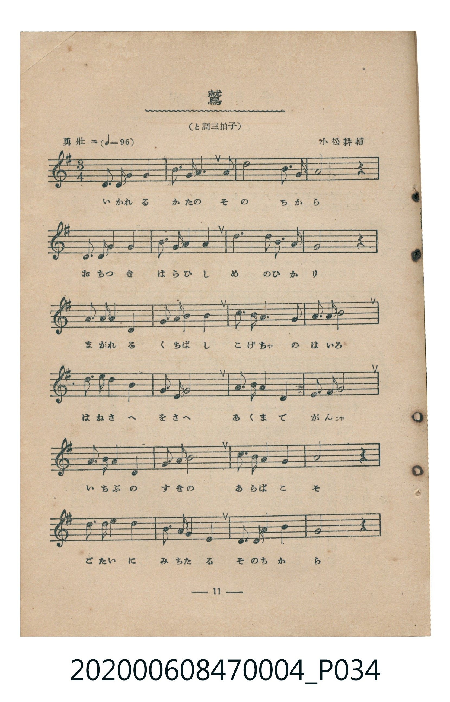
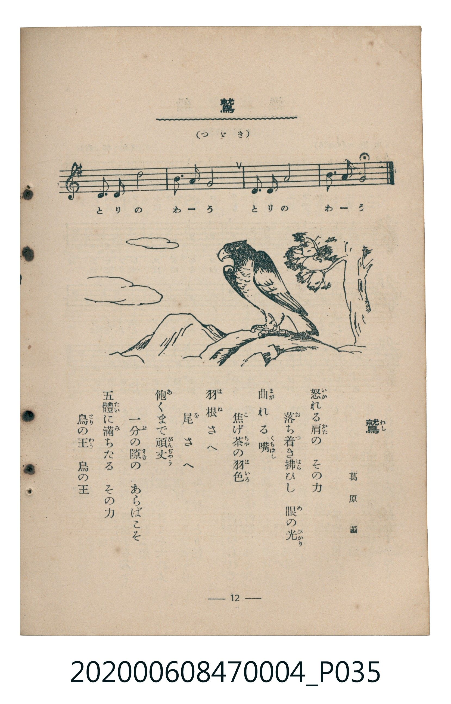

# 鷲

> Re:Shōka 使用 AI 協助辨識與重建樂譜，可能會有錯誤。歡迎回報。

- **鋼琴伴奏版**：<br><audio controls src="washi.mp3"></audio>
- **NEUTRINO 歌聲合成版**：<br><audio controls src="washi_neutrino.mp3"></audio>

- 詞：葛原齒
- 曲：小松耕輔
- 臺灣教育會公認《新定兒童唱歌》尋常科第四學年用（2020.006.0847.0004）

## 說明

原書資訊與歌詞全文（對應 P034.jpg–P035.jpg，書頁 pp. 11–12，第二學期第 1 首）：
調性與拍號：と調三拍子（G 大調 3/4 拍）
速度指示：勇壯ニ（♩=96）


## 歌詞

```text
怒（いか）れる肩（かた）の　その力
落（お）ち着（つ）き拂（はら）ひし　眼（め）の光（ひかり）
曲（まが）れる嘴（くちばし）　焦（こ）げ茶（ちゃ）の羽色（はいろ）
羽根（はね）さへ　尾（を）さへ　飽（あ）くまで頑丈（がんぢゃう）
一分（いちぶ）の隙（すき）の　あらばこそ
五體（ごたい）に滿（み）ちたる　その力
鳥（とり）の王（わう）　鳥の王
```

## ABC

<div class="abc-score" data-abc-src="washi.abc" aria-label="五線譜載入中"></div>

[下載 ABC 原始檔](washi.abc)

## TMD 檔案連結

- [主旋律 TMD 檔案](washi.tmd) [[在 TMD Studio 編輯](https://tmdlang.github.io/Tmd-TS/#tmd=s7IKdvYPcrWy4qpTUCpJTLdSSM7PyUlNLsnMz7MqzsjMK0nNjM_KTMmPL87Iz05Ugisry88pzU21Si9KTEmNN4k3MjAyiDcwMIs3sDAxBzIMTBBKi_NLi5JTrYqTM_Lzc-JLUitKkvLzsxHyBUX5Zal5iXlANQVFIBtTwIoQClLLMlNSQdKpKZkl-UWZiTlI7kgtKga7FWxJfElRYl5xclFmAcgDCFUlGalAxybmZeYi6wUalZ6ZZ1WSmAn0HMiD5YnxuYmZeTmJeSlKXFpaCi-3b1LQ0uJStFWwNOOyt1Vw57Ix1jexAxnwYuW893tmvZg4-2nf_Jd7J4ENfTZ7E1Ds6Yb-Z3P3vWiY-mLPFLDwi_ZdzxsXP5s680XTpmdzmp-2rnmxqvdxQ9ezaRuerpv1tHXS89VLn07Z-Gxtz-OG7qcbup_u2PF8-cTna9Y8nT376dodT3dueT5lxfs9HaAw1gOGsR4ojIEMA5P3ezqVuLj0tRRsqQW4FBQUgD56NnvHi83tL1Z0vehoB7oL6NmnrSueTWsHuuLpht5n7Z0KAQbGJnpZBemPGiYDmaYg5vs9PUB9Lxc0KhQU6CkYGgKlDI2AgkCfPNnVA_TJsznzgWwFQ4WXy6YBnQ4MK5B1L1btf9awHGRRd--LmfOBoo8bVwAFn-zoBIo8XTsBaKm7wtMly4FiCsDgVwCKAnWDtL5smP9017JnPe3Pl-wChXx3-9PF6x83dwN1PJq50tbSDKQOpPBZwySg2OPGlseNQMnOx009j5u6XzStBAt2P24E2tr5uHHd44aGx41zgYynXbPBTpuwF6yiCyy98PncBjB3CZjb-6y7Ccxd_7gJ6BegyKbHjdOBRjyfswck3tQIMfRpK1AWqAwo2_24CWQU2EWgtAIU3fe4sQfuoqcztoAF-4GWPW7cADQOJAU0sWUZWHwy2MRJL3q2gbkLHzc1Q-x4vm_vi06IgetBvmyChRBQ4tmCnTCJtWDVUx837gAa-nTDPrAzgSGDEHy5GOJjoM-AgkB3AN23_OWCiU92dIDFga6c_LhxEdDix41tUDue7Gh42gHkQMIX6HCg60COejlrJlhwJjCskMK3CRhcYM8BDZoL1r9rysvVU8BKpwCjAmgKWPXqZ7v3gwWBJCj0QVJN3ehR9HLzUrCiFZCgBYVFHyj-HzcBHQ9yIchTm5dCxEEaKM8jUKCgpc_FFZ4ILCStAjIT8_IdagxqqkE2KNgYmmnZgVnYsqYCKD_saHixsEdBw0QBWFo8X9-gA89Pmlg0AC2CGgYMGyADnJB6gHRTN0gcCGpAYmAZYPCtA9FzkWSAAnAADEiICSCZpk4kGRiA2lajYBqvoAuEQMoQzNCF0zUKxkgiRlA2iAbqgvJgEKLSECgDUweDBjDTwPb5gFzaAhYAuQ7kQYg0yJcwa0EyUNHG-WCfgXwKE1kHVoNqCUh8IdxUiJ9R5SG-BDkDf5Tt6iEzyrogwQ4sN0B0L1LErAfJgHLDJpDMdIRMUyNShIE8CVYAcT_IOArizBAlviAyyHEGYkNUGgFlYLrxxFkXPJRBPoSFeS_ccJA3IfHYCfYITMV0hAqgd5HjCxSPMJUIX5MXazs6yYy1feCwB5Z3GBmtHxafG9BirXEyWGYSWLapGSkC4ZENTOHAwhlbzEFiwwgeK9CYBIUPJBKM4JkORtcomED5yFkLpBphHEwtDCJF3D5oAPfgzGz9UBWgqN0Ajx6kiAP6GCIG9zN6PCLFP9Tv6O7BG3_AJhCZ8QcJ7rVAPBUaDTsgsdQ0CcybChVBir4msEQ_NPJB7OVQGWAaAGqcDGRBqz6M6INkITN4VkLEEST2zBA5Eu51aCQhog8pzoHqQQxzLNoQMQgLWIgvYcG-AxE_QL9CxCC-Rbcf5GWIPMTTMBOWI6mApAxUz5MUhcDqnaK6DpT4tsFzEiQ-ZoJ5vVAR9CgEFzTAzAlWBMqTIBlYhYgM0DIfIiKgoY8t8yFCDz3zIUpaEmo6iO9gAQ_KMbCAnwkVg_gSZ9RBPQszAZIhISpgNSMMEllmPm1dS2aETQGHOKhiBkUdiL0aGvr74VE5HyIDLlFh8QKp40ANE0g1B8mn-BsnYJ-YAnMcxE-wfAer5ozg0YEUl4jaERZD6NkUb5xNgYYxxIOwEF-NFOL7oWIQj0JVoBSpkDiBeRhmBpIKstsnO5oxYw3cLyMUayvA8dGFkZmawBVd8x6gBLy8g8QZaTqwNE5gsQaDmLGGkMGMNCJ0ISJtBTQSIK5FNwDkZFgkYJRrlOnmquXi0rVTAPcQFIAMZS4A)]
- [鋼琴伴奏 TMD 檔案](washi_piano.tmd) [[在 TMD Studio 編輯](https://tmdlang.github.io/Tmd-TS/#tmd=s7IKdvYPcrWy4tLSUni5fdP7PR0vu_c8n7DlyZ4tT5f2P-_seL-nU0FLi0vRVsHSjMveVsGdy8ZY38SOq05B6cXKee_3zHoxcfbTvvkv905SAok9mw00Y9bTDf3P5u570TD1xZ4pYOEX7bueNy5-NnXmi6ZNz-Y0P21d82JV7-OGrmfTNjxdN-tp66Tnq5c-nbLx2dqexw3dTzd0P92x4_nyic_XrHk6e_bTtTue7tzyfMoKoOOMDIwM9AwMzPQMLEzMgQwDE6D7lLi4whOLMzKtAjIT8_KDPBxqDGqquRSAwMbQTMsOzNLXUrBFBwpA85_saHixsEdBw0QB6Obn6xt0FAIMjE30sgrSNbFo0NKHGfa4sQXIeNzY_bipB0g3dYPEgaAGJAaWmf-4cR2InoskAxSAg8eNCyEmgGSaOpFkYABqW42CabyCLhACKUMwQxdO1ygYI4kYQdkgGqgLyoNBiEpDoAxMHQwawEwD2-cDcmkLWADkOpAHIdIgX8KsBclARRvng30G8ilMZB1YDaolIPGFcFMhfkaVh_gS5Az8Ubarh8wo64IE--PGJSC6Fyli1oNkmjofN24CyUxHyDQ1IkUYyJNgBRD3g4yjIM4MUeILIoMcZyA2RKURUAamG0-cdcFDGeRDWJj3wg0HeRMSj51gj8BUTEeoAHoXOb5A8QhTifA1ebG2o5PMWNsHDvseLBmtHxafG9BirXEyWGYSWLapGSkC4ZENTOGPm2BJACXmILFhBI8VaEyCwgcSCUbwTAejaxRMoHzkrAVSjTAOphYGkSJuHzSAe3Bmtn6oClDUboBHD1LEAX0MEYP7GT0ekeIf6nd09-CNP2BBTGb8QYJ7LRBPhUbDDkgsNU0C86ZCRZCirwks0Q-NfBB7OVQGmAaAGicDWYuAnnzc2IYRfZAsZAbPSog4gsSeGSJHwr0OjSRE9CHFOVA9iGGORRsiBmEBC_ElLNh3IOIH6FeIGMS36PaDvAyRh3gaZsJyJBWQlIHqeZKi8MmuKRTVdaDEtw2ekyDxMRPM64WKoEchuKABZk6wIlCeBMnAKkRkgJb5EBEBDX1smQ8ReuiZD1HSklDTQXwHC3hQjoEF_EyoGMSXOKMO6lmYCZAMCVEBqxlhkMgy82nrWjIjbAo4xEEVMyjqQOzV0NDfD4_K-RAZcIkKixdIHQdqmECqOUg-xd84AfvEFJjjIH6C5TtYNWcEjw6kuETUjrAYQs-meONsCjSMIR6EhfhqpBDfDxWDeBSqAqVIhcQJzMMwM5BUkN0-2dGMGWumxMTaCnB8dGFkpiZwRde8BygBL-8gcUaaDiyNE1iswSBmrCFkMCONCF2ISFsBjQSIa9ENADkZFgkY5RplurlqUToIPsgdBBNo_wDku3iFaNP4WAgBTIZAriGQB8TIkqhcA6gHidaOIkmkbiMgxygXLoes1hwoADUCn3vhJpjFA0l0aWLcYALkmGA6AeEDmGqgIgQHwzoc3kexipiQg8aqrp0COGIVgAxlLgA)]

## 分析

```text
================================================================================
📊 TMD Song Profile: [ 鷲 ]
================================================================================
⏱  Duration:       0:52 (52.5s), 28 measures total
🎼 Key & Tempo:    首調基準 G, != 96.0 BPM, <3/4>
   - 分析範圍：      由實際發聲的音符與和弦推測調性；播放脈絡另行呈現
🎤 人聲音域:    D4 (MIDI 62) – E5 (MIDI 76) [跨度: 14 個半音 / 1.2 個八度, 難度: moderate]
   - 最低音:  D4 in [Washi #1 @ m.1, 0:00]
   - 最高音: E5 in [Washi #1 @ m.13, 0:22]
   - 適合: soprano, mezzo-soprano, contralto, tenor, baritone, bass
🏛  結構:      Washi (52.5s)
⚡ 編曲密度:        Peak 1 軌道同時演奏
🗝  調性診斷：       G 大調（純淨自然大調，未偵測到可信轉調）
   - 風格氣質:    純淨自然大調（陽光明朗、易唱易記，無明顯調外色彩）
   - 轉調歷程:    全曲維持單一推測調性（未偵測到可信轉調）
   - 核心骨幹音:  G, A, D, B, E
   - 調性數值:    G 大調 [相關度: 0.80, 穩定度: Moderate, 自然音純度: 100.0%]
   - 候選調性 (K-S): G 大調 (0.80), D 大調 (0.72), E 小調 (0.51)
   - 五度圈歷程:   +1
   - 各段落調性細節:
     • [Washi #1]: G 大調 (r: 0.80, 自然音純度: 100.0%)

  [ 五度圈游移軌跡 ]
               C  
         F           [G ]*
      Bb               D  
      Eb               A  
         Ab           E  
            Db       B  
               F# 
     (* = active key center)

  [ 十二半音累積音高分佈 ]
     C  : ██                         1.9%
     C# :                            0.0%
     D  : ████████████████          18.4%
     D# :                            0.0%
     E  : ███████                    7.8%
     F  :                            0.0%
     F# :                            0.3%
     G  : ████████████████████████  27.2%
     G# :                            0.0%
     A  : ███████████████████████   26.2%
     A# :                            0.0%
     B  : ████████████████          18.1%
--------------------------------------------------------------------------------
Assignment 軌道音域：
  - Piano         : D4 – E5 (14 個半音 / 1.2 個八度, 91 個音符)
================================================================================
```


## 原書掃描頁






