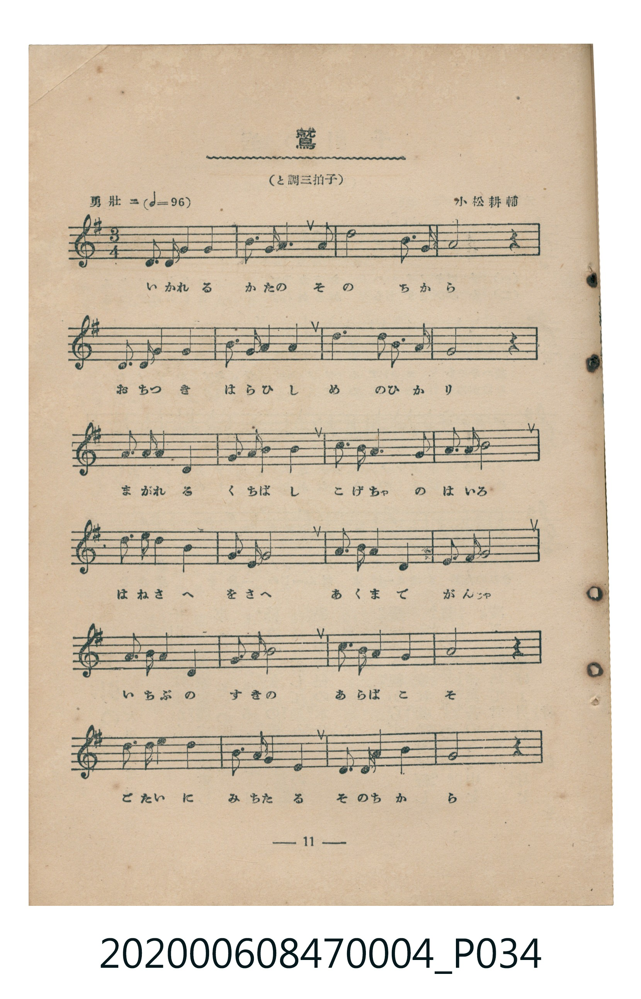
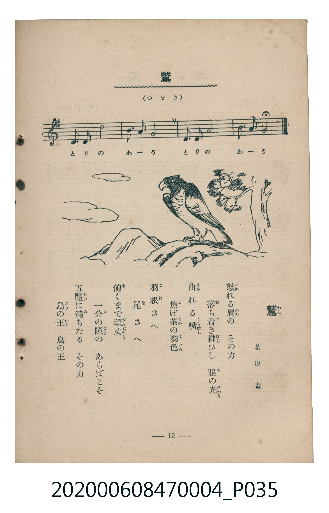

# 鷲

<audio controls src="washi.mp3"></audio>

- 詞：葛原齒
- 曲：小松耕輔
- 臺灣教育會公認《新定兒童唱歌》尋常科第四學年用（2020.006.0847.0004）

## 說明

原書資訊與歌詞全文（對應 P034.jpg–P035.jpg，書頁 pp. 11–12，第二學期第 1 首）：
調性與拍號：と調三拍子（G 大調 3/4 拍）
速度指示：勇壯ニ（♩=96）

## 歌詞

```text
怒（いか）れる肩（かた）の　その力
落（お）ち着（つ）き拂（はら）ひし　眼（め）の光（ひかり）
曲（まが）れる嘴（くちばし）　焦（こ）げ茶（ちゃ）の羽色（はいろ）
羽根（はね）さへ　尾（を）さへ　飽（あ）くまで頑丈（がんぢゃう）
一分（いちぶ）の隙（すき）の　あらばこそ
五體（ごたい）に滿（み）ちたる　その力
鳥（とり）の王（わう）　鳥の王
```

## 原書掃描頁





## 分析

```text
================================================================================
📊 TMD Song Profile: [ 鷲 ]
================================================================================
⏱  Duration:       0:52 (52.5s), 28 measures total
🎼 Key & Tempo:    首調基準 G, != 96.0 BPM, <3/4>
   - 分析範圍：      由實際發聲的音符與和弦推測調性；播放脈絡另行呈現
🎤 人聲音域:    D4 (MIDI 62) – E5 (MIDI 76) [跨度: 14 個半音 / 1.2 個八度, 難度: moderate]
   - 最低音:  D4 in [Washi #1 @ m.1, 0:00]
   - 最高音: E5 in [Washi #1 @ m.21, 0:38]
   - 適合: soprano, mezzo-soprano, contralto, tenor, baritone, bass
🏛  結構:      Washi (52.5s)
⚡ 編曲密度:        Peak 1 軌道同時演奏
🗝  調性診斷：       G 大調（純淨自然大調，未偵測到可信轉調）
   - 風格氣質:    純淨自然大調（陽光明朗、易唱易記，無明顯調外色彩）
   - 轉調歷程:    全曲維持單一推測調性（未偵測到可信轉調）
   - 核心骨幹音:  G, A, D, B, E
   - 調性數值:    G 大調 [相關度: 0.82, 穩定度: Moderate, 自然音純度: 100.0%]
   - 候選調性 (K-S): G 大調 (0.82), D 大調 (0.75), B 小調 (0.54)
   - 五度圈歷程:   +1
   - 各段落調性細節:
     • [Washi #1]: G 大調 (r: 0.82, 自然音純度: 100.0%)

  [ 五度圈游移軌跡 ]
               C  
         F           [G ]*
      Bb               D  
      Eb               A  
         Ab           E  
            Db       B  
               F# 
     (* = active key center)

  [ 十二半音累積音高分佈 ]
     C  : ████                       4.4%
     C# :                            0.0%
     D  : ███████████████████       20.0%
     D# :                            0.0%
     E  : █████                      5.0%
     F  :                            0.0%
     F# : █                          1.6%
     G  : ████████████████████████  25.3%
     G# :                            0.0%
     A  : ████████████████████████  25.0%
     A# :                            0.0%
     B  : ██████████████████        18.7%
--------------------------------------------------------------------------------
Assignment 軌道音域：
  - Piano         : D4 – E5 (14 個半音 / 1.2 個八度, 91 個音符)
================================================================================
```

## ABC

```abc
X:1
T:鷲
C:曲：小松耕輔
M:3/4
L:1/16
Q:1/4=96
K:G

V:V1 name="Piano" snm="Pia"

[V:V1]
d3 d g4 a4 | b3 a b4 b4 | d8 b3 a | a8 z4 |
d3 d g4 a4 | b3 a b4 b4 | d6 d2 b3 a | g8 z4 |
a3 a a4 d4 | g3 a b4 b4 | c3 b a6 a2 | a3 b c8 |
d3 d d4 b4 | a3 b g8 | a3 a a4 e4 | g3 f g8 |
a3 a g4 d4 | g3 a b8 | c3 a g4 f4 | a8 z4 |
d3 d e4 d4 | b3 a g4 e4 | d3 d g4 a4 | g8 z4 |
e3 e d8 | b3 a g8 | d3 d a8 | b3 a g8 |
```

- [主旋律 TMD 檔案](washi.tmd)
- [鋼琴伴奏 TMD 檔案](washi_piano.tmd)
