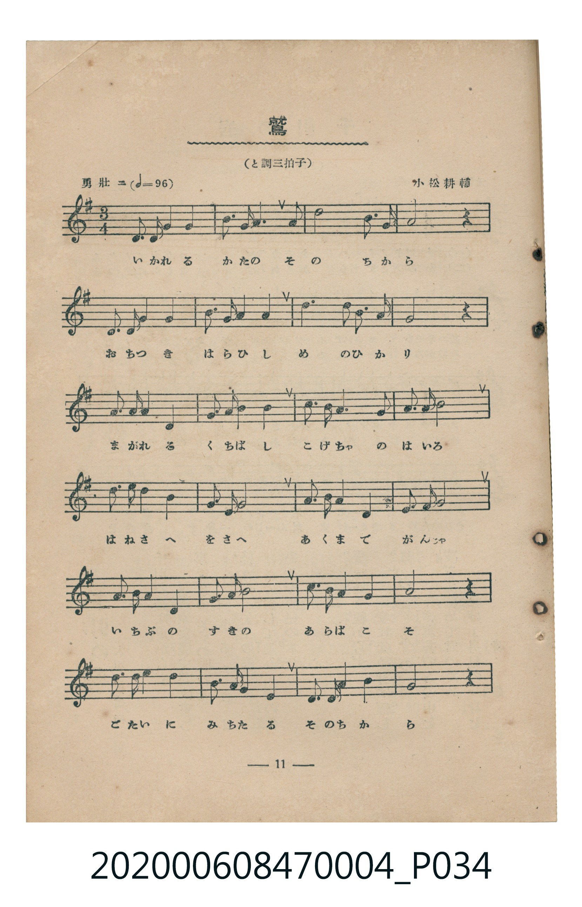

# 鷲

> Re:Shōka 使用 AI 協助辨識與重建樂譜，可能會有錯誤。歡迎回報。

- **鋼琴伴奏版**：<br><audio controls src="washi.mp3"></audio>
- **NEUTRINO 歌聲合成版**：<br><audio controls src="washi_neutrino.mp3"></audio>

- 詞：葛原齒
- 曲：小松耕輔
- 臺灣教育會公認《新定兒童唱歌》尋常科第四學年用（2020.006.0847.0004）

## 說明

原書資訊與歌詞全文（對應 P034.jpg–P035.jpg，書頁 pp. 11–12，第二學期第 1 首）：
調性與拍號：と調三拍子（G 大調 3/4 拍）
速度指示：勇壯ニ（♩=96）


## 歌詞

```text
怒（いか）れる肩（かた）の　その力
落（お）ち着（つ）き拂（はら）ひし　眼（め）の光（ひかり）
曲（まが）れる嘴（くちばし）　焦（こ）げ茶（ちゃ）の羽色（はいろ）
羽根（はね）さへ　尾（を）さへ　飽（あ）くまで頑丈（がんぢゃう）
一分（いちぶ）の隙（すき）の　あらばこそ
五體（ごたい）に滿（み）ちたる　その力
鳥（とり）の王（わう）　鳥の王
```

## ABC

<div class="abc-score" data-abc-src="washi.abc" aria-label="五線譜載入中"></div>

[下載 ABC 原始檔](washi.abc)

## TMD 檔案連結

- [主旋律 TMD 檔案](washi.tmd) [[在 TMD Studio 編輯](https://tmdlang.github.io/Tmd-TS/#tmd=s7IKdvYPcrWy4qpTUCpJTLdSSM7PyUlNLsnMz7MqzsjMK0nNjM_KTMmPL87Iz05Ugisry88pzU21Si9KTEmNN4k3MjAyiDcwMIs3sDAxBzIMTBBKi_NLi5JTrYqTM_Lzc-JLUitKkvLzsxHyBUX5Zal5iXlANQVFIBtTwIoQClLLMlNSQdKpKZkl-UWZiTlI7kgtKga7FWxJfElRYl5xclFmAcgDCFUlGalAxybmZeYi6wUalZ6ZZ1WSmAn0HMiD5YnxuYmZeTmJeSnIqkoy8oH-LMiotMrILAY5IDkxJz47MQ8pOKDWFySmp1oFGBib6AIJUyUuLS2Fl9s3KWhpcSnaKliacdnbKrhz2Rjrm9iBdL5YOe_9nlkvJs5-2jf_5d5JYNOezd4EFHu6of_Z3H0vGqa-2DMFLPyifdfzxsXPps580bTp2Zzmp61rXqzqfdzQ9WzahqfrZj1tnfR89dKnUzY-W9vzuKH76Ybupzt2PF8-8fmaNU9nz366dsfTnVueT1nxfk8HKJ70gPGkB4onIMPA5P2eTiUuLn0tBVtqAS4FBQWgj57N3vFic_uLFV0vOtqB7gJ69mnrimfT2oGueLqh91l7pwIooPSyCtIfNUwGBReI-X5PD1DfywWNCgUFegqGhkApQyOgINAnT3b1AH3ybM58IFvBUOHlsmlApwPDCmTdi1X7nzUsB1nU3fti5nyg6OPGFUDBJzs6gSJP104AWuqu8HTJcqCYAjD4FYCiQN0grS8b5j_dtexZT_vzJbtAId_d_nTx-sfN3UAdj2autLU0A6kDKXzWMAko9rix5XEjULLzcVPP46buF00rwYLdjxuBtnY-blz3uKHhceNcIONp12yw0ybsBavoAksvfD63AcxdAub2PutuAnPXP24C-gUosulx43SgEc_n7AGJNzVCDH3aCpQFKgPKdj9uAhkFdhEorQBF9z1u7IG76OmMLWDBfqBljxs3AI0DSQFNbFkGFp8MNnHSi55tYO7Cx03NEDue79v7ohNi4HqQL5tgIQSUeLZgJ0xiLVj11MeNO4CGPt2wD-xMYMggBF8uhvgY6DOgINAdQPctf7lg4pMdHWBxoCsnP25cBLT4cWMb1I4nOxqedgA5kPAFOhzoOpCjXs6aCRacCQwrpPBtAgYX2HNAg-aC9e-a8nL1FLDSKcCoAJoCVr362e79YEEgCQp9kFRTN3oUvdy8FKxoBSRoQWHRB4r_x01Ax4NcCPLU5qUQcZAGyvMIFCho6XNxhScCC1qrgMzEvHyHGoOaapANCjaGZlp2YBa2rKkAyg87Gl4s7FHQMFEAlhbP1zfowPOTJhYNQIughgHDBsgAJ6QeIN3UDRIHghqQGFgGGHzrQPRcJBmgABwAAxJiAkimqRNJBgagttUomMYr6AIhkDIEM3ThdI2CMZKIEZQNooG6oDwYhKg0BMrA1MGgAcw0sH0-IJe2gAVArgN5ECIN8iXMWpAMVLRxPthnIJ_CRNaB1aBaAhJfCDcV4mdUeYgvQc7AH2W7esiMsi5IsAPLDRDdixQx60EyoNywCSQzHSHT1IgUYSBPghVA3A8yjoI4M0SJL4gMcpyB2BCVRkAZmG48cdYFD2WQD2Fh3gs3HORNSDx2gj0CUzEdoQLoXeT4AsUjTCXC1-TF2o5OMmNtHzjsgeUdRkbrh8XnBrRYa5wMlpkElm1qRopAeGQDUziwcMYWc5DYMILHCjQmQeEDiQQjeKaD0TUKJlA-ctYCqUYYB1MLg0gRtw8awD04M1s_VAUoajfAowcp4oA-hojB_Ywej0jxD_U7unvwxh-wCURm_EGCey0QT4VGww5ILDVNAvOmQkWQoq8JLNEPjXwQezlUBpgGgBonA1nQqg8j-iBZyAyelRBxBIk9M0SOhHsdGkmI6EOKc6B6EMMcizZEDMICFuJLWLDvQMQP0K8QMYhv0e0HeRkiD_E0zITlSCogKQPV8yRFIbB6p6iuAyW-bfCcBImPmWBeL1QEPQrBBQ0wc4IVgfIkSAZWISIDtMyHiAho6GPLfIjQQ898iJKWhJoO4jtYwINyDCzgZ0LFIL7EGXVQz8JMgGRIiApYzQiDRJaZT1vXkhlhU8AhDqqYQVEHYq-Ghv5-eFTOh8iAS1RYvEDqOFDDBFLNQfIp_sYJ2CemwBwH8RMs38GqOSN4dCDFJaJ2hMUQejbFG2dToGEM8SAsxFcjhfh-qBjEo1AVKEUqJE5gHoaZgaSC7PbJjmbMWAP3ywjF2gpwfHRhZKYmcEXXvAcoAS_vIHFGmg4sjRNYrMEgZqwhZDAjjQhdiEhbAY0EiGvRDQA5GRYJGOUaZbq5arm4dO0UwD0EBSBDmQsA)]
- [鋼琴伴奏 TMD 檔案](washi_piano.tmd) [[在 TMD Studio 編輯](https://tmdlang.github.io/Tmd-TS/#tmd=s7IKdvYPcrWy4qpTUCpJTLdSyC8qychPL0osyKi0ysgsLskvykxOzInPTsxLVIIrKs4vLUpOjS9ITE-1CjAwNtEFEqZKXFpaCi-3b3q_p-Nl957nE7Y82bPl6dL-550d7_d0KmhpcSnaKliacdnbKrhz2Rjrm9iBjHuxct77PbNeTJz9tG_-y72TwFY8mw00Y9bTDf3P5u570TD1xZ4pYOEX7bueNy5-NnXmi6ZNz-Y0P21d82JV7-OGrmfTNjxdN-tp66Tnq5c-nbLx2dqexw3dTzd0P92x4_nyic_XrHk6e_bTtTue7tzyfMoKoOOMDIwM9AwMzPQMLEzMgQwDE6D7lLi4whOLMzKtAjIT8_KDPBxqDGqquRSAwMbQTMsOzNLXUrBFBwpA85_saHixsEdBw0QB6Obn6xt0FEBhopdVkK6JRYOWPsywx40tQMbjxu7HTT1AuqkbJA4ENSAxsMz8x43rQPRcJBmgABw8blwIMQEk09SJJAMDUNtqFEzjFXSBEEgZghm6cLpGwRhJxAjKBtFAXVAeDEJUGgJlYOpg0ABmGtg-H5BLW8ACINeBPAiRBvkSZi1IBiraOB_sM5BPYSLrwGpQLQGJL4SbCvEzqjzElyBn4I-yXT1kRlkXJNgfNy4B0b1IEbMeJNPU-bhxE0hmOkKmqREpwkCeBCuAuB9kHAVxZogSXxAZ5DgDsSEqjYAyMN144qwLHsogH8LCvBduOMibkHjsBHsEpmI6QgXQu8jxBYpHmEqEr8mLtR2dZMbaPnDY92DJaP2w-NyAFmuNk8Eyk8CyTc1IEQiPbGAKf9wESwIoMQeJDSN4rEBjEhQ-kEgwgmc6GF2jYALlI2ctkGqEcTC1MIgUcfugAdyDM7P1Q1WAonYDPHqQIg7oY4gY3M_o8YgU_1C_o7sHb_wBC2Iy4w8S3GuBeCo0GnZAYqlpEpg3FSqCFH1NYIl-aOSD2MuhMsA0ANQ4GchaBPTk48Y2jOiDZCEzeFZCxBEk9swQORLudWgkIaIPKc6B6kEMcyzaEDEIC1iIL2HBvgMRP0C_QsQgvkW3H-RliDzE0zATliOpgKQMVM-TFIVPdk2hqK4DJb5t8JwEiY-ZYF4vVAQ9CsEFDTBzghWB8iRIBlYhIgO0zIeICGjoY8t8iNBDz3yIkpaEmg7iO1jAg3IMLOBnQsUgvsQZdVDPwkyAZEiICljNCINElplPW9eSGWFTwCEOqphBUQdir4aG_n54VM6HyIBLVFi8QOo4UMMEUs1B8in-xgnYJ6bAHAfxEyzfwao5I3h0IMUlonaExRB6NsUbZ1OgYQzxICzEVyOF-H6oGMSjUBUoRSokTmAehpmBpILs9smOZsxYMyUm1laA46MLIzM1gSu65j1ACXh5B4kz0nRgaZzAYg0GMWMNIYMZaUToQkTaCmgkQFyLbgDIybBIwCjXKNPNVYvSQfBB7iCYQPsHIN_FK0SbxsdCCGAyBHINgTwgRpZE5RpAPUi0dhRJInUbATlGuXA5ZLXmQAGoEfjcCzfBLB5IoksT4wYTIMcE0wkIH8BUAxUhOBjW4fA-ilXEhBw0VnXtFMARqwBkKHMBAA)]

## 分析

```text
================================================================================
📊 TMD Song Profile: [ 鷲 ]
================================================================================
⏱  Duration:       0:52 (52.5s), 28 measures total
🎼 Key & Tempo:    首調基準 G, != 96.0 BPM, <3/4>
   - 分析範圍：      由實際發聲的音符與和弦推測調性；播放脈絡另行呈現
🎤 人聲音域:    D4 (MIDI 62) – E5 (MIDI 76) [跨度: 14 個半音 / 1.2 個八度, 難度: moderate]
   - 最低音:  D4 in [Washi #1 @ m.1, 0:00]
   - 最高音: E5 in [Washi #1 @ m.13, 0:22]
   - 適合: soprano, mezzo-soprano, contralto, tenor, baritone, bass
🏛  結構:      Washi (52.5s)
⚡ 編曲密度:        Peak 1 軌道同時演奏
🗝  調性診斷：       G 大調（純淨自然大調，未偵測到可信轉調）
   - 風格氣質:    純淨自然大調（陽光明朗、易唱易記，無明顯調外色彩）
   - 轉調歷程:    全曲維持單一推測調性（未偵測到可信轉調）
   - 核心骨幹音:  G, A, D, B, E
   - 調性數值:    G 大調 [相關度: 0.80, 穩定度: Moderate, 自然音純度: 100.0%]
   - 候選調性 (K-S): G 大調 (0.80), D 大調 (0.72), E 小調 (0.51)
   - 五度圈歷程:   +1
   - 各段落調性細節:
     • [Washi #1]: G 大調 (r: 0.80, 自然音純度: 100.0%)

  [ 五度圈游移軌跡 ]
               C  
         F           [G ]*
      Bb               D  
      Eb               A  
         Ab           E  
            Db       B  
               F# 
     (* = active key center)

  [ 十二半音累積音高分佈 ]
     C  : ██                         1.9%
     C# :                            0.0%
     D  : ████████████████          18.4%
     D# :                            0.0%
     E  : ███████                    7.8%
     F  :                            0.0%
     F# :                            0.3%
     G  : ████████████████████████  27.2%
     G# :                            0.0%
     A  : ███████████████████████   26.2%
     A# :                            0.0%
     B  : ████████████████          18.1%
--------------------------------------------------------------------------------
Assignment 軌道音域：
  - Piano         : D4 – E5 (14 個半音 / 1.2 個八度, 91 個音符)
================================================================================
```


## 原書掃描頁




