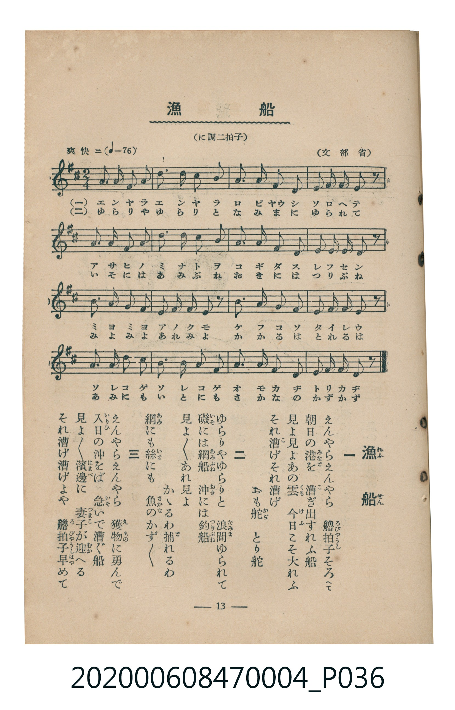

# 漁船

> Re:Shōka 使用 AI 協助辨識與重建樂譜，可能會有錯誤。歡迎[回報](https://github.com/TMDLang/reshoka/issues)。

- **鋼琴伴奏版**：<br><audio controls src="gyosen.mp3"></audio>
- **NEUTRINO 歌聲合成版**：<br><audio controls src="gyosen_neutrino.mp3"></audio>

- 詞：文部省
- 曲：文部省
- 臺灣教育會公認《新定兒童唱歌》尋常科第四學年用（2020.006.0847.0004）

## 說明

原書資訊與歌詞全文（對應 P036.jpg，書頁 p. 13，第二學期第 2 首）：
調性與拍號：に調二拍子（D 大調 2/4 拍）
速度指示：爽快ニ（♩=76）


## 歌詞

```text
一
えんやらえんやら　艪拍子（ろびゃうし）そろへて
朝日（あさひ）の港（みなと）を　漕（こ）ぎ出す舟（ふね）舟
見よ見よあの雲（くも）　今日（けふ）こそ大漁（たいれう）
それ漕げそれ漕げ　おも舵（かぢ）とり舵

二
ゆらりやゆらりと　浪間（なみま）にゆられて
磯（いそ）には網船（あみぶね）　沖（おき）には釣船（つりぶね）
見よ見よあれ見よ　かゝるわ捕（と）れるわ
網（あみ）にも絲（いと）にも　魚（さかな）のかずかず

三
えんやらえんやら　獲物（えもの）に勇（いさ）んで
入日（いりひ）の沖をば　急（いそ）いで漕ぐ船
見よ見よ濱邊（はまべ）に　妻子（つまこ）が迎（むか）へる
それ漕げ漕げよや　艪拍子早（はや）めて
```

## ABC

<div class="abc-score" data-abc-src="gyosen.abc" aria-label="五線譜載入中"></div>

[下載 ABC 原始檔](gyosen.abc)

## TMD 檔案連結

- [主旋律 TMD 檔案](gyosen.tmd) [[在 TMD Studio 編輯](https://tmdlang.github.io/Tmd-TS/#tmd=s7IKdvYPcrWy4qpTUCpJTLdSSM7PyUlNLsnMz7MqzsjMK0nNjM_KTMmPL87Iz05Ugisry88pzU21Si9KTEmNN4k3MjAyiDcwMIs3sDAxBzIMTBBKi_NLi5JTrYqTM_Lzc-JLUitKkvLzs9Hl4wsS01OtAgyMzRAyBUX5Zal5iXlA3QVFILekgLUjFKSWZaakgqSLkxPz4stSizLTMlNTkFyZWlQM9gnEipKixLzi5KLMApD3EKryi0oy8oE-KciotMrILC7JL8pMTsyJz07MQ_JwSUYq0L9gEwqAGpB1Z6Zn5lnl5ucllQIDSYlLS0vh2Z7GFx07FbS0uBRtFczNuOxtFVy4bIz0TexA2l6snPd-z6xn09pfNq94PqcRbNSz2ZswxF6073reuPjZ1JkvmjY9m9P8tHXNi1W9jxu6nk3b8HTdrKetk56vXvp0ysZna3seN3Q_3dD9dMeO58snPl-z5uns2U_X7ni6c8vzKSve7-kARY4eMHL0QJEDZBiYvN_TqcTFpa-lYEstwKWgoPC0b_6z2TtebG5_saLrRUc70F1Anz5tXQH0FdAVTzf0PmvvVADFsF5WQfr7PT1AxS8XNCoU6CkYGgO5QIc_2dUDdPizOfOBbAUjhZfLpgFdCgwXkOkvVu1_1rAcZG5374uZ84GijxtXAwWBeoAiT9dOANrhovB0yXKgmAIwqBWAokDdIK0vG-Y_3bXsWU_78yW7gPqed-x9un_14-ZuoI5HM1fampuB1IEUPtnRAKIeN3Y8bpr8uKnlcVMnCruh4UXnKrhtj5t6HzduftzU_Lix7XHjdKAhjxvnggV3PG5cBjLo2Zy5z6YvBSltbHrcOPVxIzCSgYrWPduxHiy4_3HjqseNwDjqfNw0CWj6sz1TweKTwcr6nrbvetw480UH0LNAwa2PG9cCxYFccHAs637c1AEhwaavewlKQkB2_-OmJpD-hoYnu7tg1k8E6gcbOhnoRmAgAVMoWHz-40agz3qAPoCGFdgLPUCHPG6chMJuaHjc2AU0-kUH0CCgzu7HjYvAJq543ASM7q2QANzVAzakqQ0UXE1A9UDTYWygSqAXt656OQ3oP6AJQK8DA2Af2JDVMGVAp4CD7vliSBC1AB0BVdG4_vm2TcB8BQtPoOZtkDABmbsJmFaA4kBrQNEOUf-yfTFM_RKwC6DqsQVgUw-UDfIokAH0OpDsf9YLiRJIJPVABMEO3AYJbpBDYF5oer4VIgh0NVgDWBBo4su1s8DiwJAEhtsqSCoAs4GpGERCkx80CnAmv-e9m553rgQbBRQHxTrElqfdoCwGthfoXKBDgdG8HJwnW5fCkgDQCGAIwFLgpmmgJNe4ARR0DTAF0KAGMoAJBOjWCcDQQw-rZ_s3vmzqAmtYD4y9x43A8AV7tKHh6bLd0JwBDG6QFCQd97zY3wfOLqCABYvsAAYjemKDJjNgBAA9i5TRnk2H-Hc9UBzstUZoCqG80IICBS19Li73yvzi1DyrgMzEvHyHGoOaapAVCjaGZlp2YBa2wlIBVGTtaHixsEdBw0Th6Yb-5-sbdOAlnCYWDUCboIZpADVqWgFzygpQODRvBuIlYNZKhRpcos1rwezJj5sXP25aBlS1Hax2L1gUIjcDTLYBSWSrdvWArQIJA9MREHeBWS1g7WiijStAoo2rwOz9QLwPzFqNohZE9oDFlyGsqlEwVdAFQlMFYzCpCxQxjAMLASlzIGUGFkNWZQgWMQKSxkAIog1AImDzfAwhIQFSDQsLEGslWA8eGWBYQGRgIQVkA8MKJAYJL5DcWnBogcJKVyEeYacRxJtg_dBAAbFaoHoxZIDBBZYBBhhYBhpkINZqJD0QHT3gAEOxzxiktwNq6mSoTSDVEFMJyzQB2euQ7WsEq2ucCtHVuBxuH_50vKuHsnS8CJwotgJDdBI4DfaBY2I-mN0FxB1g1iZwiGwGq10H5DeAWTvBateAVUwFi-yGpn9s6RjoQXDRAfYyiLUe7O0meIrdBmatBYtC0nQvmlpwpoKmd5hqKqVjIyAE8dDT8SJofEFCCJQC-6CpdT40tUJCCcTaBE05m6F6ICEFYu2E6lkDVgeK493gcMJIw-BUAEoHkGACsdZD00cTUkrdBmaB8gsksCAykOBC1gPOX8AAA-mAqEdPw1D7wGpA7oekSjRTm8A-b9yAlFJhboSkWlBqBclMBvMmADEwvJDsI1AWd1KUhqGpdQUSCxJzkPQMSjLrwexFYPGN0PQKS897waL7wWxIqQ1O0cDyB2sqhijsQGLBUzG0bEUW7waLdAP5EBYkHYOrCYhquDhSOgalU1AKNQGSoFSKpaQlRg0iFcPTKiSMICxIWgWlb1AogcIIFELQGAOHE0QPJKRAaQRUAkPCCsRbAg4pSDmNnopBKkBqIMEEYSFSMaREBaZjsCjUPmAgQVIVJLBAqvqhMiC3gvUAxSGi6KkYt32gnAAq2YENHmjugNkHyhswOUi67YH6D5xnQe5o3AF1CxGpGNh7o6wkhrQHQCEKSZeQMhe7KLiaB8bW4yZw8djcBC5dIGU1WA4ujjUNI8pcsDJgZQTJ1pB2BKoouGAHBwakbbEOKV3PgsrB2BglMbj8BRW9sARrBpaCJFjcDQpsBTEo8YGSIyQoQFEMK25xy0Ard2hAgVig5AcJKhBvFVgcIoqehJGLW7BeYHigFn-QkEKWmYpIwuCGBaIwBSdoYBhB5GZhScJzoUkYlDUgyRFU6MIKVQgfkqwRzZpeqAy0NwtmTweLwZM-UC2w7Q3kIbJpLReXrp0CpOWsAGQpcwEA)]
- [鋼琴伴奏 TMD 檔案](gyosen_piano.tmd) [[在 TMD Studio 編輯](https://tmdlang.github.io/Tmd-TS/#tmd=s7IKdvYPcrWy4qpTUCpJTLdSyC8qychPL0osyKi0ysgsLskvykxOzInPTsxLVIIrKs4vLUpOjS9ITE-1CjAwNlPi0tJSeLan8UXHzvd7Ol5273k-YcuTPVueLu1_3tnxfk-ngpYWl6KtgrkZl72tgguXjZG-iR3IsBcr573fM-vZtPaXzSuez2kEW_Bs9iYMsRftu543Ln42deaLpk3P5jQ_bV3zYlXv44auZ9M2PF0362nrpOerlz6dsvHZ2p7HDd1PN3Q_3bHj-fKJz9eseTp79tO1O57u3PJ8ygqgy4wMjAz0DAzM9AwsTMyBDAMToOOUuLjcK_OLU_OsAjIT8_KDPBxqDGqquRSAwMbQTMsOzNLXUrBFBwpAC57saHixsEdBw0Th6Yb-5-sbdBRA4aGXVZCuiUWDlj7MMA2gRk0rhcdNK4D8x82bgXgJmLVSoQaXaPNaMHvy4-bFj5uWAVVtB6vdCxaFyM0Ak21AEtmqXT1gq0DCj5s6gbgLzGoBa0cTbVwBEm1cBWbvB-J9YNZqFLUgsgcsvgxhVY2CqYIuEJoqGINJXaCIYRxYCEiZAykzsBiyKkOwiBGQNAZCEG0AEgGb52MICQmQalhYgFgrwXrwyADDAiIDCykgGxhWIDFIeIHk1oJDCxRWugrxCDuNIN4E64cGCojVAtWLIQMMLrAMMMDAMtAgA7FWI-mB6OgBBxiKfcYgvR1QUydDbQKphphKWKYJyF6HbF8jWF3jVIiuxuVw-_Cn4109lKXjReBEsRUYopPAabAPHBPzwewuIO4AszaBQ2QzWO06IL8BzNoJVrsGrGIqWGQ3NP1jS8dAD4JS3lywl0Gs9WBvN8FT7DYway1YFJKme9HUgjMVNL3DVFMpHRsBIYiHno4XQeMLEkKgFNgHTa3zoakVEkog1iZoytkM1QMJKRBrJ1TPGrA6UBzvBocTRhoGpwJQOoAEE4i1Hpo-mpBS6jYwC5RfIIEFkYEEF7IecP4CBhhIB0Q9ehqG2gdWA3I_JFWimdoE9nnjBqSUCnMjJNWCUitIZjKYNwGIgeGFZB-BsriTojQMTa0rkFiQmIOkZ1CSWQ9mLwKLb4SmV1h63gsW3Q9mQ0ptcIoGlj9YUzFEYQcSC56KoWUrsng3WKQbyIewIOkYXE1AVMPFkdIxKJ2CUqgJkASlUiwlLTFqEKkYnlYhYQRhQdIqKH2DQgkURqAQgsYYOJwgeiAhBUojoBIYElYg3hJwSEHKafRUDFIBUgMJJggLkYohJSowHYNFofYBAwmSqiCBBVLVD5UBuRWsBygOEUVPxbjtA-UEUMn-uHEnNHfA7APlDZgcJN32QP0HzrMgdzTugLqFiFQMbLJQVhJD2gOgEIWkS0iZi10UXM0DY-txE7h4bG4Cly6QshosBxfHmoYRZS5YGbAygmRrSDsCVRRcsIMDA9K2WIeUrmdB5WBsjJIYXP6Cil5YgjUDS0ESLO4GBbaCGJT4QMkREhSgKIYVt7hloJU7NKBAMjsgMtACexVYHCKKnoSRi1uIXpAIcvEHCSlkmamIJAxuWCAKU3CCBoYRRG4WliQ8F5qEQVkDkhxBhS6sUIXwIcka0azphcpsftzU_LgR3GBpnA4Wgyd9oNrHTY1AHiKb1qI2nH2QG84W0HYzsOqMV4g2jIVRcL4JkDJB4sPlTeOBLNP4WDDDAOo1CowBiiBMgSrHaRlBBZiuAUli6iPkHGDY6dopQIIv2geoBIlnhMIzBvOUuQA)]

## 分析

```text
================================================================================
📊 TMD Song Profile: [ 漁船 ]
================================================================================
⏱  Duration:       0:25 (25.3s), 16 measures total
🎼 Key & Tempo:    首調基準 D, != 76.0 BPM, <2/4>
   - 分析範圍：      由實際發聲的音符與和弦推測調性；播放脈絡另行呈現
🎤 人聲音域:    D4 (MIDI 62) – D5 (MIDI 74) [跨度: 12 個半音 / 1.0 個八度, 難度: easy]
   - 最低音:  D4 in [Gyosen #1 @ m.3, 0:04]
   - 最高音: D5 in [Gyosen #1 @ m.2, 0:01]
   - 適合: soprano, mezzo-soprano, contralto, tenor, baritone, bass
🏛  結構:      Gyosen (25.3s)
⚡ 編曲密度:        Peak 1 軌道同時演奏
🗝  調性診斷：       A 調性不明確（純淨自然大調，未偵測到可信轉調）
   - 風格氣質:    純淨自然大調（陽光明朗、易唱易記，無明顯調外色彩）
   - 轉調歷程:    全曲維持單一推測調性（未偵測到可信轉調）
   - 核心骨幹音:  A, F#, D, E, B
   - 調性數值:    A 調性不明確 [相關度: 0.85, 穩定度: Ambiguous, 自然音純度: 96.6%]
   - 候選調性 (K-S): A 大調 (0.85), D 大調 (0.82), F# 小調 (0.76)
   - 五度圈歷程:   +3
   - 各段落調性細節:
     • [Gyosen #1]: A 調性不明確 (r: 0.85, 自然音純度: 96.6%, 調外音: G)

  [ 五度圈游移軌跡 ]
               C  
         F            G  
      Bb               D  
      Eb              [A ]*
         Ab           E  
            Db       B  
               F# 
     (* = active key center)

  [ 十二半音累積音高分佈 ]
     C  :                            0.0%
     C# : █████                      5.1%
     D  : ███████████████           16.9%
     D# :                            0.0%
     E  : ██████████████            15.3%
     F  :                            0.0%
     F# : ██████████████████        20.3%
     G  : ███                        3.4%
     G# :                            0.0%
     A  : ████████████████████████  27.1%
     A# :                            0.0%
     B  : ███████████               11.9%
--------------------------------------------------------------------------------
Assignment 軌道音域：
  - Piano         : D4 – D5 (12 個半音 / 1.0 個八度, 64 個音符)
================================================================================
```


## 原書掃描頁




