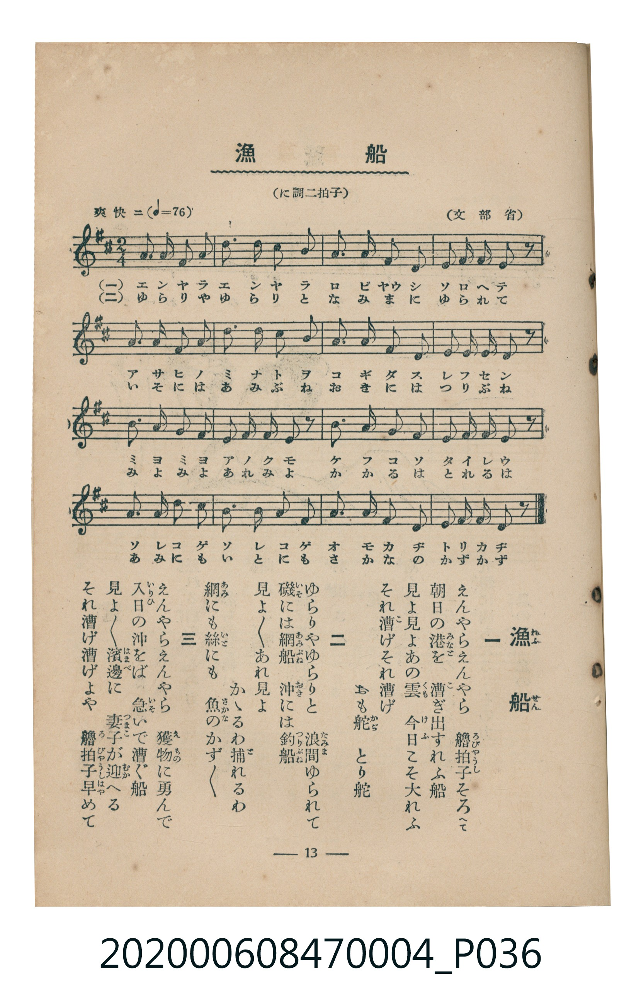

# 漁船

> Re:Shōka 使用 AI 協助辨識與重建樂譜，可能會有錯誤。歡迎回報。

- **NEUTRINO 歌聲合成版**：<br><audio controls src="gyosen_neutrino.mp3"></audio>
- **鋼琴伴奏版**：<br><audio controls src="gyosen.mp3"></audio>


- 詞：文部省
- 曲：文部省
- 臺灣教育會公認《新定兒童唱歌》尋常科第四學年用（2020.006.0847.0004）

## 說明

原書資訊與歌詞全文（對應 P036.jpg，書頁 p. 13，第二學期第 2 首）：
調性與拍號：に調二拍子（D 大調 2/4 拍）
速度指示：爽快ニ（♩=76）


## 跨冊／重複收錄參照

> 同曲（《公學校唱歌》、《公學校唱歌集》、《新定兒童唱歌》、《新編 小學校・公學校 唱歌教材集》共同收錄教材）

- **[同曲]** 《公學校唱歌》第四學年用（昭和12年／1937）：[**〈漁船〉**](../../../kogakko_shoka/grade_4/8_gyosen/index.md)（`D` / `2/4` — [原始 TMD](../../../kogakko_shoka/grade_4/8_gyosen/gyosen.tmd)）
- **[同曲]** 《公學校唱歌集》（大正4年／1915，國臺圖 0725 26）：[**〈漁船〉**](../../../kogakko_shokashu_1915/5_07_gyosen/index.md)（`D` / `2/4` — [原始 TMD](../../../kogakko_shokashu_1915/5_07_gyosen/gyosen.tmd)）
- **[同曲]** 《新編小公學校唱歌教材集》第三、四學年（大正12年／1923，國臺圖 0725-41）：[**〈漁船〉**](../../../shoka_kyozai_shu_1923/grade_3_4/29_gyosen/index.md)（`D` / `2/4` — [原始 TMD](../../../shoka_kyozai_shu_1923/grade_3_4/29_gyosen/gyosen.tmd)）
- **[同曲]** 《新編小公學校唱歌教材集》第五、六學年（大正12年／1923，國臺圖 0725-41）：[**〈漁船〉**](../../../shoka_kyozai_shu_1923/grade_5_6/19_gyosen/index.md)（`D` / `2/4` — [原始 TMD](../../../shoka_kyozai_shu_1923/grade_5_6/19_gyosen/gyosen.tmd)）
- 總表：[跨冊重複與同名歌曲總索引](../../../duplicate_songs.md)

## 歌詞

```text
一
えんやらえんやら　艪拍子（ろびゃうし）そろへて
朝日（あさひ）の港（みなと）を　漕（こ）ぎ出す舟（ふね）舟
見よ見よあの雲（くも）　今日（けふ）こそ大漁（たいれう）
それ漕げそれ漕げ　おも舵（かぢ）とり舵

二
ゆらりやゆらりと　浪間（なみま）にゆられて
磯（いそ）には網船（あみぶね）　沖（おき）には釣船（つりぶね）
見よ見よあれ見よ　かゝるわ捕（と）れるわ
網（あみ）にも絲（いと）にも　魚（さかな）のかずかず

三
えんやらえんやら　獲物（えもの）に勇（いさ）んで
入日（いりひ）の沖をば　急（いそ）いで漕ぐ船
見よ見よ濱邊（はまべ）に　妻子（つまこ）が迎（むか）へる
それ漕げ漕げよや　艪拍子早（はや）めて
```

## ABC

```abc
X:1
T:漁船
C:曲：文部省
M:2/4
L:1/16
Q:1/4=76
K:D
V:V1 name="Piano" snm="Pia"
[V:V1]
A3 A F2 A2 | d3 d c2 B2 | A3 A F2 D2 | E2 F F E2 z2 |
w: 1.~エ ン ヤ ラ | エ ン ヤ ラ | ロ ビャウ _ _ | ソ ロ ヘ テ
w: 2.~ゆ ら り や | ゆ ら り と | な み ま に | ゆ ら れ て
w: 3.~え ん や ら | え ん や ら | え も の に | い さ ん で
A3 A F2 A2 | d3 d c2 B2 | A3 A F2 D2 | E2 E E D2 z2 |
w: 1.~ア サ ヒ ノ | ミ ナ ト ヲ | コ ギ ダ ス | レ フ セ ン
w: 2.~い そ に は | あ み ぶ ね | お き に は | つ り ぶ ね
w: 3.~い り ひ の | お き を ば | い そ い で | こ ぐ ふ ね
B3 A G2 F2 | E2 F F E2 z2 | B3 A G2 F2 | E2 F F E2 z2 |
w: 1.~ミ ヨ ミ ヨ | ア ノ ク モ | ケ フ コ ソ | タ イ レ ウ
w: 2.~み よ み よ | あ れ み よ | か か る わ | と れ る わ
w: 3.~み よ み よ | は ま べ に | つ ま こ が | む か へ る
A3 A d2 c2 | B3 B A2 F2 | A3 A F2 D2 | E2 F F D2 z2 |
w: 1.~ソ レ コ ゲ | ソ レ コ ゲ | オ モ カ ヂ | ト リ カ ヂ
w: 2.~あ み に も | い と に も | さ か な の | か ず か ず
w: 3.~そ れ こ げ | こ げ よ や | ろ びゃう _ _ | は や め て
```

## TMD 檔案連結

- [主旋律 TMD 檔案](gyosen.tmd) [[在 TMD Studio 編輯](https://tmdlang.github.io/Tmd-TS/#tmd=s7IKdvYPcrWy4qpTUCpJTLdSSM7PyUlNLsnMz7MqzsjMK0nNjM_KTMmPL87Iz05Ugisry88pzU21Si9KTEmNN4k3MjAyiDcwMIs3sDAxBzIMTBBKi_NLi5JTrYqTM_Lzc-JLUitKkvLzs9Hl4wsS01OtAgyMzRAyBUX5Zal5iXlA3QVFILekgLUjFKSWZaakgqSLkxPz4stSizLTMlNTkFyZWlQM9gnEipKixLzi5KLMApD3EKryi0oy8oE-KciotMrILC7JL8pMTsyJz07MQ_JwSUYq0L9gEwqAGpS4tLQUnu1pfNGxU0FLi0vRVsHcjMveVsGFy8ZI38QOpO3Fynnv98x6Nq39ZfOK53MawUY9m70JQ-xF-67njYufTZ35omnTsznNT1vXvFjV-7ih69m0DU_XzXraOun56qVPp2x8trbncUP30w3dT3fseL584vM1a57Onv107Y6nO7c8n7Li_Z4OUBzoAeNADxQHQIaByfs9nUpcXPpaCrbUAlwKCgpP--Y_m73jxeb2Fyu6XnS0A90F9OnT1hVAXwFd8XRD77P2TgVQROplFaS_39MDVPxyQaNCgZ6CoTGQC3T4k109QIc_mzMfyFYwUni5bBrQpcBwAZn-YtX-Zw3LQeZ2976YOR8o-rhxNVAQqAco8nTtBKAdLgpPlywHiikAg1oBKArUDdL6smH-013LnvW0P1-yC6jvecfep_tXP27uBup4NHOlrbkZSB1I4ZMdDSDqcWPH46bJj5taHjd1orAbGl50roLb9rip93Hj5sdNzY8b2x43Tgca8rhxLlhwx-PGZSCDns2Z-2z6UpDSxqbHjVMfNwIjGaho3bMd68GC-x83rnrcCIyjzsdNk4CmP9szFSw-Gays72n7rseNM190AD0LFNz6uHEtUBzIBQfHsu7HTR0QEmz6upegJARk9z9uagLpb2h4srsLZv1EoH6woZOBbgQGEjCFgsXnP24E-qwH6ANoWIG90AN0yOPGSSjshobHjV1Ao190AA0C6ux-3LgIbOKKx03A6N4KCcBdPWBDmtpAwdUEVA80HcYGqgR6ceuql9OA_gOaAPQ6MAD2gQ1ZDVMGdAo46J4vhgRRC9ARUBWN659v2wTMV7DwBGreBgkTkLmbgGkFKA60BhTtEPUv2xfD1C8BuwCqHlsANvVA2SCPAhlArwPJ_me9kCiBRFIPRBDswG2Q4AY5BOaFpudbIYJAV4M1gAWBJr5cOwssDgxJYLitgqQCMBuYikEkNPlBowBn8nveu-l550qwUUBxUKxDbHnaDcpiYHuBzgU6FBjNy8F5snUpLAkAjQCGACwFbpoGSnKNG0BB1wBTAA1qIAOYQIBunQAMPfSwerZ_48umLrCG9cDYe9wIDF-wRxsani7bDc0ZwOAGSUHScc-L_X3g7AIKWLDIDmAwoic2aDIDRgDQs0gZ7dl0iH_XA8XBXmuEphDKCy0oUNDS5-Jyr8wvTs2zCshMzMt3qDGoqQZZoWBjaKZlB2ZhKywVQEXWjoYXC3sUNEwUnm7of76-QQdewmli0QC0CWqYBlCjphUwp6wAhUPzZiBeAmatVKjBJdq8Fsye_Lh58eOmZUBV28Fq94JFIXIzwGQbkES2alcP2CqQMDAdAXEXmNUC1o4m2rgCJNq4CszeD8T7wKzVKGpBZA9YfBnCqhoFUwVdIDRVMAaTukARwziwEJAyB1JmYDFkVYZgESMgaQyEINoAJAI2z8cQEhIg1bCwALFWgvXgkQGGBUQGFlJANjCsQGKQ8ALJrQWHFiisdBXiEXYaQbwJ1g8NFBCrBaoXQwYYXGAZYICBZaBBBmKtRtID0dEDDjAU-4xBejugpk6G2gRSDTGVsEwTkL0O2b5GsLrGqRBdjcvh9uFPx7t6KEvHi8CJYiswRCeB02AfOCbmg9ldQNwBZm0Ch8hmsNp1QH4DmLUTrHYNWMVUsMhuaPrHlo6BHgQXHWAvg1jrwd5ugqfYbWDWWrAoJE33oqkFZypoeoepplI6NgJCEA89HS-CxhckhEApsA-aWudDUysklECsTdCUsxmqBxJSINZOqJ41YHWgON4NDieMNAxOBaB0AAkmEGs9NH00IaXUbWAWKL9AAgsiAwkuZD3g_AUMMJAOiHr0NAy1D6wG5H5IqkQztQns88YNSCkV5kZIqgWlVpDMZDBvAhADwwvJPgJlcSdFaRiaWlcgsSAxB0nPoCSzHsxeBBbfCE2vsPS8Fyy6H8yGlNrgFA0sf7CmYojCDiQWPBVDy1Zk8W6wSDeQD2FB0jG4moCohosjpWNQOgWlUBMgCUqlWEpaYtQgUjE8rULCCMKCpFVQ-gaFEiiMQCEEjTFwOEH0QEIKlEZAJTAkrEC8JeCQgpTT6KkYpAKkBhJMEBYiFUNKVGA6BotC7QMGEiRVQQILpKofKgNyK1gPUBwiip6KcdsHygmgkh3Y4IHmDph9oLwBk4Ok2x6o_8B5FuSOxh1QtxCRioG9N8pKYkh7ABSikHQJKXOxi4KreWBsPW4CF4_NTeDSBVJWg-Xg4ljTMKLMBSsDVkaQbA1pR6CKggt2cGBA2hbrkNL1LKgcjI1REoPLX1DRC0uwZmApSILF3aDAVhCDEh8oOUKCAhTFsOIWtwy0cocGFIgFSn6QoALxVoHFIaLoSRi5uAXrBYYHavEHCSlkmamIJAxuWCAKU3CCBoYRRG4WliQ8F5qEQVkDkhxBhS6sUIXwIcka0azphcpAe7Ng9nSwGDzpA9UC295AHiKb1nJx6dopQFrOCkCWMhcA)]
- [鋼琴伴奏 TMD 檔案](gyosen_piano.tmd) [[在 TMD Studio 編輯](https://tmdlang.github.io/Tmd-TS/#tmd=s7IKdvYPcrWy4tLSUni2p_FFx873ezpedu95PmHLkz1bni7tf97Z8X5Pp4KWFpeirYK5GZe9rYILl42RvokdV52C0ouV897vmfVsWvvL5hXP5zQqgcSezd6EIfaifdfzxsXPps580bTp2Zzmp61rXqzqfdzQ9WzahqfrZj1tnfR89dKnUzY-W9vzuKH76Ybupzt2PF8-8fmaNU9nz366dsfTnVueT1kBdJmRgZGBnoGBmZ6BhYk5kGFgAnScEheXe2V-cWqeVUBmYl5-kIdDjUFNNZcCENgYmmnZgVn6Wgq26EABaMGTHQ0vFvYoaJgoPN3Q_3x9g45CgIGxmV5WQbomFg1a-jDDNIAaNa0UHjetAPIfN28G4iVg1kqFGlyizWvB7MmPmxc_bloGVLUdrHYvWBQiNwNMtgFJZKt29YCtAgk_buoE4i4wqwWsHU20cQVItHEVmL0fiPeBWatR1ILIHrD4MoRVNQqmCrpAaKpgDCZ1gSKGcWAhIGUOpMzAYsiqDMEiRkDSGAhBtAFIBGyejyEkJECqYWEBYq0E68EjAwwLiAwspIBsYFiBxCDhBZJbCw4tUFjpKsQj7DSCeBOsHxooIFYLVC-GDDC4wDLAAAPLQIMMxFqNpAeiowccYCj2GYP0dkBNnQy1CaQaYiphmSYgex2yfY1gdY1TIboal8Ptw5-Od_VQlo4XgRPFVmCITgKnwT5wTMwHs7uAuAPM2gQOkc1gteuA_AYwaydY7Rqwiqlgkd3Q9I8tHQM9CEp5c8FeBrHWg73dBE-x28CstWBRSJruRVMLzlTQ9A5TTaV0bASEIB56Ol4EjS9ICIFSYB80tc6HplZIKIFYm6ApZzNUDySkQKydUD1rwOpAcbwbHE4YaRicCkDpABJMINZ6aPpoQkqp28AsUH6BBBZEBhJcyHrA-QsYYCAdEPXoaRhqH1gNyP2QVIlmahPY540bkFIqzI2QVAtKrSCZyWDeBCAGhheSfQTK4k6K0jA0ta5AYkFiDpKeQUlmPZi9CCy-EZpeYel5L1h0P5gNKbXBKRpY_mBNxRCFHUgseCqGlq3I4t1gkW4gH8KCpGNwNQFRDRdHSsegdApKoSZAEpRKsZS0xKhBpGJ4WoWEEYQFSaug9A0KJVAYgUIIGmPgcILogYQUKI2ASmBIWIF4S8AhBSmn0VMxSAVIDSSYICxEKoaUqMB0DBaF2gcMJEiqggQWSFU_VAbkVrAeoDhEFD0V47YPlBNAJfvjxp3Q3AGzD5Q3YHKQdNsD9R84z4Lc0bgD6hYiUjGwyUJZSQxpD4BCFJIuIWUudlFwNQ-MrcdN4OKxuQlcukDKarAcXBxrGkaUuWBlwMoIkq0h7QhUUXDBDg4MSNtiHVK6ngWVg7ExSmJw-QsqemEJ1gwsBUmwuBsU2ApiUOIDJUdIUICiGFbc4paBVu7QgAKxQMkPElQg3iqwOEQUPQkjF7dgvcDwQC3-ICGFLDMVkYTBDQtEYQpO0MAwgsjNwpKE50KTMChrQJIjqNCFFaoQPiRZI5o1vVCZzY-bmh83ghssjdPBYvCkD1T7uKkRyENk01rUhrMPcsPZAtpuBlad8QrRhrEwCs43AVImSHy4vGk8kGUaHwtmGEC9RoExQBGEKVDlOC0jqADTNSBJTH2EnAMMO107BUjwRfsAlSDxjFB4xmCeMhcA)]

## 分析

```text
================================================================================
📊 TMD Song Profile: [ 漁船 ]
================================================================================
⏱  Duration:       0:25 (25.3s), 16 measures total
🎼 Key & Tempo:    首調基準 D, != 76.0 BPM, <2/4>
   - 分析範圍：      由實際發聲的音符與和弦推測調性；播放脈絡另行呈現
🎤 人聲音域:    D4 (MIDI 62) – D5 (MIDI 74) [跨度: 12 個半音 / 1.0 個八度, 難度: easy]
   - 最低音:  D4 in [Gyosen #1 @ m.3, 0:04]
   - 最高音: D5 in [Gyosen #1 @ m.2, 0:01]
   - 適合: soprano, mezzo-soprano, contralto, tenor, baritone, bass
🏛  結構:      Gyosen (25.3s)
⚡ 編曲密度:        Peak 1 軌道同時演奏
🗝  調性診斷：       A 調性不明確（純淨自然大調，未偵測到可信轉調）
   - 風格氣質:    純淨自然大調（陽光明朗、易唱易記，無明顯調外色彩）
   - 轉調歷程:    全曲維持單一推測調性（未偵測到可信轉調）
   - 核心骨幹音:  A, F#, D, E, B
   - 調性數值:    A 調性不明確 [相關度: 0.85, 穩定度: Ambiguous, 自然音純度: 96.6%]
   - 候選調性 (K-S): A 大調 (0.85), D 大調 (0.82), F# 小調 (0.76)
   - 五度圈歷程:   +3
   - 各段落調性細節:
     • [Gyosen #1]: A 調性不明確 (r: 0.85, 自然音純度: 96.6%, 調外音: G)

  [ 五度圈游移軌跡 ]
               C  
         F            G  
      Bb               D  
      Eb              [A ]*
         Ab           E  
            Db       B  
               F# 
     (* = active key center)

  [ 十二半音累積音高分佈 ]
     C  :                            0.0%
     C# : █████                      5.1%
     D  : ███████████████           16.9%
     D# :                            0.0%
     E  : ██████████████            15.3%
     F  :                            0.0%
     F# : ██████████████████        20.3%
     G  : ███                        3.4%
     G# :                            0.0%
     A  : ████████████████████████  27.1%
     A# :                            0.0%
     B  : ███████████               11.9%
--------------------------------------------------------------------------------
Assignment 軌道音域：
  - Piano         : D4 – D5 (12 個半音 / 1.0 個八度, 64 個音符)
================================================================================
```


## 原書掃描頁




